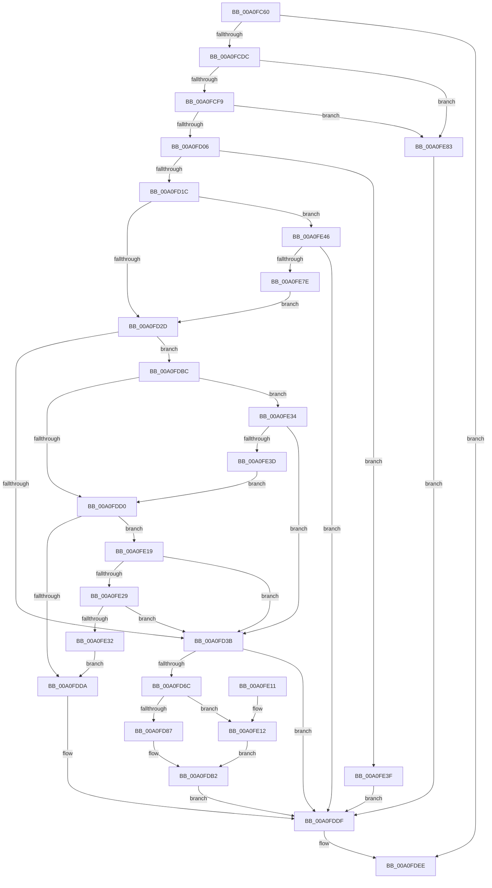

# NtDebugActiveProcess

- RVA: `0x00A0FC60`–`0x00A0FE8D` (길이 `557` bytes)
- VA: `0x0000000140A0FC60`
- 실행 섹션: `PAGE`
- PDB 이름 있음: `예`; PDB Function 태그: `아니요`
- unwind 정보 RVA: `0x000A91AC`
- 디코드: `132`개 명령, `557/557` bytes 표시
- 미해석 바이트: `0` (있으면 어셈블리에 `.byte`로 보존)

> 이 문서는 커널 이미지의 기계어와 PDB 기호를 분석해 생성했습니다. 4번과 5번은 함수 원형과 자료형을 바이너리 사용 방식에서 추정한 C 해석이며 원본 소스 복구 결과는 아닙니다.

## 1. Dependencies

- 직접 호출 지점: **12**; 고유 호출 대상: **12**
- 직접 호출자로 확인된 함수: **0**
- RIP 상대 이미지 참조: **4**

### Outgoing calls
- `0x00A0FCCF` → [ObpReferenceObjectByHandleWithTag](../86/ObpReferenceObjectByHandleWithTag_function_00869650.md) (function, `0x00869650`)
- `0x00A0FD0F` → [PsTestProtectedProcessIncompatibility](../A1/PsTestProtectedProcessIncompatibility_function_00A1003C.md) (function, `0x00A1003C`)
- `0x00A0FD61` → [ObReferenceObjectByHandle](../86/ObReferenceObjectByHandle_function_00868DB0.md) (function, `0x00868DB0`)
- `0x00A0FD76` → [ExAcquireRundownProtection](../../text/21/ExAcquireRundownProtection_function_00216620.md) (function, `0x00216620`)
- `0x00A0FD91` → [DbgkpPostFakeProcessCreateMessages](../A1/DbgkpPostFakeProcessCreateMessages_function_00A10780.md) (function, `0x00A10780`)
- `0x00A0FDA3` → [DbgkpSetProcessDebugObject](../A1/DbgkpSetProcessDebugObject_function_00A10468.md) (function, `0x00A10468`)
- `0x00A0FDAD` → [ExReleaseRundownProtection](../../text/34/ExReleaseRundownProtection_function_00349E80.md) (function, `0x00349E80`)
- `0x00A0FDB5` → [ObfDereferenceObject](../../text/2F/ObfDereferenceObject_function_002F9350.md) (function, `0x002F9350`)
- `0x00A0FDE7` → [ObfDereferenceObjectWithTag](../../text/2F/ObfDereferenceObjectWithTag_function_002F78E0.md) (function, `0x002F78E0`)
- `0x00A0FDF5` → [_security_check_cookie](../../text/6A/_security_check_cookie_function_006AC640.md) (function, `0x006AC640`)
- `0x00A0FE50` → [memset](../../text/6C/memset_function_006C6C40.md) (function, `0x006C6C40`)
- `0x00A0FE6F` → [VslpEnterIumSecureMode](../../text/23/VslpEnterIumSecureMode_function_00235E50.md) (function, `0x00235E50`)

### Direct callers
- 이 함수 시작 RVA로 연결되는 직접 call은 확인되지 않았습니다. 간접 호출은 완전히 역산할 수 없습니다.

### Static image references
- `0x00A0FC78` → RVA `0x00E0A740` (`.data`; read)
- `0x00A0FCA3` → RVA `0x00FC6A98` (`ALMOSTRO`; read)
- `0x00A0FCF9` → RVA `0x00FC6AB0` (`ALMOSTRO`; read)
- `0x00A0FD3B` → RVA `0x00FC5140` (`ALMOSTRO`; read)

## 2. Other-region calls and transfers

- 다른 실행 섹션으로 향하는 call: **7**
  - `0x00A0FD76` → [ExAcquireRundownProtection](../../text/21/ExAcquireRundownProtection_function_00216620.md) (`PAGE` → `.text`)
  - `0x00A0FDAD` → [ExReleaseRundownProtection](../../text/34/ExReleaseRundownProtection_function_00349E80.md) (`PAGE` → `.text`)
  - `0x00A0FDB5` → [ObfDereferenceObject](../../text/2F/ObfDereferenceObject_function_002F9350.md) (`PAGE` → `.text`)
  - `0x00A0FDE7` → [ObfDereferenceObjectWithTag](../../text/2F/ObfDereferenceObjectWithTag_function_002F78E0.md) (`PAGE` → `.text`)
  - `0x00A0FDF5` → [_security_check_cookie](../../text/6A/_security_check_cookie_function_006AC640.md) (`PAGE` → `.text`)
  - `0x00A0FE50` → [memset](../../text/6C/memset_function_006C6C40.md) (`PAGE` → `.text`)
  - `0x00A0FE6F` → [VslpEnterIumSecureMode](../../text/23/VslpEnterIumSecureMode_function_00235E50.md) (`PAGE` → `.text`)
- 별도 외부 분기/꼬리 이동을 확인하지 못했습니다.

## 3. Assembly (complete function range)

```asm
00A0FC60  48 89 5C 24 18                  mov qword ptr [rsp + 0x18], rbx
00A0FC65  55                              push rbp
00A0FC66  56                              push rsi
00A0FC67  57                              push rdi
00A0FC68  41 56                           push r14
00A0FC6A  41 57                           push r15
00A0FC6C  48 8D 6C 24 C9                  lea rbp, [rsp - 0x37]
00A0FC71  48 81 EC D0 00 00 00            sub rsp, 0xd0
00A0FC78  48 8B 05 C1 AA 3F 00            mov rax, qword ptr [rip + 0x3faac1]
00A0FC7F  48 33 C4                        xor rax, rsp
00A0FC82  48 89 45 27                     mov qword ptr [rbp + 0x27], rax
00A0FC86  65 48 8B 04 25 88 01 00 00      mov rax, qword ptr gs:[0x188]
00A0FC8F  4C 8B FA                        mov r15, rdx
00A0FC92  48 83 64 24 38 00               and qword ptr [rsp + 0x38], 0
00A0FC98  BA 00 08 00 00                  mov edx, 0x800
00A0FC9D  48 83 64 24 30 00               and qword ptr [rsp + 0x30], 0
00A0FCA3  4C 8B 05 EE 6D 5B 00            mov r8, qword ptr [rip + 0x5b6dee]
00A0FCAA  44 8A B0 32 02 00 00            mov r14b, byte ptr [rax + 0x232]
00A0FCB1  48 8D 45 A7                     lea rax, [rbp - 0x59]
00A0FCB5  48 83 65 A7 00                  and qword ptr [rbp - 0x59], 0
00A0FCBA  45 8A CE                        mov r9b, r14b
00A0FCBD  48 83 65 AF 00                  and qword ptr [rbp - 0x51], 0
00A0FCC2  48 89 44 24 28                  mov qword ptr [rsp + 0x28], rax
00A0FCC7  C7 44 24 20 44 62 67 4F         mov dword ptr [rsp + 0x20], 0x4f676244
00A0FCCF  E8 7C 99 E5 FF                  call 0x140869650
00A0FCD4  85 C0                           test eax, eax
00A0FCD6  0F 88 12 01 00 00               js 0x140a0fdee
00A0FCDC  65 48 8B 04 25 88 01 00 00      mov rax, qword ptr gs:[0x188]
00A0FCE5  48 8B 5D A7                     mov rbx, qword ptr [rbp - 0x59]
00A0FCE9  48 8B B0 B8 00 00 00            mov rsi, qword ptr [rax + 0xb8]
00A0FCF0  48 3B DE                        cmp rbx, rsi
00A0FCF3  0F 84 8A 01 00 00               je 0x140a0fe83
00A0FCF9  48 3B 1D B0 6D 5B 00            cmp rbx, qword ptr [rip + 0x5b6db0]
00A0FD00  0F 84 7D 01 00 00               je 0x140a0fe83
00A0FD06  4C 8B C3                        mov r8, rbx
00A0FD09  48 8B D6                        mov rdx, rsi
00A0FD0C  41 8A CE                        mov cl, r14b
00A0FD0F  E8 28 03 00 00                  call 0x140a1003c
00A0FD14  84 C0                           test al, al
00A0FD16  0F 85 23 01 00 00               jne 0x140a0fe3f
00A0FD1C  48 8B BB 70 01 00 00            mov rdi, qword ptr [rbx + 0x170]
00A0FD23  40 F6 C7 01                     test dil, 1
00A0FD27  0F 85 19 01 00 00               jne 0x140a0fe46
00A0FD2D  48 83 BE 10 03 00 00 00         cmp qword ptr [rsi + 0x310], 0
00A0FD35  0F 85 81 00 00 00               jne 0x140a0fdbc
00A0FD3B  4C 8B 05 FE 53 5B 00            mov r8, qword ptr [rip + 0x5b53fe]
00A0FD42  48 8D 45 A7                     lea rax, [rbp - 0x59]
00A0FD46  48 83 64 24 28 00               and qword ptr [rsp + 0x28], 0
00A0FD4C  45 8A CE                        mov r9b, r14b
00A0FD4F  48 83 65 A7 00                  and qword ptr [rbp - 0x59], 0
00A0FD54  BA 02 00 00 00                  mov edx, 2
00A0FD59  49 8B CF                        mov rcx, r15
00A0FD5C  48 89 44 24 20                  mov qword ptr [rsp + 0x20], rax
00A0FD61  E8 4A 90 E5 FF                  call 0x140868db0
00A0FD66  8B F8                           mov edi, eax
00A0FD68  85 C0                           test eax, eax
00A0FD6A  78 73                           js 0x140a0fddf
00A0FD6C  4C 8D B3 E8 01 00 00            lea r14, [rbx + 0x1e8]
00A0FD73  49 8B CE                        mov rcx, r14
00A0FD76  E8 A5 68 80 FF                  call 0x140216620
00A0FD7B  48 8B 75 A7                     mov rsi, qword ptr [rbp - 0x59]
00A0FD7F  84 C0                           test al, al
00A0FD81  0F 84 8B 00 00 00               je 0x140a0fe12
00A0FD87  4C 8D 45 AF                     lea r8, [rbp - 0x51]
00A0FD8B  48 8B D6                        mov rdx, rsi
00A0FD8E  48 8B CB                        mov rcx, rbx
00A0FD91  E8 EA 09 00 00                  call 0x140a10780
00A0FD96  4C 8B 4D AF                     mov r9, qword ptr [rbp - 0x51]
00A0FD9A  44 8B C0                        mov r8d, eax
00A0FD9D  48 8B D6                        mov rdx, rsi
00A0FDA0  48 8B CB                        mov rcx, rbx
00A0FDA3  E8 C0 06 00 00                  call 0x140a10468
00A0FDA8  49 8B CE                        mov rcx, r14
00A0FDAB  8B F8                           mov edi, eax
00A0FDAD  E8 CE A0 93 FF                  call 0x140349e80
00A0FDB2  48 8B CE                        mov rcx, rsi
00A0FDB5  E8 96 95 8E FF                  call 0x1402f9350
00A0FDBA  EB 23                           jmp 0x140a0fddf
00A0FDBC  0F B7 86 EC 06 00 00            movzx eax, word ptr [rsi + 0x6ec]
00A0FDC3  BA 4C 01 00 00                  mov edx, 0x14c
00A0FDC8  8D 4A 78                        lea ecx, [rdx + 0x78]
00A0FDCB  66 3B C2                        cmp ax, dx
00A0FDCE  75 64                           jne 0x140a0fe34
00A0FDD0  48 83 BB 10 03 00 00 00         cmp qword ptr [rbx + 0x310], 0
00A0FDD8  75 3F                           jne 0x140a0fe19
00A0FDDA  BF BB 00 00 C0                  mov edi, 0xc00000bb
00A0FDDF  BA 44 62 67 4F                  mov edx, 0x4f676244
00A0FDE4  48 8B CB                        mov rcx, rbx
00A0FDE7  E8 F4 7A 8E FF                  call 0x1402f78e0
00A0FDEC  8B C7                           mov eax, edi
00A0FDEE  48 8B 4D 27                     mov rcx, qword ptr [rbp + 0x27]
00A0FDF2  48 33 CC                        xor rcx, rsp
00A0FDF5  E8 46 C8 C9 FF                  call 0x1406ac640
00A0FDFA  48 8B 9C 24 10 01 00 00         mov rbx, qword ptr [rsp + 0x110]
00A0FE02  48 81 C4 D0 00 00 00            add rsp, 0xd0
00A0FE09  41 5F                           pop r15
00A0FE0B  41 5E                           pop r14
00A0FE0D  5F                              pop rdi
00A0FE0E  5E                              pop rsi
00A0FE0F  5D                              pop rbp
00A0FE10  C3                              ret
00A0FE11  CC                              int3
00A0FE12  BF 0A 01 00 C0                  mov edi, 0xc000010a
00A0FE17  EB 99                           jmp 0x140a0fdb2
00A0FE19  0F B7 83 EC 06 00 00            movzx eax, word ptr [rbx + 0x6ec]
00A0FE20  66 3B C2                        cmp ax, dx
00A0FE23  0F 84 12 FF FF FF               je 0x140a0fd3b
00A0FE29  66 3B C1                        cmp ax, cx
00A0FE2C  0F 84 09 FF FF FF               je 0x140a0fd3b
00A0FE32  EB A6                           jmp 0x140a0fdda
00A0FE34  66 3B C1                        cmp ax, cx
00A0FE37  0F 85 FE FE FF FF               jne 0x140a0fd3b
00A0FE3D  EB 91                           jmp 0x140a0fdd0
00A0FE3F  BF 12 07 00 C0                  mov edi, 0xc0000712
00A0FE44  EB 99                           jmp 0x140a0fddf
00A0FE46  33 D2                           xor edx, edx
00A0FE48  48 8D 4D B7                     lea rcx, [rbp - 0x49]
00A0FE4C  44 8D 42 68                     lea r8d, [rdx + 0x68]
00A0FE50  E8 EB 6D CB FF                  call 0x1406c6c40
00A0FE55  BA 0C 00 00 00                  mov edx, 0xc
00A0FE5A  48 89 7D BF                     mov qword ptr [rbp - 0x41], rdi
00A0FE5E  4C 8D 4D B7                     lea r9, [rbp - 0x49]
00A0FE62  48 C7 45 C7 01 00 00 00         mov qword ptr [rbp - 0x39], 1
00A0FE6A  45 33 C0                        xor r8d, r8d
00A0FE6D  B1 02                           mov cl, 2
00A0FE6F  E8 DC 5F 82 FF                  call 0x140235e50
00A0FE74  8B F8                           mov edi, eax
00A0FE76  85 C0                           test eax, eax
00A0FE78  0F 88 61 FF FF FF               js 0x140a0fddf
00A0FE7E  E9 AA FE FF FF                  jmp 0x140a0fd2d
00A0FE83  BF 22 00 00 C0                  mov edi, 0xc0000022
00A0FE88  E9 52 FF FF FF                  jmp 0x140a0fddf
```

## 4. C-style interpretation (structured pseudocode)

```c
__int64 __fastcall NtDebugActiveProcess(__int64 a1, __int64 a2)
{
    __int64 result;
    __int64 v_rsp;
    unsigned __int64 v_stack_m38;
    unsigned __int64 v_stack_m5F;
    unsigned __int64 v_stack_m98;
    unsigned __int64 v_stack_mA0;
    unsigned __int64 v_stack_mA8;
    unsigned __int64 v_stack_mB0;
    unsigned __int64 v_stack_mB8;
    unsigned __int64 v_stack_mC0;
    unsigned __int64 v_stack_mC8;
    unsigned __int64 v_stack_mD0;
    unsigned int v_stack_mD8;
    unsigned __int64 v_stack_p18;

    v_stack_p18 = v_rbx;
    v_rsp = (v_rsp) - (208);
    result = (*(unsigned __int64 *)(v_rip + 4172481)) ^ (v_rsp);
    v_stack_m38 = result;
    v_stack_mD0 = v_stack_mB8;
    v_stack_mD8 = 0x4F676244ULL;
    result = ObpReferenceObjectByHandleWithTag(a1, (unsigned int)(0x800ULL), *(unsigned __int64 *)(v_rip + 5991918), (unsigned __int8)(*(unsigned __int8 *)(*(unsigned __int64 *)(gs_base + (0 + 392)) + 562)));
    if (sign_flag) goto loc_00A0FDEE;
    if (v_stack_mB8 == (*(unsigned __int64 *)(*(unsigned __int64 *)(gs_base + (0 + 392)) + 184))) goto loc_00A0FE83;
    if (v_stack_mB8 == (*(unsigned __int64 *)(v_rip + 5991856))) goto loc_00A0FE83;
    result = PsTestProtectedProcessIncompatibility((unsigned __int8)(*(unsigned __int8 *)(*(unsigned __int64 *)(gs_base + (0 + 392)) + 562)), *(unsigned __int64 *)(*(unsigned __int64 *)(gs_base + (0 + 392)) + 184), v_stack_mB8, (unsigned __int8)(*(unsigned __int8 *)(*(unsigned __int64 *)(gs_base + (0 + 392)) + 562)));
    if ((unsigned __int8)(result) != 0) goto loc_00A0FE3F;
    if ((((unsigned __int8)(*(unsigned __int64 *)(v_stack_mB8 + 368))) & (1)) != 0) goto loc_00A0FE46;
loc_00A0FD2D:
    if ((*(unsigned __int64 *)(*(unsigned __int64 *)(*(unsigned __int64 *)(gs_base + (0 + 392)) + 184) + 784)) != 0) goto loc_00A0FDBC;
loc_00A0FD3B:
    v_stack_mD8 = v_stack_mB8;
    result = ObReferenceObjectByHandle(a2, 2, *(unsigned __int64 *)(v_rip + 5985278), (unsigned __int8)(*(unsigned __int8 *)(*(unsigned __int64 *)(gs_base + (0 + 392)) + 562)));
    if (sign_flag) goto loc_00A0FDDF;
    result = ExAcquireRundownProtection(v_stack_mB8 + 488, 2, *(unsigned __int64 *)(v_rip + 5985278), (unsigned __int8)(*(unsigned __int8 *)(*(unsigned __int64 *)(gs_base + (0 + 392)) + 562)));
    if ((unsigned __int8)(result) == 0) goto loc_00A0FE12;
    result = DbgkpPostFakeProcessCreateMessages(v_stack_mB8, v_stack_mB8, v_stack_mB0, (unsigned __int8)(*(unsigned __int8 *)(*(unsigned __int64 *)(gs_base + (0 + 392)) + 562)));
    result = DbgkpSetProcessDebugObject(v_stack_mB8, v_stack_mB8, (unsigned int)((unsigned int)(result)), v_stack_mB0);
    result = ExReleaseRundownProtection(v_stack_mB8 + 488, v_stack_mB8, (unsigned int)((unsigned int)(result)), v_stack_mB0);
loc_00A0FDB2:
    result = ObfDereferenceObject(v_stack_mB8, v_stack_mB8, (unsigned int)((unsigned int)(result)), v_stack_mB0);
    goto loc_00A0FDDF;
loc_00A0FDBC:
    if (((unsigned __int16)(*(unsigned __int16 *)(v_stack_mB8 + 1772))) != 332) goto loc_00A0FE34;
loc_00A0FDD0:
    if ((*(unsigned __int64 *)(v_stack_mB8 + 784)) != 0) goto loc_00A0FE19;
loc_00A0FDDA:
loc_00A0FDDF:
    result = ObfDereferenceObjectWithTag(v_stack_mB8, (unsigned int)(0x4F676244ULL), (unsigned int)((unsigned int)(result)), v_stack_mB0);
loc_00A0FDEE:
    a1 = (v_stack_m38) ^ (v_rsp);
    result = _security_check_cookie(a1, (unsigned int)(0x4F676244ULL), (unsigned int)((unsigned int)(result)), v_stack_mB0);
    v_rsp = (v_rsp) + (208);
    return result;
loc_00A0FE12:
    goto loc_00A0FDB2;
loc_00A0FE19:
    if (((unsigned __int16)(*(unsigned __int16 *)(v_stack_p18 + 1772))) == ((unsigned __int16)((unsigned int)(0x4F676244ULL)))) goto loc_00A0FD3B;
    if (((unsigned __int16)(*(unsigned __int16 *)(v_stack_p18 + 1772))) == ((unsigned __int16)(a1))) goto loc_00A0FD3B;
    goto loc_00A0FDDA;
loc_00A0FE34:
    if (((unsigned __int16)(*(unsigned __int16 *)(v_stack_p18 + 1772))) != ((unsigned __int16)(a1))) goto loc_00A0FD3B;
    goto loc_00A0FDD0;
loc_00A0FE3F:
    goto loc_00A0FDDF;
loc_00A0FE46:
    a2 = 0;
    result = memset(v_stack_mA8, a2, a2 + 104, v_stack_mB0);
    v_stack_mA0 = (unsigned int)(0xC0000712ULL);
    v_stack_m98 = 1;
    a3 = 0;
    result = VslpEnterIumSecureMode(2, 12, a3, v_stack_mA8);
    if (sign_flag) goto loc_00A0FDDF;
    goto loc_00A0FD2D;
loc_00A0FE83:
    goto loc_00A0FDDF;
}
```

## 5. (Beta) C Style

```c
int64_t NtDebugActiveProcess(int64_t Arg1, int64_t Arg2)
{
    int64_t result;
    int64_t local_rsp;
    uint64_t v_stack_m38;
    uint64_t v_stack_m5F;
    uint64_t v_stack_m98;
    uint64_t v_stack_mA0;
    uint64_t v_stack_mA8;
    uint64_t v_stack_mB0;
    uint64_t v_stack_mB8;
    uint64_t v_stack_mC0;
    uint64_t v_stack_mC8;
    uint64_t v_stack_mD0;
    uint32_t v_stack_mD8;
    uint64_t v_stack_p18;

    v_stack_p18 = local_rbx;
    local_rsp = (local_rsp) - (208);
    result = (*(uint64_t *)(v_rip + 0x3FAAC1)) ^ (local_rsp);
    v_stack_m38 = result;
    v_stack_mD0 = v_stack_mB8;
    v_stack_mD8 = 0x4F676244ULL;
    result = ObpReferenceObjectByHandleWithTag(Arg1, (uint32_t)(0x800ULL), *(uint64_t *)(v_rip + 0x5B6DEE), (uint8_t)(*(uint8_t *)(*(uint64_t *)(gs_base + (0 + 0x188)) + 0x232)));
    if (sign_flag) goto loc_00A0FDEE;
    if (v_stack_mB8 == (*(uint64_t *)(*(uint64_t *)(gs_base + (0 + 0x188)) + 0xB8))) goto loc_00A0FE83;
    if (v_stack_mB8 == (*(uint64_t *)(v_rip + 0x5B6DB0))) goto loc_00A0FE83;
    result = PsTestProtectedProcessIncompatibility((uint8_t)(*(uint8_t *)(*(uint64_t *)(gs_base + (0 + 0x188)) + 0x232)), *(uint64_t *)(*(uint64_t *)(gs_base + (0 + 0x188)) + 0xB8), v_stack_mB8, (uint8_t)(*(uint8_t *)(*(uint64_t *)(gs_base + (0 + 0x188)) + 0x232)));
    if ((uint8_t)(result) != 0) goto loc_00A0FE3F;
    if ((((uint8_t)(*(uint64_t *)(v_stack_mB8 + 0x170))) & (1)) != 0) goto loc_00A0FE46;
loc_00A0FD2D:
    if ((*(uint64_t *)(*(uint64_t *)(*(uint64_t *)(gs_base + (0 + 0x188)) + 0xB8) + 0x310)) != 0) goto loc_00A0FDBC;
loc_00A0FD3B:
    v_stack_mD8 = v_stack_mB8;
    result = ObReferenceObjectByHandle(Arg2, 2, *(uint64_t *)(v_rip + 0x5B53FE), (uint8_t)(*(uint8_t *)(*(uint64_t *)(gs_base + (0 + 0x188)) + 0x232)));
    if (sign_flag) goto loc_00A0FDDF;
    result = ExAcquireRundownProtection(v_stack_mB8 + 488, 2, *(uint64_t *)(v_rip + 0x5B53FE), (uint8_t)(*(uint8_t *)(*(uint64_t *)(gs_base + (0 + 0x188)) + 0x232)));
    if ((uint8_t)(result) == 0) goto loc_00A0FE12;
    result = DbgkpPostFakeProcessCreateMessages(v_stack_mB8, v_stack_mB8, v_stack_mB0, (uint8_t)(*(uint8_t *)(*(uint64_t *)(gs_base + (0 + 0x188)) + 0x232)));
    result = DbgkpSetProcessDebugObject(v_stack_mB8, v_stack_mB8, (uint32_t)((uint32_t)(result)), v_stack_mB0);
    result = ExReleaseRundownProtection(v_stack_mB8 + 488, v_stack_mB8, (uint32_t)((uint32_t)(result)), v_stack_mB0);
loc_00A0FDB2:
    result = ObfDereferenceObject(v_stack_mB8, v_stack_mB8, (uint32_t)((uint32_t)(result)), v_stack_mB0);
    goto loc_00A0FDDF;
loc_00A0FDBC:
    if (((uint16_t)(*(uint16_t *)(v_stack_mB8 + 0x6EC))) != 332) goto loc_00A0FE34;
loc_00A0FDD0:
    if ((*(uint64_t *)(v_stack_mB8 + 0x310)) != 0) goto loc_00A0FE19;
loc_00A0FDDA:
loc_00A0FDDF:
    result = ObfDereferenceObjectWithTag(v_stack_mB8, (uint32_t)(0x4F676244ULL), (uint32_t)((uint32_t)(result)), v_stack_mB0);
loc_00A0FDEE:
    Arg1 = (v_stack_m38) ^ (local_rsp);
    result = _security_check_cookie(Arg1, (uint32_t)(0x4F676244ULL), (uint32_t)((uint32_t)(result)), v_stack_mB0);
    local_rsp = (local_rsp) + (208);
    return result;
loc_00A0FE12:
    goto loc_00A0FDB2;
loc_00A0FE19:
    if (((uint16_t)(*(uint16_t *)(v_stack_p18 + 0x6EC))) == ((uint16_t)((uint32_t)(0x4F676244ULL)))) goto loc_00A0FD3B;
    if (((uint16_t)(*(uint16_t *)(v_stack_p18 + 0x6EC))) == ((uint16_t)(Arg1))) goto loc_00A0FD3B;
    goto loc_00A0FDDA;
loc_00A0FE34:
    if (((uint16_t)(*(uint16_t *)(v_stack_p18 + 0x6EC))) != ((uint16_t)(Arg1))) goto loc_00A0FD3B;
    goto loc_00A0FDD0;
loc_00A0FE3F:
    goto loc_00A0FDDF;
loc_00A0FE46:
    Arg2 = 0;
    result = memset(v_stack_mA8, Arg2, Arg2 + 104, v_stack_mB0);
    v_stack_mA0 = (uint32_t)(0xC0000712ULL);
    v_stack_m98 = 1;
    a3 = 0;
    result = VslpEnterIumSecureMode(2, 12, a3, v_stack_mA8);
    if (sign_flag) goto loc_00A0FDDF;
    goto loc_00A0FD2D;
loc_00A0FE83:
    goto loc_00A0FDDF;
}
```

## 6. Execution-region graph

[열기: 2D/3D 그래프와 함수 탐색 컨트롤 패널](../../../control-panel.html?section=page&rva=0x00A0FC60&view=graph)

- 2D 그래프는 위에서 아래로 흐르고, 3D 그래프는 빈 공간을 드래그해 회전합니다. Shift+드래그는 이동, 휠은 확대·축소, 함수 노드 선택은 대상 보고서 이동입니다.

### Static fallback


