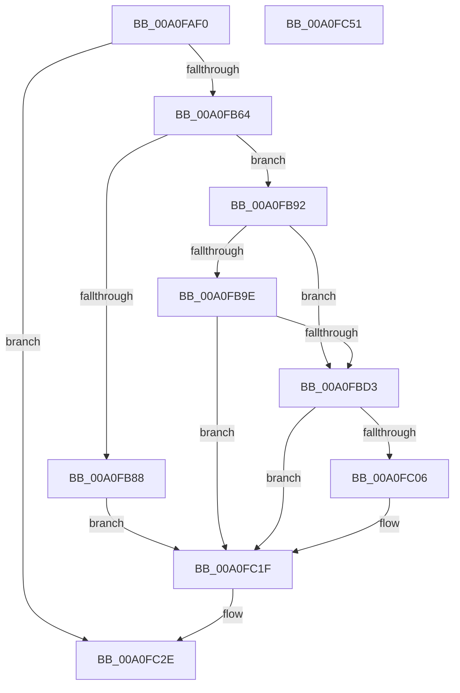

# NtRemoveProcessDebug

- RVA: `0x00A0FAF0`–`0x00A0FC52` (길이 `354` bytes)
- VA: `0x0000000140A0FAF0`
- 실행 섹션: `PAGE`
- PDB 이름 있음: `예`; PDB Function 태그: `아니요`
- unwind 정보 RVA: `0x000A918C`
- 디코드: `82`개 명령, `354/354` bytes 표시
- 미해석 바이트: `0` (있으면 어셈블리에 `.byte`로 보존)

> 이 문서는 커널 이미지의 기계어와 PDB 기호를 분석해 생성했습니다. 4번과 5번은 함수 원형과 자료형을 바이너리 사용 방식에서 추정한 C 해석이며 원본 소스 복구 결과는 아닙니다.

## 1. Dependencies

- 직접 호출 지점: **9**; 고유 호출 대상: **9**
- 직접 호출자로 확인된 함수: **0**
- RIP 상대 이미지 참조: **3**

### Outgoing calls
- `0x00A0FB57` → [ObpReferenceObjectByHandleWithTag](../86/ObpReferenceObjectByHandleWithTag_function_00869650.md) (function, `0x00869650`)
- `0x00A0FB7F` → [PsTestProtectedProcessIncompatibility](../A1/PsTestProtectedProcessIncompatibility_function_00A1003C.md) (function, `0x00A1003C`)
- `0x00A0FBA9` → [memset](../../text/6C/memset_function_006C6C40.md) (function, `0x006C6C40`)
- `0x00A0FBC8` → [VslpEnterIumSecureMode](../../text/23/VslpEnterIumSecureMode_function_00235E50.md) (function, `0x00235E50`)
- `0x00A0FBFB` → [ObReferenceObjectByHandle](../86/ObReferenceObjectByHandle_function_00868DB0.md) (function, `0x00868DB0`)
- `0x00A0FC0E` → [DbgkClearProcessDebugObject](../A1/DbgkClearProcessDebugObject_function_00A10110.md) (function, `0x00A10110`)
- `0x00A0FC1A` → [ObfDereferenceObject](../../text/2F/ObfDereferenceObject_function_002F9350.md) (function, `0x002F9350`)
- `0x00A0FC27` → [ObfDereferenceObjectWithTag](../../text/2F/ObfDereferenceObjectWithTag_function_002F78E0.md) (function, `0x002F78E0`)
- `0x00A0FC39` → [_security_check_cookie](../../text/6A/_security_check_cookie_function_006AC640.md) (function, `0x006AC640`)

### Direct callers
- 이 함수 시작 RVA로 연결되는 직접 call은 확인되지 않았습니다. 간접 호출은 완전히 역산할 수 없습니다.

### Static image references
- `0x00A0FAFF` → RVA `0x00E0A740` (`.data`; read)
- `0x00A0FB2E` → RVA `0x00FC6A98` (`ALMOSTRO`; read)
- `0x00A0FBD3` → RVA `0x00FC5140` (`ALMOSTRO`; read)

## 2. Other-region calls and transfers

- 다른 실행 섹션으로 향하는 call: **5**
  - `0x00A0FBA9` → [memset](../../text/6C/memset_function_006C6C40.md) (`PAGE` → `.text`)
  - `0x00A0FBC8` → [VslpEnterIumSecureMode](../../text/23/VslpEnterIumSecureMode_function_00235E50.md) (`PAGE` → `.text`)
  - `0x00A0FC1A` → [ObfDereferenceObject](../../text/2F/ObfDereferenceObject_function_002F9350.md) (`PAGE` → `.text`)
  - `0x00A0FC27` → [ObfDereferenceObjectWithTag](../../text/2F/ObfDereferenceObjectWithTag_function_002F78E0.md) (`PAGE` → `.text`)
  - `0x00A0FC39` → [_security_check_cookie](../../text/6A/_security_check_cookie_function_006AC640.md) (`PAGE` → `.text`)
- 별도 외부 분기/꼬리 이동을 확인하지 못했습니다.

## 3. Assembly (complete function range)

```asm
00A0FAF0  48 89 5C 24 18                  mov qword ptr [rsp + 0x18], rbx
00A0FAF5  55                              push rbp
00A0FAF6  56                              push rsi
00A0FAF7  57                              push rdi
00A0FAF8  48 81 EC D0 00 00 00            sub rsp, 0xd0
00A0FAFF  48 8B 05 3A AC 3F 00            mov rax, qword ptr [rip + 0x3fac3a]
00A0FB06  48 33 C4                        xor rax, rsp
00A0FB09  48 89 84 24 C0 00 00 00         mov qword ptr [rsp + 0xc0], rax
00A0FB11  65 48 8B 04 25 88 01 00 00      mov rax, qword ptr gs:[0x188]
00A0FB1A  48 8B EA                        mov rbp, rdx
00A0FB1D  48 83 64 24 38 00               and qword ptr [rsp + 0x38], 0
00A0FB23  BA 00 08 00 00                  mov edx, 0x800
00A0FB28  48 83 64 24 30 00               and qword ptr [rsp + 0x30], 0
00A0FB2E  4C 8B 05 63 6F 5B 00            mov r8, qword ptr [rip + 0x5b6f63]
00A0FB35  40 8A B0 32 02 00 00            mov sil, byte ptr [rax + 0x232]
00A0FB3C  48 8D 44 24 40                  lea rax, [rsp + 0x40]
00A0FB41  48 83 64 24 40 00               and qword ptr [rsp + 0x40], 0
00A0FB47  44 8A CE                        mov r9b, sil
00A0FB4A  48 89 44 24 28                  mov qword ptr [rsp + 0x28], rax
00A0FB4F  C7 44 24 20 44 62 67 4F         mov dword ptr [rsp + 0x20], 0x4f676244
00A0FB57  E8 F4 9A E5 FF                  call 0x140869650
00A0FB5C  85 C0                           test eax, eax
00A0FB5E  0F 88 CA 00 00 00               js 0x140a0fc2e
00A0FB64  65 48 8B 04 25 88 01 00 00      mov rax, qword ptr gs:[0x188]
00A0FB6D  40 8A CE                        mov cl, sil
00A0FB70  48 8B 7C 24 40                  mov rdi, qword ptr [rsp + 0x40]
00A0FB75  4C 8B C7                        mov r8, rdi
00A0FB78  48 8B 90 B8 00 00 00            mov rdx, qword ptr [rax + 0xb8]
00A0FB7F  E8 B8 04 00 00                  call 0x140a1003c
00A0FB84  84 C0                           test al, al
00A0FB86  74 0A                           je 0x140a0fb92
00A0FB88  BB 12 07 00 C0                  mov ebx, 0xc0000712
00A0FB8D  E9 8D 00 00 00                  jmp 0x140a0fc1f
00A0FB92  48 8B 9F 70 01 00 00            mov rbx, qword ptr [rdi + 0x170]
00A0FB99  F6 C3 01                        test bl, 1
00A0FB9C  74 35                           je 0x140a0fbd3
00A0FB9E  33 D2                           xor edx, edx
00A0FBA0  48 8D 4C 24 50                  lea rcx, [rsp + 0x50]
00A0FBA5  44 8D 42 68                     lea r8d, [rdx + 0x68]
00A0FBA9  E8 92 70 CB FF                  call 0x1406c6c40
00A0FBAE  48 83 64 24 60 00               and qword ptr [rsp + 0x60], 0
00A0FBB4  4C 8D 4C 24 50                  lea r9, [rsp + 0x50]
00A0FBB9  BA 0C 00 00 00                  mov edx, 0xc
00A0FBBE  48 89 5C 24 58                  mov qword ptr [rsp + 0x58], rbx
00A0FBC3  45 33 C0                        xor r8d, r8d
00A0FBC6  B1 02                           mov cl, 2
00A0FBC8  E8 83 62 82 FF                  call 0x140235e50
00A0FBCD  8B D8                           mov ebx, eax
00A0FBCF  85 C0                           test eax, eax
00A0FBD1  78 4C                           js 0x140a0fc1f
00A0FBD3  4C 8B 05 66 55 5B 00            mov r8, qword ptr [rip + 0x5b5566]
00A0FBDA  48 8D 44 24 40                  lea rax, [rsp + 0x40]
00A0FBDF  48 83 64 24 28 00               and qword ptr [rsp + 0x28], 0
00A0FBE5  44 8A CE                        mov r9b, sil
00A0FBE8  48 83 64 24 40 00               and qword ptr [rsp + 0x40], 0
00A0FBEE  BA 02 00 00 00                  mov edx, 2
00A0FBF3  48 8B CD                        mov rcx, rbp
00A0FBF6  48 89 44 24 20                  mov qword ptr [rsp + 0x20], rax
00A0FBFB  E8 B0 91 E5 FF                  call 0x140868db0
00A0FC00  8B D8                           mov ebx, eax
00A0FC02  85 C0                           test eax, eax
00A0FC04  78 19                           js 0x140a0fc1f
00A0FC06  48 8B 54 24 40                  mov rdx, qword ptr [rsp + 0x40]
00A0FC0B  48 8B CF                        mov rcx, rdi
00A0FC0E  E8 FD 04 00 00                  call 0x140a10110
00A0FC13  48 8B 4C 24 40                  mov rcx, qword ptr [rsp + 0x40]
00A0FC18  8B D8                           mov ebx, eax
00A0FC1A  E8 31 97 8E FF                  call 0x1402f9350
00A0FC1F  BA 44 62 67 4F                  mov edx, 0x4f676244
00A0FC24  48 8B CF                        mov rcx, rdi
00A0FC27  E8 B4 7C 8E FF                  call 0x1402f78e0
00A0FC2C  8B C3                           mov eax, ebx
00A0FC2E  48 8B 8C 24 C0 00 00 00         mov rcx, qword ptr [rsp + 0xc0]
00A0FC36  48 33 CC                        xor rcx, rsp
00A0FC39  E8 02 CA C9 FF                  call 0x1406ac640
00A0FC3E  48 8B 9C 24 00 01 00 00         mov rbx, qword ptr [rsp + 0x100]
00A0FC46  48 81 C4 D0 00 00 00            add rsp, 0xd0
00A0FC4D  5F                              pop rdi
00A0FC4E  5E                              pop rsi
00A0FC4F  5D                              pop rbp
00A0FC50  C3                              ret
00A0FC51  CC                              int3
```

## 4. C-style interpretation (structured pseudocode)

```c
__int64 __fastcall NtRemoveProcessDebug(__int64 a1, __int64 a2)
{
    __int64 result;
    __int64 v_rbx;
    __int64 v_rsp;
    unsigned __int64 v_stack_m28;
    unsigned __int64 v_stack_m88;
    unsigned __int64 v_stack_m90;
    unsigned __int64 v_stack_m98;
    unsigned __int64 v_stack_mA8;
    unsigned __int64 v_stack_mB0;
    unsigned __int64 v_stack_mB8;
    unsigned __int64 v_stack_mC0;
    unsigned int v_stack_mC8;
    unsigned __int64 v_stack_p18;

    v_stack_p18 = v_rbx;
    v_rsp = (v_rsp) - (208);
    result = (*(unsigned __int64 *)(v_rip + 4172858)) ^ (v_rsp);
    v_stack_m28 = result;
    v_stack_mC0 = v_stack_mA8;
    v_stack_mC8 = 0x4F676244ULL;
    result = ObpReferenceObjectByHandleWithTag(a1, (unsigned int)(0x800ULL), *(unsigned __int64 *)(v_rip + 5992291), (unsigned __int8)(*(unsigned __int8 *)(*(unsigned __int64 *)(gs_base + (0 + 392)) + 562)));
    if (sign_flag) goto loc_00A0FC2E;
    result = PsTestProtectedProcessIncompatibility((unsigned __int8)(*(unsigned __int8 *)(*(unsigned __int64 *)(gs_base + (0 + 392)) + 562)), *(unsigned __int64 *)(*(unsigned __int64 *)(gs_base + (0 + 392)) + 184), v_stack_mA8, (unsigned __int8)(*(unsigned __int8 *)(*(unsigned __int64 *)(gs_base + (0 + 392)) + 562)));
    if ((unsigned __int8)(result) == 0) goto loc_00A0FB92;
    goto loc_00A0FC1F;
loc_00A0FB92:
    if ((((unsigned __int8)(*(unsigned __int64 *)(v_stack_mA8 + 368))) & (1)) == 0) goto loc_00A0FBD3;
    a2 = 0;
    result = memset(v_stack_m98, a2, a2 + 104, (unsigned __int8)(*(unsigned __int8 *)(*(unsigned __int64 *)(gs_base + (0 + 392)) + 562)));
    v_stack_m90 = *(unsigned __int64 *)(v_stack_mA8 + 368);
    a3 = 0;
    result = VslpEnterIumSecureMode(2, 12, a3, v_stack_m98);
    if (sign_flag) goto loc_00A0FC1F;
loc_00A0FBD3:
    v_stack_mC8 = v_stack_mA8;
    result = ObReferenceObjectByHandle(0, 2, *(unsigned __int64 *)(v_rip + 5985638), (unsigned __int8)(*(unsigned __int8 *)(*(unsigned __int64 *)(gs_base + (0 + 392)) + 562)));
    v_rbx = (unsigned int)((unsigned int)(result));
    if (!(sign_flag)) {
        a2 = v_stack_mA8;
        a1 = v_stack_mA8;
        result = DbgkClearProcessDebugObject(a1, a2, *(unsigned __int64 *)(v_rip + 5985638), (unsigned __int8)(*(unsigned __int8 *)(*(unsigned __int64 *)(gs_base + (0 + 392)) + 562)));
        a1 = v_stack_mA8;
        v_rbx = (unsigned int)(result);
        result = ObfDereferenceObject(a1, a2, *(unsigned __int64 *)(v_rip + 5985638), (unsigned __int8)(*(unsigned __int8 *)(*(unsigned __int64 *)(gs_base + (0 + 392)) + 562)));
    }
    result = ObfDereferenceObjectWithTag(v_stack_mA8, (unsigned int)(0x4F676244ULL), *(unsigned __int64 *)(v_rip + 5985638), (unsigned __int8)(*(unsigned __int8 *)(*(unsigned __int64 *)(gs_base + (0 + 392)) + 562)));
loc_00A0FC2E:
    a1 = (v_stack_m28) ^ (v_rsp);
    result = _security_check_cookie(a1, (unsigned int)(0x4F676244ULL), *(unsigned __int64 *)(v_rip + 5985638), (unsigned __int8)(*(unsigned __int8 *)(*(unsigned __int64 *)(gs_base + (0 + 392)) + 562)));
    v_rsp = (v_rsp) + (208);
    return result;
}
```

## 5. (Beta) C Style

```c
int64_t NtRemoveProcessDebug(int64_t Arg1, int64_t Arg2)
{
    int64_t result;
    int64_t local_rbx;
    int64_t local_rsp;
    uint64_t v_stack_m28;
    uint64_t v_stack_m88;
    uint64_t v_stack_m90;
    uint64_t v_stack_m98;
    uint64_t v_stack_mA8;
    uint64_t v_stack_mB0;
    uint64_t v_stack_mB8;
    uint64_t v_stack_mC0;
    uint32_t v_stack_mC8;
    uint64_t v_stack_p18;

    v_stack_p18 = local_rbx;
    local_rsp = (local_rsp) - (208);
    result = (*(uint64_t *)(v_rip + 0x3FAC3A)) ^ (local_rsp);
    v_stack_m28 = result;
    v_stack_mC0 = v_stack_mA8;
    v_stack_mC8 = 0x4F676244ULL;
    result = ObpReferenceObjectByHandleWithTag(Arg1, (uint32_t)(0x800ULL), *(uint64_t *)(v_rip + 0x5B6F63), (uint8_t)(*(uint8_t *)(*(uint64_t *)(gs_base + (0 + 0x188)) + 0x232)));
    if (sign_flag) goto loc_00A0FC2E;
    result = PsTestProtectedProcessIncompatibility((uint8_t)(*(uint8_t *)(*(uint64_t *)(gs_base + (0 + 0x188)) + 0x232)), *(uint64_t *)(*(uint64_t *)(gs_base + (0 + 0x188)) + 0xB8), v_stack_mA8, (uint8_t)(*(uint8_t *)(*(uint64_t *)(gs_base + (0 + 0x188)) + 0x232)));
    if ((uint8_t)(result) == 0) goto loc_00A0FB92;
    goto loc_00A0FC1F;
loc_00A0FB92:
    if ((((uint8_t)(*(uint64_t *)(v_stack_mA8 + 0x170))) & (1)) == 0) goto loc_00A0FBD3;
    Arg2 = 0;
    result = memset(v_stack_m98, Arg2, Arg2 + 104, (uint8_t)(*(uint8_t *)(*(uint64_t *)(gs_base + (0 + 0x188)) + 0x232)));
    v_stack_m90 = *(uint64_t *)(v_stack_mA8 + 0x170);
    a3 = 0;
    result = VslpEnterIumSecureMode(2, 12, a3, v_stack_m98);
    if (sign_flag) goto loc_00A0FC1F;
loc_00A0FBD3:
    v_stack_mC8 = v_stack_mA8;
    result = ObReferenceObjectByHandle(0, 2, *(uint64_t *)(v_rip + 0x5B5566), (uint8_t)(*(uint8_t *)(*(uint64_t *)(gs_base + (0 + 0x188)) + 0x232)));
    local_rbx = (uint32_t)((uint32_t)(result));
    if (!(sign_flag)) {
        Arg2 = v_stack_mA8;
        Arg1 = v_stack_mA8;
        result = DbgkClearProcessDebugObject(Arg1, Arg2, *(uint64_t *)(v_rip + 0x5B5566), (uint8_t)(*(uint8_t *)(*(uint64_t *)(gs_base + (0 + 0x188)) + 0x232)));
        Arg1 = v_stack_mA8;
        local_rbx = (uint32_t)(result);
        result = ObfDereferenceObject(Arg1, Arg2, *(uint64_t *)(v_rip + 0x5B5566), (uint8_t)(*(uint8_t *)(*(uint64_t *)(gs_base + (0 + 0x188)) + 0x232)));
    }
    result = ObfDereferenceObjectWithTag(v_stack_mA8, (uint32_t)(0x4F676244ULL), *(uint64_t *)(v_rip + 0x5B5566), (uint8_t)(*(uint8_t *)(*(uint64_t *)(gs_base + (0 + 0x188)) + 0x232)));
loc_00A0FC2E:
    Arg1 = (v_stack_m28) ^ (local_rsp);
    result = _security_check_cookie(Arg1, (uint32_t)(0x4F676244ULL), *(uint64_t *)(v_rip + 0x5B5566), (uint8_t)(*(uint8_t *)(*(uint64_t *)(gs_base + (0 + 0x188)) + 0x232)));
    local_rsp = (local_rsp) + (208);
    return result;
}
```

## 6. Execution-region graph

[열기: 2D/3D 그래프와 함수 탐색 컨트롤 패널](../../../control-panel.html?section=page&rva=0x00A0FAF0&view=graph)

- 2D 그래프는 위에서 아래로 흐르고, 3D 그래프는 빈 공간을 드래그해 회전합니다. Shift+드래그는 이동, 휠은 확대·축소, 함수 노드 선택은 대상 보고서 이동입니다.

### Static fallback


