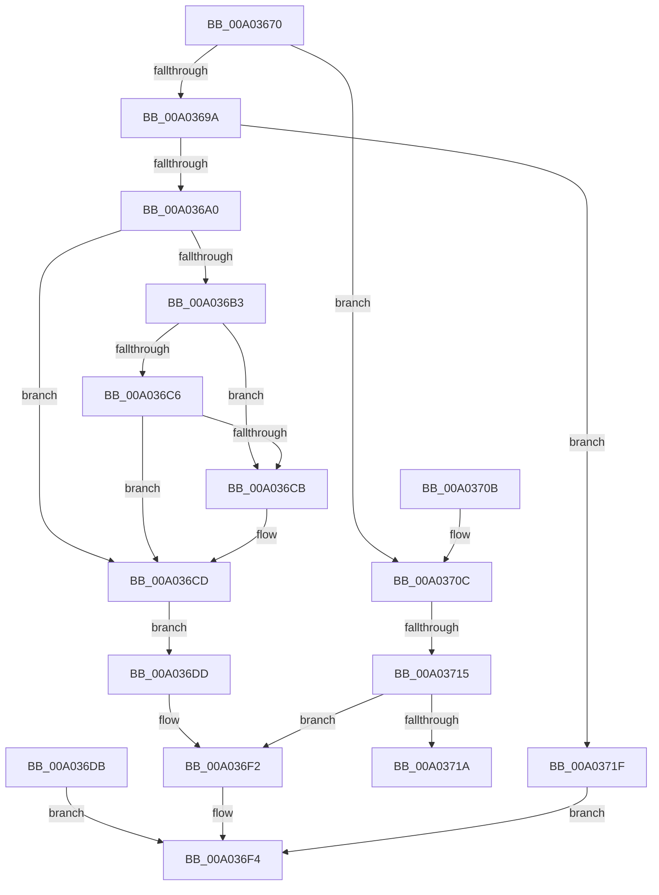

# NtSetInformationObject

- RVA: `0x00A03670`–`0x00A03726` (길이 `182` bytes)
- VA: `0x0000000140A03670`
- 실행 섹션: `PAGE`
- PDB 이름 있음: `예`; PDB Function 태그: `예`
- unwind 정보 RVA: `0x000A8014`
- 디코드: `50`개 명령, `182/182` bytes 표시
- 미해석 바이트: `0` (있으면 어셈블리에 `.byte`로 보존)

> 이 문서는 커널 이미지의 기계어와 PDB 기호를 분석해 생성했습니다. 4번과 5번은 함수 원형과 자료형을 바이너리 사용 방식에서 추정한 C 해석이며 원본 소스 복구 결과는 아닙니다.

## 1. Dependencies

- 직접 호출 지점: **1**; 고유 호출 대상: **1**
- 직접 호출자로 확인된 함수: **0**
- RIP 상대 이미지 참조: **0**

### Outgoing calls
- `0x00A036EB` → [ObSetHandleAttributes](ObSetHandleAttributes_function_00A03730.md) (function, `0x00A03730`)

### Direct callers
- 이 함수 시작 RVA로 연결되는 직접 call은 확인되지 않았습니다. 간접 호출은 완전히 역산할 수 없습니다.

### Static image references
- 디코드된 RIP-relative 메모리 참조가 없습니다.

## 2. Other-region calls and transfers

- 다른 실행 섹션으로 향하는 call: **0**
- call이 아닌 외부 분기/꼬리 이동: **2**
  - `0x00A0370F` → [sub_00B334D2 + 0xD1](../B3/Unknown_function_00B334D2.md) (`tail-transfer`)
  - `0x00A0371A` → [sub_00B334D2](../B3/Unknown_function_00B334D2.md) (`tail-transfer`)

## 3. Assembly (complete function range)

```asm
00A03670  48 8B C4                        mov rax, rsp
00A03673  48 89 58 08                     mov qword ptr [rax + 8], rbx
00A03677  48 89 70 18                     mov qword ptr [rax + 0x18], rsi
00A0367B  48 89 78 20                     mov qword ptr [rax + 0x20], rdi
00A0367F  41 56                           push r14
00A03681  48 83 EC 70                     sub rsp, 0x70
00A03685  48 8B F1                        mov rsi, rcx
00A03688  45 33 F6                        xor r14d, r14d
00A0368B  66 44 89 70 10                  mov word ptr [rax + 0x10], r14w
00A03690  BF 03 00 00 C0                  mov edi, 0xc0000003
00A03695  83 EA 04                        sub edx, 4
00A03698  75 72                           jne 0x140a0370c
00A0369A  41 83 F9 02                     cmp r9d, 2
00A0369E  75 7F                           jne 0x140a0371f
00A036A0  65 48 8B 04 25 88 01 00 00      mov rax, qword ptr gs:[0x188]
00A036A9  8A 88 32 02 00 00               mov cl, byte ptr [rax + 0x232]
00A036AF  84 C9                           test cl, cl
00A036B1  74 1A                           je 0x140a036cd
00A036B3  49 8D 40 02                     lea rax, [r8 + 2]
00A036B7  48 BA 00 00 FF FF FF 7F 00 00   movabs rdx, 0x7fffffff0000
00A036C1  48 3B C2                        cmp rax, rdx
00A036C4  77 05                           ja 0x140a036cb
00A036C6  49 3B C0                        cmp rax, r8
00A036C9  73 02                           jae 0x140a036cd
00A036CB  8A 02                           mov al, byte ptr [rdx]
00A036CD  41 0F B7 00                     movzx eax, word ptr [r8]
00A036D1  66 89 84 24 88 00 00 00         mov word ptr [rsp + 0x88], ax
00A036D9  EB 02                           jmp 0x140a036dd
00A036DB  EB 17                           jmp 0x140a036f4
00A036DD  44 8A C1                        mov r8b, cl
00A036E0  48 8D 94 24 88 00 00 00         lea rdx, [rsp + 0x88]
00A036E8  48 8B CE                        mov rcx, rsi
00A036EB  E8 40 00 00 00                  call 0x140a03730
00A036F0  8B F8                           mov edi, eax
00A036F2  8B C7                           mov eax, edi
00A036F4  4C 8D 5C 24 70                  lea r11, [rsp + 0x70]
00A036F9  49 8B 5B 10                     mov rbx, qword ptr [r11 + 0x10]
00A036FD  49 8B 73 20                     mov rsi, qword ptr [r11 + 0x20]
00A03701  49 8B 7B 28                     mov rdi, qword ptr [r11 + 0x28]
00A03705  49 8B E3                        mov rsp, r11
00A03708  41 5E                           pop r14
00A0370A  C3                              ret
00A0370B  CC                              int3
00A0370C  83 EA 01                        sub edx, 1
00A0370F  0F 84 8E FE 12 00               je 0x140b335a3
00A03715  83 FA 01                        cmp edx, 1
00A03718  75 D8                           jne 0x140a036f2
00A0371A  E9 B3 FD 12 00                  jmp 0x140b334d2
00A0371F  B8 04 00 00 C0                  mov eax, 0xc0000004
00A03724  EB CE                           jmp 0x140a036f4
```

## 4. C-style interpretation (structured pseudocode)

```c
__int64 __fastcall NtSetInformationObject(__int64 a1, int a2, __int64 a3, int a4)
{
    __int64 result;
    __int64 v_r14;
    __int64 v_rsp;
    unsigned __int64 v_stack_m8;
    unsigned __int16 v_stack_p10;

    *(unsigned __int64 *)(v_rsp + 8) = v_rbx;
    *(unsigned __int64 *)(v_rsp + 24) = v_rsi;
    *(unsigned __int64 *)(v_rsp + 32) = v_rdi;
    v_rsp = (v_rsp) - (112);
    v_r14 = 0;
    *(unsigned __int16 *)(v_rsp + 16) = 0;
    a2 = (unsigned int)((a2) - (4));
    if (condition_is_not_equal) goto loc_00A0370C;
    if (a4 != 2) goto loc_00A0371F;
    if ((unsigned __int8)(*(unsigned __int8 *)(*(unsigned __int64 *)(gs_base + (0 + 392)) + 562)) == 0) goto loc_00A036CD;
    if ((a3 + 2) > a2) goto loc_00A036CB;
    result = a3 + 2;
    if ((a3 + 2) < a3) {
        result = *(unsigned __int8 *)(a2);
    }
    v_stack_p10 = (unsigned __int16)(*(unsigned __int16 *)(a3));
    goto loc_00A036DD;
loc_00A036DD:
    result = ObSetHandleAttributes(a1, v_stack_p10, (unsigned __int8)(*(unsigned __int8 *)(*(unsigned __int64 *)(gs_base + (0 + 392)) + 562)), a4);
loc_00A036F2:
loc_00A036F4:
    return (unsigned int)((unsigned int)((unsigned int)((unsigned int)(result))));
loc_00A0370C:
    a2 = (unsigned int)((v_stack_p10) - (1));
    if (a2 != 1) goto loc_00A036F2;
loc_00A0371F:
    goto loc_00A036F4;
}
```

## 5. (Beta) C Style

```c
int64_t NtSetInformationObject(int64_t Arg1, int32_t Arg2, void *Arg3, int32_t Arg4)
{
    uint8_t *arg3 = (uint8_t *)Arg3;

    int64_t result;
    int64_t local_r14;
    int64_t local_rsp;
    uint64_t v_stack_m8;
    uint16_t v_stack_p10;

    *(uint64_t *)(local_rsp + 0x8) = local_rbx;
    *(uint64_t *)(local_rsp + 0x18) = local_rsi;
    *(uint64_t *)(local_rsp + 0x20) = local_rdi;
    local_rsp = (local_rsp) - (112);
    local_r14 = 0;
    *(uint16_t *)(local_rsp + 0x10) = 0;
    Arg2 = (uint32_t)((Arg2) - (4));
    if (condition_is_not_equal) goto loc_00A0370C;
    if (Arg4 != 2) goto loc_00A0371F;
    if ((uint8_t)(*(uint8_t *)(*(uint64_t *)(gs_base + (0 + 0x188)) + 0x232)) == 0) goto loc_00A036CD;
    if ((Arg3 + 2) > Arg2) goto loc_00A036CB;
    result = Arg3 + 2;
    if ((Arg3 + 2) < Arg3) {
        result = *(uint8_t *)(Arg2);
    }
    v_stack_p10 = (uint16_t)(*(uint16_t *)(arg3));
    goto loc_00A036DD;
loc_00A036DD:
    result = ObSetHandleAttributes(Arg1, v_stack_p10, (uint8_t)(*(uint8_t *)(*(uint64_t *)(gs_base + (0 + 0x188)) + 0x232)), Arg4);
loc_00A036F2:
loc_00A036F4:
    return (uint32_t)((uint32_t)((uint32_t)((uint32_t)(result))));
loc_00A0370C:
    Arg2 = (uint32_t)((v_stack_p10) - (1));
    if (Arg2 != 1) goto loc_00A036F2;
loc_00A0371F:
    goto loc_00A036F4;
}
```

### 관측된 메모리 오프셋

구조체 형식이 확인되지 않은 접근은 인자 기준의 오프셋으로만 기록했습니다.

| 기준 인자 | 오프셋 표현 | 폭 (bit) | 접근 |
|---|---:|---:|---|
| `Arg3` | `+ 0x0` | `16` | `R` |
| `Arg3` | `+ 0x2` | `64` | `R` |

## 6. Execution-region graph

[열기: 2D/3D 그래프와 함수 탐색 컨트롤 패널](../../../control-panel.html?section=page&rva=0x00A03670&view=graph)

- 2D 그래프는 위에서 아래로 흐르고, 3D 그래프는 빈 공간을 드래그해 회전합니다. Shift+드래그는 이동, 휠은 확대·축소, 함수 노드 선택은 대상 보고서 이동입니다.

### Static fallback


