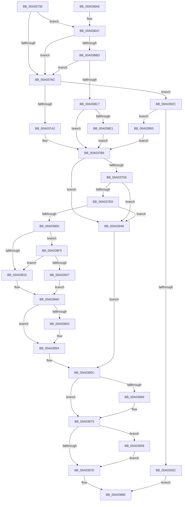

# ObSetHandleAttributes

- RVA: `0x00A03730`–`0x00A03969` (길이 `569` bytes)
- VA: `0x0000000140A03730`
- 실행 섹션: `PAGE`
- PDB 이름 있음: `예`; PDB Function 태그: `아니요`
- unwind 정보 RVA: `0x000A8060`
- 디코드: `139`개 명령, `569/569` bytes 표시
- 미해석 바이트: `0` (있으면 어셈블리에 `.byte`로 보존)

> 이 문서는 커널 이미지의 기계어와 PDB 기호를 분석해 생성했습니다. 4번과 5번은 함수 원형과 자료형을 바이너리 사용 방식에서 추정한 C 해석이며 원본 소스 복구 결과는 아닙니다.

## 1. Dependencies

- 직접 호출 지점: **10**; 고유 호출 대상: **10**
- 직접 호출자로 확인된 함수: **1**
- RIP 상대 이미지 참조: **5**

### Outgoing calls
- `0x00A037DC` → [ExpLookupHandleTableEntry](../86/ExpLookupHandleTableEntry_function_00869DB0.md) (function, `0x00869DB0`)
- `0x00A037F3` → [ExLockHandleTableEntry](../../text/40/ExLockHandleTableEntry_function_0040DAA0.md) (function, `0x0040DAA0`)
- `0x00A03803` → [ExGetHandlePointer](../../text/43/ExGetHandlePointer_function_00430C90.md) (function, `0x00430C90`)
- `0x00A03855` → [ExfUnblockPushLock](../../text/2A/ExfUnblockPushLock_function_002A3FE0.md) (function, `0x002A3FE0`)
- `0x00A0385F` → [KiLeaveCriticalRegionUnsafe](../../text/25/KiLeaveCriticalRegionUnsafe_function_0025F010.md) (function, `0x0025F010`)
- `0x00A03870` → [KiUnstackDetachProcess](../../text/21/KiUnstackDetachProcess_function_00217D30.md) (function, `0x00217D30`)
- `0x00A03888` → [_security_check_cookie](../../text/6A/_security_check_cookie_function_006AC640.md) (function, `0x006AC640`)
- `0x00A038E8` → [KiStackAttachProcess](../../text/21/KiStackAttachProcess_function_00216820.md) (function, `0x00216820`)
- `0x00A0392F` → [ObReferenceProcessHandleTable](../89/ObReferenceProcessHandleTable_function_00893B70.md) (function, `0x00893B70`)
- `0x00A0395F` → [ExReleaseRundownProtection](../../text/34/ExReleaseRundownProtection_function_00349E80.md) (function, `0x00349E80`)

### Direct callers
- [NtSetInformationObject](NtSetInformationObject_function_00A03670.md) at `0x00A036EB`

### Static image references
- `0x00A03746` → RVA `0x00E0A740` (`.data`; read)
- `0x00A038C7` → RVA `0x00F0F5B8` (`.data`; read)
- `0x00A038D1` → RVA `0x00FC6AB0` (`ALMOSTRO`; read)
- `0x00A03906` → RVA `0x00FC6E4C` (`ALMOSTRO`; read)
- `0x00A03910` → RVA `0x00FC7800` (`ALMOSTRO`; read)

## 2. Other-region calls and transfers

- 다른 실행 섹션으로 향하는 call: **8**
  - `0x00A037F3` → [ExLockHandleTableEntry](../../text/40/ExLockHandleTableEntry_function_0040DAA0.md) (`PAGE` → `.text`)
  - `0x00A03803` → [ExGetHandlePointer](../../text/43/ExGetHandlePointer_function_00430C90.md) (`PAGE` → `.text`)
  - `0x00A03855` → [ExfUnblockPushLock](../../text/2A/ExfUnblockPushLock_function_002A3FE0.md) (`PAGE` → `.text`)
  - `0x00A0385F` → [KiLeaveCriticalRegionUnsafe](../../text/25/KiLeaveCriticalRegionUnsafe_function_0025F010.md) (`PAGE` → `.text`)
  - `0x00A03870` → [KiUnstackDetachProcess](../../text/21/KiUnstackDetachProcess_function_00217D30.md) (`PAGE` → `.text`)
  - `0x00A03888` → [_security_check_cookie](../../text/6A/_security_check_cookie_function_006AC640.md) (`PAGE` → `.text`)
  - `0x00A038E8` → [KiStackAttachProcess](../../text/21/KiStackAttachProcess_function_00216820.md) (`PAGE` → `.text`)
  - `0x00A0395F` → [ExReleaseRundownProtection](../../text/34/ExReleaseRundownProtection_function_00349E80.md) (`PAGE` → `.text`)
- 별도 외부 분기/꼬리 이동을 확인하지 못했습니다.

## 3. Assembly (complete function range)

```asm
00A03730  48 89 5C 24 10                  mov qword ptr [rsp + 0x10], rbx
00A03735  48 89 6C 24 18                  mov qword ptr [rsp + 0x18], rbp
00A0373A  56                              push rsi
00A0373B  57                              push rdi
00A0373C  41 54                           push r12
00A0373E  41 56                           push r14
00A03740  41 57                           push r15
00A03742  48 83 EC 60                     sub rsp, 0x60
00A03746  48 8B 05 F3 6F 40 00            mov rax, qword ptr [rip + 0x406ff3]
00A0374D  48 33 C4                        xor rax, rsp
00A03750  48 89 44 24 50                  mov qword ptr [rsp + 0x50], rax
00A03755  0F 57 C0                        xorps xmm0, xmm0
00A03758  45 32 FF                        xor r15b, r15b
00A0375B  0F 11 44 24 20                  movups xmmword ptr [rsp + 0x20], xmm0
00A03760  45 32 F6                        xor r14b, r14b
00A03763  4C 8B E2                        mov r12, rdx
00A03766  48 8B D9                        mov rbx, rcx
00A03769  0F 11 44 24 30                  movups xmmword ptr [rsp + 0x30], xmm0
00A0376E  0F 11 44 24 40                  movups xmmword ptr [rsp + 0x40], xmm0
00A03773  65 48 8B 04 25 88 01 00 00      mov rax, qword ptr gs:[0x188]
00A0377C  48 8B A8 B8 00 00 00            mov rbp, qword ptr [rax + 0xb8]
00A03783  45 84 C0                        test r8b, r8b
00A03786  0F 84 1B 01 00 00               je 0x140a038a7
00A0378C  65 48 8B 04 25 88 01 00 00      mov rax, qword ptr gs:[0x188]
00A03795  80 B8 4A 02 00 00 01            cmp byte ptr [rax + 0x24a], 1
00A0379C  0F 84 8A 01 00 00               je 0x140a0392c
00A037A2  65 48 8B 04 25 88 01 00 00      mov rax, qword ptr gs:[0x188]
00A037AB  48 8B 88 B8 00 00 00            mov rcx, qword ptr [rax + 0xb8]
00A037B2  48 8B B9 00 03 00 00            mov rdi, qword ptr [rcx + 0x300]
00A037B9  65 48 8B 34 25 88 01 00 00      mov rsi, qword ptr gs:[0x188]
00A037C2  66 FF 8E E4 01 00 00            dec word ptr [rsi + 0x1e4]
00A037C9  90                              nop
00A037CA  F7 C3 FC 03 00 00               test ebx, 0x3fc
00A037D0  0F 84 70 01 00 00               je 0x140a03946
00A037D6  48 8B D3                        mov rdx, rbx
00A037D9  48 8B CF                        mov rcx, rdi
00A037DC  E8 CF 65 E6 FF                  call 0x140869db0
00A037E1  48 8B D8                        mov rbx, rax
00A037E4  48 85 C0                        test rax, rax
00A037E7  0F 84 59 01 00 00               je 0x140a03946
00A037ED  48 8B D0                        mov rdx, rax
00A037F0  48 8B CF                        mov rcx, rdi
00A037F3  E8 A8 A2 A0 FF                  call 0x14040daa0
00A037F8  84 C0                           test al, al
00A037FA  0F 84 46 01 00 00               je 0x140a03946
00A03800  48 8B CB                        mov rcx, rbx
00A03803  E8 88 D4 A2 FF                  call 0x140430c90
00A03808  45 8A 04 24                     mov r8b, byte ptr [r12]
00A0380C  45 84 C0                        test r8b, r8b
00A0380F  0F 85 E0 00 00 00               jne 0x140a038f5
00A03815  48 8B 03                        mov rax, qword ptr [rbx]
00A03818  41 F6 D8                        neg r8b
00A0381B  1B D2                           sbb edx, edx
00A0381D  83 E2 02                        and edx, 2
00A03820  8B CA                           mov ecx, edx
00A03822  83 C9 01                        or ecx, 1
00A03825  41 80 7C 24 01 00               cmp byte ptr [r12 + 1], 0
00A0382B  0F 44 CA                        cmove ecx, edx
00A0382E  48 25 FF FF F9 FF               and rax, 0xfffffffffff9ffff
00A03834  8B D1                           mov edx, ecx
00A03836  48 C1 E2 11                     shl rdx, 0x11
00A0383A  48 0B D0                        or rdx, rax
00A0383D  48 89 13                        mov qword ptr [rbx], rdx
00A03840  F0 48 FF 03                     lock inc qword ptr [rbx]
00A03844  48 8D 4F 30                     lea rcx, [rdi + 0x30]
00A03848  F0 83 0C 24 00                  lock or dword ptr [rsp], 0
00A0384D  48 83 39 00                     cmp qword ptr [rcx], 0
00A03851  74 07                           je 0x140a0385a
00A03853  33 D2                           xor edx, edx
00A03855  E8 86 07 8A FF                  call 0x1402a3fe0
00A0385A  33 DB                           xor ebx, ebx
00A0385C  48 8B CE                        mov rcx, rsi
00A0385F  E8 AC B7 85 FF                  call 0x14025f010
00A03864  45 84 FF                        test r15b, r15b
00A03867  74 0C                           je 0x140a03875
00A03869  33 D2                           xor edx, edx
00A0386B  48 8D 4C 24 20                  lea rcx, [rsp + 0x20]
00A03870  E8 BB 44 81 FF                  call 0x140217d30
00A03875  45 84 F6                        test r14b, r14b
00A03878  0F 85 DA 00 00 00               jne 0x140a03958
00A0387E  8B C3                           mov eax, ebx
00A03880  48 8B 4C 24 50                  mov rcx, qword ptr [rsp + 0x50]
00A03885  48 33 CC                        xor rcx, rsp
00A03888  E8 B3 8D CA FF                  call 0x1406ac640
00A0388D  4C 8D 5C 24 60                  lea r11, [rsp + 0x60]
00A03892  49 8B 5B 38                     mov rbx, qword ptr [r11 + 0x38]
00A03896  49 8B 6B 40                     mov rbp, qword ptr [r11 + 0x40]
00A0389A  49 8B E3                        mov rsp, r11
00A0389D  41 5F                           pop r15
00A0389F  41 5E                           pop r14
00A038A1  41 5C                           pop r12
00A038A3  5F                              pop rdi
00A038A4  5E                              pop rsi
00A038A5  C3                              ret
00A038A6  CC                              int3
00A038A7  48 C7 C1 00 00 00 80            mov rcx, 0xffffffff80000000
00A038AE  48 8B C3                        mov rax, rbx
00A038B1  48 23 C1                        and rax, rcx
00A038B4  48 3B C1                        cmp rax, rcx
00A038B7  0F 85 CF FE FF FF               jne 0x140a0378c
00A038BD  48 83 FB FD                     cmp rbx, -3
00A038C1  0F 87 C5 FE FF FF               ja 0x140a0378c
00A038C7  48 8B 3D EA BC 50 00            mov rdi, qword ptr [rip + 0x50bcea]
00A038CE  48 33 D9                        xor rbx, rcx
00A038D1  48 8B 0D D8 31 5C 00            mov rcx, qword ptr [rip + 0x5c31d8]
00A038D8  48 3B E9                        cmp rbp, rcx
00A038DB  0F 84 D8 FE FF FF               je 0x140a037b9
00A038E1  4C 8D 44 24 20                  lea r8, [rsp + 0x20]
00A038E6  33 D2                           xor edx, edx
00A038E8  E8 33 2F 81 FF                  call 0x140216820
00A038ED  41 B7 01                        mov r15b, 1
00A038F0  E9 C4 FE FF FF                  jmp 0x140a037b9
00A038F5  48 8B C8                        mov rcx, rax
00A038F8  0F B6 40 18                     movzx eax, byte ptr [rax + 0x18]
00A038FC  48 C1 E9 08                     shr rcx, 8
00A03900  0F B6 D1                        movzx edx, cl
00A03903  48 33 D0                        xor rdx, rax
00A03906  0F B6 05 3F 35 5C 00            movzx eax, byte ptr [rip + 0x5c353f]
00A0390D  48 33 D0                        xor rdx, rax
00A03910  48 8D 05 E9 3E 5C 00            lea rax, [rip + 0x5c3ee9]
00A03917  48 8B 04 D0                     mov rax, qword ptr [rax + rdx*8]
00A0391B  8B 48 48                        mov ecx, dword ptr [rax + 0x48]
00A0391E  F6 C1 02                        test cl, 2
00A03921  0F 84 EE FE FF FF               je 0x140a03815
00A03927  E9 14 FF FF FF                  jmp 0x140a03840
00A0392C  48 8B CD                        mov rcx, rbp
00A0392F  E8 3C 02 E9 FF                  call 0x140893b70
00A03934  48 8B F8                        mov rdi, rax
00A03937  48 85 C0                        test rax, rax
00A0393A  75 14                           jne 0x140a03950
00A0393C  B8 08 00 00 C0                  mov eax, 0xc0000008
00A03941  E9 3A FF FF FF                  jmp 0x140a03880
00A03946  BB 22 00 00 C0                  mov ebx, 0xc0000022
00A0394B  E9 0C FF FF FF                  jmp 0x140a0385c
00A03950  41 B6 01                        mov r14b, 1
00A03953  E9 61 FE FF FF                  jmp 0x140a037b9
00A03958  48 8D 8D E8 01 00 00            lea rcx, [rbp + 0x1e8]
00A0395F  E8 1C 65 94 FF                  call 0x140349e80
00A03964  E9 15 FF FF FF                  jmp 0x140a0387e
```

## 4. C-style interpretation (structured pseudocode)

```c
__int64 __fastcall ObSetHandleAttributes(__int64 a1, __int64 a2, unsigned __int8 a3)
{
    __int64 result;
    __int64 v_r14;
    __int64 v_r15;
    __int64 v_rbx;
    __int64 v_rsp;
    unsigned __int64 v_stack_m28;
    unsigned __int64 v_stack_m38;
    unsigned __int64 v_stack_m40;
    unsigned __int64 v_stack_m48;
    unsigned __int64 v_stack_m58;
    unsigned __int64 v_stack_m68;
    unsigned int v_stack_m88;
    unsigned __int64 v_stack_p10;
    unsigned __int64 v_stack_p18;

    v_stack_p10 = v_rbx;
    v_stack_p18 = v_rbp;
    v_rsp = (v_rsp) - (96);
    result = (*(unsigned __int64 *)(v_rip + 4222963)) ^ (v_rsp);
    v_stack_m38 = result;
    v_r15 = 0;
    v_stack_m68 = v_xmm0;
    v_r14 = 0;
    v_stack_m58 = v_xmm0;
    v_stack_m48 = v_xmm0;
    if (a3 == 0) goto loc_00A038A7;
loc_00A0378C:
    if ((*(unsigned __int8 *)(*(unsigned __int64 *)(gs_base + (0 + 392)) + 586)) == 1) goto loc_00A0392C;
loc_00A037B9:
    if ((((unsigned int)(a1)) & (0x3FCULL)) == 0) goto loc_00A03946;
    result = ExpLookupHandleTableEntry(*(unsigned __int64 *)(*(unsigned __int64 *)(*(unsigned __int64 *)(gs_base + (0 + 392)) + 184) + 768), a1, a3, a4);
    if (result == 0) goto loc_00A03946;
    result = ExLockHandleTableEntry(*(unsigned __int64 *)(*(unsigned __int64 *)(*(unsigned __int64 *)(gs_base + (0 + 392)) + 184) + 768), result, a3, a4);
    if ((unsigned __int8)(result) == 0) goto loc_00A03946;
    result = ExGetHandlePointer(result, result, a3, a4);
    if ((unsigned __int8)(*(unsigned __int8 *)(a2)) != 0) goto loc_00A038F5;
loc_00A03815:
    a3 = (unsigned __int8)(-(*(unsigned __int8 *)(a2)));
    a2 = (unsigned int)((result) & (2));
    a1 = (unsigned int)(((unsigned int)((unsigned int)(a2))) | (1));
    if ((*(unsigned __int8 *)(a2 + 1)) == 0) { a1 = (unsigned int)(a2); }
    result = (*(unsigned __int64 *)(result)) & (0xFFFFFFFFFFF9FFFFULL);
    a2 = ((unsigned int)((unsigned int)(a1))) << (17);
    a2 = (a2) | (result);
    *(unsigned __int64 *)(result) = a2;
loc_00A03840:
    if ((*(unsigned __int64 *)(*(unsigned __int64 *)(*(unsigned __int64 *)(*(unsigned __int64 *)(gs_base + (0 + 392)) + 184) + 768) + 48)) != 0) {
        a2 = 0;
        result = ExfUnblockPushLock(*(unsigned __int64 *)(*(unsigned __int64 *)(*(unsigned __int64 *)(gs_base + (0 + 392)) + 184) + 768) + 48, a2, a3, a4);
    }
    v_rbx = 0;
loc_00A0385C:
    result = KiLeaveCriticalRegionUnsafe(*(unsigned __int64 *)(gs_base + (0 + 392)), a2, a3, a4);
    if (0 != 0) {
        a2 = 0;
        a1 = v_stack_m68;
        result = KiUnstackDetachProcess(a1, a2, a3, a4);
    }
    if (0 != 0) goto loc_00A03958;
loc_00A0387E:
loc_00A03880:
    a1 = (v_stack_m38) ^ (v_rsp);
    result = _security_check_cookie(a1, a2, a3, a4);
    return result;
loc_00A038A7:
    result = (*(unsigned __int64 *)(v_stack_m28 + 56)) & (0xFFFFFFFF80000000ULL);
    if (result != 0xFFFFFFFF80000000ULL) goto loc_00A0378C;
    if ((*(unsigned __int64 *)(v_stack_m28 + 56)) > -3) goto loc_00A0378C;
    v_rbx = (*(unsigned __int64 *)(v_stack_m28 + 56)) ^ (0xFFFFFFFF80000000ULL);
    if ((*(unsigned __int64 *)(v_stack_m28 + 64)) == (*(unsigned __int64 *)(v_rip + 6042072))) goto loc_00A037B9;
    a2 = 0;
    result = KiStackAttachProcess(*(unsigned __int64 *)(v_rip + 6042072), a2, v_stack_m40, a4);
    goto loc_00A037B9;
loc_00A038F5:
    a1 = (result) >> (8);
    a2 = ((unsigned __int8)(a1)) ^ (*(unsigned __int8 *)(result + 24));
    a2 = (a2) ^ (*(unsigned __int8 *)(v_rip + 6042943));
    if ((((unsigned __int8)((unsigned int)(*(unsigned int *)(*(unsigned __int64 *)(v_rip + 6045417 + a2 * 8) + 72)))) & (2)) == 0) goto loc_00A03815;
    goto loc_00A03840;
loc_00A0392C:
    result = ObReferenceProcessHandleTable(*(unsigned __int64 *)(v_stack_m28 + 64), a2, v_stack_m40, a4);
    if (result != 0) goto loc_00A03950;
    goto loc_00A03880;
loc_00A03946:
    goto loc_00A0385C;
loc_00A03950:
    goto loc_00A037B9;
loc_00A03958:
    result = ExReleaseRundownProtection(*(unsigned __int64 *)(v_stack_m28 + 64) + 488, a2, v_stack_m40, a4);
    goto loc_00A0387E;
}
```

## 5. (Beta) C Style

```c
int64_t ObSetHandleAttributes(int64_t Arg1, void *Arg2, uint8_t Arg3)
{
    uint8_t *arg2 = (uint8_t *)Arg2;

    int64_t result;
    int64_t local_r14;
    int64_t local_r15;
    int64_t local_rbx;
    int64_t local_rsp;
    uint64_t v_stack_m28;
    uint64_t v_stack_m38;
    uint64_t v_stack_m40;
    uint64_t v_stack_m48;
    uint64_t v_stack_m58;
    uint64_t v_stack_m68;
    uint32_t v_stack_m88;
    uint64_t v_stack_p10;
    uint64_t v_stack_p18;

    v_stack_p10 = local_rbx;
    v_stack_p18 = local_rbp;
    local_rsp = (local_rsp) - (96);
    result = (*(uint64_t *)(v_rip + 0x406FF3)) ^ (local_rsp);
    v_stack_m38 = result;
    local_r15 = 0;
    v_stack_m68 = v_xmm0;
    local_r14 = 0;
    v_stack_m58 = v_xmm0;
    v_stack_m48 = v_xmm0;
    if (Arg3 == 0) goto loc_00A038A7;
loc_00A0378C:
    if ((*(uint8_t *)(*(uint64_t *)(gs_base + (0 + 0x188)) + 0x24A)) == 1) goto loc_00A0392C;
loc_00A037B9:
    if ((((uint32_t)(Arg1)) & (0x3FCULL)) == 0) goto loc_00A03946;
    result = ExpLookupHandleTableEntry(*(uint64_t *)(*(uint64_t *)(*(uint64_t *)(gs_base + (0 + 0x188)) + 0xB8) + 0x300), Arg1, Arg3, a4);
    if (result == 0) goto loc_00A03946;
    result = ExLockHandleTableEntry(*(uint64_t *)(*(uint64_t *)(*(uint64_t *)(gs_base + (0 + 0x188)) + 0xB8) + 0x300), result, Arg3, a4);
    if ((uint8_t)(result) == 0) goto loc_00A03946;
    result = ExGetHandlePointer(result, result, Arg3, a4);
    if ((uint8_t)(*(uint8_t *)(arg2)) != 0) goto loc_00A038F5;
loc_00A03815:
    Arg3 = (uint8_t)(-(*(uint8_t *)(arg2)));
    Arg2 = (uint32_t)((result) & (2));
    Arg1 = (uint32_t)(((uint32_t)((uint32_t)(Arg2))) | (1));
    if ((*(uint8_t *)(arg2 + 0x1)) == 0) { Arg1 = (uint32_t)(Arg2); }
    result = (*(uint64_t *)(result)) & (0xFFFFFFFFFFF9FFFFULL);
    Arg2 = ((uint32_t)((uint32_t)(Arg1))) << (17);
    Arg2 = (Arg2) | (result);
    *(void **)(result) = Arg2;
loc_00A03840:
    if ((*(uint64_t *)(*(uint64_t *)(*(uint64_t *)(*(uint64_t *)(gs_base + (0 + 0x188)) + 0xB8) + 0x300) + 0x30)) != 0) {
        Arg2 = 0;
        result = ExfUnblockPushLock(*(uint64_t *)(*(uint64_t *)(*(uint64_t *)(gs_base + (0 + 0x188)) + 0xB8) + 0x300) + 48, Arg2, Arg3, a4);
    }
    local_rbx = 0;
loc_00A0385C:
    result = KiLeaveCriticalRegionUnsafe(*(uint64_t *)(gs_base + (0 + 0x188)), Arg2, Arg3, a4);
    if (0 != 0) {
        Arg2 = 0;
        Arg1 = v_stack_m68;
        result = KiUnstackDetachProcess(Arg1, Arg2, Arg3, a4);
    }
    if (0 != 0) goto loc_00A03958;
loc_00A0387E:
loc_00A03880:
    Arg1 = (v_stack_m38) ^ (local_rsp);
    result = _security_check_cookie(Arg1, Arg2, Arg3, a4);
    return result;
loc_00A038A7:
    result = (*(uint64_t *)(v_stack_m28 + 0x38)) & (0xFFFFFFFF80000000ULL);
    if (result != 0xFFFFFFFF80000000ULL) goto loc_00A0378C;
    if ((*(uint64_t *)(v_stack_m28 + 0x38)) > -3) goto loc_00A0378C;
    local_rbx = (*(uint64_t *)(v_stack_m28 + 0x38)) ^ (0xFFFFFFFF80000000ULL);
    if ((*(uint64_t *)(v_stack_m28 + 0x40)) == (*(uint64_t *)(v_rip + 0x5C31D8))) goto loc_00A037B9;
    Arg2 = 0;
    result = KiStackAttachProcess(*(uint64_t *)(v_rip + 0x5C31D8), Arg2, v_stack_m40, a4);
    goto loc_00A037B9;
loc_00A038F5:
    Arg1 = (result) >> (8);
    Arg2 = ((uint8_t)(Arg1)) ^ (*(uint8_t *)(result + 0x18));
    Arg2 = (Arg2) ^ (*(uint8_t *)(v_rip + 0x5C353F));
    if ((((uint8_t)((uint32_t)(*(uint32_t *)(*(uint64_t *)(v_rip + 0x5C3EE9 + arg2 * 8) + 0x48)))) & (2)) == 0) goto loc_00A03815;
    goto loc_00A03840;
loc_00A0392C:
    result = ObReferenceProcessHandleTable(*(uint64_t *)(v_stack_m28 + 0x40), Arg2, v_stack_m40, a4);
    if (result != 0) goto loc_00A03950;
    goto loc_00A03880;
loc_00A03946:
    goto loc_00A0385C;
loc_00A03950:
    goto loc_00A037B9;
loc_00A03958:
    result = ExReleaseRundownProtection(*(uint64_t *)(v_stack_m28 + 0x40) + 488, Arg2, v_stack_m40, a4);
    goto loc_00A0387E;
}
```

### 관측된 메모리 오프셋

구조체 형식이 확인되지 않은 접근은 인자 기준의 오프셋으로만 기록했습니다.

| 기준 인자 | 오프셋 표현 | 폭 (bit) | 접근 |
|---|---:|---:|---|
| `Arg2` | `+ 0x0` | `8` | `R` |
| `Arg2` | `+ 0x1` | `8` | `R` |

## 6. Execution-region graph

[열기: 2D/3D 그래프와 함수 탐색 컨트롤 패널](../../../control-panel.html?section=page&rva=0x00A03730&view=graph)

- 2D 그래프는 위에서 아래로 흐르고, 3D 그래프는 빈 공간을 드래그해 회전합니다. Shift+드래그는 이동, 휠은 확대·축소, 함수 노드 선택은 대상 보고서 이동입니다.

### Static fallback


