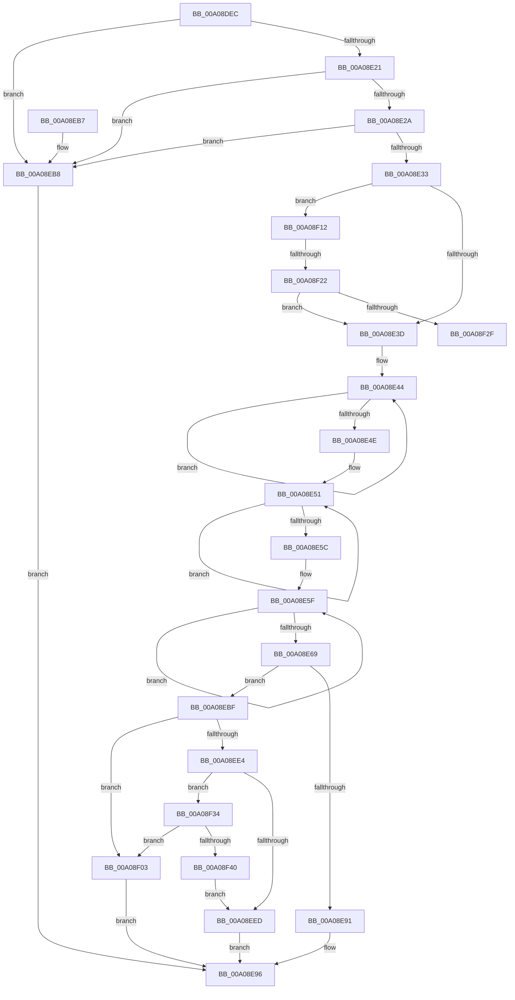

# PiBuildDeviceNodeInstancePath

- RVA: `0x00A08DEC`–`0x00A08F42` (길이 `342` bytes)
- VA: `0x0000000140A08DEC`
- 실행 섹션: `PAGE`
- PDB 이름 있음: `예`; PDB Function 태그: `예`
- unwind 정보 RVA: `0x000A12D8`
- 디코드: `92`개 명령, `342/342` bytes 표시
- 미해석 바이트: `0` (있으면 어셈블리에 `.byte`로 보존)

> 이 문서는 커널 이미지의 기계어와 PDB 기호를 분석해 생성했습니다. 4번과 5번은 함수 원형과 자료형을 바이너리 사용 방식에서 추정한 C 해석이며 원본 소스 복구 결과는 아닙니다.

## 1. Dependencies

- 직접 호출 지점: **6**; 고유 호출 대상: **6**
- 직접 호출자로 확인된 함수: **1**
- RIP 상대 이미지 참조: **1**

### Outgoing calls
- `0x00A08E84` → [ExAllocatePool2](../../poolcode/B8/ExAllocatePool2_function_00B820F0.md) (function, `0x00B820F0`)
- `0x00A08ED9` → [RtlStringCbPrintfW](../../text/40/RtlStringCbPrintfW_function_0040FB40.md) (function, `0x0040FB40`)
- `0x00A08EF0` → [PnpFreeDeviceInstancePath](PnpFreeDeviceInstancePath_function_00A074F0.md) (function, `0x00A074F0`)
- `0x00A08EFC` → [RtlInitUnicodeString](../../text/42/RtlInitUnicodeString_function_0042A780.md) (function, `0x0042A780`)
- `0x00A08F0B` → [ExFreePoolWithTag](../../poolcode/B8/ExFreePoolWithTag_function_00B82870.md) (function, `0x00B82870`)
- `0x00A08F37` → [wcsicmp](../../text/50/wcsicmp_function_00500080.md) (function, `0x00500080`)

### Direct callers
- [PiProcessNewDeviceNode](../A2/PiProcessNewDeviceNode_function_00A28F20.md) at `0x00A2927D`

### Static image references
- `0x00A08EC4` → RVA `0x00AFDE50` (` ?? ::NNGAKEGL::`string'`; read)

## 2. Other-region calls and transfers

- 다른 실행 섹션으로 향하는 call: **5**
  - `0x00A08E84` → [ExAllocatePool2](../../poolcode/B8/ExAllocatePool2_function_00B820F0.md) (`PAGE` → `POOLCODE`)
  - `0x00A08ED9` → [RtlStringCbPrintfW](../../text/40/RtlStringCbPrintfW_function_0040FB40.md) (`PAGE` → `.text`)
  - `0x00A08EFC` → [RtlInitUnicodeString](../../text/42/RtlInitUnicodeString_function_0042A780.md) (`PAGE` → `.text`)
  - `0x00A08F0B` → [ExFreePoolWithTag](../../poolcode/B8/ExFreePoolWithTag_function_00B82870.md) (`PAGE` → `POOLCODE`)
  - `0x00A08F37` → [wcsicmp](../../text/50/wcsicmp_function_00500080.md) (`PAGE` → `.text`)
- call이 아닌 외부 분기/꼬리 이동: **2**
  - `0x00A08F1C` → [sub_00B348E8](../B3/Unknown_function_00B348E8.md) (`tail-transfer`)
  - `0x00A08F2F` → [sub_00B348E8](../B3/Unknown_function_00B348E8.md) (`tail-transfer`)

## 3. Assembly (complete function range)

```asm
00A08DEC  48 8B C4                        mov rax, rsp
00A08DEF  48 89 58 08                     mov qword ptr [rax + 8], rbx
00A08DF3  48 89 68 10                     mov qword ptr [rax + 0x10], rbp
00A08DF7  48 89 70 18                     mov qword ptr [rax + 0x18], rsi
00A08DFB  48 89 78 20                     mov qword ptr [rax + 0x20], rdi
00A08DFF  41 54                           push r12
00A08E01  41 56                           push r14
00A08E03  41 57                           push r15
00A08E05  48 83 EC 30                     sub rsp, 0x30
00A08E09  45 33 E4                        xor r12d, r12d
00A08E0C  49 8B F9                        mov rdi, r9
00A08E0F  49 8B E8                        mov rbp, r8
00A08E12  4C 8B F2                        mov r14, rdx
00A08E15  48 8B D9                        mov rbx, rcx
00A08E18  48 85 D2                        test rdx, rdx
00A08E1B  0F 84 97 00 00 00               je 0x140a08eb8
00A08E21  4D 85 C0                        test r8, r8
00A08E24  0F 84 8E 00 00 00               je 0x140a08eb8
00A08E2A  4D 85 C9                        test r9, r9
00A08E2D  0F 84 85 00 00 00               je 0x140a08eb8
00A08E33  4C 39 61 30                     cmp qword ptr [rcx + 0x30], r12
00A08E37  0F 85 D5 00 00 00               jne 0x140a08f12
00A08E3D  48 83 C8 FF                     or rax, 0xffffffffffffffff
00A08E41  48 8B C8                        mov rcx, rax
00A08E44  48 FF C1                        inc rcx
00A08E47  66 45 39 24 4E                  cmp word ptr [r14 + rcx*2], r12w
00A08E4C  75 F6                           jne 0x140a08e44
00A08E4E  48 8B D0                        mov rdx, rax
00A08E51  48 FF C2                        inc rdx
00A08E54  66 44 39 64 55 00               cmp word ptr [rbp + rdx*2], r12w
00A08E5A  75 F5                           jne 0x140a08e51
00A08E5C  48 03 CA                        add rcx, rdx
00A08E5F  48 FF C0                        inc rax
00A08E62  66 44 39 24 47                  cmp word ptr [rdi + rax*2], r12w
00A08E67  75 F6                           jne 0x140a08e5f
00A08E69  48 03 C8                        add rcx, rax
00A08E6C  41 B8 50 6E 70 49               mov r8d, 0x49706e50
00A08E72  48 8D 04 4D 06 00 00 00         lea rax, [rcx*2 + 6]
00A08E7A  B9 40 00 00 00                  mov ecx, 0x40
00A08E7F  8B D0                           mov edx, eax
00A08E81  44 8B F8                        mov r15d, eax
00A08E84  E8 67 92 17 00                  call 0x140b820f0
00A08E89  48 8B F0                        mov rsi, rax
00A08E8C  48 85 C0                        test rax, rax
00A08E8F  75 2E                           jne 0x140a08ebf
00A08E91  BF 9A 00 00 C0                  mov edi, 0xc000009a
00A08E96  48 8B 5C 24 50                  mov rbx, qword ptr [rsp + 0x50]
00A08E9B  8B C7                           mov eax, edi
00A08E9D  48 8B 7C 24 68                  mov rdi, qword ptr [rsp + 0x68]
00A08EA2  48 8B 6C 24 58                  mov rbp, qword ptr [rsp + 0x58]
00A08EA7  48 8B 74 24 60                  mov rsi, qword ptr [rsp + 0x60]
00A08EAC  48 83 C4 30                     add rsp, 0x30
00A08EB0  41 5F                           pop r15
00A08EB2  41 5E                           pop r14
00A08EB4  41 5C                           pop r12
00A08EB6  C3                              ret
00A08EB7  CC                              int3
00A08EB8  BF 01 00 00 C0                  mov edi, 0xc0000001
00A08EBD  EB D7                           jmp 0x140a08e96
00A08EBF  48 89 7C 24 28                  mov qword ptr [rsp + 0x28], rdi
00A08EC4  4C 8D 05 85 4F 0F 00            lea r8, [rip + 0xf4f85]
00A08ECB  4D 8B CE                        mov r9, r14
00A08ECE  48 89 6C 24 20                  mov qword ptr [rsp + 0x20], rbp
00A08ED3  49 8B D7                        mov rdx, r15
00A08ED6  48 8B CE                        mov rcx, rsi
00A08ED9  E8 62 6C A0 FF                  call 0x14040fb40
00A08EDE  8B F8                           mov edi, eax
00A08EE0  85 C0                           test eax, eax
00A08EE2  78 1F                           js 0x140a08f03
00A08EE4  48 8B 4B 30                     mov rcx, qword ptr [rbx + 0x30]
00A08EE8  48 85 C9                        test rcx, rcx
00A08EEB  75 47                           jne 0x140a08f34
00A08EED  48 8B CB                        mov rcx, rbx
00A08EF0  E8 FB E5 FF FF                  call 0x140a074f0
00A08EF5  48 8D 4B 28                     lea rcx, [rbx + 0x28]
00A08EF9  48 8B D6                        mov rdx, rsi
00A08EFC  E8 7F 18 A2 FF                  call 0x14042a780
00A08F01  EB 93                           jmp 0x140a08e96
00A08F03  BA 50 6E 70 49                  mov edx, 0x49706e50
00A08F08  48 8B CE                        mov rcx, rsi
00A08F0B  E8 60 99 17 00                  call 0x140b82870
00A08F10  EB 84                           jmp 0x140a08e96
00A08F12  F7 81 8C 01 00 00 00 20 00 00   test dword ptr [rcx + 0x18c], 0x2000
00A08F1C  0F 84 C6 B9 12 00               je 0x140b348e8
00A08F22  83 B9 94 01 00 00 2A            cmp dword ptr [rcx + 0x194], 0x2a
00A08F29  0F 84 0E FF FF FF               je 0x140a08e3d
00A08F2F  E9 B4 B9 12 00                  jmp 0x140b348e8
00A08F34  48 8B D6                        mov rdx, rsi
00A08F37  E8 44 71 AF FF                  call 0x140500080
00A08F3C  85 C0                           test eax, eax
00A08F3E  74 C3                           je 0x140a08f03
00A08F40  EB AB                           jmp 0x140a08eed
```

## 4. C-style interpretation (structured pseudocode)

```c
__int64 __fastcall PiBuildDeviceNodeInstancePath(__int64 a1, __int64 a2, __int64 a3, __int64 a4)
{
    __int64 result;
    __int64 v_r12;
    __int64 v_rsp;
    unsigned __int64 v_stack_p10;
    unsigned __int64 v_stack_p18;
    unsigned __int64 v_stack_p20;
    unsigned __int64 v_stack_p28;
    unsigned __int64 v_stack_p8;

    *(unsigned __int64 *)(v_rsp + 8) = v_rbx;
    *(unsigned __int64 *)(v_rsp + 16) = v_rbp;
    *(unsigned __int64 *)(v_rsp + 24) = v_rsi;
    *(unsigned __int64 *)(v_rsp + 32) = v_rdi;
    v_rsp = (v_rsp) - (48);
    v_r12 = 0;
    if (a2 == 0) goto loc_00A08EB8;
    if (a3 == 0) goto loc_00A08EB8;
    if (a4 == 0) goto loc_00A08EB8;
    if ((*(unsigned __int64 *)(a1 + 48)) != 0) goto loc_00A08F12;
loc_00A08E3D:
    result = (v_rsp) | (-1);
loc_00A08E44:
    a1 = (result) + 1;
    if ((*(unsigned __int16 *)(a2 + a1 * 2)) != 0) goto loc_00A08E44;
loc_00A08E51:
    a2 = (result) + 1;
    if ((*(unsigned __int16 *)(a3 + a2 * 2)) != 0) goto loc_00A08E51;
    a1 = (a1) + (a2);
loc_00A08E5F:
    result = (result) + 1;
    if ((*(unsigned __int16 *)(a4 + result * 2)) != 0) goto loc_00A08E5F;
    a1 = (a1) + (result);
    result = ExAllocatePool2(64, (unsigned int)((unsigned int)(a1 * 2 + 6)), (unsigned int)(0x49706E50ULL), a4);
    if (result != 0) goto loc_00A08EBF;
loc_00A08E96:
    v_rsp = (v_rsp) + (48);
    return (unsigned int)((unsigned int)((unsigned int)(0xC000009AULL)));
loc_00A08EB8:
    goto loc_00A08E96;
loc_00A08EBF:
    v_stack_p28 = (unsigned int)(0xC0000001ULL);
    v_stack_p20 = v_stack_p10;
    result = RtlStringCbPrintfW(v_stack_p18, (unsigned int)((unsigned int)(a1 * 2 + 6)), v_rip + 1003397, a2);
    if (sign_flag) goto loc_00A08F03;
    if (*(unsigned __int64 *)(v_stack_p8 + 48) != 0) goto loc_00A08F34;
loc_00A08EED:
    result = PnpFreeDeviceInstancePath(v_stack_p8, (unsigned int)((unsigned int)(a1 * 2 + 6)), v_rip + 1003397, a2);
    result = RtlInitUnicodeString(v_stack_p8 + 40, v_stack_p18, v_rip + 1003397, a2);
    goto loc_00A08E96;
loc_00A08F03:
    result = ExFreePoolWithTag(v_stack_p18, (unsigned int)(0x49706E50ULL), v_rip + 1003397, a2);
    goto loc_00A08E96;
loc_00A08F12:
    if ((*(unsigned int *)(v_stack_p18 + 404)) == 42) goto loc_00A08E3D;
loc_00A08F34:
    result = wcsicmp(v_stack_p18, v_stack_p18, v_rip + 1003397, a2);
    if ((unsigned int)(result) == 0) goto loc_00A08F03;
    goto loc_00A08EED;
}
```

## 5. (Beta) C Style

```c
int64_t PiBuildDeviceNodeInstancePath(void *Arg1, void *Arg2, void *Arg3, void *Arg4)
{
    uint8_t *arg1 = (uint8_t *)Arg1;
    uint8_t *arg2 = (uint8_t *)Arg2;
    uint8_t *arg3 = (uint8_t *)Arg3;
    uint8_t *arg4 = (uint8_t *)Arg4;

    int64_t result;
    int64_t local_r12;
    int64_t local_rsp;
    uint64_t v_stack_p10;
    uint64_t v_stack_p18;
    uint64_t v_stack_p20;
    uint64_t v_stack_p28;
    uint64_t v_stack_p8;

    *(uint64_t *)(local_rsp + 0x8) = local_rbx;
    *(uint64_t *)(local_rsp + 0x10) = local_rbp;
    *(uint64_t *)(local_rsp + 0x18) = local_rsi;
    *(uint64_t *)(local_rsp + 0x20) = local_rdi;
    local_rsp = (local_rsp) - (48);
    local_r12 = 0;
    if (Arg2 == NULL) goto loc_00A08EB8;
    if (Arg3 == NULL) goto loc_00A08EB8;
    if (Arg4 == NULL) goto loc_00A08EB8;
    if ((*(uint64_t *)(arg1 + 0x30)) != 0) goto loc_00A08F12;
loc_00A08E3D:
    result = (local_rsp) | (-1);
loc_00A08E44:
    Arg1 = (result) + 1;
    if ((*(uint16_t *)(arg2 + arg1 * 2)) != 0) goto loc_00A08E44;
loc_00A08E51:
    Arg2 = (result) + 1;
    if ((*(uint16_t *)(arg3 + arg2 * 2)) != 0) goto loc_00A08E51;
    Arg1 = (Arg1) + (Arg2);
loc_00A08E5F:
    result = (result) + 1;
    if ((*(uint16_t *)(arg4 + result * 2)) != 0) goto loc_00A08E5F;
    Arg1 = (Arg1) + (result);
    result = ExAllocatePool2(64, (uint32_t)((uint32_t)(Arg1 * 2 + 6)), (uint32_t)(0x49706E50ULL), Arg4);
    if (result != 0) goto loc_00A08EBF;
loc_00A08E96:
    local_rsp = (local_rsp) + (48);
    return (uint32_t)((uint32_t)((uint32_t)(0xC000009AULL)));
loc_00A08EB8:
    goto loc_00A08E96;
loc_00A08EBF:
    v_stack_p28 = (uint32_t)(0xC0000001ULL);
    v_stack_p20 = v_stack_p10;
    result = RtlStringCbPrintfW(v_stack_p18, (uint32_t)((uint32_t)(Arg1 * 2 + 6)), v_rip + 1003397, Arg2);
    if (sign_flag) goto loc_00A08F03;
    if (*(uint64_t *)(v_stack_p8 + 0x30) != 0) goto loc_00A08F34;
loc_00A08EED:
    result = PnpFreeDeviceInstancePath(v_stack_p8, (uint32_t)((uint32_t)(Arg1 * 2 + 6)), v_rip + 1003397, Arg2);
    result = RtlInitUnicodeString(v_stack_p8 + 40, v_stack_p18, v_rip + 1003397, Arg2);
    goto loc_00A08E96;
loc_00A08F03:
    result = ExFreePoolWithTag(v_stack_p18, (uint32_t)(0x49706E50ULL), v_rip + 1003397, Arg2);
    goto loc_00A08E96;
loc_00A08F12:
    if ((*(uint32_t *)(v_stack_p18 + 0x194)) == 42) goto loc_00A08E3D;
loc_00A08F34:
    result = wcsicmp(v_stack_p18, v_stack_p18, v_rip + 1003397, Arg2);
    if ((uint32_t)(result) == 0) goto loc_00A08F03;
    goto loc_00A08EED;
}
```

### 관측된 메모리 오프셋

구조체 형식이 확인되지 않은 접근은 인자 기준의 오프셋으로만 기록했습니다.

| 기준 인자 | 오프셋 표현 | 폭 (bit) | 접근 |
|---|---:|---:|---|
| `Arg1` | `+ 0x28` | `64` | `R` |
| `Arg1` | `+ 0x30` | `64` | `R` |
| `Arg1` | `+ 0x18C` | `32` | `R` |
| `Arg1` | `+ 0x194` | `32` | `R` |
| `Arg2` | `+ 0x0 + rcx*2` | `16` | `R` |
| `Arg3` | `+ 0x0 + rdx*2` | `16` | `R` |
| `Arg4` | `+ 0x0 + rax*2` | `16` | `R` |

## 6. Execution-region graph

[열기: 2D/3D 그래프와 함수 탐색 컨트롤 패널](../../../control-panel.html?section=page&rva=0x00A08DEC&view=graph)

- 2D 그래프는 위에서 아래로 흐르고, 3D 그래프는 빈 공간을 드래그해 회전합니다. Shift+드래그는 이동, 휠은 확대·축소, 함수 노드 선택은 대상 보고서 이동입니다.

### Static fallback


