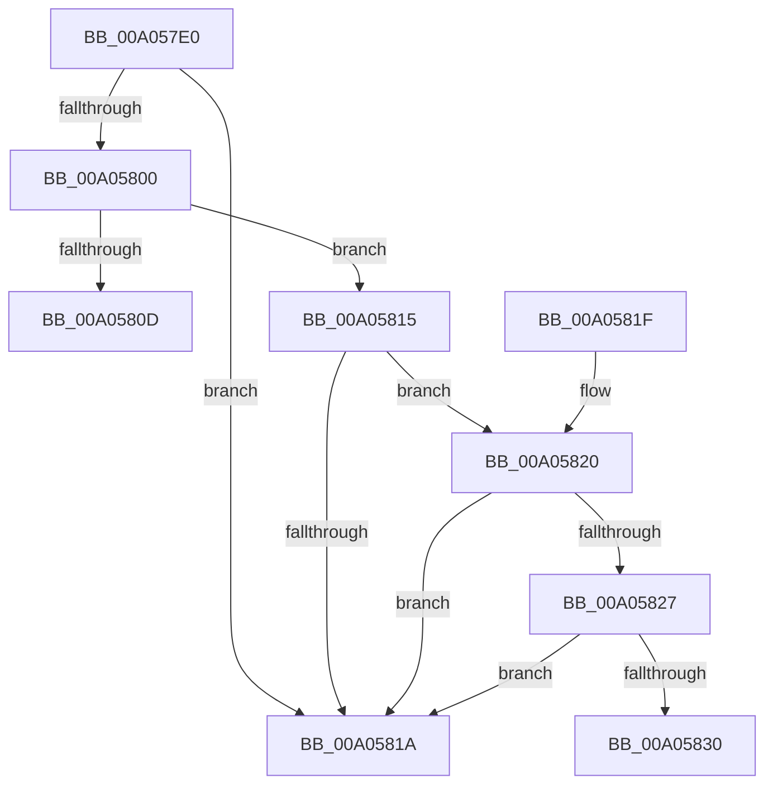

# PiCheckRemovalPreconditions

- RVA: `0x00A057E0`–`0x00A0583A` (길이 `90` bytes)
- VA: `0x0000000140A057E0`
- 실행 섹션: `PAGE`
- PDB 이름 있음: `예`; PDB Function 태그: `예`
- unwind 정보 RVA: `0x0009D63C`
- 디코드: `24`개 명령, `90/90` bytes 표시
- 미해석 바이트: `0` (있으면 어셈블리에 `.byte`로 보존)

> 이 문서는 커널 이미지의 기계어와 PDB 기호를 분석해 생성했습니다. 4번과 5번은 함수 원형과 자료형을 바이너리 사용 방식에서 추정한 C 해석이며 원본 소스 복구 결과는 아닙니다.

## 1. Dependencies

- 직접 호출 지점: **1**; 고유 호출 대상: **1**
- 직접 호출자로 확인된 함수: **1**
- RIP 상대 이미지 참조: **0**

### Outgoing calls
- `0x00A057ED` → [PiGetTargetDeviceNode](PiGetTargetDeviceNode_function_00A0506C.md) (function, `0x00A0506C`)

### Direct callers
- [PnpProcessQueryRemoveAndEject](PnpProcessQueryRemoveAndEject_function_00A05170.md) at `0x00A05427`

### Static image references
- 디코드된 RIP-relative 메모리 참조가 없습니다.

## 2. Other-region calls and transfers

- 다른 실행 섹션으로 향하는 call: **0**
- call이 아닌 외부 분기/꼬리 이동: **2**
  - `0x00A05810` → [sub_00B3445E](../B3/Unknown_function_00B3445E.md) (`tail-transfer`)
  - `0x00A05835` → [sub_00B3445E](../B3/Unknown_function_00B3445E.md) (`tail-transfer`)

## 3. Assembly (complete function range)

```asm
00A057E0  48 83 EC 28                     sub rsp, 0x28
00A057E4  44 8B D9                        mov r11d, ecx
00A057E7  4C 8B D2                        mov r10, rdx
00A057EA  48 8B CA                        mov rcx, rdx
00A057ED  E8 7A F8 FF FF                  call 0x140a0506c
00A057F2  4C 8B C8                        mov r9, rax
00A057F5  33 C0                           xor eax, eax
00A057F7  41 F7 C3 FB FF FF FF            test r11d, 0xfffffffb
00A057FE  75 1A                           jne 0x140a0581a
00A05800  41 F7 81 8C 01 00 00 00 10 00 00  test dword ptr [r9 + 0x18c], 0x1000
00A0580B  74 08                           je 0x140a05815
00A0580D  8D 50 01                        lea edx, [rax + 1]
00A05810  E9 49 EC 12 00                  jmp 0x140b3445e
00A05815  45 85 DB                        test r11d, r11d
00A05818  74 06                           je 0x140a05820
00A0581A  48 83 C4 28                     add rsp, 0x28
00A0581E  C3                              ret
00A0581F  CC                              int3
00A05820  41 83 7A 10 16                  cmp dword ptr [r10 + 0x10], 0x16
00A05825  75 F3                           jne 0x140a0581a
00A05827  41 39 81 58 02 00 00            cmp dword ptr [r9 + 0x258], eax
00A0582E  76 EA                           jbe 0x140a0581a
00A05830  BA 0A 00 00 00                  mov edx, 0xa
00A05835  E9 24 EC 12 00                  jmp 0x140b3445e
```

## 4. C-style interpretation (structured pseudocode)

```c
__int64 __fastcall PiCheckRemovalPreconditions(int a1, __int64 a2)
{
    __int64 result;
    __int64 v_rsp;

    v_rsp = (v_rsp) - (40);
    result = PiGetTargetDeviceNode(a2, a2, a3, a4);
    result = 0;
    if ((((unsigned int)((unsigned int)(a1))) & (0xFFFFFFFBULL)) != 0) goto loc_00A0581A;
    if (((*(unsigned int *)(result + 396)) & (0x1000ULL)) == 0) goto loc_00A05815;
loc_00A05815:
    if ((unsigned int)((unsigned int)(a1)) == 0) goto loc_00A05820;
loc_00A0581A:
    v_rsp = (v_rsp) + (40);
    return result;
loc_00A05820:
    if ((*(unsigned int *)(a2 + 16)) != 22) goto loc_00A0581A;
    if ((*(unsigned int *)(result + 600)) <= 0) goto loc_00A0581A;
}
```

## 5. (Beta) C Style

```c
int64_t PiCheckRemovalPreconditions(int32_t Arg1, int64_t Arg2)
{
    int64_t result;
    int64_t local_rsp;

    local_rsp = (local_rsp) - (40);
    result = PiGetTargetDeviceNode(Arg2, Arg2, a3, a4);
    result = 0;
    if ((((uint32_t)((uint32_t)(Arg1))) & (0xFFFFFFFBULL)) != 0) goto loc_00A0581A;
    if (((*(uint32_t *)(result + 0x18C)) & (0x1000ULL)) == 0) goto loc_00A05815;
loc_00A05815:
    if ((uint32_t)((uint32_t)(Arg1)) == 0) goto loc_00A05820;
loc_00A0581A:
    local_rsp = (local_rsp) + (40);
    return result;
loc_00A05820:
    if ((*(uint32_t *)(Arg2 + 0x10)) != 22) goto loc_00A0581A;
    if ((*(uint32_t *)(result + 0x258)) <= 0) goto loc_00A0581A;
}
```

## 6. Execution-region graph

[열기: 2D/3D 그래프와 함수 탐색 컨트롤 패널](../../../control-panel.html?section=page&rva=0x00A057E0&view=graph)

- 2D 그래프는 위에서 아래로 흐르고, 3D 그래프는 빈 공간을 드래그해 회전합니다. Shift+드래그는 이동, 휠은 확대·축소, 함수 노드 선택은 대상 보고서 이동입니다.

### Static fallback


