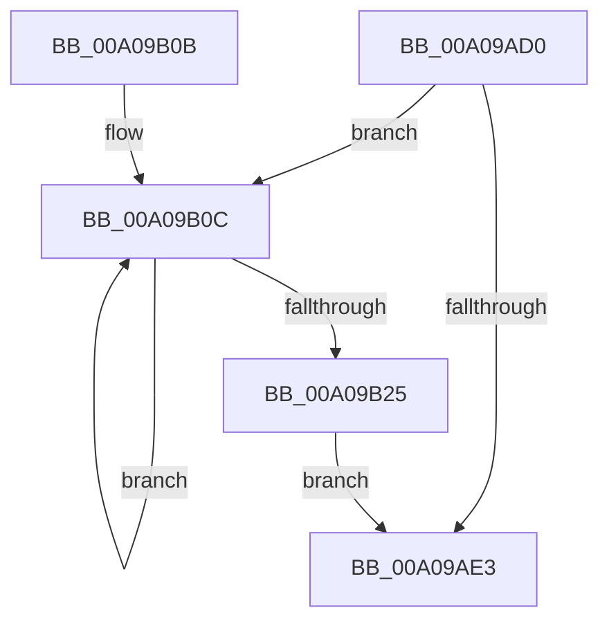

# PiClearDeviceObjectList

- RVA: `0x00A09AD0`–`0x00A09B27` (길이 `87` bytes)
- VA: `0x0000000140A09AD0`
- 실행 섹션: `PAGE`
- PDB 이름 있음: `예`; PDB Function 태그: `아니요`
- unwind 정보 RVA: `0x0007CED0`
- 디코드: `28`개 명령, `87/87` bytes 표시
- 미해석 바이트: `0` (있으면 어셈블리에 `.byte`로 보존)

> 이 문서는 커널 이미지의 기계어와 PDB 기호를 분석해 생성했습니다. 4번과 5번은 함수 원형과 자료형을 바이너리 사용 방식에서 추정한 C 해석이며 원본 소스 복구 결과는 아닙니다.

## 1. Dependencies

- 직접 호출 지점: **2**; 고유 호출 대상: **2**
- 직접 호출자로 확인된 함수: **2**
- RIP 상대 이미지 참조: **0**

### Outgoing calls
- `0x00A09AF4` → [memset](../../text/6C/memset_function_006C6C40.md) (function, `0x006C6C40`)
- `0x00A09B1A` → [ObfDereferenceObjectWithTag](../../text/2F/ObfDereferenceObjectWithTag_function_002F78E0.md) (function, `0x002F78E0`)

### Direct callers
- [PiAllocateDeviceObjectList](PiAllocateDeviceObjectList_function_00A078B4.md) at `0x00A07914`
- [PipFreeDeviceObjectList](PipFreeDeviceObjectList_function_00A08348.md) at `0x00A08351`

### Static image references
- 디코드된 RIP-relative 메모리 참조가 없습니다.

## 2. Other-region calls and transfers

- 다른 실행 섹션으로 향하는 call: **2**
  - `0x00A09AF4` → [memset](../../text/6C/memset_function_006C6C40.md) (`PAGE` → `.text`)
  - `0x00A09B1A` → [ObfDereferenceObjectWithTag](../../text/2F/ObfDereferenceObjectWithTag_function_002F78E0.md) (`PAGE` → `.text`)
- 별도 외부 분기/꼬리 이동을 확인하지 못했습니다.

## 3. Assembly (complete function range)

```asm
00A09AD0  48 89 5C 24 08                  mov qword ptr [rsp + 8], rbx
00A09AD5  57                              push rdi
00A09AD6  48 83 EC 20                     sub rsp, 0x20
00A09ADA  33 FF                           xor edi, edi
00A09ADC  48 8B D9                        mov rbx, rcx
00A09ADF  39 39                           cmp dword ptr [rcx], edi
00A09AE1  77 29                           ja 0x140a09b0c
00A09AE3  8B 43 04                        mov eax, dword ptr [rbx + 4]
00A09AE6  48 8D 4B 10                     lea rcx, [rbx + 0x10]
00A09AEA  33 D2                           xor edx, edx
00A09AEC  4C 8D 04 40                     lea r8, [rax + rax*2]
00A09AF0  49 C1 E0 03                     shl r8, 3
00A09AF4  E8 47 D1 CB FF                  call 0x1406c6c40
00A09AF9  83 23 00                        and dword ptr [rbx], 0
00A09AFC  83 63 08 00                     and dword ptr [rbx + 8], 0
00A09B00  48 8B 5C 24 30                  mov rbx, qword ptr [rsp + 0x30]
00A09B05  48 83 C4 20                     add rsp, 0x20
00A09B09  5F                              pop rdi
00A09B0A  C3                              ret
00A09B0B  CC                              int3
00A09B0C  48 8D 0C 7F                     lea rcx, [rdi + rdi*2]
00A09B10  BA 50 6E 70 4C                  mov edx, 0x4c706e50
00A09B15  48 8B 4C CB 10                  mov rcx, qword ptr [rbx + rcx*8 + 0x10]
00A09B1A  E8 C1 DD 8E FF                  call 0x1402f78e0
00A09B1F  FF C7                           inc edi
00A09B21  3B 3B                           cmp edi, dword ptr [rbx]
00A09B23  72 E7                           jb 0x140a09b0c
00A09B25  EB BC                           jmp 0x140a09ae3
```

## 4. C-style interpretation (structured pseudocode)

```c
__int64 __fastcall PiClearDeviceObjectList(__int64 a1, int a2)
{
    __int64 result;
    __int64 v_rdi;
    __int64 v_rsp;
    unsigned __int64 v_stack_p8;

    v_stack_p8 = v_rbx;
    v_rsp = (v_rsp) - (32);
    v_rdi = 0;
    if ((*(unsigned int *)(a1)) > 0) goto loc_00A09B0C;
loc_00A09AE3:
    a2 = 0;
    a3 = ((unsigned int)(*(unsigned int *)(a1 + 4)) + (unsigned int)(*(unsigned int *)(a1 + 4)) * 2) << (3);
    result = memset(a1 + 16, a2, a3, a4);
    v_rsp = (v_rsp) + (32);
    return result;
loc_00A09B0C:
    result = ObfDereferenceObjectWithTag(*(unsigned __int64 *)(v_stack_p8 + v_rdi + v_rdi * 2 * 8 + 16), (unsigned int)(0x4C706E50ULL), a3, a4);
    v_rdi = (unsigned int)((v_rdi) + 1);
    if (((unsigned int)(v_rdi)) < (*(unsigned int *)(v_stack_p8))) goto loc_00A09B0C;
    goto loc_00A09AE3;
}
```

## 5. (Beta) C Style

```c
int64_t PiClearDeviceObjectList(void *Arg1, int32_t Arg2)
{
    uint8_t *arg1 = (uint8_t *)Arg1;

    int64_t result;
    int64_t local_rdi;
    int64_t local_rsp;
    uint64_t v_stack_p8;

    v_stack_p8 = local_rbx;
    local_rsp = (local_rsp) - (32);
    local_rdi = 0;
    if ((*(uint32_t *)(arg1)) > 0) goto loc_00A09B0C;
loc_00A09AE3:
    Arg2 = 0;
    a3 = ((uint32_t)(*(uint32_t *)(arg1 + 0x4)) + (uint32_t)(*(uint32_t *)(arg1 + 0x4)) * 2) << (3);
    result = memset(Arg1 + 16, Arg2, a3, a4);
    local_rsp = (local_rsp) + (32);
    return result;
loc_00A09B0C:
    result = ObfDereferenceObjectWithTag(*(uint64_t *)(v_stack_p8 + local_rdi + local_rdi * 2 * 8 + 0x10), (uint32_t)(0x4C706E50ULL), a3, a4);
    local_rdi = (uint32_t)((local_rdi) + 1);
    if (((uint32_t)(local_rdi)) < (*(uint32_t *)(v_stack_p8))) goto loc_00A09B0C;
    goto loc_00A09AE3;
}
```

### 관측된 메모리 오프셋

구조체 형식이 확인되지 않은 접근은 인자 기준의 오프셋으로만 기록했습니다.

| 기준 인자 | 오프셋 표현 | 폭 (bit) | 접근 |
|---|---:|---:|---|
| `Arg1` | `+ 0x0` | `32` | `R` |
| `Arg1` | `+ 0x0` | `32` | `R/W` |
| `Arg1` | `+ 0x4` | `32` | `R` |
| `Arg1` | `+ 0x8` | `32` | `R/W` |
| `Arg1` | `+ 0x10` | `64` | `R` |
| `Arg1` | `+ 0x10 + rcx*8` | `64` | `R` |

## 6. Execution-region graph

[열기: 2D/3D 그래프와 함수 탐색 컨트롤 패널](../../../control-panel.html?section=page&rva=0x00A09AD0&view=graph)

- 2D 그래프는 위에서 아래로 흐르고, 3D 그래프는 빈 공간을 드래그해 회전합니다. Shift+드래그는 이동, 휠은 확대·축소, 함수 노드 선택은 대상 보고서 이동입니다.

### Static fallback


