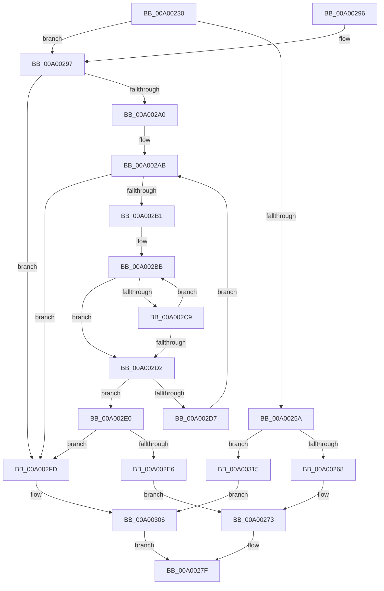

# PiDaDispatch

- RVA: `0x00A00230`–`0x00A0031F` (길이 `239` bytes)
- VA: `0x0000000140A00230`
- 실행 섹션: `PAGE`
- PDB 이름 있음: `예`; PDB Function 태그: `아니요`
- unwind 정보 RVA: `0x000A7D4C`
- 디코드: `67`개 명령, `239/239` bytes 표시
- 미해석 바이트: `0` (있으면 어셈블리에 `.byte`로 보존)

> 이 문서는 커널 이미지의 기계어와 PDB 기호를 분석해 생성했습니다. 4번과 5번은 함수 원형과 자료형을 바이너리 사용 방식에서 추정한 C 해석이며 원본 소스 복구 결과는 아닙니다.

## 1. Dependencies

- 직접 호출 지점: **2**; 고유 호출 대상: **2**
- 직접 호출자로 확인된 함수: **2**
- RIP 상대 이미지 참조: **1**

### Outgoing calls
- `0x00A00278` → [guard_dispatch_icall](../../text/6B/guard_dispatch_icall_function_006BAAD0.md) (function, `0x006BAAD0`)
- `0x00A0030B` → [IofCompleteRequest](../../text/29/IofCompleteRequest_function_0029B5C0.md) (function, `0x0029B5C0`)

### Direct callers
- [IofCallDriver](../../text/29/IofCallDriver_function_0029B4B0.md) at `0x0029B516`
- [IopfCallDriver](../../text/29/IopfCallDriver_function_0029C474.md) at `0x0029C4C7`

### Static image references
- `0x00A0026C` → RVA `0x00001990` (`.rdata`; read)

## 2. Other-region calls and transfers

- 다른 실행 섹션으로 향하는 call: **2**
  - `0x00A00278` → [guard_dispatch_icall](../../text/6B/guard_dispatch_icall_function_006BAAD0.md) (`PAGE` → `.text`)
  - `0x00A0030B` → [IofCompleteRequest](../../text/29/IofCompleteRequest_function_0029B5C0.md) (`PAGE` → `.text`)
- 별도 외부 분기/꼬리 이동을 확인하지 못했습니다.

## 3. Assembly (complete function range)

```asm
00A00230  48 89 5C 24 08                  mov qword ptr [rsp + 8], rbx
00A00235  48 89 6C 24 10                  mov qword ptr [rsp + 0x10], rbp
00A0023A  48 89 74 24 18                  mov qword ptr [rsp + 0x18], rsi
00A0023F  57                              push rdi
00A00240  48 83 EC 20                     sub rsp, 0x20
00A00244  48 8B 9A B8 00 00 00            mov rbx, qword ptr [rdx + 0xb8]
00A0024B  4C 8B C2                        mov r8, rdx
00A0024E  48 8B E9                        mov rbp, rcx
00A00251  80 3B 00                        cmp byte ptr [rbx], 0
00A00254  48 8B 43 30                     mov rax, qword ptr [rbx + 0x30]
00A00258  74 3D                           je 0x140a00297
00A0025A  48 8B 40 18                     mov rax, qword ptr [rax + 0x18]
00A0025E  48 83 F8 05                     cmp rax, 5
00A00262  0F 83 AD 00 00 00               jae 0x140a00315
00A00268  48 8D 04 40                     lea rax, [rax + rax*2]
00A0026C  48 8D 35 1D 17 60 FF            lea rsi, [rip - 0x9fe8e3]
00A00273  48 8B 44 C6 08                  mov rax, qword ptr [rsi + rax*8 + 8]
00A00278  E8 53 A8 CB FF                  call 0x1406baad0
00A0027D  8B D8                           mov ebx, eax
00A0027F  48 8B 6C 24 38                  mov rbp, qword ptr [rsp + 0x38]
00A00284  8B C3                           mov eax, ebx
00A00286  48 8B 5C 24 30                  mov rbx, qword ptr [rsp + 0x30]
00A0028B  48 8B 74 24 40                  mov rsi, qword ptr [rsp + 0x40]
00A00290  48 83 C4 20                     add rsp, 0x20
00A00294  5F                              pop rdi
00A00295  C3                              ret
00A00296  CC                              int3
00A00297  48 8B 78 60                     mov rdi, qword ptr [rax + 0x60]
00A0029B  48 85 FF                        test rdi, rdi
00A0029E  74 5D                           je 0x140a002fd
00A002A0  33 D2                           xor edx, edx
00A002A2  48 8D 35 E7 16 60 FF            lea rsi, [rip - 0x9fe919]
00A002A9  33 C0                           xor eax, eax
00A002AB  48 83 F8 78                     cmp rax, 0x78
00A002AF  73 4C                           jae 0x140a002fd
00A002B1  48 8B 0C 30                     mov rcx, qword ptr [rax + rsi]
00A002B5  4C 8B DF                        mov r11, rdi
00A002B8  4C 2B D9                        sub r11, rcx
00A002BB  44 0F B7 09                     movzx r9d, word ptr [rcx]
00A002BF  46 0F B7 14 19                  movzx r10d, word ptr [rcx + r11]
00A002C4  45 2B CA                        sub r9d, r10d
00A002C7  75 09                           jne 0x140a002d2
00A002C9  48 83 C1 02                     add rcx, 2
00A002CD  45 85 D2                        test r10d, r10d
00A002D0  75 E9                           jne 0x140a002bb
00A002D2  45 85 C9                        test r9d, r9d
00A002D5  74 09                           je 0x140a002e0
00A002D7  48 FF C2                        inc rdx
00A002DA  48 83 C0 18                     add rax, 0x18
00A002DE  EB CB                           jmp 0x140a002ab
00A002E0  48 83 FA FF                     cmp rdx, -1
00A002E4  74 17                           je 0x140a002fd
00A002E6  48 8B 43 30                     mov rax, qword ptr [rbx + 0x30]
00A002EA  48 8B CD                        mov rcx, rbp
00A002ED  48 89 50 18                     mov qword ptr [rax + 0x18], rdx
00A002F1  48 8D 04 52                     lea rax, [rdx + rdx*2]
00A002F5  49 8B D0                        mov rdx, r8
00A002F8  E9 76 FF FF FF                  jmp 0x140a00273
00A002FD  BB 0D 00 00 C0                  mov ebx, 0xc000000d
00A00302  41 89 58 30                     mov dword ptr [r8 + 0x30], ebx
00A00306  33 D2                           xor edx, edx
00A00308  49 8B C8                        mov rcx, r8
00A0030B  E8 B0 B2 89 FF                  call 0x14029b5c0
00A00310  E9 6A FF FF FF                  jmp 0x140a0027f
00A00315  BB 10 00 00 C0                  mov ebx, 0xc0000010
00A0031A  89 5A 30                        mov dword ptr [rdx + 0x30], ebx
00A0031D  EB E7                           jmp 0x140a00306
```

## 4. C-style interpretation (structured pseudocode)

```c
__int64 __fastcall PiDaDispatch(__int64 a1, __int64 a2)
{
    __int64 result;
    __int64 v_r11;
    __int64 v_rsp;
    unsigned __int64 v_stack_p10;
    unsigned __int64 v_stack_p18;
    unsigned __int64 v_stack_p8;

    v_stack_p8 = v_rbx;
    v_stack_p10 = v_rbp;
    v_stack_p18 = v_rsi;
    v_rsp = (v_rsp) - (32);
    if ((*(unsigned __int8 *)(*(unsigned __int64 *)(a2 + 184))) == 0) goto loc_00A00297;
    if ((*(unsigned __int64 *)(*(unsigned __int64 *)(*(unsigned __int64 *)(a2 + 184) + 48) + 24)) >= 5) goto loc_00A00315;
loc_00A00273:
    result = guard_dispatch_icall(a1, a2, a2, a4);
loc_00A0027F:
    v_rsp = (v_rsp) + (32);
    return (unsigned int)((unsigned int)((unsigned int)((unsigned int)(result))));
loc_00A00297:
    if (*(unsigned __int64 *)((unsigned int)((unsigned int)((unsigned int)((unsigned int)(result)))) + 96) == 0) goto loc_00A002FD;
    a2 = 0;
    result = 0;
loc_00A002AB:
    if (0 >= 120) goto loc_00A002FD;
    v_r11 = (*(unsigned __int64 *)((unsigned int)((unsigned int)((unsigned int)((unsigned int)(result)))) + 96)) - (*(unsigned __int64 *)(result + v_rip - 10479897 * 1));
loc_00A002BB:
    a4 = (unsigned int)((*(unsigned __int16 *)(*(unsigned __int64 *)(result + v_rip - 10479897 * 1))) - ((unsigned int)(*(unsigned __int16 *)(*(unsigned __int64 *)(result + v_rip - 10479897 * 1) + v_r11 * 1))));
    if (condition_is_not_equal) goto loc_00A002D2;
    a1 = (*(unsigned __int64 *)(result + v_rip - 10479897 * 1)) + (2);
    if ((unsigned int)(*(unsigned __int16 *)(*(unsigned __int64 *)(result + v_rip - 10479897 * 1) + v_r11 * 1)) != 0) goto loc_00A002BB;
loc_00A002D2:
    if ((unsigned int)(a4) == 0) goto loc_00A002E0;
    a2 = (a2) + 1;
    result = (result) + (24);
    goto loc_00A002AB;
loc_00A002E0:
    if (a2 == -1) goto loc_00A002FD;
    *(unsigned __int64 *)(*(unsigned __int64 *)(v_stack_p8 + 48) + 24) = a2;
    goto loc_00A00273;
loc_00A002FD:
    *(unsigned int *)(a2 + 48) = (unsigned int)((unsigned int)(0xC000000DULL));
loc_00A00306:
    a2 = 0;
    result = IofCompleteRequest(0, a2, a2, a4);
    goto loc_00A0027F;
loc_00A00315:
    *(unsigned int *)(a2 + 48) = (unsigned int)((unsigned int)(0xC0000010ULL));
    goto loc_00A00306;
}
```

## 5. (Beta) C Style

```c
int64_t PiDaDispatch(int64_t Arg1, void *Arg2)
{
    uint8_t *arg2 = (uint8_t *)Arg2;

    int64_t result;
    int64_t local_r11;
    int64_t local_rsp;
    uint64_t v_stack_p10;
    uint64_t v_stack_p18;
    uint64_t v_stack_p8;

    v_stack_p8 = local_rbx;
    v_stack_p10 = local_rbp;
    v_stack_p18 = local_rsi;
    local_rsp = (local_rsp) - (32);
    if ((*(uint8_t *)(*(uint64_t *)(arg2 + 0xB8))) == 0) goto loc_00A00297;
    if ((*(uint64_t *)(*(uint64_t *)(*(uint64_t *)(arg2 + 0xB8) + 0x30) + 0x18)) >= 5) goto loc_00A00315;
loc_00A00273:
    result = guard_dispatch_icall(Arg1, Arg2, Arg2, a4);
loc_00A0027F:
    local_rsp = (local_rsp) + (32);
    return (uint32_t)((uint32_t)((uint32_t)((uint32_t)(result))));
loc_00A00297:
    if (*(uint64_t *)((uint32_t)((uint32_t)((uint32_t)((uint32_t)(result)))) + 0x60) == 0) goto loc_00A002FD;
    Arg2 = 0;
    result = 0;
loc_00A002AB:
    if (0 >= 120) goto loc_00A002FD;
    local_r11 = (*(uint64_t *)((uint32_t)((uint32_t)((uint32_t)((uint32_t)(result)))) + 0x60)) - (*(uint64_t *)(result + v_rip - 0x9FE919 * 1));
loc_00A002BB:
    a4 = (uint32_t)((*(uint16_t *)(*(uint64_t *)(result + v_rip - 0x9FE919 * 1))) - ((uint32_t)(*(uint16_t *)(*(uint64_t *)(result + v_rip - 0x9FE919 * 1) + local_r11 * 1))));
    if (condition_is_not_equal) goto loc_00A002D2;
    Arg1 = (*(uint64_t *)(result + v_rip - 0x9FE919 * 1)) + (2);
    if ((uint32_t)(*(uint16_t *)(*(uint64_t *)(result + v_rip - 0x9FE919 * 1) + local_r11 * 1)) != 0) goto loc_00A002BB;
loc_00A002D2:
    if ((uint32_t)(a4) == 0) goto loc_00A002E0;
    Arg2 = (Arg2) + 1;
    result = (result) + (24);
    goto loc_00A002AB;
loc_00A002E0:
    if (Arg2 == -1) goto loc_00A002FD;
    *(void **)(*(uint64_t *)(v_stack_p8 + 0x30) + 0x18) = Arg2;
    goto loc_00A00273;
loc_00A002FD:
    *(uint32_t *)(arg2 + 0x30) = (uint32_t)((uint32_t)(0xC000000DULL));
loc_00A00306:
    Arg2 = 0;
    result = IofCompleteRequest(0, Arg2, Arg2, a4);
    goto loc_00A0027F;
loc_00A00315:
    *(uint32_t *)(arg2 + 0x30) = (uint32_t)((uint32_t)(0xC0000010ULL));
    goto loc_00A00306;
}
```

### 관측된 메모리 오프셋

구조체 형식이 확인되지 않은 접근은 인자 기준의 오프셋으로만 기록했습니다.

| 기준 인자 | 오프셋 표현 | 폭 (bit) | 접근 |
|---|---:|---:|---|
| `Arg2` | `+ 0x30` | `32` | `W` |
| `Arg2` | `+ 0xB8` | `64` | `R` |

## 6. Execution-region graph

[열기: 2D/3D 그래프와 함수 탐색 컨트롤 패널](../../../control-panel.html?section=page&rva=0x00A00230&view=graph)

- 2D 그래프는 위에서 아래로 흐르고, 3D 그래프는 빈 공간을 드래그해 회전합니다. Shift+드래그는 이동, 휠은 확대·축소, 함수 노드 선택은 대상 보고서 이동입니다.

### Static fallback


