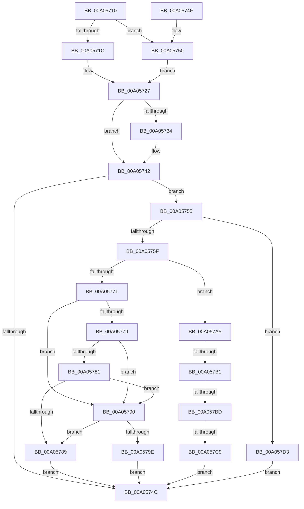

# PiDetermineDeleteType

- RVA: `0x00A05710`–`0x00A057DA` (길이 `202` bytes)
- VA: `0x0000000140A05710`
- 실행 섹션: `PAGE`
- PDB 이름 있음: `예`; PDB Function 태그: `예`
- unwind 정보 RVA: `0x000DB714`
- 디코드: `49`개 명령, `202/202` bytes 표시
- 미해석 바이트: `0` (있으면 어셈블리에 `.byte`로 보존)

> 이 문서는 커널 이미지의 기계어와 PDB 기호를 분석해 생성했습니다. 4번과 5번은 함수 원형과 자료형을 바이너리 사용 방식에서 추정한 C 해석이며 원본 소스 복구 결과는 아닙니다.

## 1. Dependencies

- 직접 호출 지점: **0**; 고유 호출 대상: **0**
- 직접 호출자로 확인된 함수: **1**
- RIP 상대 이미지 참조: **2**

### Outgoing calls
- 직접 디코드된 call 명령이 없습니다.

### Direct callers
- [PnpProcessQueryRemoveAndEject](PnpProcessQueryRemoveAndEject_function_00A05170.md) at `0x00A05412`

### Static image references
- `0x00A0572B` → RVA `0x00014D48` (`.rdata`; read)
- `0x00A0573B` → RVA `0x00014D50` (`.rdata`; read)

## 2. Other-region calls and transfers

- 다른 실행 섹션으로 향하는 call: **0**
- call이 아닌 외부 분기/꼬리 이동: **3**
  - `0x00A057AB` → `0x00B34454` (`tail-transfer`)
  - `0x00A057B7` → `0x00B34454` (`tail-transfer`)
  - `0x00A057C3` → `0x00B34454` (`tail-transfer`)

## 3. Assembly (complete function range)

```asm
00A05710  4C 8B 89 A0 00 00 00            mov r9, qword ptr [rcx + 0xa0]
00A05717  4D 85 C9                        test r9, r9
00A0571A  74 34                           je 0x140a05750
00A0571C  49 8B 81 38 01 00 00            mov rax, qword ptr [r9 + 0x138]
00A05723  4C 8B 40 28                     mov r8, qword ptr [rax + 0x28]
00A05727  48 8B 41 78                     mov rax, qword ptr [rcx + 0x78]
00A0572B  48 2B 05 16 F6 60 FF            sub rax, qword ptr [rip - 0x9f09ea]
00A05732  75 0E                           jne 0x140a05742
00A05734  48 8B 81 80 00 00 00            mov rax, qword ptr [rcx + 0x80]
00A0573B  48 2B 05 0E F6 60 FF            sub rax, qword ptr [rip - 0x9f09f2]
00A05742  BA 04 00 00 00                  mov edx, 4
00A05747  48 85 C0                        test rax, rax
00A0574A  75 09                           jne 0x140a05755
00A0574C  8B C2                           mov eax, edx
00A0574E  C3                              ret
00A0574F  CC                              int3
00A05750  45 33 C0                        xor r8d, r8d
00A05753  EB D2                           jmp 0x140a05727
00A05755  8B 81 98 00 00 00               mov eax, dword ptr [rcx + 0x98]
00A0575B  84 C2                           test dl, al
00A0575D  74 74                           je 0x140a057d3
00A0575F  41 8B 80 8C 01 00 00            mov eax, dword ptr [r8 + 0x18c]
00A05766  41 8B 88 30 01 00 00            mov ecx, dword ptr [r8 + 0x130]
00A0576D  A8 10                           test al, 0x10
00A0576F  75 34                           jne 0x140a057a5
00A05771  81 F9 0B 03 00 00               cmp ecx, 0x30b
00A05777  74 17                           je 0x140a05790
00A05779  81 F9 08 03 00 00               cmp ecx, 0x308
00A0577F  7E 0F                           jle 0x140a05790
00A05781  81 F9 0E 03 00 00               cmp ecx, 0x30e
00A05787  7D 07                           jge 0x140a05790
00A05789  BA 03 00 00 00                  mov edx, 3
00A0578E  EB BC                           jmp 0x140a0574c
00A05790  49 8B 81 38 01 00 00            mov rax, qword ptr [r9 + 0x138]
00A05797  8B 48 20                        mov ecx, dword ptr [rax + 0x20]
00A0579A  84 CA                           test dl, cl
00A0579C  75 EB                           jne 0x140a05789
00A0579E  BA 02 00 00 00                  mov edx, 2
00A057A3  EB A7                           jmp 0x140a0574c
00A057A5  81 F9 0B 03 00 00               cmp ecx, 0x30b
00A057AB  0F 84 A3 EC 12 00               je 0x140b34454
00A057B1  81 F9 08 03 00 00               cmp ecx, 0x308
00A057B7  0F 8E 97 EC 12 00               jle 0x140b34454
00A057BD  81 F9 0E 03 00 00               cmp ecx, 0x30e
00A057C3  0F 8D 8B EC 12 00               jge 0x140b34454
00A057C9  BA 05 00 00 00                  mov edx, 5
00A057CE  E9 79 FF FF FF                  jmp 0x140a0574c
00A057D3  33 D2                           xor edx, edx
00A057D5  E9 72 FF FF FF                  jmp 0x140a0574c
```

## 4. C-style interpretation (structured pseudocode)

```c
__int64 __fastcall PiDetermineDeleteType(__int64 a1)
{
    __int64 result;

    if (*(unsigned __int64 *)(a1 + 160) == 0) goto loc_00A05750;
loc_00A05727:
    result = (*(unsigned __int64 *)(a1 + 120)) - (*(unsigned __int64 *)(v_rip - 10422762));
    if (!(condition_is_not_equal)) {
        result = *(unsigned __int64 *)(a1 + 128);
        result = (result) - (*(unsigned __int64 *)(v_rip - 10422770));
    }
    if (result != 0) goto loc_00A05755;
loc_00A0574C:
    return 4;
loc_00A05750:
    a3 = 0;
    goto loc_00A05727;
loc_00A05755:
    if (((4) & ((unsigned __int8)((unsigned int)(*(unsigned int *)(a1 + 152))))) == 0) goto loc_00A057D3;
    if ((((unsigned __int8)((unsigned int)(*(unsigned int *)(a3 + 396)))) & (16)) != 0) goto loc_00A057A5;
    if (((unsigned int)((unsigned int)(*(unsigned int *)(a3 + 304)))) == 779) goto loc_00A05790;
    if (((unsigned int)((unsigned int)(*(unsigned int *)(a3 + 304)))) <= 776) goto loc_00A05790;
    if (((unsigned int)((unsigned int)(*(unsigned int *)(a3 + 304)))) >= 782) goto loc_00A05790;
loc_00A05789:
    goto loc_00A0574C;
loc_00A05790:
    if (((3) & ((unsigned __int8)((unsigned int)(*(unsigned int *)(*(unsigned __int64 *)(*(unsigned __int64 *)(a1 + 160) + 312) + 32))))) != 0) goto loc_00A05789;
    goto loc_00A0574C;
loc_00A057A5:
    goto loc_00A0574C;
loc_00A057D3:
    a2 = 0;
    goto loc_00A0574C;
}
```

## 5. (Beta) C Style

```c
int64_t PiDetermineDeleteType(void *Arg1)
{
    uint8_t *arg1 = (uint8_t *)Arg1;

    int64_t result;

    if (*(uint64_t *)(arg1 + 0xA0) == 0) goto loc_00A05750;
loc_00A05727:
    result = (*(uint64_t *)(arg1 + 0x78)) - (*(uint64_t *)(v_rip - 0x9F09EA));
    if (!(condition_is_not_equal)) {
        result = *(uint64_t *)(arg1 + 0x80);
        result = (result) - (*(uint64_t *)(v_rip - 0x9F09F2));
    }
    if (result != 0) goto loc_00A05755;
loc_00A0574C:
    return 4;
loc_00A05750:
    a3 = 0;
    goto loc_00A05727;
loc_00A05755:
    if (((4) & ((uint8_t)((uint32_t)(*(uint32_t *)(arg1 + 0x98))))) == 0) goto loc_00A057D3;
    if ((((uint8_t)((uint32_t)(*(uint32_t *)(a3 + 0x18C)))) & (16)) != 0) goto loc_00A057A5;
    if (((uint32_t)((uint32_t)(*(uint32_t *)(a3 + 0x130)))) == 779) goto loc_00A05790;
    if (((uint32_t)((uint32_t)(*(uint32_t *)(a3 + 0x130)))) <= 776) goto loc_00A05790;
    if (((uint32_t)((uint32_t)(*(uint32_t *)(a3 + 0x130)))) >= 782) goto loc_00A05790;
loc_00A05789:
    goto loc_00A0574C;
loc_00A05790:
    if (((3) & ((uint8_t)((uint32_t)(*(uint32_t *)(*(uint64_t *)(*(uint64_t *)(arg1 + 0xA0) + 0x138) + 0x20))))) != 0) goto loc_00A05789;
    goto loc_00A0574C;
loc_00A057A5:
    goto loc_00A0574C;
loc_00A057D3:
    a2 = 0;
    goto loc_00A0574C;
}
```

### 관측된 메모리 오프셋

구조체 형식이 확인되지 않은 접근은 인자 기준의 오프셋으로만 기록했습니다.

| 기준 인자 | 오프셋 표현 | 폭 (bit) | 접근 |
|---|---:|---:|---|
| `Arg1` | `+ 0x78` | `64` | `R` |
| `Arg1` | `+ 0x80` | `64` | `R` |
| `Arg1` | `+ 0x98` | `32` | `R` |
| `Arg1` | `+ 0xA0` | `64` | `R` |

## 6. Execution-region graph

[열기: 2D/3D 그래프와 함수 탐색 컨트롤 패널](../../../control-panel.html?section=page&rva=0x00A05710&view=graph)

- 2D 그래프는 위에서 아래로 흐르고, 3D 그래프는 빈 공간을 드래그해 회전합니다. Shift+드래그는 이동, 휠은 확대·축소, 함수 노드 선택은 대상 보고서 이동입니다.

### Static fallback


