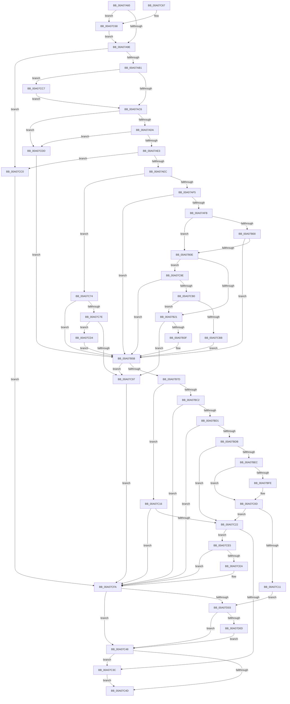

# PiDeviceRegistration

- RVA: `0x00A07A60`–`0x00A07D24` (길이 `708` bytes)
- VA: `0x0000000140A07A60`
- 실행 섹션: `PAGE`
- PDB 이름 있음: `예`; PDB Function 태그: `아니요`
- unwind 정보 RVA: `0x000A8674`
- 디코드: `188`개 명령, `708/708` bytes 표시
- 미해석 바이트: `0` (있으면 어셈블리에 `.byte`로 보존)

> 이 문서는 커널 이미지의 기계어와 PDB 기호를 분석해 생성했습니다. 4번과 5번은 함수 원형과 자료형을 바이너리 사용 방식에서 추정한 C 해석이며 원본 소스 복구 결과는 아닙니다.

## 1. Dependencies

- 직접 호출 지점: **13**; 고유 호출 대상: **9**
- 직접 호출자로 확인된 함수: **2**
- RIP 상대 이미지 참조: **1**

### Outgoing calls
- `0x00A07B2E` → [ExAllocatePool2](../../poolcode/B8/ExAllocatePool2_function_00B820F0.md) (function, `0x00B820F0`)
- `0x00A07B4A` → [memcpy](../../text/6C/memcpy_function_006C6840.md) (function, `0x006C6840`)
- `0x00A07B6C` → [ExAllocatePool2](../../poolcode/B8/ExAllocatePool2_function_00B820F0.md) (function, `0x00B820F0`)
- `0x00A07BAC` → [CmGetDeviceRegProp](../8E/CmGetDeviceRegProp_function_008ED870.md) (function, `0x008ED870`)
- `0x00A07BB9` → [PnpUnicodeStringToWstrFree](../8F/PnpUnicodeStringToWstrFree_function_008F59F0.md) (function, `0x008F59F0`)
- `0x00A07BE2` → [RtlInitUnicodeStringEx](../../text/46/RtlInitUnicodeStringEx_function_00463960.md) (function, `0x00463960`)
- `0x00A07BF3` → [IopAllocateUnicodeString](../95/IopAllocateUnicodeString_function_00951F0C.md) (function, `0x00951F0C`)
- `0x00A07C05` → [RtlCopyUnicodeString](../../text/3F/RtlCopyUnicodeString_function_003FEF30.md) (function, `0x003FEF30`)
- `0x00A07C2D` → [PpForEachDeviceInstanceDriver](PpForEachDeviceInstanceDriver_function_00A07D2C.md) (function, `0x00A07D2C`)
- `0x00A07C41` → [ExFreePoolWithTag](../../poolcode/B8/ExFreePoolWithTag_function_00B82870.md) (function, `0x00B82870`)
- `0x00A07C8A` → [ExAllocatePool2](../../poolcode/B8/ExAllocatePool2_function_00B820F0.md) (function, `0x00B820F0`)
- `0x00A07CF5` → [PpForEachDeviceInstanceDriver](PpForEachDeviceInstanceDriver_function_00A07D2C.md) (function, `0x00A07D2C`)
- `0x00A07D13` → [ExFreePoolWithTag](../../poolcode/B8/ExFreePoolWithTag_function_00B82870.md) (function, `0x00B82870`)

### Direct callers
- [PnpCleanupDeviceRegistryValues](PnpCleanupDeviceRegistryValues_function_00A0797C.md) at `0x00A079C1`
- [PpDeviceRegistration](PpDeviceRegistration_function_00A079D4.md) at `0x00A07A02`

### Static image references
- `0x00A07B7D` → RVA `0x00E66398` (`.data`; read)

## 2. Other-region calls and transfers

- 다른 실행 섹션으로 향하는 call: **8**
  - `0x00A07B2E` → [ExAllocatePool2](../../poolcode/B8/ExAllocatePool2_function_00B820F0.md) (`PAGE` → `POOLCODE`)
  - `0x00A07B4A` → [memcpy](../../text/6C/memcpy_function_006C6840.md) (`PAGE` → `.text`)
  - `0x00A07B6C` → [ExAllocatePool2](../../poolcode/B8/ExAllocatePool2_function_00B820F0.md) (`PAGE` → `POOLCODE`)
  - `0x00A07BE2` → [RtlInitUnicodeStringEx](../../text/46/RtlInitUnicodeStringEx_function_00463960.md) (`PAGE` → `.text`)
  - `0x00A07C05` → [RtlCopyUnicodeString](../../text/3F/RtlCopyUnicodeString_function_003FEF30.md) (`PAGE` → `.text`)
  - `0x00A07C41` → [ExFreePoolWithTag](../../poolcode/B8/ExFreePoolWithTag_function_00B82870.md) (`PAGE` → `POOLCODE`)
  - `0x00A07C8A` → [ExAllocatePool2](../../poolcode/B8/ExAllocatePool2_function_00B820F0.md) (`PAGE` → `POOLCODE`)
  - `0x00A07D13` → [ExFreePoolWithTag](../../poolcode/B8/ExFreePoolWithTag_function_00B82870.md) (`PAGE` → `POOLCODE`)
- 별도 외부 분기/꼬리 이동을 확인하지 못했습니다.

## 3. Assembly (complete function range)

```asm
00A07A60  48 89 5C 24 10                  mov qword ptr [rsp + 0x10], rbx
00A07A65  55                              push rbp
00A07A66  56                              push rsi
00A07A67  57                              push rdi
00A07A68  41 54                           push r12
00A07A6A  41 55                           push r13
00A07A6C  41 56                           push r14
00A07A6E  41 57                           push r15
00A07A70  48 8B EC                        mov rbp, rsp
00A07A73  48 83 EC 50                     sub rsp, 0x50
00A07A77  45 33 ED                        xor r13d, r13d
00A07A7A  0F 57 C0                        xorps xmm0, xmm0
00A07A7D  44 89 6D 58                     mov dword ptr [rbp + 0x58], r13d
00A07A81  49 8B F0                        mov rsi, r8
00A07A84  44 89 6D 50                     mov dword ptr [rbp + 0x50], r13d
00A07A88  44 8A E2                        mov r12b, dl
00A07A8B  4C 8B F1                        mov r14, rcx
00A07A8E  45 8B FD                        mov r15d, r13d
00A07A91  0F 11 45 F0                     movups xmmword ptr [rbp - 0x10], xmm0
00A07A95  4D 85 C0                        test r8, r8
00A07A98  0F 85 CA 01 00 00               jne 0x140a07c68
00A07A9E  0F B7 09                        movzx ecx, word ptr [rcx]
00A07AA1  41 B9 02 00 00 00               mov r9d, 2
00A07AA7  66 41 3B C9                     cmp cx, r9w
00A07AAB  0F 86 0F 02 00 00               jbe 0x140a07cc0
00A07AB1  49 8B 7E 08                     mov rdi, qword ptr [r14 + 8]
00A07AB5  8B C1                           mov eax, ecx
00A07AB7  48 D1 E8                        shr rax, 1
00A07ABA  66 83 7C 47 FE 5C               cmp word ptr [rdi + rax*2 - 2], 0x5c
00A07AC0  0F 84 01 02 00 00               je 0x140a07cc7
00A07AC6  41 0F B7 56 02                  movzx edx, word ptr [r14 + 2]
00A07ACB  BB 00 01 00 00                  mov ebx, 0x100
00A07AD0  66 41 3B D1                     cmp dx, r9w
00A07AD4  0F 82 03 02 00 00               jb 0x140a07cdd
00A07ADA  48 85 FF                        test rdi, rdi
00A07ADD  0F 84 FA 01 00 00               je 0x140a07cdd
00A07AE3  66 3B CA                        cmp cx, dx
00A07AE6  0F 87 D4 01 00 00               ja 0x140a07cc0
00A07AEC  66 85 C9                        test cx, cx
00A07AEF  0F 84 7F 01 00 00               je 0x140a07c74
00A07AF5  66 44 39 2F                     cmp word ptr [rdi], r13w
00A07AF9  74 60                           je 0x140a07b5b
00A07AFB  66 3B CA                        cmp cx, dx
00A07AFE  75 0E                           jne 0x140a07b0e
00A07B00  0F B7 C1                        movzx eax, cx
00A07B03  48 D1 E8                        shr rax, 1
00A07B06  66 44 39 6C 47 FE               cmp word ptr [rdi + rax*2 - 2], r13w
00A07B0C  74 4D                           je 0x140a07b5b
00A07B0E  48 8B C2                        mov rax, rdx
00A07B11  44 0F B7 C1                     movzx r8d, cx
00A07B15  49 2B C1                        sub rax, r9
00A07B18  4C 3B C0                        cmp r8, rax
00A07B1B  0F 86 7D 01 00 00               jbe 0x140a07c9e
00A07B21  49 8D 50 02                     lea rdx, [r8 + 2]
00A07B25  48 8B CB                        mov rcx, rbx
00A07B28  41 B8 50 70 73 75               mov r8d, 0x75737050
00A07B2E  E8 BD A5 17 00                  call 0x140b820f0
00A07B33  48 8B F8                        mov rdi, rax
00A07B36  48 85 C0                        test rax, rax
00A07B39  0F 84 58 01 00 00               je 0x140a07c97
00A07B3F  45 0F B7 06                     movzx r8d, word ptr [r14]
00A07B43  48 8B C8                        mov rcx, rax
00A07B46  49 8B 56 08                     mov rdx, qword ptr [r14 + 8]
00A07B4A  E8 F1 EC CB FF                  call 0x1406c6840
00A07B4F  41 0F B7 06                     movzx eax, word ptr [r14]
00A07B53  48 D1 E8                        shr rax, 1
00A07B56  66 44 89 2C 47                  mov word ptr [rdi + rax*2], r13w
00A07B5B  BA 00 02 00 00                  mov edx, 0x200
00A07B60  41 B8 50 70 20 20               mov r8d, 0x20207050
00A07B66  48 8B CB                        mov rcx, rbx
00A07B69  89 55 50                        mov dword ptr [rbp + 0x50], edx
00A07B6C  E8 7F A5 17 00                  call 0x140b820f0
00A07B71  4C 8B F8                        mov r15, rax
00A07B74  48 85 C0                        test rax, rax
00A07B77  0F 84 1A 01 00 00               je 0x140a07c97
00A07B7D  48 8B 0D 14 E8 45 00            mov rcx, qword ptr [rip + 0x45e814]
00A07B84  48 8D 45 50                     lea rax, [rbp + 0x50]
00A07B88  44 89 6C 24 38                  mov dword ptr [rsp + 0x38], r13d
00A07B8D  41 B9 05 00 00 00               mov r9d, 5
00A07B93  48 89 44 24 30                  mov qword ptr [rsp + 0x30], rax
00A07B98  45 33 C0                        xor r8d, r8d
00A07B9B  48 8D 45 58                     lea rax, [rbp + 0x58]
00A07B9F  4C 89 7C 24 28                  mov qword ptr [rsp + 0x28], r15
00A07BA4  48 8B D7                        mov rdx, rdi
00A07BA7  48 89 44 24 20                  mov qword ptr [rsp + 0x20], rax
00A07BAC  E8 BF 5C EE FF                  call 0x1408ed870
00A07BB1  49 8B D6                        mov rdx, r14
00A07BB4  48 8B CF                        mov rcx, rdi
00A07BB7  8B D8                           mov ebx, eax
00A07BB9  E8 32 DE EE FF                  call 0x1408f59f0
00A07BBE  85 DB                           test ebx, ebx
00A07BC0  78 54                           js 0x140a07c16
00A07BC2  83 7D 50 02                     cmp dword ptr [rbp + 0x50], 2
00A07BC6  BB 34 00 00 C0                  mov ebx, 0xc0000034
00A07BCB  0F 86 29 01 00 00               jbe 0x140a07cfa
00A07BD1  83 7D 58 01                     cmp dword ptr [rbp + 0x58], 1
00A07BD5  0F 85 1F 01 00 00               jne 0x140a07cfa
00A07BDB  49 8B D7                        mov rdx, r15
00A07BDE  48 8D 4D F0                     lea rcx, [rbp - 0x10]
00A07BE2  E8 79 BD A5 FF                  call 0x140463960
00A07BE7  48 85 F6                        test rsi, rsi
00A07BEA  74 36                           je 0x140a07c22
00A07BEC  0F B7 55 F0                     movzx edx, word ptr [rbp - 0x10]
00A07BF0  48 8B CE                        mov rcx, rsi
00A07BF3  E8 14 A3 F4 FF                  call 0x140951f0c
00A07BF8  8B D8                           mov ebx, eax
00A07BFA  85 C0                           test eax, eax
00A07BFC  78 0F                           js 0x140a07c0d
00A07BFE  48 8D 55 F0                     lea rdx, [rbp - 0x10]
00A07C02  48 8B CE                        mov rcx, rsi
00A07C05  E8 26 73 9F FF                  call 0x1403fef30
00A07C0A  41 8B DD                        mov ebx, r13d
00A07C0D  85 DB                           test ebx, ebx
00A07C0F  79 11                           jns 0x140a07c22
00A07C11  E9 ED 00 00 00                  jmp 0x140a07d03
00A07C16  81 FB 25 02 00 C0               cmp ebx, 0xc0000225
00A07C1C  0F 85 D8 00 00 00               jne 0x140a07cfa
00A07C22  4C 8D 45 40                     lea r8, [rbp + 0x40]
00A07C26  44 88 65 40                     mov byte ptr [rbp + 0x40], r12b
00A07C2A  49 8B CE                        mov rcx, r14
00A07C2D  E8 FA 00 00 00                  call 0x140a07d2c
00A07C32  8B D8                           mov ebx, eax
00A07C34  85 C0                           test eax, eax
00A07C36  0F 88 A9 00 00 00               js 0x140a07ce5
00A07C3C  33 D2                           xor edx, edx
00A07C3E  49 8B CF                        mov rcx, r15
00A07C41  E8 2A AC 17 00                  call 0x140b82870
00A07C46  EB 05                           jmp 0x140a07c4d
00A07C48  4D 85 FF                        test r15, r15
00A07C4B  75 EF                           jne 0x140a07c3c
00A07C4D  8B C3                           mov eax, ebx
00A07C4F  48 8B 9C 24 98 00 00 00         mov rbx, qword ptr [rsp + 0x98]
00A07C57  48 83 C4 50                     add rsp, 0x50
00A07C5B  41 5F                           pop r15
00A07C5D  41 5E                           pop r14
00A07C5F  41 5D                           pop r13
00A07C61  41 5C                           pop r12
00A07C63  5F                              pop rdi
00A07C64  5E                              pop rsi
00A07C65  5D                              pop rbp
00A07C66  C3                              ret
00A07C67  CC                              int3
00A07C68  45 89 28                        mov dword ptr [r8], r13d
00A07C6B  4D 89 68 08                     mov qword ptr [r8 + 8], r13
00A07C6F  E9 2A FE FF FF                  jmp 0x140a07a9e
00A07C74  66 44 39 2F                     cmp word ptr [rdi], r13w
00A07C78  0F 84 DD FE FF FF               je 0x140a07b5b
00A07C7E  41 B8 50 70 73 75               mov r8d, 0x75737050
00A07C84  49 8B D1                        mov rdx, r9
00A07C87  48 8B CB                        mov rcx, rbx
00A07C8A  E8 61 A4 17 00                  call 0x140b820f0
00A07C8F  48 8B F8                        mov rdi, rax
00A07C92  48 85 C0                        test rax, rax
00A07C95  75 3D                           jne 0x140a07cd4
00A07C97  BB 9A 00 00 C0                  mov ebx, 0xc000009a
00A07C9C  EB 5C                           jmp 0x140a07cfa
00A07C9E  49 8B C0                        mov rax, r8
00A07CA1  48 D1 E8                        shr rax, 1
00A07CA4  66 44 39 6C 47 FE               cmp word ptr [rdi + rax*2 - 2], r13w
00A07CAA  0F 84 AB FE FF FF               je 0x140a07b5b
00A07CB0  66 44 39 2C 47                  cmp word ptr [rdi + rax*2], r13w
00A07CB5  0F 85 66 FE FF FF               jne 0x140a07b21
00A07CBB  E9 9B FE FF FF                  jmp 0x140a07b5b
00A07CC0  BB 0D 00 00 C0                  mov ebx, 0xc000000d
00A07CC5  EB 33                           jmp 0x140a07cfa
00A07CC7  66 41 2B C9                     sub cx, r9w
00A07CCB  66 41 89 0E                     mov word ptr [r14], cx
00A07CCF  E9 F2 FD FF FF                  jmp 0x140a07ac6
00A07CD4  66 44 89 28                     mov word ptr [rax], r13w
00A07CD8  E9 7E FE FF FF                  jmp 0x140a07b5b
00A07CDD  49 8B FD                        mov rdi, r13
00A07CE0  E9 76 FE FF FF                  jmp 0x140a07b5b
00A07CE5  45 84 E4                        test r12b, r12b
00A07CE8  74 10                           je 0x140a07cfa
00A07CEA  4C 8D 45 40                     lea r8, [rbp + 0x40]
00A07CEE  44 88 6D 40                     mov byte ptr [rbp + 0x40], r13b
00A07CF2  49 8B CE                        mov rcx, r14
00A07CF5  E8 32 00 00 00                  call 0x140a07d2c
00A07CFA  48 85 F6                        test rsi, rsi
00A07CFD  0F 84 45 FF FF FF               je 0x140a07c48
00A07D03  66 44 39 2E                     cmp word ptr [rsi], r13w
00A07D07  0F 84 3B FF FF FF               je 0x140a07c48
00A07D0D  48 8B 4E 08                     mov rcx, qword ptr [rsi + 8]
00A07D11  33 D2                           xor edx, edx
00A07D13  E8 58 AB 17 00                  call 0x140b82870
00A07D18  4C 89 6E 08                     mov qword ptr [rsi + 8], r13
00A07D1C  44 89 2E                        mov dword ptr [rsi], r13d
00A07D1F  E9 24 FF FF FF                  jmp 0x140a07c48
```

## 4. C-style interpretation (structured pseudocode)

```c
__int64 __fastcall PiDeviceRegistration(__int64 a1, unsigned __int8 a2, __int64 a3)
{
    __int64 result;
    __int64 v_r13;
    __int64 v_rbx;
    __int64 v_rsp;
    unsigned __int64 v_stack_m48;
    unsigned int v_stack_m50;
    unsigned __int64 v_stack_m58;
    unsigned __int64 v_stack_m60;
    unsigned __int64 v_stack_m68;
    unsigned __int64 v_stack_p10;
    unsigned int v_stack_p18;
    unsigned int v_stack_p20;
    unsigned __int64 v_stack_p8;

    v_stack_p10 = v_rbx;
    v_rsp = (v_rsp) - (80);
    v_r13 = 0;
    v_stack_p20 = 0;
    v_stack_p18 = 0;
    v_stack_m48 = v_xmm0;
    if (a3 != 0) goto loc_00A07C68;
loc_00A07A9E:
    if (((unsigned __int16)(*(unsigned __int16 *)(a1))) <= 2) goto loc_00A07CC0;
    result = ((unsigned int)((unsigned int)(*(unsigned __int16 *)(a1)))) >> (1);
    if ((*(unsigned __int16 *)(*(unsigned __int64 *)(a1 + 8) + result * 2 - 2)) == 92) goto loc_00A07CC7;
loc_00A07AC6:
    if (((unsigned __int16)(*(unsigned __int16 *)(a1 + 2))) < 2) goto loc_00A07CDD;
    if (*(unsigned __int64 *)(a1 + 8) == 0) goto loc_00A07CDD;
    if (((unsigned __int16)(*(unsigned __int16 *)(a1))) > ((unsigned __int16)(*(unsigned __int16 *)(a1 + 2)))) goto loc_00A07CC0;
    if ((unsigned __int16)(*(unsigned __int16 *)(a1)) == 0) goto loc_00A07C74;
    if ((*(unsigned __int16 *)(*(unsigned __int64 *)(a1 + 8))) == 0) goto loc_00A07B5B;
    if (((unsigned __int16)(*(unsigned __int16 *)(a1))) != ((unsigned __int16)(*(unsigned __int16 *)(a1 + 2)))) goto loc_00A07B0E;
    result = ((unsigned __int16)(*(unsigned __int16 *)(a1))) >> (1);
    if ((*(unsigned __int16 *)(*(unsigned __int64 *)(a1 + 8) + result * 2 - 2)) == 0) goto loc_00A07B5B;
loc_00A07B0E:
    result = (*(unsigned __int16 *)(a1 + 2)) - (2);
    if (((unsigned __int16)(*(unsigned __int16 *)(a1))) <= result) goto loc_00A07C9E;
loc_00A07B21:
    result = ExAllocatePool2(256, (unsigned __int16)(*(unsigned __int16 *)(a1)) + 2, (unsigned int)(0x75737050ULL), 2);
    if (result == 0) goto loc_00A07C97;
    result = memcpy(result, *(unsigned __int64 *)(a1 + 8), *(unsigned __int16 *)(a1), 2);
    result = (*(unsigned __int16 *)(a1)) >> (1);
    *(unsigned __int16 *)(result + result * 2) = 0;
loc_00A07B5B:
    v_stack_p18 = 512;
    result = ExAllocatePool2(256, 512, (unsigned int)(0x20207050ULL), 2);
    if (result == 0) goto loc_00A07C97;
    v_stack_m50 = 0;
    v_stack_m58 = v_stack_p18;
    a3 = 0;
    v_stack_m60 = result;
    v_stack_m68 = v_stack_p20;
    result = CmGetDeviceRegProp(*(unsigned __int64 *)(v_rip + 4581396), result, a3, 5);
    result = PnpUnicodeStringToWstrFree(result, a1, a3, 5);
    if (sign_flag) goto loc_00A07C16;
    if (v_stack_p18 <= 2) goto loc_00A07CFA;
    if (v_stack_p20 != 1) goto loc_00A07CFA;
    result = RtlInitUnicodeStringEx(v_stack_m48, result, a3, 5);
    if (0 == 0) goto loc_00A07C22;
    result = IopAllocateUnicodeString(0, v_stack_m48, a3, 5);
    v_rbx = (unsigned int)((unsigned int)(result));
    if (!(sign_flag)) {
        a2 = v_stack_m48;
        a1 = 0;
        result = RtlCopyUnicodeString(a1, a2, a3, 5);
        v_rbx = 0;
    }
    if (!sign_flag) goto loc_00A07C22;
    goto loc_00A07D03;
loc_00A07C16:
    if (((unsigned int)(v_rbx)) != 0xC0000225ULL) goto loc_00A07CFA;
loc_00A07C22:
    v_stack_p8 = a2;
    result = PpForEachDeviceInstanceDriver(a1, a2, v_stack_p8, 5);
    if (sign_flag) goto loc_00A07CE5;
loc_00A07C3C:
    a2 = 0;
    result = ExFreePoolWithTag(result, a2, v_stack_p8, 5);
    goto loc_00A07C4D;
loc_00A07C48:
    if (result != 0) goto loc_00A07C3C;
loc_00A07C4D:
    v_rsp = (v_rsp) + (80);
    return (unsigned int)((unsigned int)((unsigned int)((unsigned int)(result))));
loc_00A07C68:
    *(unsigned int *)(v_stack_p8) = 0;
    *(unsigned __int64 *)(v_stack_p8 + 8) = 0;
    goto loc_00A07A9E;
loc_00A07C74:
    if ((*(unsigned __int16 *)(result)) == 0) goto loc_00A07B5B;
    result = ExAllocatePool2(v_stack_p10, 5, (unsigned int)(0x75737050ULL), 5);
    if (result != 0) goto loc_00A07CD4;
loc_00A07C97:
    goto loc_00A07CFA;
loc_00A07C9E:
    result = ((unsigned int)(0x75737050ULL)) >> (1);
    if ((*(unsigned __int16 *)(result + result * 2 - 2)) == 0) goto loc_00A07B5B;
    if ((*(unsigned __int16 *)(result + result * 2)) != 0) goto loc_00A07B21;
    goto loc_00A07B5B;
loc_00A07CC0:
    goto loc_00A07CFA;
loc_00A07CC7:
    a1 = (unsigned __int16)((v_stack_p10) - (5));
    *(unsigned __int16 *)(a1) = (unsigned __int16)(a1);
    goto loc_00A07AC6;
loc_00A07CD4:
    *(unsigned __int16 *)(result) = 0;
    goto loc_00A07B5B;
loc_00A07CDD:
    goto loc_00A07B5B;
loc_00A07CE5:
    if (0 != 0) {
        a3 = v_stack_p8;
        v_stack_p8 = 0;
        a1 = a1;
        result = PpForEachDeviceInstanceDriver(a1, 5, a3, 5);
    }
    if (a3 == 0) goto loc_00A07C48;
loc_00A07D03:
    if ((*(unsigned __int16 *)(a3)) == 0) goto loc_00A07C48;
    a2 = 0;
    result = ExFreePoolWithTag(*(unsigned __int64 *)(a3 + 8), a2, a3, 5);
    *(unsigned __int64 *)(a3 + 8) = 0;
    *(unsigned int *)(a3) = 0;
    goto loc_00A07C48;
}
```

## 5. (Beta) C Style

```c
int64_t PiDeviceRegistration(void *Arg1, uint8_t Arg2, int64_t Arg3)
{
    uint8_t *arg1 = (uint8_t *)Arg1;

    int64_t result;
    int64_t local_r13;
    int64_t local_rbx;
    int64_t local_rsp;
    uint64_t v_stack_m48;
    uint32_t v_stack_m50;
    uint64_t v_stack_m58;
    uint64_t v_stack_m60;
    uint64_t v_stack_m68;
    uint64_t v_stack_p10;
    uint32_t v_stack_p18;
    uint32_t v_stack_p20;
    uint64_t v_stack_p8;

    v_stack_p10 = local_rbx;
    local_rsp = (local_rsp) - (80);
    local_r13 = 0;
    v_stack_p20 = 0;
    v_stack_p18 = 0;
    v_stack_m48 = v_xmm0;
    if (Arg3 != 0) goto loc_00A07C68;
loc_00A07A9E:
    if (((uint16_t)(*(uint16_t *)(arg1))) <= 2) goto loc_00A07CC0;
    result = ((uint32_t)((uint32_t)(*(uint16_t *)(arg1)))) >> (1);
    if ((*(uint16_t *)(*(uint64_t *)(arg1 + 0x8) + result * 2 - 0x2)) == 92) goto loc_00A07CC7;
loc_00A07AC6:
    if (((uint16_t)(*(uint16_t *)(arg1 + 0x2))) < 2) goto loc_00A07CDD;
    if (*(uint64_t *)(arg1 + 0x8) == 0) goto loc_00A07CDD;
    if (((uint16_t)(*(uint16_t *)(arg1))) > ((uint16_t)(*(uint16_t *)(arg1 + 0x2)))) goto loc_00A07CC0;
    if ((uint16_t)(*(uint16_t *)(arg1)) == 0) goto loc_00A07C74;
    if ((*(uint16_t *)(*(uint64_t *)(arg1 + 0x8))) == 0) goto loc_00A07B5B;
    if (((uint16_t)(*(uint16_t *)(arg1))) != ((uint16_t)(*(uint16_t *)(arg1 + 0x2)))) goto loc_00A07B0E;
    result = ((uint16_t)(*(uint16_t *)(arg1))) >> (1);
    if ((*(uint16_t *)(*(uint64_t *)(arg1 + 0x8) + result * 2 - 0x2)) == 0) goto loc_00A07B5B;
loc_00A07B0E:
    result = (*(uint16_t *)(arg1 + 0x2)) - (2);
    if (((uint16_t)(*(uint16_t *)(arg1))) <= result) goto loc_00A07C9E;
loc_00A07B21:
    result = ExAllocatePool2(256, (uint16_t)(*(uint16_t *)(arg1)) + 2, (uint32_t)(0x75737050ULL), 2);
    if (result == 0) goto loc_00A07C97;
    result = memcpy(result, *(uint64_t *)(arg1 + 0x8), *(uint16_t *)(arg1), 2);
    result = (*(uint16_t *)(arg1)) >> (1);
    *(uint16_t *)(result + result * 2) = 0;
loc_00A07B5B:
    v_stack_p18 = 512;
    result = ExAllocatePool2(256, 512, (uint32_t)(0x20207050ULL), 2);
    if (result == 0) goto loc_00A07C97;
    v_stack_m50 = 0;
    v_stack_m58 = v_stack_p18;
    Arg3 = 0;
    v_stack_m60 = result;
    v_stack_m68 = v_stack_p20;
    result = CmGetDeviceRegProp(*(uint64_t *)(v_rip + 0x45E814), result, Arg3, 5);
    result = PnpUnicodeStringToWstrFree(result, Arg1, Arg3, 5);
    if (sign_flag) goto loc_00A07C16;
    if (v_stack_p18 <= 2) goto loc_00A07CFA;
    if (v_stack_p20 != 1) goto loc_00A07CFA;
    result = RtlInitUnicodeStringEx(v_stack_m48, result, Arg3, 5);
    if (0 == 0) goto loc_00A07C22;
    result = IopAllocateUnicodeString(0, v_stack_m48, Arg3, 5);
    local_rbx = (uint32_t)((uint32_t)(result));
    if (!(sign_flag)) {
        Arg2 = v_stack_m48;
        Arg1 = 0;
        result = RtlCopyUnicodeString(Arg1, Arg2, Arg3, 5);
        local_rbx = 0;
    }
    if (!sign_flag) goto loc_00A07C22;
    goto loc_00A07D03;
loc_00A07C16:
    if (((uint32_t)(local_rbx)) != 0xC0000225ULL) goto loc_00A07CFA;
loc_00A07C22:
    v_stack_p8 = Arg2;
    result = PpForEachDeviceInstanceDriver(Arg1, Arg2, v_stack_p8, 5);
    if (sign_flag) goto loc_00A07CE5;
loc_00A07C3C:
    Arg2 = 0;
    result = ExFreePoolWithTag(result, Arg2, v_stack_p8, 5);
    goto loc_00A07C4D;
loc_00A07C48:
    if (result != 0) goto loc_00A07C3C;
loc_00A07C4D:
    local_rsp = (local_rsp) + (80);
    return (uint32_t)((uint32_t)((uint32_t)((uint32_t)(result))));
loc_00A07C68:
    *(uint32_t *)(v_stack_p8) = 0;
    *(uint64_t *)(v_stack_p8 + 0x8) = 0;
    goto loc_00A07A9E;
loc_00A07C74:
    if ((*(uint16_t *)(result)) == 0) goto loc_00A07B5B;
    result = ExAllocatePool2(v_stack_p10, 5, (uint32_t)(0x75737050ULL), 5);
    if (result != 0) goto loc_00A07CD4;
loc_00A07C97:
    goto loc_00A07CFA;
loc_00A07C9E:
    result = ((uint32_t)(0x75737050ULL)) >> (1);
    if ((*(uint16_t *)(result + result * 2 - 0x2)) == 0) goto loc_00A07B5B;
    if ((*(uint16_t *)(result + result * 2)) != 0) goto loc_00A07B21;
    goto loc_00A07B5B;
loc_00A07CC0:
    goto loc_00A07CFA;
loc_00A07CC7:
    Arg1 = (uint16_t)((v_stack_p10) - (5));
    *(uint16_t *)(arg1) = (uint16_t)(Arg1);
    goto loc_00A07AC6;
loc_00A07CD4:
    *(uint16_t *)(result) = 0;
    goto loc_00A07B5B;
loc_00A07CDD:
    goto loc_00A07B5B;
loc_00A07CE5:
    if (0 != 0) {
        Arg3 = v_stack_p8;
        v_stack_p8 = 0;
        Arg1 = Arg1;
        result = PpForEachDeviceInstanceDriver(Arg1, 5, Arg3, 5);
    }
    if (Arg3 == 0) goto loc_00A07C48;
loc_00A07D03:
    if ((*(uint16_t *)(Arg3)) == 0) goto loc_00A07C48;
    Arg2 = 0;
    result = ExFreePoolWithTag(*(uint64_t *)(Arg3 + 0x8), Arg2, Arg3, 5);
    *(uint64_t *)(Arg3 + 0x8) = 0;
    *(uint32_t *)(Arg3) = 0;
    goto loc_00A07C48;
}
```

### 관측된 메모리 오프셋

구조체 형식이 확인되지 않은 접근은 인자 기준의 오프셋으로만 기록했습니다.

| 기준 인자 | 오프셋 표현 | 폭 (bit) | 접근 |
|---|---:|---:|---|
| `Arg1` | `+ 0x0` | `16` | `R` |
| `Arg1` | `+ 0x0` | `16` | `W` |
| `Arg1` | `+ 0x2` | `16` | `R` |
| `Arg1` | `+ 0x8` | `64` | `R` |

## 6. Execution-region graph

[열기: 2D/3D 그래프와 함수 탐색 컨트롤 패널](../../../control-panel.html?section=page&rva=0x00A07A60&view=graph)

- 2D 그래프는 위에서 아래로 흐르고, 3D 그래프는 빈 공간을 드래그해 회전합니다. Shift+드래그는 이동, 휠은 확대·축소, 함수 노드 선택은 대상 보고서 이동입니다.

### Static fallback


