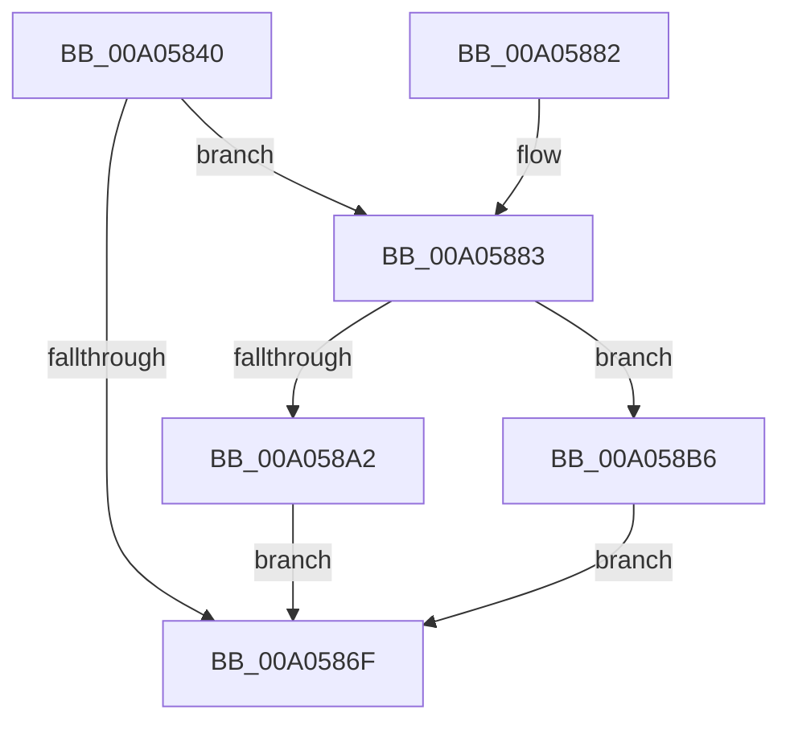

# PiEventAllocateVetoBuffer

- RVA: `0x00A05840`–`0x00A058C7` (길이 `135` bytes)
- VA: `0x0000000140A05840`
- 실행 섹션: `PAGE`
- PDB 이름 있음: `예`; PDB Function 태그: `아니요`
- unwind 정보 RVA: `0x000A8408`
- 디코드: `38`개 명령, `135/135` bytes 표시
- 미해석 바이트: `0` (있으면 어셈블리에 `.byte`로 보존)

> 이 문서는 커널 이미지의 기계어와 PDB 기호를 분석해 생성했습니다. 4번과 5번은 함수 원형과 자료형을 바이너리 사용 방식에서 추정한 C 해석이며 원본 소스 복구 결과는 아닙니다.

## 1. Dependencies

- 직접 호출 지점: **3**; 고유 호출 대상: **2**
- 직접 호출자로 확인된 함수: **1**
- RIP 상대 이미지 참조: **0**

### Outgoing calls
- `0x00A05862` → [PnpAllocateCriticalMemory](PnpAllocateCriticalMemory_function_00A07924.md) (function, `0x00A07924`)
- `0x00A05898` → [PnpAllocateCriticalMemory](PnpAllocateCriticalMemory_function_00A07924.md) (function, `0x00A07924`)
- `0x00A058BE` → [ExFreePoolWithTag](../../poolcode/B8/ExFreePoolWithTag_function_00B82870.md) (function, `0x00B82870`)

### Direct callers
- [PnpProcessQueryRemoveAndEject](PnpProcessQueryRemoveAndEject_function_00A05170.md) at `0x00A05449`

### Static image references
- 디코드된 RIP-relative 메모리 참조가 없습니다.

## 2. Other-region calls and transfers

- 다른 실행 섹션으로 향하는 call: **1**
  - `0x00A058BE` → [ExFreePoolWithTag](../../poolcode/B8/ExFreePoolWithTag_function_00B82870.md) (`PAGE` → `POOLCODE`)
- 별도 외부 분기/꼬리 이동을 확인하지 못했습니다.

## 3. Assembly (complete function range)

```asm
00A05840  48 89 5C 24 08                  mov qword ptr [rsp + 8], rbx
00A05845  48 89 6C 24 10                  mov qword ptr [rsp + 0x10], rbp
00A0584A  57                              push rdi
00A0584B  48 83 EC 20                     sub rsp, 0x20
00A0584F  BA 00 01 00 00                  mov edx, 0x100
00A05854  41 B9 50 6E 70 4D               mov r9d, 0x4d706e50
00A0585A  41 B8 18 00 00 00               mov r8d, 0x18
00A05860  8B F9                           mov edi, ecx
00A05862  E8 BD 20 00 00                  call 0x140a07924
00A05867  48 8B D8                        mov rbx, rax
00A0586A  48 85 C0                        test rax, rax
00A0586D  75 14                           jne 0x140a05883
00A0586F  48 8B 6C 24 38                  mov rbp, qword ptr [rsp + 0x38]
00A05874  48 8B C3                        mov rax, rbx
00A05877  48 8B 5C 24 30                  mov rbx, qword ptr [rsp + 0x30]
00A0587C  48 83 C4 20                     add rsp, 0x20
00A05880  5F                              pop rdi
00A05881  C3                              ret
00A05882  CC                              int3
00A05883  BD 00 04 00 00                  mov ebp, 0x400
00A05888  41 B9 50 6E 70 4D               mov r9d, 0x4d706e50
00A0588E  44 8B C5                        mov r8d, ebp
00A05891  BA 00 01 00 00                  mov edx, 0x100
00A05896  8B CF                           mov ecx, edi
00A05898  E8 87 20 00 00                  call 0x140a07924
00A0589D  48 85 C0                        test rax, rax
00A058A0  74 14                           je 0x140a058b6
00A058A2  83 23 00                        and dword ptr [rbx], 0
00A058A5  0F 57 C0                        xorps xmm0, xmm0
00A058A8  0F 11 43 08                     movups xmmword ptr [rbx + 8], xmm0
00A058AC  66 89 6B 0A                     mov word ptr [rbx + 0xa], bp
00A058B0  48 89 43 10                     mov qword ptr [rbx + 0x10], rax
00A058B4  EB B9                           jmp 0x140a0586f
00A058B6  BA 50 6E 70 4D                  mov edx, 0x4d706e50
00A058BB  48 8B CB                        mov rcx, rbx
00A058BE  E8 AD CF 17 00                  call 0x140b82870
00A058C3  33 DB                           xor ebx, ebx
00A058C5  EB A8                           jmp 0x140a0586f
```

## 4. C-style interpretation (structured pseudocode)

```c
__int64 __fastcall PiEventAllocateVetoBuffer(int a1)
{
    __int64 result;
    __int64 v_rbx;
    __int64 v_rsp;
    unsigned __int64 v_stack_p10;
    unsigned __int64 v_stack_p8;

    v_stack_p8 = v_rbx;
    v_stack_p10 = v_rbp;
    v_rsp = (v_rsp) - (32);
    result = PnpAllocateCriticalMemory(a1, 256, 24, (unsigned int)(0x4D706E50ULL));
    if (result != 0) goto loc_00A05883;
loc_00A0586F:
    v_rsp = (v_rsp) + (32);
    return result;
loc_00A05883:
    result = PnpAllocateCriticalMemory((unsigned int)((unsigned int)((unsigned int)(a1))), 256, (unsigned int)((unsigned int)((unsigned int)(0x400ULL))), (unsigned int)(0x4D706E50ULL));
    if (result == 0) goto loc_00A058B6;
    *(unsigned __int64 *)(v_stack_p8 + 8) = v_xmm0;
    *(unsigned __int16 *)(v_stack_p8 + 10) = (unsigned __int16)((unsigned int)(0x400ULL));
    *(unsigned __int64 *)(v_stack_p8 + 16) = result;
    goto loc_00A0586F;
loc_00A058B6:
    result = ExFreePoolWithTag(v_stack_p8, (unsigned int)(0x4D706E50ULL), (unsigned int)((unsigned int)((unsigned int)(0x400ULL))), (unsigned int)(0x4D706E50ULL));
    v_rbx = 0;
    goto loc_00A0586F;
}
```

## 5. (Beta) C Style

```c
int64_t PiEventAllocateVetoBuffer(int32_t Arg1)
{
    int64_t result;
    int64_t local_rbx;
    int64_t local_rsp;
    uint64_t v_stack_p10;
    uint64_t v_stack_p8;

    v_stack_p8 = local_rbx;
    v_stack_p10 = local_rbp;
    local_rsp = (local_rsp) - (32);
    result = PnpAllocateCriticalMemory(Arg1, 256, 24, (uint32_t)(0x4D706E50ULL));
    if (result != 0) goto loc_00A05883;
loc_00A0586F:
    local_rsp = (local_rsp) + (32);
    return result;
loc_00A05883:
    result = PnpAllocateCriticalMemory((uint32_t)((uint32_t)((uint32_t)(Arg1))), 256, (uint32_t)((uint32_t)((uint32_t)(0x400ULL))), (uint32_t)(0x4D706E50ULL));
    if (result == 0) goto loc_00A058B6;
    *(uint64_t *)(v_stack_p8 + 0x8) = v_xmm0;
    *(uint16_t *)(v_stack_p8 + 0xA) = (uint16_t)((uint32_t)(0x400ULL));
    *(uint64_t *)(v_stack_p8 + 0x10) = result;
    goto loc_00A0586F;
loc_00A058B6:
    result = ExFreePoolWithTag(v_stack_p8, (uint32_t)(0x4D706E50ULL), (uint32_t)((uint32_t)((uint32_t)(0x400ULL))), (uint32_t)(0x4D706E50ULL));
    local_rbx = 0;
    goto loc_00A0586F;
}
```

## 6. Execution-region graph

[열기: 2D/3D 그래프와 함수 탐색 컨트롤 패널](../../../control-panel.html?section=page&rva=0x00A05840&view=graph)

- 2D 그래프는 위에서 아래로 흐르고, 3D 그래프는 빈 공간을 드래그해 회전합니다. Shift+드래그는 이동, 휠은 확대·축소, 함수 노드 선택은 대상 보고서 이동입니다.

### Static fallback


