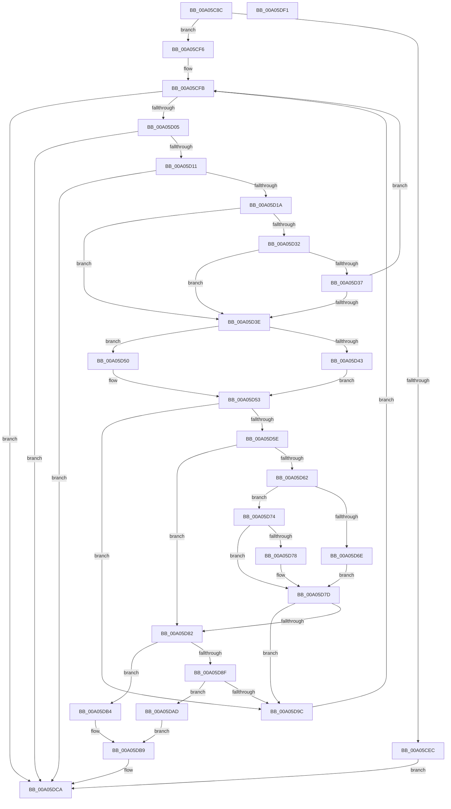

# PiEventBuildPdoList

- RVA: `0x00A05C8C`–`0x00A05DF2` (길이 `358` bytes)
- VA: `0x0000000140A05C8C`
- 실행 섹션: `PAGE`
- PDB 이름 있음: `예`; PDB Function 태그: `아니요`
- unwind 정보 RVA: `0x00075C18`
- 디코드: `103`개 명령, `358/358` bytes 표시
- 미해석 바이트: `0` (있으면 어셈블리에 `.byte`로 보존)

> 이 문서는 커널 이미지의 기계어와 PDB 기호를 분석해 생성했습니다. 4번과 5번은 함수 원형과 자료형을 바이너리 사용 방식에서 추정한 C 해석이며 원본 소스 복구 결과는 아닙니다.

## 1. Dependencies

- 직접 호출 지점: **2**; 고유 호출 대상: **2**
- 직접 호출자로 확인된 함수: **1**
- RIP 상대 이미지 참조: **0**

### Outgoing calls
- `0x00A05CDF` → [PnpAllocateCriticalMemory](PnpAllocateCriticalMemory_function_00A07924.md) (function, `0x00A07924`)
- `0x00A05DC0` → [PnpFinalizeVetoedRemove](PnpFinalizeVetoedRemove_function_00A04968.md) (function, `0x00A04968`)

### Direct callers
- [PnpProcessQueryRemoveAndEject](PnpProcessQueryRemoveAndEject_function_00A05170.md) at `0x00A0549E`

### Static image references
- 디코드된 RIP-relative 메모리 참조가 없습니다.

## 2. Other-region calls and transfers

- 다른 실행 섹션으로 향하는 call: **0**
- 별도 외부 분기/꼬리 이동을 확인하지 못했습니다.

## 3. Assembly (complete function range)

```asm
00A05C8C  48 89 5C 24 08                  mov qword ptr [rsp + 8], rbx
00A05C91  48 89 6C 24 10                  mov qword ptr [rsp + 0x10], rbp
00A05C96  48 89 74 24 18                  mov qword ptr [rsp + 0x18], rsi
00A05C9B  57                              push rdi
00A05C9C  41 54                           push r12
00A05C9E  41 55                           push r13
00A05CA0  41 56                           push r14
00A05CA2  41 57                           push r15
00A05CA4  48 83 EC 20                     sub rsp, 0x20
00A05CA8  48 8B 01                        mov rax, qword ptr [rcx]
00A05CAB  33 DB                           xor ebx, ebx
00A05CAD  4C 8B 64 24 78                  mov r12, qword ptr [rsp + 0x78]
00A05CB2  49 8B E8                        mov rbp, r8
00A05CB5  4C 8B AC 24 80 00 00 00         mov r13, qword ptr [rsp + 0x80]
00A05CBD  8B FA                           mov edi, edx
00A05CBF  4D 8B F1                        mov r14, r9
00A05CC2  4C 8B F9                        mov r15, rcx
00A05CC5  44 8B 00                        mov r8d, dword ptr [rax]
00A05CC8  8D 53 40                        lea edx, [rbx + 0x40]
00A05CCB  49 C1 E0 03                     shl r8, 3
00A05CCF  41 B9 50 6E 70 4E               mov r9d, 0x4e706e50
00A05CD5  8B CF                           mov ecx, edi
00A05CD7  41 88 1C 24                     mov byte ptr [r12], bl
00A05CDB  41 88 5D 00                     mov byte ptr [r13], bl
00A05CDF  E8 40 1C 00 00                  call 0x140a07924
00A05CE4  48 8B F0                        mov rsi, rax
00A05CE7  48 85 C0                        test rax, rax
00A05CEA  75 0A                           jne 0x140a05cf6
00A05CEC  BB 9A 00 00 C0                  mov ebx, 0xc000009a
00A05CF1  E9 D4 00 00 00                  jmp 0x140a05dca
00A05CF6  41 89 1E                        mov dword ptr [r14], ebx
00A05CF9  8B CB                           mov ecx, ebx
00A05CFB  41 38 5F 08                     cmp byte ptr [r15 + 8], bl
00A05CFF  0F 84 C5 00 00 00               je 0x140a05dca
00A05D05  4D 8B 07                        mov r8, qword ptr [r15]
00A05D08  41 3B 08                        cmp ecx, dword ptr [r8]
00A05D0B  0F 83 B9 00 00 00               jae 0x140a05dca
00A05D11  4D 85 C0                        test r8, r8
00A05D14  0F 84 B0 00 00 00               je 0x140a05dca
00A05D1A  8B C1                           mov eax, ecx
00A05D1C  44 8D 49 01                     lea r9d, [rcx + 1]
00A05D20  48 8D 04 40                     lea rax, [rax + rax*2]
00A05D24  49 8B 54 C0 10                  mov rdx, qword ptr [r8 + rax*8 + 0x10]
00A05D29  41 8B 44 C0 18                  mov eax, dword ptr [r8 + rax*8 + 0x18]
00A05D2E  85 C0                           test eax, eax
00A05D30  75 0C                           jne 0x140a05d3e
00A05D32  83 FF 04                        cmp edi, 4
00A05D35  74 07                           je 0x140a05d3e
00A05D37  41 8B C9                        mov ecx, r9d
00A05D3A  85 FF                           test edi, edi
00A05D3C  75 BD                           jne 0x140a05cfb
00A05D3E  48 85 D2                        test rdx, rdx
00A05D41  74 0D                           je 0x140a05d50
00A05D43  48 8B 82 38 01 00 00            mov rax, qword ptr [rdx + 0x138]
00A05D4A  4C 8B 40 28                     mov r8, qword ptr [rax + 0x28]
00A05D4E  EB 03                           jmp 0x140a05d53
00A05D50  4C 8B C3                        mov r8, rbx
00A05D53  4C 8B D2                        mov r10, rdx
00A05D56  41 8B C9                        mov ecx, r9d
00A05D59  83 FF 02                        cmp edi, 2
00A05D5C  74 3E                           je 0x140a05d9c
00A05D5E  85 FF                           test edi, edi
00A05D60  74 20                           je 0x140a05d82
00A05D62  41 8B 80 38 02 00 00            mov eax, dword ptr [r8 + 0x238]
00A05D69  83 F8 01                        cmp eax, 1
00A05D6C  75 06                           jne 0x140a05d74
00A05D6E  41 88 04 24                     mov byte ptr [r12], al
00A05D72  EB 09                           jmp 0x140a05d7d
00A05D74  85 C0                           test eax, eax
00A05D76  74 05                           je 0x140a05d7d
00A05D78  41 C6 45 00 01                  mov byte ptr [r13], 1
00A05D7D  83 FF 04                        cmp edi, 4
00A05D80  75 1A                           jne 0x140a05d9c
00A05D82  41 F7 80 8C 01 00 00 00 10 00 00  test dword ptr [r8 + 0x18c], 0x1000
00A05D8D  75 25                           jne 0x140a05db4
00A05D8F  41 81 B8 2C 01 00 00 13 03 00 00  cmp dword ptr [r8 + 0x12c], 0x313
00A05D9A  74 11                           je 0x140a05dad
00A05D9C  41 8B 06                        mov eax, dword ptr [r14]
00A05D9F  4C 89 14 C6                     mov qword ptr [rsi + rax*8], r10
00A05DA3  FF C0                           inc eax
00A05DA5  41 89 06                        mov dword ptr [r14], eax
00A05DA8  E9 4E FF FF FF                  jmp 0x140a05cfb
00A05DAD  BA 05 00 00 00                  mov edx, 5
00A05DB2  EB 05                           jmp 0x140a05db9
00A05DB4  BA 01 00 00 00                  mov edx, 1
00A05DB9  49 83 C0 28                     add r8, 0x28
00A05DBD  48 8B CD                        mov rcx, rbp
00A05DC0  E8 A3 EB FF FF                  call 0x140a04968
00A05DC5  BB 28 00 00 80                  mov ebx, 0x80000028
00A05DCA  48 8B 4C 24 70                  mov rcx, qword ptr [rsp + 0x70]
00A05DCF  8B C3                           mov eax, ebx
00A05DD1  48 8B 5C 24 50                  mov rbx, qword ptr [rsp + 0x50]
00A05DD6  48 8B 6C 24 58                  mov rbp, qword ptr [rsp + 0x58]
00A05DDB  48 89 31                        mov qword ptr [rcx], rsi
00A05DDE  48 8B 74 24 60                  mov rsi, qword ptr [rsp + 0x60]
00A05DE3  48 83 C4 20                     add rsp, 0x20
00A05DE7  41 5F                           pop r15
00A05DE9  41 5E                           pop r14
00A05DEB  41 5D                           pop r13
00A05DED  41 5C                           pop r12
00A05DEF  5F                              pop rdi
00A05DF0  C3                              ret
00A05DF1  CC                              int3
```

## 4. C-style interpretation (structured pseudocode)

```c
__int64 __fastcall PiEventBuildPdoList(__int64 a1, int a2, __int64 a3, __int64 a4, __int64 a5, __int64 a6, __int64 a7)
{
    __int64 result;
    __int64 v_rbx;
    __int64 v_rsp;
    unsigned __int64 v_stack_p10;
    unsigned __int64 v_stack_p18;
    unsigned __int64 v_stack_p8;

    v_stack_p8 = v_rbx;
    v_stack_p10 = v_rbp;
    v_stack_p18 = v_rsi;
    v_rsp = (v_rsp) - (32);
    v_rbx = 0;
    a3 = ((unsigned int)(*(unsigned int *)(*(unsigned __int64 *)(a1)))) << (3);
    *(unsigned __int8 *)(a6) = 0;
    *(unsigned __int8 *)(a7) = 0;
    result = PnpAllocateCriticalMemory((unsigned int)((unsigned int)((unsigned int)(a2))), v_rbx + 64, a3, (unsigned int)(0x4E706E50ULL));
    if (result != 0) goto loc_00A05CF6;
    goto loc_00A05DCA;
loc_00A05CF6:
    *(unsigned int *)(a4) = (unsigned int)((unsigned int)(0xC000009AULL));
loc_00A05CFB:
    if ((*(unsigned __int8 *)(a1 + 8)) == ((unsigned __int8)((unsigned int)(0xC000009AULL)))) goto loc_00A05DCA;
    if (((unsigned int)((unsigned int)((unsigned int)((unsigned int)(0xC000009AULL))))) >= (*(unsigned int *)(*(unsigned __int64 *)(a1)))) goto loc_00A05DCA;
    if (*(unsigned __int64 *)(a1) == 0) goto loc_00A05DCA;
    if ((unsigned int)((unsigned int)(*(unsigned int *)(*(unsigned __int64 *)(a1) + (unsigned int)((unsigned int)((unsigned int)((unsigned int)((unsigned int)(0xC000009AULL))))) + (unsigned int)((unsigned int)((unsigned int)((unsigned int)((unsigned int)(0xC000009AULL))))) * 2 * 8 + 24))) != 0) goto loc_00A05D3E;
    if (((unsigned int)((unsigned int)(a2))) == 4) goto loc_00A05D3E;
    if ((unsigned int)((unsigned int)(a2)) != 0) goto loc_00A05CFB;
loc_00A05D3E:
    if (*(unsigned __int64 *)(*(unsigned __int64 *)(a1) + (unsigned int)((unsigned int)((unsigned int)((unsigned int)((unsigned int)(0xC000009AULL))))) + (unsigned int)((unsigned int)((unsigned int)((unsigned int)((unsigned int)(0xC000009AULL))))) * 2 * 8 + 16) == 0) goto loc_00A05D50;
    goto loc_00A05D53;
loc_00A05D50:
loc_00A05D53:
    if (((unsigned int)((unsigned int)(a2))) == 2) goto loc_00A05D9C;
    if ((unsigned int)((unsigned int)(a2)) == 0) goto loc_00A05D82;
    if (((unsigned int)((unsigned int)(*(unsigned int *)((unsigned int)(0xC000009AULL) + 568)))) != 1) goto loc_00A05D74;
    *(unsigned __int8 *)(a6) = (unsigned __int8)((unsigned int)(*(unsigned int *)((unsigned int)(0xC000009AULL) + 568)));
    goto loc_00A05D7D;
loc_00A05D74:
    if ((unsigned int)((unsigned int)(*(unsigned int *)((unsigned int)(0xC000009AULL) + 568))) != 0) {
        *(unsigned __int8 *)(a7) = 1;
    }
    if (((unsigned int)((unsigned int)(a2))) != 4) goto loc_00A05D9C;
loc_00A05D82:
    if (((*(unsigned int *)((unsigned int)(0xC000009AULL) + 396)) & (0x1000ULL)) != 0) goto loc_00A05DB4;
    if ((*(unsigned int *)((unsigned int)(0xC000009AULL) + 300)) == 787) goto loc_00A05DAD;
loc_00A05D9C:
    *(unsigned __int64 *)(result + (unsigned int)(*(unsigned int *)(a4)) * 8) = *(unsigned __int64 *)(*(unsigned __int64 *)(a1) + (unsigned int)((unsigned int)((unsigned int)((unsigned int)((unsigned int)(0xC000009AULL))))) + (unsigned int)((unsigned int)((unsigned int)((unsigned int)((unsigned int)(0xC000009AULL))))) * 2 * 8 + 16);
    result = (unsigned int)(((unsigned int)(*(unsigned int *)(a4))) + 1);
    *(unsigned int *)(a4) = (unsigned int)(result);
    goto loc_00A05CFB;
loc_00A05DAD:
    goto loc_00A05DB9;
loc_00A05DB4:
loc_00A05DB9:
    a3 = ((unsigned int)(0xC000009AULL)) + (40);
    result = PnpFinalizeVetoedRemove(a3, 1, a3, (unsigned int)((unsigned int)((unsigned int)(0xC000009AULL))) + 1);
loc_00A05DCA:
    *(unsigned __int64 *)(a5) = result;
    v_rsp = (v_rsp) + (32);
    return (unsigned int)((unsigned int)((unsigned int)(0x80000028ULL)));
}
```

## 5. (Beta) C Style

```c
int64_t PiEventBuildPdoList(void *Arg1, int32_t Arg2, int64_t Arg3, void *Arg4, void *Arg5, void *Arg6, void *Arg7)
{
    uint8_t *arg1 = (uint8_t *)Arg1;
    uint8_t *arg4 = (uint8_t *)Arg4;
    uint8_t *arg5 = (uint8_t *)Arg5;
    uint8_t *arg6 = (uint8_t *)Arg6;
    uint8_t *arg7 = (uint8_t *)Arg7;

    int64_t result;
    int64_t local_rbx;
    int64_t local_rsp;
    uint64_t v_stack_p10;
    uint64_t v_stack_p18;
    uint64_t v_stack_p8;

    v_stack_p8 = local_rbx;
    v_stack_p10 = local_rbp;
    v_stack_p18 = local_rsi;
    local_rsp = (local_rsp) - (32);
    local_rbx = 0;
    Arg3 = ((uint32_t)(*(uint32_t *)(*(uint64_t *)(arg1)))) << (3);
    *(uint8_t *)(arg6) = 0;
    *(uint8_t *)(arg7) = 0;
    result = PnpAllocateCriticalMemory((uint32_t)((uint32_t)((uint32_t)(Arg2))), local_rbx + 64, Arg3, (uint32_t)(0x4E706E50ULL));
    if (result != 0) goto loc_00A05CF6;
    goto loc_00A05DCA;
loc_00A05CF6:
    *(uint32_t *)(arg4) = (uint32_t)((uint32_t)(0xC000009AULL));
loc_00A05CFB:
    if ((*(uint8_t *)(arg1 + 0x8)) == ((uint8_t)((uint32_t)(0xC000009AULL)))) goto loc_00A05DCA;
    if (((uint32_t)((uint32_t)((uint32_t)((uint32_t)(0xC000009AULL))))) >= (*(uint32_t *)(*(uint64_t *)(arg1)))) goto loc_00A05DCA;
    if (*(uint64_t *)(arg1) == 0) goto loc_00A05DCA;
    if ((uint32_t)((uint32_t)(*(uint32_t *)(*(uint64_t *)(arg1) + (uint32_t)((uint32_t)((uint32_t)((uint32_t)((uint32_t)(0xC000009AULL))))) + (uint32_t)((uint32_t)((uint32_t)((uint32_t)((uint32_t)(0xC000009AULL))))) * 2 * 8 + 0x18))) != 0) goto loc_00A05D3E;
    if (((uint32_t)((uint32_t)(Arg2))) == 4) goto loc_00A05D3E;
    if ((uint32_t)((uint32_t)(Arg2)) != 0) goto loc_00A05CFB;
loc_00A05D3E:
    if (*(uint64_t *)(*(uint64_t *)(arg1) + (uint32_t)((uint32_t)((uint32_t)((uint32_t)((uint32_t)(0xC000009AULL))))) + (uint32_t)((uint32_t)((uint32_t)((uint32_t)((uint32_t)(0xC000009AULL))))) * 2 * 8 + 0x10) == 0) goto loc_00A05D50;
    goto loc_00A05D53;
loc_00A05D50:
loc_00A05D53:
    if (((uint32_t)((uint32_t)(Arg2))) == 2) goto loc_00A05D9C;
    if ((uint32_t)((uint32_t)(Arg2)) == 0) goto loc_00A05D82;
    if (((uint32_t)((uint32_t)(*(uint32_t *)((uint32_t)(0xC000009AULL) + 0x238)))) != 1) goto loc_00A05D74;
    *(uint8_t *)(arg6) = (uint8_t)((uint32_t)(*(uint32_t *)((uint32_t)(0xC000009AULL) + 0x238)));
    goto loc_00A05D7D;
loc_00A05D74:
    if ((uint32_t)((uint32_t)(*(uint32_t *)((uint32_t)(0xC000009AULL) + 0x238))) != 0) {
        *(uint8_t *)(arg7) = 1;
    }
    if (((uint32_t)((uint32_t)(Arg2))) != 4) goto loc_00A05D9C;
loc_00A05D82:
    if (((*(uint32_t *)((uint32_t)(0xC000009AULL) + 0x18C)) & (0x1000ULL)) != 0) goto loc_00A05DB4;
    if ((*(uint32_t *)((uint32_t)(0xC000009AULL) + 0x12C)) == 787) goto loc_00A05DAD;
loc_00A05D9C:
    *(uint64_t *)(result + (uint32_t)(*(uint32_t *)(arg4)) * 8) = *(uint64_t *)(*(uint64_t *)(arg1) + (uint32_t)((uint32_t)((uint32_t)((uint32_t)((uint32_t)(0xC000009AULL))))) + (uint32_t)((uint32_t)((uint32_t)((uint32_t)((uint32_t)(0xC000009AULL))))) * 2 * 8 + 0x10);
    result = (uint32_t)(((uint32_t)(*(uint32_t *)(arg4))) + 1);
    *(uint32_t *)(arg4) = (uint32_t)(result);
    goto loc_00A05CFB;
loc_00A05DAD:
    goto loc_00A05DB9;
loc_00A05DB4:
loc_00A05DB9:
    Arg3 = ((uint32_t)(0xC000009AULL)) + (40);
    result = PnpFinalizeVetoedRemove(Arg3, 1, Arg3, (uint32_t)((uint32_t)((uint32_t)(0xC000009AULL))) + 1);
loc_00A05DCA:
    *(uint64_t *)(arg5) = result;
    local_rsp = (local_rsp) + (32);
    return (uint32_t)((uint32_t)((uint32_t)(0x80000028ULL)));
}
```

### 관측된 메모리 오프셋

구조체 형식이 확인되지 않은 접근은 인자 기준의 오프셋으로만 기록했습니다.

| 기준 인자 | 오프셋 표현 | 폭 (bit) | 접근 |
|---|---:|---:|---|
| `Arg1` | `+ 0x0` | `64` | `R` |
| `Arg1` | `+ 0x8` | `8` | `R` |
| `Arg4` | `+ 0x0` | `32` | `R` |
| `Arg4` | `+ 0x0` | `32` | `W` |
| `Arg5` | `+ 0x0` | `64` | `W` |
| `Arg6` | `+ 0x0` | `8` | `W` |
| `Arg7` | `+ 0x0` | `8` | `W` |

## 6. Execution-region graph

[열기: 2D/3D 그래프와 함수 탐색 컨트롤 패널](../../../control-panel.html?section=page&rva=0x00A05C8C&view=graph)

- 2D 그래프는 위에서 아래로 흐르고, 3D 그래프는 빈 공간을 드래그해 회전합니다. Shift+드래그는 이동, 휠은 확대·축소, 함수 노드 선택은 대상 보고서 이동입니다.

### Static fallback


