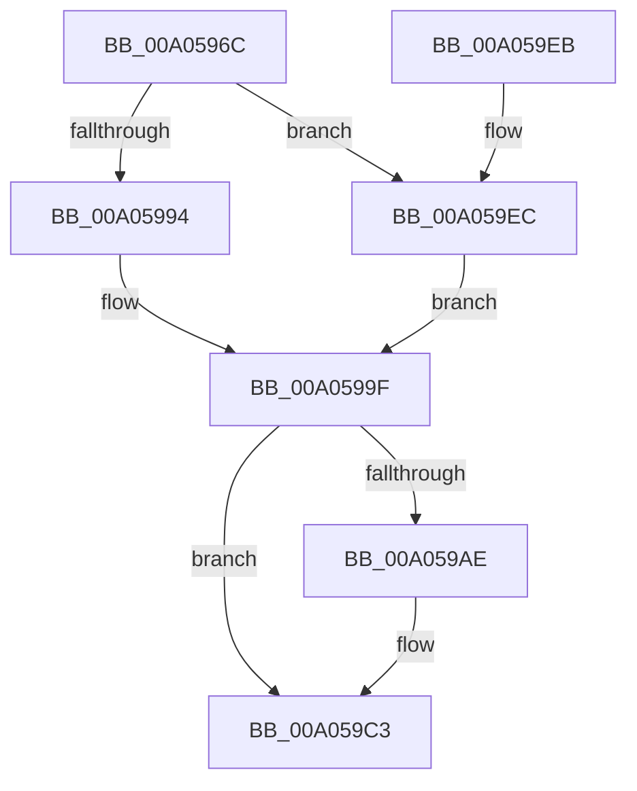

# PiEventRemovalPostSurpriseRemove

- RVA: `0x00A0596C`–`0x00A059F0` (길이 `132` bytes)
- VA: `0x0000000140A0596C`
- 실행 섹션: `PAGE`
- PDB 이름 있음: `예`; PDB Function 태그: `아니요`
- unwind 정보 RVA: `0x0005F9EC`
- 디코드: `34`개 명령, `132/132` bytes 표시
- 미해석 바이트: `0` (있으면 어셈블리에 `.byte`로 보존)

> 이 문서는 커널 이미지의 기계어와 PDB 기호를 분석해 생성했습니다. 4번과 5번은 함수 원형과 자료형을 바이너리 사용 방식에서 추정한 C 해석이며 원본 소스 복구 결과는 아닙니다.

## 1. Dependencies

- 직접 호출 지점: **2**; 고유 호출 대상: **2**
- 직접 호출자로 확인된 함수: **1**
- RIP 상대 이미지 참조: **0**

### Outgoing calls
- `0x00A059A2` → [PnpUnlinkDeviceRemovalRelations](PnpUnlinkDeviceRemovalRelations_function_00A063D8.md) (function, `0x00A063D8`)
- `0x00A059D1` → [PnpQueuePendingSurpriseRemoval](PnpQueuePendingSurpriseRemoval_function_00A05FAC.md) (function, `0x00A05FAC`)

### Direct callers
- [PnpProcessQueryRemoveAndEject](PnpProcessQueryRemoveAndEject_function_00A05170.md) at `0x00A05360`

### Static image references
- 디코드된 RIP-relative 메모리 참조가 없습니다.

## 2. Other-region calls and transfers

- 다른 실행 섹션으로 향하는 call: **0**
- 별도 외부 분기/꼬리 이동을 확인하지 못했습니다.

## 3. Assembly (complete function range)

```asm
00A0596C  48 89 5C 24 08                  mov qword ptr [rsp + 8], rbx
00A05971  48 89 6C 24 10                  mov qword ptr [rsp + 0x10], rbp
00A05976  48 89 74 24 18                  mov qword ptr [rsp + 0x18], rsi
00A0597B  57                              push rdi
00A0597C  48 83 EC 20                     sub rsp, 0x20
00A05980  48 8B 81 A0 00 00 00            mov rax, qword ptr [rcx + 0xa0]
00A05987  49 8B F8                        mov rdi, r8
00A0598A  8B EA                           mov ebp, edx
00A0598C  48 8B F1                        mov rsi, rcx
00A0598F  48 85 C0                        test rax, rax
00A05992  74 58                           je 0x140a059ec
00A05994  48 8B 80 38 01 00 00            mov rax, qword ptr [rax + 0x138]
00A0599B  48 8B 58 28                     mov rbx, qword ptr [rax + 0x28]
00A0599F  49 8B 10                        mov rdx, qword ptr [r8]
00A059A2  E8 31 0A 00 00                  call 0x140a063d8
00A059A7  48 83 7B 10 00                  cmp qword ptr [rbx + 0x10], 0
00A059AC  75 15                           jne 0x140a059c3
00A059AE  48 8B 83 88 02 00 00            mov rax, qword ptr [rbx + 0x288]
00A059B5  FF 80 90 02 00 00               inc dword ptr [rax + 0x290]
00A059BB  48 83 8B 88 02 00 00 01         or qword ptr [rbx + 0x288], 1
00A059C3  44 8B 46 10                     mov r8d, dword ptr [rsi + 0x10]
00A059C7  44 8B CD                        mov r9d, ebp
00A059CA  48 8B 4B 20                     mov rcx, qword ptr [rbx + 0x20]
00A059CE  48 8B D7                        mov rdx, rdi
00A059D1  E8 D6 05 00 00                  call 0x140a05fac
00A059D6  48 8B 5C 24 30                  mov rbx, qword ptr [rsp + 0x30]
00A059DB  48 8B 6C 24 38                  mov rbp, qword ptr [rsp + 0x38]
00A059E0  48 8B 74 24 40                  mov rsi, qword ptr [rsp + 0x40]
00A059E5  48 83 C4 20                     add rsp, 0x20
00A059E9  5F                              pop rdi
00A059EA  C3                              ret
00A059EB  CC                              int3
00A059EC  33 DB                           xor ebx, ebx
00A059EE  EB AF                           jmp 0x140a0599f
```

## 4. C-style interpretation (structured pseudocode)

```c
__int64 __fastcall PiEventRemovalPostSurpriseRemove(__int64 a1, int a2, __int64 a3)
{
    __int64 result;
    __int64 v_rbx;
    __int64 v_rsp;
    unsigned __int64 v_stack_p10;
    unsigned __int64 v_stack_p18;
    unsigned __int64 v_stack_p8;

    v_stack_p8 = v_rbx;
    v_stack_p10 = v_rbp;
    v_stack_p18 = v_rsi;
    v_rsp = (v_rsp) - (32);
    if (*(unsigned __int64 *)(a1 + 160) == 0) goto loc_00A059EC;
loc_00A0599F:
    result = PnpUnlinkDeviceRemovalRelations(a1, *(unsigned __int64 *)(a3), a3, a4);
    if ((*(unsigned __int64 *)(*(unsigned __int64 *)(*(unsigned __int64 *)(*(unsigned __int64 *)(a1 + 160) + 312) + 40) + 16)) == 0) {
        result = *(unsigned __int64 *)(*(unsigned __int64 *)(*(unsigned __int64 *)(*(unsigned __int64 *)(a1 + 160) + 312) + 40) + 648);
    }
    result = PnpQueuePendingSurpriseRemoval(*(unsigned __int64 *)(*(unsigned __int64 *)(*(unsigned __int64 *)(*(unsigned __int64 *)(a1 + 160) + 312) + 40) + 32), a3, (unsigned int)(*(unsigned int *)(a1 + 16)), (unsigned int)((unsigned int)((unsigned int)(a2))));
    v_rsp = (v_rsp) + (32);
    return result;
loc_00A059EC:
    v_rbx = 0;
    goto loc_00A0599F;
}
```

## 5. (Beta) C Style

```c
int64_t PiEventRemovalPostSurpriseRemove(void *Arg1, int32_t Arg2, void *Arg3)
{
    uint8_t *arg1 = (uint8_t *)Arg1;
    uint8_t *arg3 = (uint8_t *)Arg3;

    int64_t result;
    int64_t local_rbx;
    int64_t local_rsp;
    uint64_t v_stack_p10;
    uint64_t v_stack_p18;
    uint64_t v_stack_p8;

    v_stack_p8 = local_rbx;
    v_stack_p10 = local_rbp;
    v_stack_p18 = local_rsi;
    local_rsp = (local_rsp) - (32);
    if (*(uint64_t *)(arg1 + 0xA0) == 0) goto loc_00A059EC;
loc_00A0599F:
    result = PnpUnlinkDeviceRemovalRelations(Arg1, *(uint64_t *)(arg3), Arg3, a4);
    if ((*(uint64_t *)(*(uint64_t *)(*(uint64_t *)(*(uint64_t *)(arg1 + 0xA0) + 0x138) + 0x28) + 0x10)) == 0) {
        result = *(uint64_t *)(*(uint64_t *)(*(uint64_t *)(*(uint64_t *)(arg1 + 0xA0) + 0x138) + 0x28) + 0x288);
    }
    result = PnpQueuePendingSurpriseRemoval(*(uint64_t *)(*(uint64_t *)(*(uint64_t *)(*(uint64_t *)(arg1 + 0xA0) + 0x138) + 0x28) + 0x20), Arg3, (uint32_t)(*(uint32_t *)(arg1 + 0x10)), (uint32_t)((uint32_t)((uint32_t)(Arg2))));
    local_rsp = (local_rsp) + (32);
    return result;
loc_00A059EC:
    local_rbx = 0;
    goto loc_00A0599F;
}
```

### 관측된 메모리 오프셋

구조체 형식이 확인되지 않은 접근은 인자 기준의 오프셋으로만 기록했습니다.

| 기준 인자 | 오프셋 표현 | 폭 (bit) | 접근 |
|---|---:|---:|---|
| `Arg1` | `+ 0x10` | `32` | `R` |
| `Arg1` | `+ 0xA0` | `64` | `R` |
| `Arg3` | `+ 0x0` | `64` | `R` |

## 6. Execution-region graph

[열기: 2D/3D 그래프와 함수 탐색 컨트롤 패널](../../../control-panel.html?section=page&rva=0x00A0596C&view=graph)

- 2D 그래프는 위에서 아래로 흐르고, 3D 그래프는 빈 공간을 드래그해 회전합니다. Shift+드래그는 이동, 휠은 확대·축소, 함수 노드 선택은 대상 보고서 이동입니다.

### Static fallback


