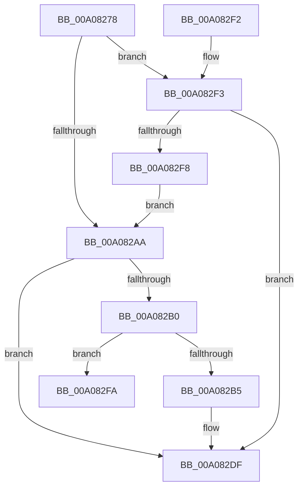

# PiForEachDriverQueryRoutine

- RVA: `0x00A08278`–`0x00A08307` (길이 `143` bytes)
- VA: `0x0000000140A08278`
- 실행 섹션: `PAGE`
- PDB 이름 있음: `예`; PDB Function 태그: `예`
- unwind 정보 RVA: `0x000A86C8`
- 디코드: `43`개 명령, `143/143` bytes 표시
- 미해석 바이트: `0` (있으면 어셈블리에 `.byte`로 보존)

> 이 문서는 커널 이미지의 기계어와 PDB 기호를 분석해 생성했습니다. 4번과 5번은 함수 원형과 자료형을 바이너리 사용 방식에서 추정한 C 해석이며 원본 소스 복구 결과는 아닙니다.

## 1. Dependencies

- 직접 호출 지점: **2**; 고유 호출 대상: **2**
- 직접 호출자로 확인된 함수: **1**
- RIP 상대 이미지 참조: **0**

### Outgoing calls
- `0x00A082BA` → [RtlInitUnicodeString](../../text/42/RtlInitUnicodeString_function_0042A780.md) (function, `0x0042A780`)
- `0x00A082DA` → [guard_dispatch_icall](../../text/6B/guard_dispatch_icall_function_006BAAD0.md) (function, `0x006BAAD0`)

### Direct callers
- [PpForEachDeviceInstanceDriver](PpForEachDeviceInstanceDriver_function_00A07D2C.md) at `0x00A08088`

### Static image references
- 디코드된 RIP-relative 메모리 참조가 없습니다.

## 2. Other-region calls and transfers

- 다른 실행 섹션으로 향하는 call: **2**
  - `0x00A082BA` → [RtlInitUnicodeString](../../text/42/RtlInitUnicodeString_function_0042A780.md) (`PAGE` → `.text`)
  - `0x00A082DA` → [guard_dispatch_icall](../../text/6B/guard_dispatch_icall_function_006BAAD0.md) (`PAGE` → `.text`)
- call이 아닌 외부 분기/꼬리 이동: **1**
  - `0x00A08302` → [sub_00B34728](../B3/Unknown_function_00B34728.md) (`tail-transfer`)

## 3. Assembly (complete function range)

```asm
00A08278  48 8B C4                        mov rax, rsp
00A0827B  48 89 58 08                     mov qword ptr [rax + 8], rbx
00A0827F  48 89 68 10                     mov qword ptr [rax + 0x10], rbp
00A08283  44 89 40 18                     mov dword ptr [rax + 0x18], r8d
00A08287  56                              push rsi
00A08288  57                              push rdi
00A08289  41 56                           push r14
00A0828B  48 83 EC 40                     sub rsp, 0x40
00A0828F  45 33 F6                        xor r14d, r14d
00A08292  0F 57 C0                        xorps xmm0, xmm0
00A08295  49 8B E9                        mov rbp, r9
00A08298  45 8B D0                        mov r10d, r8d
00A0829B  48 8B FA                        mov rdi, rdx
00A0829E  0F 11 40 D8                     movups xmmword ptr [rax - 0x28], xmm0
00A082A2  41 8B C6                        mov eax, r14d
00A082A5  83 F9 01                        cmp ecx, 1
00A082A8  75 49                           jne 0x140a082f3
00A082AA  41 83 F8 02                     cmp r8d, 2
00A082AE  76 2F                           jbe 0x140a082df
00A082B0  83 F9 01                        cmp ecx, 1
00A082B3  75 45                           jne 0x140a082fa
00A082B5  48 8D 4C 24 30                  lea rcx, [rsp + 0x30]
00A082BA  E8 C1 24 A2 FF                  call 0x14042a780
00A082BF  48 8B 8C 24 80 00 00 00         mov rcx, qword ptr [rsp + 0x80]
00A082C7  48 8D 54 24 30                  lea rdx, [rsp + 0x30]
00A082CC  4C 8B C5                        mov r8, rbp
00A082CF  48 8B 41 08                     mov rax, qword ptr [rcx + 8]
00A082D3  4C 8B 49 10                     mov r9, qword ptr [rcx + 0x10]
00A082D7  48 8B 09                        mov rcx, qword ptr [rcx]
00A082DA  E8 F1 27 CB FF                  call 0x1406baad0
00A082DF  48 8B 5C 24 60                  mov rbx, qword ptr [rsp + 0x60]
00A082E4  48 8B 6C 24 68                  mov rbp, qword ptr [rsp + 0x68]
00A082E9  48 83 C4 40                     add rsp, 0x40
00A082ED  41 5E                           pop r14
00A082EF  5F                              pop rdi
00A082F0  5E                              pop rsi
00A082F1  C3                              ret
00A082F2  CC                              int3
00A082F3  83 F9 07                        cmp ecx, 7
00A082F6  75 E7                           jne 0x140a082df
00A082F8  EB B0                           jmp 0x140a082aa
00A082FA  48 8B B4 24 80 00 00 00         mov rsi, qword ptr [rsp + 0x80]
00A08302  E9 21 C4 12 00                  jmp 0x140b34728
```

## 4. C-style interpretation (structured pseudocode)

```c
__int64 __fastcall PiForEachDriverQueryRoutine(int a1, __int64 a2, int a3, __int64 a4, __int64 a5)
{
    __int64 result;
    __int64 v_r14;
    __int64 v_rsp;
    unsigned __int64 v_stack_m28;
    unsigned __int64 v_stack_p10;
    unsigned __int64 v_stack_p8;

    *(unsigned __int64 *)(v_rsp + 8) = v_rbx;
    *(unsigned __int64 *)(v_rsp + 16) = v_rbp;
    *(unsigned int *)(v_rsp + 24) = a3;
    v_rsp = (v_rsp) - (64);
    v_r14 = 0;
    *(unsigned __int64 *)(v_rsp - 40) = v_xmm0;
    if (a1 != 1) goto loc_00A082F3;
loc_00A082AA:
    if (a3 <= 2) goto loc_00A082DF;
    if (a1 != 1) goto loc_00A082FA;
    result = RtlInitUnicodeString(v_stack_m28, a2, a3, a4);
    result = guard_dispatch_icall(*(unsigned __int64 *)(a5), v_stack_m28, a4, *(unsigned __int64 *)(a5 + 16));
loc_00A082DF:
    v_rsp = (v_rsp) + (64);
    return result;
loc_00A082F3:
    if (((unsigned int)(*(unsigned __int64 *)(a5))) != 7) goto loc_00A082DF;
    goto loc_00A082AA;
loc_00A082FA:
}
```

## 5. (Beta) C Style

```c
int64_t PiForEachDriverQueryRoutine(int32_t Arg1, int64_t Arg2, int32_t Arg3, int64_t Arg4, void *Arg5)
{
    uint8_t *arg5 = (uint8_t *)Arg5;

    int64_t result;
    int64_t local_r14;
    int64_t local_rsp;
    uint64_t v_stack_m28;
    uint64_t v_stack_p10;
    uint64_t v_stack_p8;

    *(uint64_t *)(local_rsp + 0x8) = local_rbx;
    *(uint64_t *)(local_rsp + 0x10) = local_rbp;
    *(uint32_t *)(local_rsp + 0x18) = Arg3;
    local_rsp = (local_rsp) - (64);
    local_r14 = 0;
    *(uint64_t *)(local_rsp - 0x28) = v_xmm0;
    if (Arg1 != 1) goto loc_00A082F3;
loc_00A082AA:
    if (Arg3 <= 2) goto loc_00A082DF;
    if (Arg1 != 1) goto loc_00A082FA;
    result = RtlInitUnicodeString(v_stack_m28, Arg2, Arg3, Arg4);
    result = guard_dispatch_icall(*(uint64_t *)(arg5), v_stack_m28, Arg4, *(uint64_t *)(arg5 + 0x10));
loc_00A082DF:
    local_rsp = (local_rsp) + (64);
    return result;
loc_00A082F3:
    if (((uint32_t)(*(uint64_t *)(arg5))) != 7) goto loc_00A082DF;
    goto loc_00A082AA;
loc_00A082FA:
}
```

### 관측된 메모리 오프셋

구조체 형식이 확인되지 않은 접근은 인자 기준의 오프셋으로만 기록했습니다.

| 기준 인자 | 오프셋 표현 | 폭 (bit) | 접근 |
|---|---:|---:|---|
| `Arg5` | `+ 0x0` | `64` | `R` |
| `Arg5` | `+ 0x8` | `64` | `R` |
| `Arg5` | `+ 0x10` | `64` | `R` |

## 6. Execution-region graph

[열기: 2D/3D 그래프와 함수 탐색 컨트롤 패널](../../../control-panel.html?section=page&rva=0x00A08278&view=graph)

- 2D 그래프는 위에서 아래로 흐르고, 3D 그래프는 빈 공간을 드래그해 회전합니다. Shift+드래그는 이동, 휠은 확대·축소, 함수 노드 선택은 대상 보고서 이동입니다.

### Static fallback


