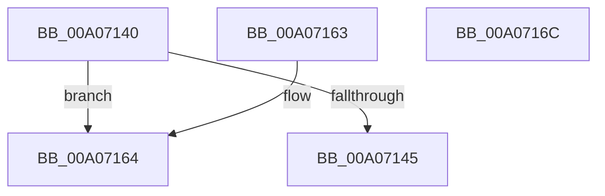

# PiGetProviderList

- RVA: `0x00A07140`–`0x00A0716D` (길이 `45` bytes)
- VA: `0x0000000140A07140`
- 실행 섹션: `PAGE`
- PDB 이름 있음: `예`; PDB Function 태그: `아니요`
- unwind 정보 RVA: `0x000DB714`
- 디코드: `13`개 명령, `45/45` bytes 표시
- 미해석 바이트: `0` (있으면 어셈블리에 `.byte`로 보존)

> 이 문서는 커널 이미지의 기계어와 PDB 기호를 분석해 생성했습니다. 4번과 5번은 함수 원형과 자료형을 바이너리 사용 방식에서 추정한 C 해석이며 원본 소스 복구 결과는 아닙니다.

## 1. Dependencies

- 직접 호출 지점: **0**; 고유 호출 대상: **0**
- 직접 호출자로 확인된 함수: **5**
- RIP 상대 이미지 참조: **1**

### Outgoing calls
- 직접 디코드된 call 명령이 없습니다.

### Direct callers
- [PnpGetDeviceDependencyList](PnpGetDeviceDependencyList_function_00A05090.md) at `0x00A0514E`
- [IopCheckIfMergeRequired](IopCheckIfMergeRequired_function_00A061B4.md) at `0x00A0624D`
- [PnpNewDeviceNodeDependencyCheck](PnpNewDeviceNodeDependencyCheck_function_00A062A0.md) at `0x00A06310`
- [IopSortRelationListForRemove](IopSortRelationListForRemove_function_00A06C30.md) at `0x00A06D0D`
- [PiQueryPowerDependencyRelations](../AA/PiQueryPowerDependencyRelations_function_00AA4524.md) at `0x00AA4575`

### Static image references
- `0x00A0714C` → RVA `0x00F8CE70` (`.data`; read)

## 2. Other-region calls and transfers

- 다른 실행 섹션으로 향하는 call: **0**
- 별도 외부 분기/꼬리 이동을 확인하지 못했습니다.

## 3. Assembly (complete function range)

```asm
00A07140  48 85 C9                        test rcx, rcx
00A07143  74 1F                           je 0x140a07164
00A07145  48 8B 81 38 01 00 00            mov rax, qword ptr [rcx + 0x138]
00A0714C  48 8D 15 1D 5D 58 00            lea rdx, [rip + 0x585d1d]
00A07153  48 8B 48 50                     mov rcx, qword ptr [rax + 0x50]
00A07157  48 85 C9                        test rcx, rcx
00A0715A  48 8D 41 10                     lea rax, [rcx + 0x10]
00A0715E  48 0F 44 C2                     cmove rax, rdx
00A07162  C3                              ret
00A07163  CC                              int3
00A07164  48 8D 05 05 5D 58 00            lea rax, [rip + 0x585d05]
00A0716B  C3                              ret
00A0716C  CC                              int3
```

## 4. C-style interpretation (structured pseudocode)

```c
__int64 __fastcall PiGetProviderList(__int64 a1)
{
    __int64 result;

    if (a1 == 0) goto loc_00A07164;
    result = *(unsigned __int64 *)(*(unsigned __int64 *)(a1 + 312) + 80) + 16;
    if (*(unsigned __int64 *)(*(unsigned __int64 *)(a1 + 312) + 80) == 0) { result = v_rip + 5791005; }
    return result;
loc_00A07164:
    return v_rip + 5790981;
}
```

## 5. (Beta) C Style

```c
int64_t PiGetProviderList(int64_t Arg1)
{
    int64_t result;

    if (Arg1 == 0) goto loc_00A07164;
    result = *(uint64_t *)(*(uint64_t *)(Arg1 + 0x138) + 0x50) + 16;
    if (*(uint64_t *)(*(uint64_t *)(Arg1 + 0x138) + 0x50) == 0) { result = v_rip + 5791005; }
    return result;
loc_00A07164:
    return v_rip + 5790981;
}
```

## 6. Execution-region graph

[열기: 2D/3D 그래프와 함수 탐색 컨트롤 패널](../../../control-panel.html?section=page&rva=0x00A07140&view=graph)

- 2D 그래프는 위에서 아래로 흐르고, 3D 그래프는 빈 공간을 드래그해 회전합니다. Shift+드래그는 이동, 휠은 확대·축소, 함수 노드 선택은 대상 보고서 이동입니다.

### Static fallback


