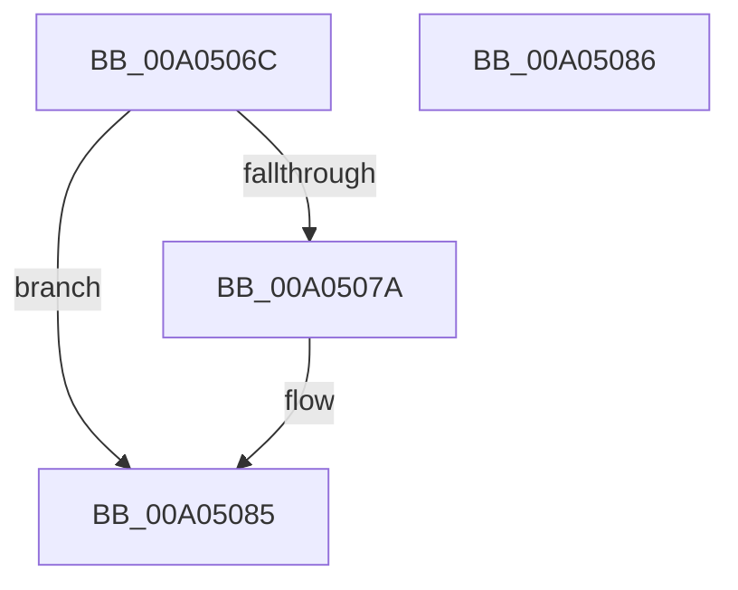

# PiGetTargetDeviceNode

- RVA: `0x00A0506C`–`0x00A05087` (길이 `27` bytes)
- VA: `0x0000000140A0506C`
- 실행 섹션: `PAGE`
- PDB 이름 있음: `예`; PDB Function 태그: `아니요`
- unwind 정보 RVA: `0x000DB714`
- 디코드: `8`개 명령, `27/27` bytes 표시
- 미해석 바이트: `0` (있으면 어셈블리에 `.byte`로 보존)

> 이 문서는 커널 이미지의 기계어와 PDB 기호를 분석해 생성했습니다. 4번과 5번은 함수 원형과 자료형을 바이너리 사용 방식에서 추정한 C 해석이며 원본 소스 복구 결과는 아닙니다.

## 1. Dependencies

- 직접 호출 지점: **0**; 고유 호출 대상: **0**
- 직접 호출자로 확인된 함수: **3**
- RIP 상대 이미지 참조: **0**

### Outgoing calls
- 직접 디코드된 call 명령이 없습니다.

### Direct callers
- [PiProcessQueryRemoveNoFdo](../74/PiProcessQueryRemoveNoFdo_function_007442B4.md) at `0x007442C6`
- [PnpRecordBlackboxPnpEventInformation](PnpRecordBlackboxPnpEventInformation_function_00A04EE0.md) at `0x00A04F1A`
- [PiCheckRemovalPreconditions](PiCheckRemovalPreconditions_function_00A057E0.md) at `0x00A057ED`

### Static image references
- 디코드된 RIP-relative 메모리 참조가 없습니다.

## 2. Other-region calls and transfers

- 다른 실행 섹션으로 향하는 call: **0**
- 별도 외부 분기/꼬리 이동을 확인하지 못했습니다.

## 3. Assembly (complete function range)

```asm
00A0506C  48 8B 91 A0 00 00 00            mov rdx, qword ptr [rcx + 0xa0]
00A05073  33 C0                           xor eax, eax
00A05075  48 85 D2                        test rdx, rdx
00A05078  74 0B                           je 0x140a05085
00A0507A  48 8B 82 38 01 00 00            mov rax, qword ptr [rdx + 0x138]
00A05081  48 8B 40 28                     mov rax, qword ptr [rax + 0x28]
00A05085  C3                              ret
00A05086  CC                              int3
```

## 4. C-style interpretation (structured pseudocode)

```c
__int64 __fastcall PiGetTargetDeviceNode(__int64 a1)
{
    __int64 result;

    result = 0;
    if (*(unsigned __int64 *)(a1 + 160) != 0) {
        result = *(unsigned __int64 *)(*(unsigned __int64 *)(a1 + 160) + 312);
        result = *(unsigned __int64 *)(result + 40);
    }
    return result;
}
```

## 5. (Beta) C Style

```c
int64_t PiGetTargetDeviceNode(void *Arg1)
{
    uint8_t *arg1 = (uint8_t *)Arg1;

    int64_t result;

    result = 0;
    if (*(uint64_t *)(arg1 + 0xA0) != 0) {
        result = *(uint64_t *)(*(uint64_t *)(arg1 + 0xA0) + 0x138);
        result = *(uint64_t *)(result + 0x28);
    }
    return result;
}
```

### 관측된 메모리 오프셋

구조체 형식이 확인되지 않은 접근은 인자 기준의 오프셋으로만 기록했습니다.

| 기준 인자 | 오프셋 표현 | 폭 (bit) | 접근 |
|---|---:|---:|---|
| `Arg1` | `+ 0xA0` | `64` | `R` |

## 6. Execution-region graph

[열기: 2D/3D 그래프와 함수 탐색 컨트롤 패널](../../../control-panel.html?section=page&rva=0x00A0506C&view=graph)

- 2D 그래프는 위에서 아래로 흐르고, 3D 그래프는 빈 공간을 드래그해 회전합니다. Shift+드래그는 이동, 휠은 확대·축소, 함수 노드 선택은 대상 보고서 이동입니다.

### Static fallback


