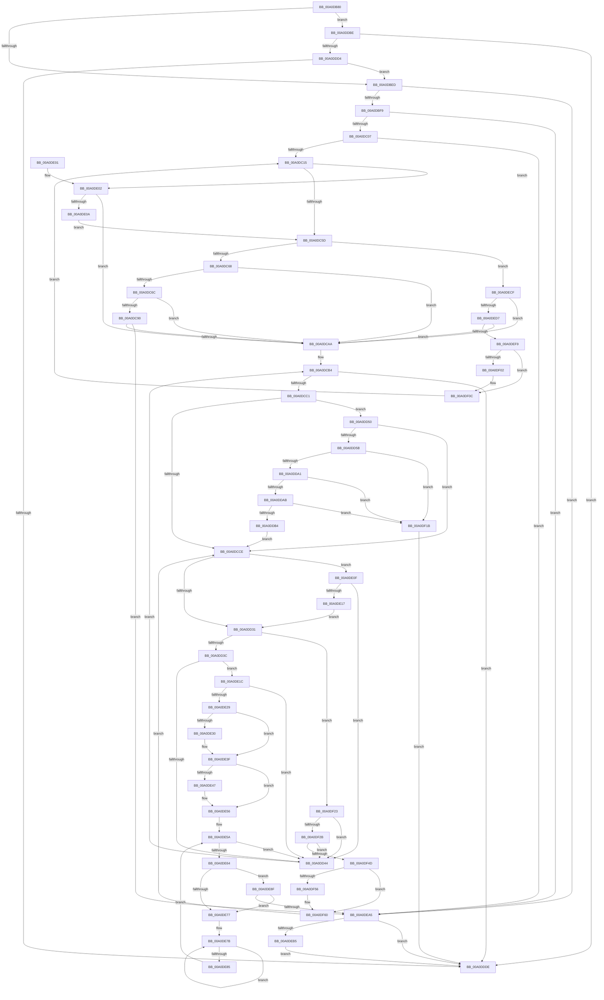

# PiPnpRtlServiceFilterCallback

- RVA: `0x00A0DB80`–`0x00A0DF74` (길이 `1,012` bytes)
- VA: `0x0000000140A0DB80`
- 실행 섹션: `PAGE`
- PDB 이름 있음: `예`; PDB Function 태그: `아니요`
- unwind 정보 RVA: `0x000A8CDC`
- 디코드: `267`개 명령, `1,012/1,012` bytes 표시
- 미해석 바이트: `0` (있으면 어셈블리에 `.byte`로 보존)

> 이 문서는 커널 이미지의 기계어와 PDB 기호를 분석해 생성했습니다. 4번과 5번은 함수 원형과 자료형을 바이너리 사용 방식에서 추정한 C 해석이며 원본 소스 복구 결과는 아닙니다.

## 1. Dependencies

- 직접 호출 지점: **15**; 고유 호출 대상: **10**
- 직접 호출자로 확인된 함수: **0**
- RIP 상대 이미지 참조: **2**

### Outgoing calls
- `0x00A0DBBD` → [memset](../../text/6C/memset_function_006C6C40.md) (function, `0x006C6C40`)
- `0x00A0DC4A` → [CmGetDeviceRegProp](../8E/CmGetDeviceRegProp_function_008ED870.md) (function, `0x008ED870`)
- `0x00A0DC84` → [RtlInitUnicodeStringEx](../../text/46/RtlInitUnicodeStringEx_function_00463960.md) (function, `0x00463960`)
- `0x00A0DC9A` → [RtlEqualUnicodeString](../93/RtlEqualUnicodeString_function_00932A20.md) (function, `0x00932A20`)
- `0x00A0DD1B` → [PnpGetObjectProperty](../8E/PnpGetObjectProperty_function_008E2180.md) (function, `0x008E2180`)
- `0x00A0DD91` → [CmGetDeviceRegProp](../8E/CmGetDeviceRegProp_function_008ED870.md) (function, `0x008ED870`)
- `0x00A0DDC8` → [CmIsDevicePresent](CmIsDevicePresent_function_00A0DF7C.md) (function, `0x00A0DF7C`)
- `0x00A0DDE8` → [_security_check_cookie](../../text/6A/_security_check_cookie_function_006AC640.md) (function, `0x006AC640`)
- `0x00A0DE6B` → [RtlInitUnicodeStringEx](../../text/46/RtlInitUnicodeStringEx_function_00463960.md) (function, `0x00463960`)
- `0x00A0DE99` → [RtlEqualUnicodeString](../93/RtlEqualUnicodeString_function_00932A20.md) (function, `0x00932A20`)
- `0x00A0DEC2` → [guard_dispatch_icall](../../text/6B/guard_dispatch_icall_function_006BAAD0.md) (function, `0x006BAAD0`)
- `0x00A0DEE5` → [ExAllocatePool2](../../poolcode/B8/ExAllocatePool2_function_00B820F0.md) (function, `0x00B820F0`)
- `0x00A0DF04` → [ExFreePoolWithTag](../../poolcode/B8/ExFreePoolWithTag_function_00B82870.md) (function, `0x00B82870`)
- `0x00A0DF39` → [ExAllocatePool2](../../poolcode/B8/ExAllocatePool2_function_00B820F0.md) (function, `0x00B820F0`)
- `0x00A0DF58` → [ExFreePoolWithTag](../../poolcode/B8/ExFreePoolWithTag_function_00B82870.md) (function, `0x00B82870`)

### Direct callers
- 이 함수 시작 RVA로 연결되는 직접 call은 확인되지 않았습니다. 간접 호출은 완전히 역산할 수 없습니다.

### Static image references
- `0x00A0DB99` → RVA `0x00E0A740` (`.data`; read)
- `0x00A0DCAD` → RVA `0x00002E98` (`.rdata`; read)

## 2. Other-region calls and transfers

- 다른 실행 섹션으로 향하는 call: **9**
  - `0x00A0DBBD` → [memset](../../text/6C/memset_function_006C6C40.md) (`PAGE` → `.text`)
  - `0x00A0DC84` → [RtlInitUnicodeStringEx](../../text/46/RtlInitUnicodeStringEx_function_00463960.md) (`PAGE` → `.text`)
  - `0x00A0DDE8` → [_security_check_cookie](../../text/6A/_security_check_cookie_function_006AC640.md) (`PAGE` → `.text`)
  - `0x00A0DE6B` → [RtlInitUnicodeStringEx](../../text/46/RtlInitUnicodeStringEx_function_00463960.md) (`PAGE` → `.text`)
  - `0x00A0DEC2` → [guard_dispatch_icall](../../text/6B/guard_dispatch_icall_function_006BAAD0.md) (`PAGE` → `.text`)
  - `0x00A0DEE5` → [ExAllocatePool2](../../poolcode/B8/ExAllocatePool2_function_00B820F0.md) (`PAGE` → `POOLCODE`)
  - `0x00A0DF04` → [ExFreePoolWithTag](../../poolcode/B8/ExFreePoolWithTag_function_00B82870.md) (`PAGE` → `POOLCODE`)
  - `0x00A0DF39` → [ExAllocatePool2](../../poolcode/B8/ExAllocatePool2_function_00B820F0.md) (`PAGE` → `POOLCODE`)
  - `0x00A0DF58` → [ExFreePoolWithTag](../../poolcode/B8/ExFreePoolWithTag_function_00B82870.md) (`PAGE` → `POOLCODE`)
- 별도 외부 분기/꼬리 이동을 확인하지 못했습니다.

## 3. Assembly (complete function range)

```asm
00A0DB80  40 55                           push rbp
00A0DB82  53                              push rbx
00A0DB83  56                              push rsi
00A0DB84  57                              push rdi
00A0DB85  41 54                           push r12
00A0DB87  41 55                           push r13
00A0DB89  41 56                           push r14
00A0DB8B  41 57                           push r15
00A0DB8D  48 8D 6C 24 E1                  lea rbp, [rsp - 0x1f]
00A0DB92  48 81 EC F8 00 00 00            sub rsp, 0xf8
00A0DB99  48 8B 05 A0 CB 3F 00            mov rax, qword ptr [rip + 0x3fcba0]
00A0DBA0  48 33 C4                        xor rax, rsp
00A0DBA3  48 89 45 07                     mov qword ptr [rbp + 7], rax
00A0DBA7  4C 8B E2                        mov r12, rdx
00A0DBAA  45 8B E8                        mov r13d, r8d
00A0DBAD  33 D2                           xor edx, edx
00A0DBAF  4C 8B F9                        mov r15, rcx
00A0DBB2  48 8D 4D B7                     lea rcx, [rbp - 0x49]
00A0DBB6  49 8B D9                        mov rbx, r9
00A0DBB9  44 8D 42 4E                     lea r8d, [rdx + 0x4e]
00A0DBBD  E8 7E 90 CB FF                  call 0x1406c6c40
00A0DBC2  45 33 C9                        xor r9d, r9d
00A0DBC5  0F 57 C0                        xorps xmm0, xmm0
00A0DBC8  41 8A F9                        mov dil, r9b
00A0DBCB  44 89 4D 8F                     mov dword ptr [rbp - 0x71], r9d
00A0DBCF  44 89 4D 97                     mov dword ptr [rbp - 0x69], r9d
00A0DBD3  0F 11 45 9F                     movups xmmword ptr [rbp - 0x61], xmm0
00A0DBD7  44 88 4D 87                     mov byte ptr [rbp - 0x79], r9b
00A0DBDB  44 89 4D 8B                     mov dword ptr [rbp - 0x75], r9d
00A0DBDF  44 89 4D 93                     mov dword ptr [rbp - 0x6d], r9d
00A0DBE3  44 38 4B 08                     cmp byte ptr [rbx + 8], r9b
00A0DBE7  0F 85 D1 01 00 00               jne 0x140a0ddbe
00A0DBED  48 8B 03                        mov rax, qword ptr [rbx]
00A0DBF0  48 85 C0                        test rax, rax
00A0DBF3  0F 84 AC 02 00 00               je 0x140a0dea5
00A0DBF9  BE 02 00 00 00                  mov esi, 2
00A0DBFE  66 39 30                        cmp word ptr [rax], si
00A0DC01  0F 82 9E 02 00 00               jb 0x140a0dea5
00A0DC07  48 8B 40 08                     mov rax, qword ptr [rax + 8]
00A0DC0B  66 44 39 08                     cmp word ptr [rax], r9w
00A0DC0F  0F 84 90 02 00 00               je 0x140a0dea5
00A0DC15  8B 43 18                        mov eax, dword ptr [rbx + 0x18]
00A0DC18  45 33 C0                        xor r8d, r8d
00A0DC1B  44 89 4C 24 38                  mov dword ptr [rsp + 0x38], r9d
00A0DC20  49 8B D4                        mov rdx, r12
00A0DC23  89 45 8B                        mov dword ptr [rbp - 0x75], eax
00A0DC26  41 B9 05 00 00 00               mov r9d, 5
00A0DC2C  48 8D 45 8B                     lea rax, [rbp - 0x75]
00A0DC30  49 8B CF                        mov rcx, r15
00A0DC33  48 89 44 24 30                  mov qword ptr [rsp + 0x30], rax
00A0DC38  48 8B 43 10                     mov rax, qword ptr [rbx + 0x10]
00A0DC3C  48 89 44 24 28                  mov qword ptr [rsp + 0x28], rax
00A0DC41  48 8D 45 8F                     lea rax, [rbp - 0x71]
00A0DC45  48 89 44 24 20                  mov qword ptr [rsp + 0x20], rax
00A0DC4A  E8 21 FC ED FF                  call 0x1408ed870
00A0DC4F  8B 4D 8B                        mov ecx, dword ptr [rbp - 0x75]
00A0DC52  45 33 C9                        xor r9d, r9d
00A0DC55  85 C0                           test eax, eax
00A0DC57  0F 84 A5 01 00 00               je 0x140a0de02
00A0DC5D  3D 23 00 00 C0                  cmp eax, 0xc0000023
00A0DC62  0F 84 67 02 00 00               je 0x140a0decf
00A0DC68  85 C0                           test eax, eax
00A0DC6A  75 3E                           jne 0x140a0dcaa
00A0DC6C  8B 4B 18                        mov ecx, dword ptr [rbx + 0x18]
00A0DC6F  48 8B 43 10                     mov rax, qword ptr [rbx + 0x10]
00A0DC73  48 D1 E9                        shr rcx, 1
00A0DC76  66 44 89 4C 48 FE               mov word ptr [rax + rcx*2 - 2], r9w
00A0DC7C  48 8D 4D 9F                     lea rcx, [rbp - 0x61]
00A0DC80  48 8B 53 10                     mov rdx, qword ptr [rbx + 0x10]
00A0DC84  E8 D7 5C A5 FF                  call 0x140463960
00A0DC89  45 33 C9                        xor r9d, r9d
00A0DC8C  85 C0                           test eax, eax
00A0DC8E  78 1A                           js 0x140a0dcaa
00A0DC90  48 8B 0B                        mov rcx, qword ptr [rbx]
00A0DC93  48 8D 55 9F                     lea rdx, [rbp - 0x61]
00A0DC97  41 B0 01                        mov r8b, 1
00A0DC9A  E8 81 4D F2 FF                  call 0x140932a20
00A0DC9F  45 33 C9                        xor r9d, r9d
00A0DCA2  84 C0                           test al, al
00A0DCA4  0F 85 FB 01 00 00               jne 0x140a0dea5
00A0DCAA  45 8B F1                        mov r14d, r9d
00A0DCAD  48 8D 35 E4 51 5F FF            lea rsi, [rip - 0xa0ae1c]
00A0DCB4  41 8A F9                        mov dil, r9b
00A0DCB7  41 83 FE 04                     cmp r14d, 4
00A0DCBB  0F 83 1D 01 00 00               jae 0x140a0ddde
00A0DCC1  BF 02 00 00 00                  mov edi, 2
00A0DCC6  39 3E                           cmp dword ptr [rsi], edi
00A0DCC8  0F 84 82 00 00 00               je 0x140a0dd50
00A0DCCE  8B 43 18                        mov eax, dword ptr [rbx + 0x18]
00A0DCD1  48 8D 4D 93                     lea rcx, [rbp - 0x6d]
00A0DCD5  44 8B 06                        mov r8d, dword ptr [rsi]
00A0DCD8  48 8D 55 B7                     lea rdx, [rbp - 0x49]
00A0DCDC  44 89 4C 24 50                  mov dword ptr [rsp + 0x50], r9d
00A0DCE1  41 83 F8 01                     cmp r8d, 1
00A0DCE5  48 89 4C 24 48                  mov qword ptr [rsp + 0x48], rcx
00A0DCEA  49 8B CF                        mov rcx, r15
00A0DCED  89 44 24 40                     mov dword ptr [rsp + 0x40], eax
00A0DCF1  49 0F 44 D4                     cmove rdx, r12
00A0DCF5  89 45 8B                        mov dword ptr [rbp - 0x75], eax
00A0DCF8  48 8B 43 10                     mov rax, qword ptr [rbx + 0x10]
00A0DCFC  48 89 44 24 38                  mov qword ptr [rsp + 0x38], rax
00A0DD01  48 8D 45 97                     lea rax, [rbp - 0x69]
00A0DD05  48 89 44 24 30                  mov qword ptr [rsp + 0x30], rax
00A0DD0A  48 8B 46 F8                     mov rax, qword ptr [rsi - 8]
00A0DD0E  48 89 44 24 28                  mov qword ptr [rsp + 0x28], rax
00A0DD13  4C 89 4C 24 20                  mov qword ptr [rsp + 0x20], r9
00A0DD18  45 33 C9                        xor r9d, r9d
00A0DD1B  E8 60 44 ED FF                  call 0x1408e2180
00A0DD20  8B 4D 93                        mov ecx, dword ptr [rbp - 0x6d]
00A0DD23  45 33 C9                        xor r9d, r9d
00A0DD26  89 4D 8B                        mov dword ptr [rbp - 0x75], ecx
00A0DD29  85 C0                           test eax, eax
00A0DD2B  0F 84 DE 00 00 00               je 0x140a0de0f
00A0DD31  3D 23 00 00 C0                  cmp eax, 0xc0000023
00A0DD36  0F 84 E7 01 00 00               je 0x140a0df23
00A0DD3C  85 C0                           test eax, eax
00A0DD3E  0F 89 D8 00 00 00               jns 0x140a0de1c
00A0DD44  41 FF C6                        inc r14d
00A0DD47  48 83 C6 10                     add rsi, 0x10
00A0DD4B  E9 64 FF FF FF                  jmp 0x140a0dcb4
00A0DD50  66 44 39 4D B7                  cmp word ptr [rbp - 0x49], r9w
00A0DD55  0F 85 73 FF FF FF               jne 0x140a0dcce
00A0DD5B  44 89 4C 24 38                  mov dword ptr [rsp + 0x38], r9d
00A0DD60  48 8D 45 8B                     lea rax, [rbp - 0x75]
00A0DD64  48 89 44 24 30                  mov qword ptr [rsp + 0x30], rax
00A0DD69  41 B9 09 00 00 00               mov r9d, 9
00A0DD6F  48 8D 45 B7                     lea rax, [rbp - 0x49]
00A0DD73  C7 45 8B 4E 00 00 00            mov dword ptr [rbp - 0x75], 0x4e
00A0DD7A  48 89 44 24 28                  mov qword ptr [rsp + 0x28], rax
00A0DD7F  45 33 C0                        xor r8d, r8d
00A0DD82  48 8D 45 8F                     lea rax, [rbp - 0x71]
00A0DD86  49 8B D4                        mov rdx, r12
00A0DD89  49 8B CF                        mov rcx, r15
00A0DD8C  48 89 44 24 20                  mov qword ptr [rsp + 0x20], rax
00A0DD91  E8 DA FA ED FF                  call 0x1408ed870
00A0DD96  45 33 C9                        xor r9d, r9d
00A0DD99  85 C0                           test eax, eax
00A0DD9B  0F 88 7A 01 00 00               js 0x140a0df1b
00A0DDA1  83 7D 8F 01                     cmp dword ptr [rbp - 0x71], 1
00A0DDA5  0F 85 70 01 00 00               jne 0x140a0df1b
00A0DDAB  39 7D 8B                        cmp dword ptr [rbp - 0x75], edi
00A0DDAE  0F 82 67 01 00 00               jb 0x140a0df1b
00A0DDB4  66 44 89 4D 03                  mov word ptr [rbp + 3], r9w
00A0DDB9  E9 10 FF FF FF                  jmp 0x140a0dcce
00A0DDBE  4C 8D 45 87                     lea r8, [rbp - 0x79]
00A0DDC2  49 8B D4                        mov rdx, r12
00A0DDC5  49 8B CF                        mov rcx, r15
00A0DDC8  E8 AF 01 00 00                  call 0x140a0df7c
00A0DDCD  45 33 C9                        xor r9d, r9d
00A0DDD0  85 C0                           test eax, eax
00A0DDD2  78 0A                           js 0x140a0ddde
00A0DDD4  44 38 4D 87                     cmp byte ptr [rbp - 0x79], r9b
00A0DDD8  0F 85 0F FE FF FF               jne 0x140a0dbed
00A0DDDE  40 8A C7                        mov al, dil
00A0DDE1  48 8B 4D 07                     mov rcx, qword ptr [rbp + 7]
00A0DDE5  48 33 CC                        xor rcx, rsp
00A0DDE8  E8 53 E8 C9 FF                  call 0x1406ac640
00A0DDED  48 81 C4 F8 00 00 00            add rsp, 0xf8
00A0DDF4  41 5F                           pop r15
00A0DDF6  41 5E                           pop r14
00A0DDF8  41 5D                           pop r13
00A0DDFA  41 5C                           pop r12
00A0DDFC  5F                              pop rdi
00A0DDFD  5E                              pop rsi
00A0DDFE  5B                              pop rbx
00A0DDFF  5D                              pop rbp
00A0DE00  C3                              ret
00A0DE01  CC                              int3
00A0DE02  3B CE                           cmp ecx, esi
00A0DE04  0F 82 A0 FE FF FF               jb 0x140a0dcaa
00A0DE0A  E9 4E FE FF FF                  jmp 0x140a0dc5d
00A0DE0F  3B CF                           cmp ecx, edi
00A0DE11  0F 82 2D FF FF FF               jb 0x140a0dd44
00A0DE17  E9 15 FF FF FF                  jmp 0x140a0dd31
00A0DE1C  81 7D 97 12 20 00 00            cmp dword ptr [rbp - 0x69], 0x2012
00A0DE23  0F 85 1B FF FF FF               jne 0x140a0dd44
00A0DE29  8B 43 18                        mov eax, dword ptr [rbx + 0x18]
00A0DE2C  3B C7                           cmp eax, edi
00A0DE2E  76 0F                           jbe 0x140a0de3f
00A0DE30  8B C8                           mov ecx, eax
00A0DE32  48 8B 43 10                     mov rax, qword ptr [rbx + 0x10]
00A0DE36  48 D1 E9                        shr rcx, 1
00A0DE39  66 44 89 4C 48 FE               mov word ptr [rax + rcx*2 - 2], r9w
00A0DE3F  8B 43 18                        mov eax, dword ptr [rbx + 0x18]
00A0DE42  83 F8 04                        cmp eax, 4
00A0DE45  76 0F                           jbe 0x140a0de56
00A0DE47  8B C8                           mov ecx, eax
00A0DE49  48 8B 43 10                     mov rax, qword ptr [rbx + 0x10]
00A0DE4D  48 D1 E9                        shr rcx, 1
00A0DE50  66 44 89 4C 48 FC               mov word ptr [rax + rcx*2 - 4], r9w
00A0DE56  48 8B 7B 10                     mov rdi, qword ptr [rbx + 0x10]
00A0DE5A  66 44 39 0F                     cmp word ptr [rdi], r9w
00A0DE5E  0F 84 E0 FE FF FF               je 0x140a0dd44
00A0DE64  48 8B D7                        mov rdx, rdi
00A0DE67  48 8D 4D 9F                     lea rcx, [rbp - 0x61]
00A0DE6B  E8 F0 5A A5 FF                  call 0x140463960
00A0DE70  45 33 C9                        xor r9d, r9d
00A0DE73  85 C0                           test eax, eax
00A0DE75  79 18                           jns 0x140a0de8f
00A0DE77  48 83 C8 FF                     or rax, 0xffffffffffffffff
00A0DE7B  48 FF C0                        inc rax
00A0DE7E  66 44 39 0C 47                  cmp word ptr [rdi + rax*2], r9w
00A0DE83  75 F6                           jne 0x140a0de7b
00A0DE85  48 8D 3C 47                     lea rdi, [rdi + rax*2]
00A0DE89  48 83 C7 02                     add rdi, 2
00A0DE8D  EB CB                           jmp 0x140a0de5a
00A0DE8F  48 8B 0B                        mov rcx, qword ptr [rbx]
00A0DE92  48 8D 55 9F                     lea rdx, [rbp - 0x61]
00A0DE96  41 B0 01                        mov r8b, 1
00A0DE99  E8 82 4B F2 FF                  call 0x140932a20
00A0DE9E  45 33 C9                        xor r9d, r9d
00A0DEA1  84 C0                           test al, al
00A0DEA3  74 D2                           je 0x140a0de77
00A0DEA5  48 8B 43 20                     mov rax, qword ptr [rbx + 0x20]
00A0DEA9  40 B7 01                        mov dil, 1
00A0DEAC  48 85 C0                        test rax, rax
00A0DEAF  0F 84 29 FF FF FF               je 0x140a0ddde
00A0DEB5  4C 8B 4B 28                     mov r9, qword ptr [rbx + 0x28]
00A0DEB9  45 8B C5                        mov r8d, r13d
00A0DEBC  49 8B D4                        mov rdx, r12
00A0DEBF  49 8B CF                        mov rcx, r15
00A0DEC2  E8 09 CC CA FF                  call 0x1406baad0
00A0DEC7  40 8A F8                        mov dil, al
00A0DECA  E9 0F FF FF FF                  jmp 0x140a0ddde
00A0DECF  3B CE                           cmp ecx, esi
00A0DED1  0F 82 D3 FD FF FF               jb 0x140a0dcaa
00A0DED7  48 8B D1                        mov rdx, rcx
00A0DEDA  41 B8 50 6E 70 47               mov r8d, 0x47706e50
00A0DEE0  B9 00 01 00 00                  mov ecx, 0x100
00A0DEE5  E8 06 42 17 00                  call 0x140b820f0
00A0DEEA  45 33 C9                        xor r9d, r9d
00A0DEED  48 8B F8                        mov rdi, rax
00A0DEF0  48 85 C0                        test rax, rax
00A0DEF3  0F 84 B1 FD FF FF               je 0x140a0dcaa
00A0DEF9  48 8B 4B 10                     mov rcx, qword ptr [rbx + 0x10]
00A0DEFD  48 85 C9                        test rcx, rcx
00A0DF00  74 0A                           je 0x140a0df0c
00A0DF02  33 D2                           xor edx, edx
00A0DF04  E8 67 49 17 00                  call 0x140b82870
00A0DF09  45 33 C9                        xor r9d, r9d
00A0DF0C  8B 4D 8B                        mov ecx, dword ptr [rbp - 0x75]
00A0DF0F  89 4B 18                        mov dword ptr [rbx + 0x18], ecx
00A0DF12  48 89 7B 10                     mov qword ptr [rbx + 0x10], rdi
00A0DF16  E9 FA FC FF FF                  jmp 0x140a0dc15
00A0DF1B  41 8A F9                        mov dil, r9b
00A0DF1E  E9 BB FE FF FF                  jmp 0x140a0ddde
00A0DF23  3B CF                           cmp ecx, edi
00A0DF25  0F 82 19 FE FF FF               jb 0x140a0dd44
00A0DF2B  48 8B D1                        mov rdx, rcx
00A0DF2E  41 B8 50 6E 70 47               mov r8d, 0x47706e50
00A0DF34  B9 00 01 00 00                  mov ecx, 0x100
00A0DF39  E8 B2 41 17 00                  call 0x140b820f0
00A0DF3E  45 33 C9                        xor r9d, r9d
00A0DF41  48 8B F8                        mov rdi, rax
00A0DF44  48 85 C0                        test rax, rax
00A0DF47  0F 84 F7 FD FF FF               je 0x140a0dd44
00A0DF4D  48 8B 4B 10                     mov rcx, qword ptr [rbx + 0x10]
00A0DF51  48 85 C9                        test rcx, rcx
00A0DF54  74 0A                           je 0x140a0df60
00A0DF56  33 D2                           xor edx, edx
00A0DF58  E8 13 49 17 00                  call 0x140b82870
00A0DF5D  45 33 C9                        xor r9d, r9d
00A0DF60  8B 4D 8B                        mov ecx, dword ptr [rbp - 0x75]
00A0DF63  48 89 7B 10                     mov qword ptr [rbx + 0x10], rdi
00A0DF67  BF 02 00 00 00                  mov edi, 2
00A0DF6C  89 4B 18                        mov dword ptr [rbx + 0x18], ecx
00A0DF6F  E9 5A FD FF FF                  jmp 0x140a0dcce
```

## 4. C-style interpretation (structured pseudocode)

```c
__int64 __fastcall PiPnpRtlServiceFilterCallback(__int64 a1, __int64 a2, int a3, __int64 a4)
{
    __int64 result;
    __int64 v_r14;
    __int64 v_rdi;
    __int64 v_rsi;
    __int64 v_rsp;
    unsigned int v_stack_m100;
    unsigned __int64 v_stack_m108;
    unsigned __int64 v_stack_m110;
    unsigned __int64 v_stack_m118;
    unsigned __int64 v_stack_m58;
    unsigned __int16 v_stack_m5C;
    unsigned __int64 v_stack_m5F;
    unsigned __int64 v_stack_mA8;
    unsigned __int64 v_stack_mC0;
    unsigned int v_stack_mC8;
    unsigned int v_stack_mCC;
    unsigned int v_stack_mD0;
    unsigned int v_stack_mD4;
    unsigned __int8 v_stack_mD8;
    unsigned int v_stack_mE8;
    unsigned __int64 v_stack_mF0;
    unsigned int v_stack_mF8;

    v_rsp = (v_rsp) - (248);
    result = (*(unsigned __int64 *)(v_rip + 4180896)) ^ (v_rsp);
    v_stack_m58 = result;
    a2 = 0;
    result = memset(v_stack_mA8, a2, a2 + 78, a4);
    a4 = 0;
    v_stack_mD0 = 0;
    v_stack_mC8 = 0;
    v_stack_mC0 = v_xmm0;
    v_stack_mD8 = 0;
    v_stack_mD4 = 0;
    v_stack_mCC = 0;
    if ((*(unsigned __int8 *)(a4 + 8)) != 0) goto loc_00A0DDBE;
loc_00A0DBED:
    if (*(unsigned __int64 *)(a4) == 0) goto loc_00A0DEA5;
    if ((*(unsigned __int16 *)(*(unsigned __int64 *)(a4))) < 2) goto loc_00A0DEA5;
    if ((*(unsigned __int16 *)(*(unsigned __int64 *)(*(unsigned __int64 *)(a4) + 8))) == 0) goto loc_00A0DEA5;
loc_00A0DC15:
    a3 = 0;
    v_stack_m100 = 0;
    v_stack_mD4 = (unsigned int)((unsigned int)(*(unsigned int *)(a4 + 24)));
    v_stack_m108 = v_stack_mD4;
    v_stack_m110 = *(unsigned __int64 *)(a4 + 16);
    v_stack_m118 = v_stack_mD0;
    result = CmGetDeviceRegProp(a1, 0, a3, 5);
    a4 = 0;
    if ((unsigned int)(result) == 0) goto loc_00A0DE02;
loc_00A0DC5D:
    if (((unsigned int)(result)) == 0xC0000023ULL) goto loc_00A0DECF;
    if ((unsigned int)(result) != 0) goto loc_00A0DCAA;
    a1 = ((unsigned int)(*(unsigned int *)(a4 + 24))) >> (1);
    *(unsigned __int16 *)(*(unsigned __int64 *)(a4 + 16) + a1 * 2 - 2) = 0;
    result = RtlInitUnicodeStringEx(v_stack_mC0, *(unsigned __int64 *)(a4 + 16), a3, a4);
    a4 = 0;
    if (sign_flag) goto loc_00A0DCAA;
    result = RtlEqualUnicodeString(*(unsigned __int64 *)(a4), v_stack_mC0, 1, a4);
    a4 = 0;
    if ((unsigned __int8)(result) != 0) goto loc_00A0DEA5;
loc_00A0DCAA:
loc_00A0DCB4:
    if (0 >= 4) goto loc_00A0DDDE;
    if ((*(unsigned int *)(v_rip - 10530332)) == 2) goto loc_00A0DD50;
loc_00A0DCCE:
    v_stack_mE8 = 0;
    v_stack_mF0 = v_stack_mCC;
    v_stack_mF8 = (unsigned int)((unsigned int)(*(unsigned int *)(a4 + 24)));
    a2 = v_stack_mA8;
    if (((unsigned int)((unsigned int)(*(unsigned int *)(v_rip - 10530332)))) == 1) { a2 = 0; }
    v_stack_mD4 = (unsigned int)((unsigned int)(*(unsigned int *)(a4 + 24)));
    v_stack_m100 = *(unsigned __int64 *)(a4 + 16);
    v_stack_m108 = v_stack_mC8;
    v_stack_m110 = *(unsigned __int64 *)(v_rip - 10530332 - 8);
    v_stack_m118 = 0;
    a4 = 0;
    result = PnpGetObjectProperty(a1, a2, (unsigned int)(*(unsigned int *)(v_rip - 10530332)), a4);
    a4 = 0;
    v_stack_mD4 = (unsigned int)((unsigned int)(v_stack_mCC));
    if ((unsigned int)(result) == 0) goto loc_00A0DE0F;
loc_00A0DD31:
    if (((unsigned int)(result)) == 0xC0000023ULL) goto loc_00A0DF23;
    if (!sign_flag) goto loc_00A0DE1C;
loc_00A0DD44:
    v_r14 = (unsigned int)((0) + 1);
    v_rsi = (v_rip - 10530332) + (16);
    goto loc_00A0DCB4;
loc_00A0DD50:
    if (v_stack_mA8 != 0) goto loc_00A0DCCE;
    v_stack_m100 = 0;
    v_stack_m108 = v_stack_mD4;
    v_stack_mD4 = 78;
    v_stack_m110 = v_stack_mA8;
    a3 = 0;
    v_stack_m118 = v_stack_mD0;
    result = CmGetDeviceRegProp(a1, a2, a3, 9);
    a4 = 0;
    if (sign_flag) goto loc_00A0DF1B;
    if (v_stack_mD0 != 1) goto loc_00A0DF1B;
    if (v_stack_mD4 < 2) goto loc_00A0DF1B;
    v_stack_m5C = 0;
    goto loc_00A0DCCE;
loc_00A0DDBE:
    result = CmIsDevicePresent(a1, a2, v_stack_mD8, a4);
    a4 = 0;
    if (sign_flag) goto loc_00A0DDDE;
    if (v_stack_mD8 != 0) goto loc_00A0DBED;
loc_00A0DDDE:
    a1 = (v_stack_m58) ^ (v_rsp);
    result = _security_check_cookie(a1, a2, v_stack_mD8, a4);
    v_rsp = (v_rsp) + (248);
    return result;
loc_00A0DE02:
    if (((unsigned int)(a1)) < ((unsigned int)(v_rsi))) goto loc_00A0DCAA;
    goto loc_00A0DC5D;
loc_00A0DE0F:
    if (((unsigned int)(a1)) < 2) goto loc_00A0DD44;
    goto loc_00A0DD31;
loc_00A0DE1C:
    if (v_stack_mC8 != 0x2012ULL) goto loc_00A0DD44;
    result = (unsigned int)(*(unsigned int *)(a4 + 24));
    if (((unsigned int)((unsigned int)(*(unsigned int *)(a4 + 24)))) >= = 2) {
        a1 = (unsigned int)((unsigned int)(*(unsigned int *)(a4 + 24)));
        result = *(unsigned __int64 *)(a4 + 16);
        a1 = (a1) >> (1);
        *(unsigned __int16 *)(result + a1 * 2 - 2) = 0;
    }
    result = (unsigned int)(*(unsigned int *)(a4 + 24));
    if (((unsigned int)((unsigned int)(*(unsigned int *)(a4 + 24)))) >= = 4) {
        a1 = (unsigned int)((unsigned int)(*(unsigned int *)(a4 + 24)));
        result = *(unsigned __int64 *)(a4 + 16);
        a1 = (a1) >> (1);
        *(unsigned __int16 *)(result + a1 * 2 - 4) = 0;
    }
loc_00A0DE5A:
    if ((*(unsigned __int16 *)(*(unsigned __int64 *)(a4 + 16))) == 0) goto loc_00A0DD44;
    result = RtlInitUnicodeStringEx(v_stack_mC0, *(unsigned __int64 *)(a4 + 16), v_stack_mD8, a4);
    a4 = 0;
    if (!sign_flag) goto loc_00A0DE8F;
loc_00A0DE77:
    result = (result) | (-1);
loc_00A0DE7B:
    result = (result) + 1;
    if ((*(unsigned __int16 *)(*(unsigned __int64 *)(a4 + 16) + result * 2)) != 0) goto loc_00A0DE7B;
    v_rdi = (*(unsigned __int64 *)(a4 + 16) + result * 2) + (2);
    goto loc_00A0DE5A;
loc_00A0DE8F:
    result = RtlEqualUnicodeString(*(unsigned __int64 *)(a4), v_stack_mC0, 1, a4);
    a4 = 0;
    if ((unsigned __int8)(result) == 0) goto loc_00A0DE77;
loc_00A0DEA5:
    if (*(unsigned __int64 *)(a4 + 32) == 0) goto loc_00A0DDDE;
    result = guard_dispatch_icall(a1, a2, (unsigned int)((unsigned int)((unsigned int)(a3))), *(unsigned __int64 *)(a4 + 40));
    goto loc_00A0DDDE;
loc_00A0DECF:
    if (((unsigned int)(a1)) < ((unsigned int)(v_rsi))) goto loc_00A0DCAA;
    result = ExAllocatePool2(256, a1, (unsigned int)(0x47706E50ULL), *(unsigned __int64 *)(a4 + 40));
    a4 = 0;
    if (result == 0) goto loc_00A0DCAA;
    if (*(unsigned __int64 *)(a4 + 16) != 0) {
        a2 = 0;
        result = ExFreePoolWithTag(*(unsigned __int64 *)(a4 + 16), a2, (unsigned int)(0x47706E50ULL), a4);
        a4 = 0;
    }
    *(unsigned int *)(a4 + 24) = (unsigned int)((unsigned int)(v_stack_mD4));
    *(unsigned __int64 *)(a4 + 16) = result;
    goto loc_00A0DC15;
loc_00A0DF1B:
    goto loc_00A0DDDE;
loc_00A0DF23:
    if (((unsigned int)((unsigned int)(v_stack_mD4))) < 0) goto loc_00A0DD44;
    result = ExAllocatePool2(256, (unsigned int)(v_stack_mD4), (unsigned int)(0x47706E50ULL), a4);
    a4 = 0;
    if (result == 0) goto loc_00A0DD44;
    if (*(unsigned __int64 *)(a4 + 16) != 0) {
        a2 = 0;
        result = ExFreePoolWithTag(*(unsigned __int64 *)(a4 + 16), a2, (unsigned int)(0x47706E50ULL), a4);
        a4 = 0;
    }
    *(unsigned __int64 *)(a4 + 16) = result;
    *(unsigned int *)(a4 + 24) = (unsigned int)((unsigned int)(v_stack_mD4));
    goto loc_00A0DCCE;
}
```

## 5. (Beta) C Style

```c
int64_t PiPnpRtlServiceFilterCallback(int64_t Arg1, int64_t Arg2, int32_t Arg3, void *Arg4)
{
    uint8_t *arg4 = (uint8_t *)Arg4;

    int64_t result;
    int64_t local_r14;
    int64_t local_rdi;
    int64_t local_rsi;
    int64_t local_rsp;
    uint32_t v_stack_m100;
    uint64_t v_stack_m108;
    uint64_t v_stack_m110;
    uint64_t v_stack_m118;
    uint64_t v_stack_m58;
    uint16_t v_stack_m5C;
    uint64_t v_stack_m5F;
    uint64_t v_stack_mA8;
    uint64_t v_stack_mC0;
    uint32_t v_stack_mC8;
    uint32_t v_stack_mCC;
    uint32_t v_stack_mD0;
    uint32_t v_stack_mD4;
    uint8_t v_stack_mD8;
    uint32_t v_stack_mE8;
    uint64_t v_stack_mF0;
    uint32_t v_stack_mF8;

    local_rsp = (local_rsp) - (248);
    result = (*(uint64_t *)(v_rip + 0x3FCBA0)) ^ (local_rsp);
    v_stack_m58 = result;
    Arg2 = 0;
    result = memset(v_stack_mA8, Arg2, Arg2 + 78, Arg4);
    Arg4 = 0;
    v_stack_mD0 = 0;
    v_stack_mC8 = 0;
    v_stack_mC0 = v_xmm0;
    v_stack_mD8 = 0;
    v_stack_mD4 = 0;
    v_stack_mCC = 0;
    if ((*(uint8_t *)(arg4 + 0x8)) != 0) goto loc_00A0DDBE;
loc_00A0DBED:
    if (*(uint64_t *)(arg4) == 0) goto loc_00A0DEA5;
    if ((*(uint16_t *)(*(uint64_t *)(arg4))) < 2) goto loc_00A0DEA5;
    if ((*(uint16_t *)(*(uint64_t *)(*(uint64_t *)(arg4) + 0x8))) == 0) goto loc_00A0DEA5;
loc_00A0DC15:
    Arg3 = 0;
    v_stack_m100 = 0;
    v_stack_mD4 = (uint32_t)((uint32_t)(*(uint32_t *)(arg4 + 0x18)));
    v_stack_m108 = v_stack_mD4;
    v_stack_m110 = *(uint64_t *)(arg4 + 0x10);
    v_stack_m118 = v_stack_mD0;
    result = CmGetDeviceRegProp(Arg1, 0, Arg3, 5);
    Arg4 = 0;
    if ((uint32_t)(result) == 0) goto loc_00A0DE02;
loc_00A0DC5D:
    if (((uint32_t)(result)) == 0xC0000023ULL) goto loc_00A0DECF;
    if ((uint32_t)(result) != 0) goto loc_00A0DCAA;
    Arg1 = ((uint32_t)(*(uint32_t *)(arg4 + 0x18))) >> (1);
    *(uint16_t *)(*(uint64_t *)(arg4 + 0x10) + Arg1 * 2 - 0x2) = 0;
    result = RtlInitUnicodeStringEx(v_stack_mC0, *(uint64_t *)(arg4 + 0x10), Arg3, Arg4);
    Arg4 = 0;
    if (sign_flag) goto loc_00A0DCAA;
    result = RtlEqualUnicodeString(*(uint64_t *)(arg4), v_stack_mC0, 1, Arg4);
    Arg4 = 0;
    if ((uint8_t)(result) != 0) goto loc_00A0DEA5;
loc_00A0DCAA:
loc_00A0DCB4:
    if (0 >= 4) goto loc_00A0DDDE;
    if ((*(uint32_t *)(v_rip - 0xA0AE1C)) == 2) goto loc_00A0DD50;
loc_00A0DCCE:
    v_stack_mE8 = 0;
    v_stack_mF0 = v_stack_mCC;
    v_stack_mF8 = (uint32_t)((uint32_t)(*(uint32_t *)(arg4 + 0x18)));
    Arg2 = v_stack_mA8;
    if (((uint32_t)((uint32_t)(*(uint32_t *)(v_rip - 0xA0AE1C)))) == 1) { Arg2 = 0; }
    v_stack_mD4 = (uint32_t)((uint32_t)(*(uint32_t *)(arg4 + 0x18)));
    v_stack_m100 = *(uint64_t *)(arg4 + 0x10);
    v_stack_m108 = v_stack_mC8;
    v_stack_m110 = *(uint64_t *)(v_rip - 0xA0AE1C - 0x8);
    v_stack_m118 = 0;
    Arg4 = 0;
    result = PnpGetObjectProperty(Arg1, Arg2, (uint32_t)(*(uint32_t *)(v_rip - 0xA0AE1C)), Arg4);
    Arg4 = 0;
    v_stack_mD4 = (uint32_t)((uint32_t)(v_stack_mCC));
    if ((uint32_t)(result) == 0) goto loc_00A0DE0F;
loc_00A0DD31:
    if (((uint32_t)(result)) == 0xC0000023ULL) goto loc_00A0DF23;
    if (!sign_flag) goto loc_00A0DE1C;
loc_00A0DD44:
    local_r14 = (uint32_t)((0) + 1);
    local_rsi = (v_rip - 10530332) + (16);
    goto loc_00A0DCB4;
loc_00A0DD50:
    if (v_stack_mA8 != 0) goto loc_00A0DCCE;
    v_stack_m100 = 0;
    v_stack_m108 = v_stack_mD4;
    v_stack_mD4 = 78;
    v_stack_m110 = v_stack_mA8;
    Arg3 = 0;
    v_stack_m118 = v_stack_mD0;
    result = CmGetDeviceRegProp(Arg1, Arg2, Arg3, 9);
    Arg4 = 0;
    if (sign_flag) goto loc_00A0DF1B;
    if (v_stack_mD0 != 1) goto loc_00A0DF1B;
    if (v_stack_mD4 < 2) goto loc_00A0DF1B;
    v_stack_m5C = 0;
    goto loc_00A0DCCE;
loc_00A0DDBE:
    result = CmIsDevicePresent(Arg1, Arg2, v_stack_mD8, Arg4);
    Arg4 = 0;
    if (sign_flag) goto loc_00A0DDDE;
    if (v_stack_mD8 != 0) goto loc_00A0DBED;
loc_00A0DDDE:
    Arg1 = (v_stack_m58) ^ (local_rsp);
    result = _security_check_cookie(Arg1, Arg2, v_stack_mD8, Arg4);
    local_rsp = (local_rsp) + (248);
    return result;
loc_00A0DE02:
    if (((uint32_t)(Arg1)) < ((uint32_t)(local_rsi))) goto loc_00A0DCAA;
    goto loc_00A0DC5D;
loc_00A0DE0F:
    if (((uint32_t)(Arg1)) < 2) goto loc_00A0DD44;
    goto loc_00A0DD31;
loc_00A0DE1C:
    if (v_stack_mC8 != 0x2012ULL) goto loc_00A0DD44;
    result = (uint32_t)(*(uint32_t *)(arg4 + 0x18));
    if (((uint32_t)((uint32_t)(*(uint32_t *)(arg4 + 0x18)))) >= = 2) {
        Arg1 = (uint32_t)((uint32_t)(*(uint32_t *)(arg4 + 0x18)));
        result = *(uint64_t *)(arg4 + 0x10);
        Arg1 = (Arg1) >> (1);
        *(uint16_t *)(result + Arg1 * 2 - 0x2) = 0;
    }
    result = (uint32_t)(*(uint32_t *)(arg4 + 0x18));
    if (((uint32_t)((uint32_t)(*(uint32_t *)(arg4 + 0x18)))) >= = 4) {
        Arg1 = (uint32_t)((uint32_t)(*(uint32_t *)(arg4 + 0x18)));
        result = *(uint64_t *)(arg4 + 0x10);
        Arg1 = (Arg1) >> (1);
        *(uint16_t *)(result + Arg1 * 2 - 0x4) = 0;
    }
loc_00A0DE5A:
    if ((*(uint16_t *)(*(uint64_t *)(arg4 + 0x10))) == 0) goto loc_00A0DD44;
    result = RtlInitUnicodeStringEx(v_stack_mC0, *(uint64_t *)(arg4 + 0x10), v_stack_mD8, Arg4);
    Arg4 = 0;
    if (!sign_flag) goto loc_00A0DE8F;
loc_00A0DE77:
    result = (result) | (-1);
loc_00A0DE7B:
    result = (result) + 1;
    if ((*(uint16_t *)(*(uint64_t *)(arg4 + 0x10) + result * 2)) != 0) goto loc_00A0DE7B;
    local_rdi = (*(uint64_t *)(arg4 + 0x10) + result * 2) + (2);
    goto loc_00A0DE5A;
loc_00A0DE8F:
    result = RtlEqualUnicodeString(*(uint64_t *)(arg4), v_stack_mC0, 1, Arg4);
    Arg4 = 0;
    if ((uint8_t)(result) == 0) goto loc_00A0DE77;
loc_00A0DEA5:
    if (*(uint64_t *)(arg4 + 0x20) == 0) goto loc_00A0DDDE;
    result = guard_dispatch_icall(Arg1, Arg2, (uint32_t)((uint32_t)((uint32_t)(Arg3))), *(uint64_t *)(arg4 + 0x28));
    goto loc_00A0DDDE;
loc_00A0DECF:
    if (((uint32_t)(Arg1)) < ((uint32_t)(local_rsi))) goto loc_00A0DCAA;
    result = ExAllocatePool2(256, Arg1, (uint32_t)(0x47706E50ULL), *(uint64_t *)(arg4 + 0x28));
    Arg4 = 0;
    if (result == 0) goto loc_00A0DCAA;
    if (*(uint64_t *)(arg4 + 0x10) != 0) {
        Arg2 = 0;
        result = ExFreePoolWithTag(*(uint64_t *)(arg4 + 0x10), Arg2, (uint32_t)(0x47706E50ULL), Arg4);
        Arg4 = 0;
    }
    *(uint32_t *)(arg4 + 0x18) = (uint32_t)((uint32_t)(v_stack_mD4));
    *(uint64_t *)(arg4 + 0x10) = result;
    goto loc_00A0DC15;
loc_00A0DF1B:
    goto loc_00A0DDDE;
loc_00A0DF23:
    if (((uint32_t)((uint32_t)(v_stack_mD4))) < 0) goto loc_00A0DD44;
    result = ExAllocatePool2(256, (uint32_t)(v_stack_mD4), (uint32_t)(0x47706E50ULL), Arg4);
    Arg4 = 0;
    if (result == 0) goto loc_00A0DD44;
    if (*(uint64_t *)(arg4 + 0x10) != 0) {
        Arg2 = 0;
        result = ExFreePoolWithTag(*(uint64_t *)(arg4 + 0x10), Arg2, (uint32_t)(0x47706E50ULL), Arg4);
        Arg4 = 0;
    }
    *(uint64_t *)(arg4 + 0x10) = result;
    *(uint32_t *)(arg4 + 0x18) = (uint32_t)((uint32_t)(v_stack_mD4));
    goto loc_00A0DCCE;
}
```

### 관측된 메모리 오프셋

구조체 형식이 확인되지 않은 접근은 인자 기준의 오프셋으로만 기록했습니다.

| 기준 인자 | 오프셋 표현 | 폭 (bit) | 접근 |
|---|---:|---:|---|
| `Arg4` | `+ 0x0` | `64` | `R` |
| `Arg4` | `+ 0x8` | `8` | `R` |
| `Arg4` | `+ 0x10` | `64` | `R` |
| `Arg4` | `+ 0x10` | `64` | `W` |
| `Arg4` | `+ 0x18` | `32` | `R` |
| `Arg4` | `+ 0x18` | `32` | `W` |
| `Arg4` | `+ 0x20` | `64` | `R` |
| `Arg4` | `+ 0x28` | `64` | `R` |

## 6. Execution-region graph

[열기: 2D/3D 그래프와 함수 탐색 컨트롤 패널](../../../control-panel.html?section=page&rva=0x00A0DB80&view=graph)

- 2D 그래프는 위에서 아래로 흐르고, 3D 그래프는 빈 공간을 드래그해 회전합니다. Shift+드래그는 이동, 휠은 확대·축소, 함수 노드 선택은 대상 보고서 이동입니다.

### Static fallback


