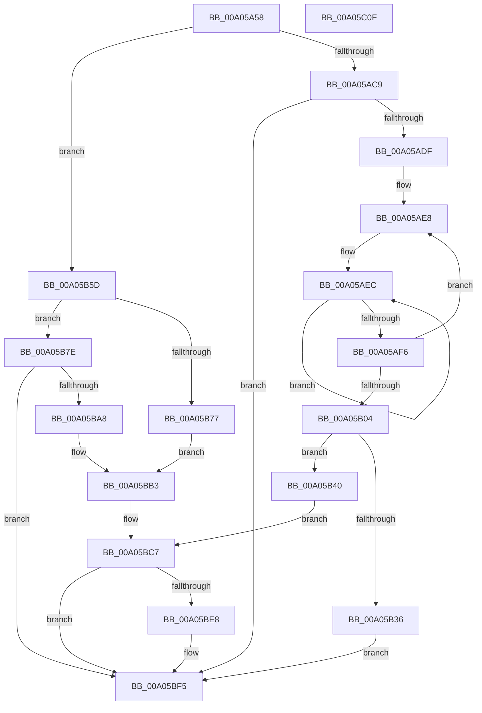

# PiProcessQueryAndCancelRemoval

- RVA: `0x00A05A58`–`0x00A05C10` (길이 `440` bytes)
- VA: `0x0000000140A05A58`
- 실행 섹션: `PAGE`
- PDB 이름 있음: `예`; PDB Function 태그: `아니요`
- unwind 정보 RVA: `0x000A8448`
- 디코드: `123`개 명령, `440/440` bytes 표시
- 미해석 바이트: `0` (있으면 어셈블리에 `.byte`로 보존)

> 이 문서는 커널 이미지의 기계어와 PDB 기호를 분석해 생성했습니다. 4번과 5번은 함수 원형과 자료형을 바이너리 사용 방식에서 추정한 C 해석이며 원본 소스 복구 결과는 아닙니다.

## 1. Dependencies

- 직접 호출 지점: **10**; 고유 호출 대상: **8**
- 직접 호출자로 확인된 함수: **1**
- RIP 상대 이미지 참조: **2**

### Outgoing calls
- `0x00A05AB7` → [PnpNotifyUserModeDeviceRemoval](../95/PnpNotifyUserModeDeviceRemoval_function_00954258.md) (function, `0x00954258`)
- `0x00A05ACE` → [PnpFinalizeVetoedRemove](PnpFinalizeVetoedRemove_function_00A04968.md) (function, `0x00A04968`)
- `0x00A05B26` → [PnpAllocateCriticalMemory](PnpAllocateCriticalMemory_function_00A07924.md) (function, `0x00A07924`)
- `0x00A05B4D` → [memcpy](../../text/6C/memcpy_function_006C6840.md) (function, `0x006C6840`)
- `0x00A05B6E` → [PipSendTargetDeviceQueryRemoveNotification](PipSendTargetDeviceQueryRemoveNotification_function_00A04518.md) (function, `0x00A04518`)
- `0x00A05B9D` → [PipSendQueryRemoveIrpAndCheckOpenHandles](../74/PipSendQueryRemoveIrpAndCheckOpenHandles_function_007443E8.md) (function, `0x007443E8`)
- `0x00A05BAE` → [PiSendTargetDeviceRemoveCanceledNotification](../74/PiSendTargetDeviceRemoveCanceledNotification_function_00744364.md) (function, `0x00744364`)
- `0x00A05BBB` → [PnpFinalizeVetoedRemove](PnpFinalizeVetoedRemove_function_00A04968.md) (function, `0x00A04968`)
- `0x00A05BDE` → [PnpNotifyUserModeDeviceRemoval](../95/PnpNotifyUserModeDeviceRemoval_function_00954258.md) (function, `0x00954258`)
- `0x00A05BF0` → [ExFreePoolWithTag](../../poolcode/B8/ExFreePoolWithTag_function_00B82870.md) (function, `0x00B82870`)

### Direct callers
- [PnpProcessQueryRemoveAndEject](PnpProcessQueryRemoveAndEject_function_00A05170.md) at `0x00A052C2`

### Static image references
- `0x00A05A8A` → RVA `0x0001A210` (`.rdata`; read)
- `0x00A05BCA` → RVA `0x00012320` (`.rdata`; read)

## 2. Other-region calls and transfers

- 다른 실행 섹션으로 향하는 call: **2**
  - `0x00A05B4D` → [memcpy](../../text/6C/memcpy_function_006C6840.md) (`PAGE` → `.text`)
  - `0x00A05BF0` → [ExFreePoolWithTag](../../poolcode/B8/ExFreePoolWithTag_function_00B82870.md) (`PAGE` → `POOLCODE`)
- 별도 외부 분기/꼬리 이동을 확인하지 못했습니다.

## 3. Assembly (complete function range)

```asm
00A05A58  4C 8B DC                        mov r11, rsp
00A05A5B  49 89 5B 10                     mov qword ptr [r11 + 0x10], rbx
00A05A5F  4D 89 43 18                     mov qword ptr [r11 + 0x18], r8
00A05A63  89 4C 24 08                     mov dword ptr [rsp + 8], ecx
00A05A67  55                              push rbp
00A05A68  56                              push rsi
00A05A69  57                              push rdi
00A05A6A  41 54                           push r12
00A05A6C  41 55                           push r13
00A05A6E  41 56                           push r14
00A05A70  41 57                           push r15
00A05A72  48 83 EC 40                     sub rsp, 0x40
00A05A76  48 8B BC 24 A8 00 00 00         mov rdi, qword ptr [rsp + 0xa8]
00A05A7E  49 8D 43 B8                     lea rax, [r11 - 0x48]
00A05A82  4C 8B AC 24 B0 00 00 00         mov r13, qword ptr [rsp + 0xb0]
00A05A8A  4C 8D 05 7F 47 61 FF            lea r8, [rip - 0x9eb881]
00A05A91  48 8B F2                        mov rsi, rdx
00A05A94  49 89 43 B0                     mov qword ptr [r11 - 0x50], rax
00A05A98  45 8B F9                        mov r15d, r9d
00A05A9B  45 33 F6                        xor r14d, r14d
00A05A9E  4C 8D 67 08                     lea r12, [rdi + 8]
00A05AA2  45 89 73 B8                     mov dword ptr [r11 - 0x48], r14d
00A05AA6  49 8B 55 00                     mov rdx, qword ptr [r13]
00A05AAA  4C 8B CF                        mov r9, rdi
00A05AAD  48 8B CE                        mov rcx, rsi
00A05AB0  4D 89 63 A8                     mov qword ptr [r11 - 0x58], r12
00A05AB4  41 8B EE                        mov ebp, r14d
00A05AB7  E8 9C E7 F4 FF                  call 0x140954258
00A05ABC  8B D8                           mov ebx, eax
00A05ABE  48 8B CE                        mov rcx, rsi
00A05AC1  85 C0                           test eax, eax
00A05AC3  0F 89 94 00 00 00               jns 0x140a05b5d
00A05AC9  8B 17                           mov edx, dword ptr [rdi]
00A05ACB  4D 8B C4                        mov r8, r12
00A05ACE  E8 95 EE FF FF                  call 0x140a04968
00A05AD3  8B 44 24 30                     mov eax, dword ptr [rsp + 0x30]
00A05AD7  85 C0                           test eax, eax
00A05AD9  0F 84 16 01 00 00               je 0x140a05bf5
00A05ADF  49 8B 55 00                     mov rdx, qword ptr [r13]
00A05AE3  8B C8                           mov ecx, eax
00A05AE5  48 8B FA                        mov rdi, rdx
00A05AE8  48 83 C8 FF                     or rax, 0xffffffffffffffff
00A05AEC  48 FF C0                        inc rax
00A05AEF  66 44 39 34 47                  cmp word ptr [rdi + rax*2], r14w
00A05AF4  75 F6                           jne 0x140a05aec
00A05AF6  48 8D 3C 47                     lea rdi, [rdi + rax*2]
00A05AFA  48 83 C7 02                     add rdi, 2
00A05AFE  48 83 E9 01                     sub rcx, 1
00A05B02  75 E4                           jne 0x140a05ae8
00A05B04  8B 8C 24 80 00 00 00            mov ecx, dword ptr [rsp + 0x80]
00A05B0B  48 2B FA                        sub rdi, rdx
00A05B0E  48 D1 FF                        sar rdi, 1
00A05B11  41 B9 50 6E 70 4B               mov r9d, 0x4b706e50
00A05B17  BA 00 01 00 00                  mov edx, 0x100
00A05B1C  44 8D 77 01                     lea r14d, [rdi + 1]
00A05B20  4D 03 F6                        add r14, r14
00A05B23  4D 8B C6                        mov r8, r14
00A05B26  E8 F9 1D 00 00                  call 0x140a07924
00A05B2B  45 33 FF                        xor r15d, r15d
00A05B2E  48 8B E8                        mov rbp, rax
00A05B31  48 85 C0                        test rax, rax
00A05B34  75 0A                           jne 0x140a05b40
00A05B36  BB 9A 00 00 C0                  mov ebx, 0xc000009a
00A05B3B  E9 B5 00 00 00                  jmp 0x140a05bf5
00A05B40  49 8B 55 00                     mov rdx, qword ptr [r13]
00A05B44  48 8B CD                        mov rcx, rbp
00A05B47  44 8B C7                        mov r8d, edi
00A05B4A  4D 03 C0                        add r8, r8
00A05B4D  E8 EE 0C CC FF                  call 0x1406c6840
00A05B52  48 8B D5                        mov rdx, rbp
00A05B55  66 45 89 7C 2E FE               mov word ptr [r14 + rbp - 2], r15w
00A05B5B  EB 6A                           jmp 0x140a05bc7
00A05B5D  4C 8B B4 24 A0 00 00 00         mov r14, qword ptr [rsp + 0xa0]
00A05B65  4C 8B CF                        mov r9, rdi
00A05B68  49 8B D6                        mov rdx, r14
00A05B6B  45 8B C7                        mov r8d, r15d
00A05B6E  E8 A5 E9 FF FF                  call 0x140a04518
00A05B73  85 C0                           test eax, eax
00A05B75  79 07                           jns 0x140a05b7e
00A05B77  BB 28 00 00 80                  mov ebx, 0x80000028
00A05B7C  EB 35                           jmp 0x140a05bb3
00A05B7E  4C 8B 84 24 90 00 00 00         mov r8, qword ptr [rsp + 0x90]
00A05B86  45 8B CF                        mov r9d, r15d
00A05B89  8B 8C 24 80 00 00 00            mov ecx, dword ptr [rsp + 0x80]
00A05B90  48 8B D6                        mov rdx, rsi
00A05B93  48 89 7C 24 28                  mov qword ptr [rsp + 0x28], rdi
00A05B98  4C 89 74 24 20                  mov qword ptr [rsp + 0x20], r14
00A05B9D  E8 46 E8 D3 FF                  call 0x1407443e8
00A05BA2  8B D8                           mov ebx, eax
00A05BA4  85 C0                           test eax, eax
00A05BA6  79 4D                           jns 0x140a05bf5
00A05BA8  41 8B D7                        mov edx, r15d
00A05BAB  49 8B CE                        mov rcx, r14
00A05BAE  E8 B1 E7 D3 FF                  call 0x140744364
00A05BB3  8B 17                           mov edx, dword ptr [rdi]
00A05BB5  4D 8B C4                        mov r8, r12
00A05BB8  48 8B CE                        mov rcx, rsi
00A05BBB  E8 A8 ED FF FF                  call 0x140a04968
00A05BC0  49 8B 55 00                     mov rdx, qword ptr [r13]
00A05BC4  45 33 FF                        xor r15d, r15d
00A05BC7  4D 8B CF                        mov r9, r15
00A05BCA  4C 8D 05 4F C7 60 FF            lea r8, [rip - 0x9f38b1]
00A05BD1  4C 89 7C 24 28                  mov qword ptr [rsp + 0x28], r15
00A05BD6  48 8B CE                        mov rcx, rsi
00A05BD9  4C 89 7C 24 20                  mov qword ptr [rsp + 0x20], r15
00A05BDE  E8 75 E6 F4 FF                  call 0x140954258
00A05BE3  48 85 ED                        test rbp, rbp
00A05BE6  74 0D                           je 0x140a05bf5
00A05BE8  BA 50 6E 70 4B                  mov edx, 0x4b706e50
00A05BED  48 8B CD                        mov rcx, rbp
00A05BF0  E8 7B CC 17 00                  call 0x140b82870
00A05BF5  8B C3                           mov eax, ebx
00A05BF7  48 8B 9C 24 88 00 00 00         mov rbx, qword ptr [rsp + 0x88]
00A05BFF  48 83 C4 40                     add rsp, 0x40
00A05C03  41 5F                           pop r15
00A05C05  41 5E                           pop r14
00A05C07  41 5D                           pop r13
00A05C09  41 5C                           pop r12
00A05C0B  5F                              pop rdi
00A05C0C  5E                              pop rsi
00A05C0D  5D                              pop rbp
00A05C0E  C3                              ret
00A05C0F  CC                              int3
```

## 4. C-style interpretation (structured pseudocode)

```c
__int64 __fastcall PiProcessQueryAndCancelRemoval(int a1, __int64 a2, __int64 a3, int a4, __int64 a5, __int64 a6, __int64 a7)
{
    __int64 result;
    __int64 v_r14;
    __int64 v_r15;
    __int64 v_rdi;
    __int64 v_rsp;
    unsigned int v_stack_m48;
    unsigned __int64 v_stack_m50;
    unsigned __int64 v_stack_m58;
    unsigned __int64 v_stack_p10;
    unsigned __int64 v_stack_p18;
    unsigned int v_stack_p8;

    *(unsigned __int64 *)(v_rsp + 16) = v_rbx;
    *(unsigned __int64 *)(v_rsp + 24) = a3;
    v_stack_p8 = a1;
    v_rsp = (v_rsp) - (64);
    *(unsigned __int64 *)(v_rsp - 80) = v_rsp - 72;
    v_r14 = 0;
    *(unsigned int *)(v_rsp - 72) = 0;
    *(unsigned __int64 *)(v_rsp - 88) = a6 + 8;
    result = PnpNotifyUserModeDeviceRemoval(a2, *(unsigned __int64 *)(a7), v_rip - 10401921, a6);
    if (!sign_flag) goto loc_00A05B5D;
    result = PnpFinalizeVetoedRemove(a2, (unsigned int)(*(unsigned int *)(a6)), a6 + 8, a6);
    if ((unsigned int)((unsigned int)(v_stack_m48)) == 0) goto loc_00A05BF5;
loc_00A05AE8:
    result = ((unsigned int)(v_stack_m48)) | (-1);
loc_00A05AEC:
    result = (result) + 1;
    if ((*(unsigned __int16 *)(*(unsigned __int64 *)(a7) + result * 2)) != 0) goto loc_00A05AEC;
    v_rdi = (*(unsigned __int64 *)(a7) + result * 2) + (2);
    a1 = ((unsigned int)((unsigned int)((unsigned int)(v_stack_m48)))) - (1);
    if (condition_is_not_equal) goto loc_00A05AE8;
    v_rdi = (v_rdi) - (*(unsigned __int64 *)(a7));
    v_rdi = (v_rdi) >> (1);
    v_r14 = (v_rdi + 1) + (v_rdi + 1);
    result = PnpAllocateCriticalMemory((unsigned int)(v_stack_p8), 256, v_r14, (unsigned int)(0x4B706E50ULL));
    v_r15 = 0;
    if (result != 0) goto loc_00A05B40;
    goto loc_00A05BF5;
loc_00A05B40:
    a3 = ((unsigned int)((unsigned int)(v_rdi))) + ((unsigned int)((unsigned int)(v_rdi)));
    result = memcpy(result, *(unsigned __int64 *)(a7), a3, (unsigned int)(0x4B706E50ULL));
    *(unsigned __int16 *)(v_r14 + result * 1 - 2) = 0;
    goto loc_00A05BC7;
loc_00A05B5D:
    result = PipSendTargetDeviceQueryRemoveNotification(result, a5, 0, v_rdi);
    if (!sign_flag) goto loc_00A05B7E;
    goto loc_00A05BB3;
loc_00A05B7E:
    v_stack_m50 = v_rdi;
    v_stack_m58 = a5;
    result = PipSendQueryRemoveIrpAndCheckOpenHandles((unsigned int)(v_stack_p8), a2, v_stack_p18, 0);
    if (!sign_flag) goto loc_00A05BF5;
    result = PiSendTargetDeviceRemoveCanceledNotification(a5, 0, v_stack_p18, 0);
loc_00A05BB3:
    result = PnpFinalizeVetoedRemove(a2, (unsigned int)(*(unsigned int *)(v_rdi)), a6 + 8, 0);
    v_r15 = 0;
loc_00A05BC7:
    v_stack_m50 = 0;
    v_stack_m58 = 0;
    result = PnpNotifyUserModeDeviceRemoval(a2, *(unsigned __int64 *)(a7), v_rip - 10434737, 0);
    if (result != 0) {
        a2 = 0x4B706E50ULL;
        a1 = result;
        result = ExFreePoolWithTag(a1, a2, v_rip - 10434737, 0);
    }
    v_rsp = (v_rsp) + (64);
    return (unsigned int)((unsigned int)((unsigned int)((unsigned int)(result))));
}
```

## 5. (Beta) C Style

```c
int64_t PiProcessQueryAndCancelRemoval(int32_t Arg1, int64_t Arg2, int64_t Arg3, int32_t Arg4, int64_t Arg5, void *Arg6, void *Arg7)
{
    uint8_t *arg6 = (uint8_t *)Arg6;
    uint8_t *arg7 = (uint8_t *)Arg7;

    int64_t result;
    int64_t local_r14;
    int64_t local_r15;
    int64_t local_rdi;
    int64_t local_rsp;
    uint32_t v_stack_m48;
    uint64_t v_stack_m50;
    uint64_t v_stack_m58;
    uint64_t v_stack_p10;
    uint64_t v_stack_p18;
    uint32_t v_stack_p8;

    *(uint64_t *)(local_rsp + 0x10) = local_rbx;
    *(uint64_t *)(local_rsp + 0x18) = Arg3;
    v_stack_p8 = Arg1;
    local_rsp = (local_rsp) - (64);
    *(uint64_t *)(local_rsp - 0x50) = local_rsp - 72;
    local_r14 = 0;
    *(uint32_t *)(local_rsp - 0x48) = 0;
    *(void **)(local_rsp - 0x58) = Arg6 + 8;
    result = PnpNotifyUserModeDeviceRemoval(Arg2, *(uint64_t *)(arg7), v_rip - 10401921, Arg6);
    if (!sign_flag) goto loc_00A05B5D;
    result = PnpFinalizeVetoedRemove(Arg2, (uint32_t)(*(uint32_t *)(arg6)), Arg6 + 8, Arg6);
    if ((uint32_t)((uint32_t)(v_stack_m48)) == 0) goto loc_00A05BF5;
loc_00A05AE8:
    result = ((uint32_t)(v_stack_m48)) | (-1);
loc_00A05AEC:
    result = (result) + 1;
    if ((*(uint16_t *)(*(uint64_t *)(arg7) + result * 2)) != 0) goto loc_00A05AEC;
    local_rdi = (*(uint64_t *)(arg7) + result * 2) + (2);
    Arg1 = ((uint32_t)((uint32_t)((uint32_t)(v_stack_m48)))) - (1);
    if (condition_is_not_equal) goto loc_00A05AE8;
    local_rdi = (local_rdi) - (*(uint64_t *)(arg7));
    local_rdi = (local_rdi) >> (1);
    local_r14 = (local_rdi + 1) + (local_rdi + 1);
    result = PnpAllocateCriticalMemory((uint32_t)(v_stack_p8), 256, local_r14, (uint32_t)(0x4B706E50ULL));
    local_r15 = 0;
    if (result != 0) goto loc_00A05B40;
    goto loc_00A05BF5;
loc_00A05B40:
    Arg3 = ((uint32_t)((uint32_t)(local_rdi))) + ((uint32_t)((uint32_t)(local_rdi)));
    result = memcpy(result, *(uint64_t *)(arg7), Arg3, (uint32_t)(0x4B706E50ULL));
    *(uint16_t *)(local_r14 + result * 1 - 0x2) = 0;
    goto loc_00A05BC7;
loc_00A05B5D:
    result = PipSendTargetDeviceQueryRemoveNotification(result, Arg5, 0, local_rdi);
    if (!sign_flag) goto loc_00A05B7E;
    goto loc_00A05BB3;
loc_00A05B7E:
    v_stack_m50 = local_rdi;
    v_stack_m58 = Arg5;
    result = PipSendQueryRemoveIrpAndCheckOpenHandles((uint32_t)(v_stack_p8), Arg2, v_stack_p18, 0);
    if (!sign_flag) goto loc_00A05BF5;
    result = PiSendTargetDeviceRemoveCanceledNotification(Arg5, 0, v_stack_p18, 0);
loc_00A05BB3:
    result = PnpFinalizeVetoedRemove(Arg2, (uint32_t)(*(uint32_t *)(local_rdi)), Arg6 + 8, 0);
    local_r15 = 0;
loc_00A05BC7:
    v_stack_m50 = 0;
    v_stack_m58 = 0;
    result = PnpNotifyUserModeDeviceRemoval(Arg2, *(uint64_t *)(arg7), v_rip - 10434737, 0);
    if (result != 0) {
        Arg2 = 0x4B706E50ULL;
        Arg1 = result;
        result = ExFreePoolWithTag(Arg1, Arg2, v_rip - 10434737, 0);
    }
    local_rsp = (local_rsp) + (64);
    return (uint32_t)((uint32_t)((uint32_t)((uint32_t)(result))));
}
```

### 관측된 메모리 오프셋

구조체 형식이 확인되지 않은 접근은 인자 기준의 오프셋으로만 기록했습니다.

| 기준 인자 | 오프셋 표현 | 폭 (bit) | 접근 |
|---|---:|---:|---|
| `Arg6` | `+ 0x0` | `32` | `R` |
| `Arg6` | `+ 0x8` | `64` | `R` |
| `Arg7` | `+ 0x0` | `64` | `R` |

## 6. Execution-region graph

[열기: 2D/3D 그래프와 함수 탐색 컨트롤 패널](../../../control-panel.html?section=page&rva=0x00A05A58&view=graph)

- 2D 그래프는 위에서 아래로 흐르고, 3D 그래프는 빈 공간을 드래그해 회전합니다. Shift+드래그는 이동, 휠은 확대·축소, 함수 노드 선택은 대상 보고서 이동입니다.

### Static fallback


