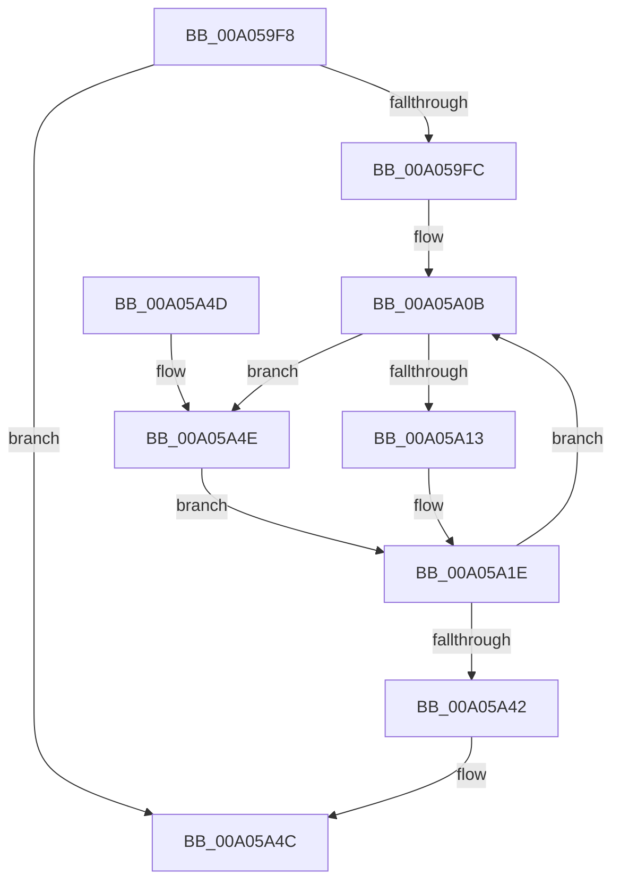

# PiSendTargetDeviceRemoveCompleteNotification

- RVA: `0x00A059F8`–`0x00A05A52` (길이 `90` bytes)
- VA: `0x0000000140A059F8`
- 실행 섹션: `PAGE`
- PDB 이름 있음: `예`; PDB Function 태그: `아니요`
- unwind 정보 RVA: `0x000A8438`
- 디코드: `27`개 명령, `90/90` bytes 표시
- 미해석 바이트: `0` (있으면 어셈블리에 `.byte`로 보존)

> 이 문서는 커널 이미지의 기계어와 PDB 기호를 분석해 생성했습니다. 4번과 5번은 함수 원형과 자료형을 바이너리 사용 방식에서 추정한 C 해석이며 원본 소스 복구 결과는 아닙니다.

## 1. Dependencies

- 직접 호출 지점: **1**; 고유 호출 대상: **1**
- 직접 호출자로 확인된 함수: **1**
- RIP 상대 이미지 참조: **1**

### Outgoing calls
- `0x00A05A33` → [PnpNotifyTargetDeviceChange](../95/PnpNotifyTargetDeviceChange_function_00954790.md) (function, `0x00954790`)

### Direct callers
- [PnpProcessQueryRemoveAndEject](PnpProcessQueryRemoveAndEject_function_00A05170.md) at `0x00A05303`

### Static image references
- `0x00A05A29` → RVA `0x0001A220` (`.rdata`; read)

## 2. Other-region calls and transfers

- 다른 실행 섹션으로 향하는 call: **0**
- 별도 외부 분기/꼬리 이동을 확인하지 못했습니다.

## 3. Assembly (complete function range)

```asm
00A059F8  85 D2                           test edx, edx
00A059FA  74 50                           je 0x140a05a4c
00A059FC  48 89 5C 24 08                  mov qword ptr [rsp + 8], rbx
00A05A01  57                              push rdi
00A05A02  48 83 EC 20                     sub rsp, 0x20
00A05A06  48 8B D9                        mov rbx, rcx
00A05A09  8B FA                           mov edi, edx
00A05A0B  48 8B 13                        mov rdx, qword ptr [rbx]
00A05A0E  48 85 D2                        test rdx, rdx
00A05A11  74 3B                           je 0x140a05a4e
00A05A13  48 8B 82 38 01 00 00            mov rax, qword ptr [rdx + 0x138]
00A05A1A  48 8B 48 28                     mov rcx, qword ptr [rax + 0x28]
00A05A1E  0F BA A9 C0 02 00 00 0E         bts dword ptr [rcx + 0x2c0], 0xe
00A05A26  45 33 C9                        xor r9d, r9d
00A05A29  48 8D 0D F0 47 61 FF            lea rcx, [rip - 0x9eb810]
00A05A30  45 33 C0                        xor r8d, r8d
00A05A33  E8 58 ED F4 FF                  call 0x140954790
00A05A38  48 83 C3 08                     add rbx, 8
00A05A3C  48 83 EF 01                     sub rdi, 1
00A05A40  75 C9                           jne 0x140a05a0b
00A05A42  48 8B 5C 24 30                  mov rbx, qword ptr [rsp + 0x30]
00A05A47  48 83 C4 20                     add rsp, 0x20
00A05A4B  5F                              pop rdi
00A05A4C  C3                              ret
00A05A4D  CC                              int3
00A05A4E  33 C9                           xor ecx, ecx
00A05A50  EB CC                           jmp 0x140a05a1e
```

## 4. C-style interpretation (structured pseudocode)

```c
__int64 __fastcall PiSendTargetDeviceRemoveCompleteNotification(__int64 a1, int a2, int a3, int a4)
{
    __int64 result;
    __int64 v_rbx;
    __int64 v_rdi;
    __int64 v_rsp;
    unsigned __int64 v_stack_p8;

    if (a2 == 0) goto loc_00A05A4C;
    v_stack_p8 = v_rbx;
    v_rsp = (v_rsp) - (32);
loc_00A05A0B:
    if (*(unsigned __int64 *)(a1) == 0) goto loc_00A05A4E;
loc_00A05A1E:
    a4 = 0;
    a3 = 0;
    result = PnpNotifyTargetDeviceChange(v_rip - 10401808, *(unsigned __int64 *)(a1), a3, a4);
    v_rbx = (a1) + (8);
    v_rdi = ((unsigned int)(a2)) - (1);
    if (condition_is_not_equal) goto loc_00A05A0B;
    v_rsp = (v_rsp) + (32);
loc_00A05A4C:
    return result;
loc_00A05A4E:
    a1 = 0;
    goto loc_00A05A1E;
}
```

## 5. (Beta) C Style

```c
int64_t PiSendTargetDeviceRemoveCompleteNotification(void *Arg1, int32_t Arg2, int32_t Arg3, int32_t Arg4)
{
    uint8_t *arg1 = (uint8_t *)Arg1;

    int64_t result;
    int64_t local_rbx;
    int64_t local_rdi;
    int64_t local_rsp;
    uint64_t v_stack_p8;

    if (Arg2 == 0) goto loc_00A05A4C;
    v_stack_p8 = local_rbx;
    local_rsp = (local_rsp) - (32);
loc_00A05A0B:
    if (*(uint64_t *)(arg1) == 0) goto loc_00A05A4E;
loc_00A05A1E:
    Arg4 = 0;
    Arg3 = 0;
    result = PnpNotifyTargetDeviceChange(v_rip - 10401808, *(uint64_t *)(arg1), Arg3, Arg4);
    local_rbx = (Arg1) + (8);
    local_rdi = ((uint32_t)(Arg2)) - (1);
    if (condition_is_not_equal) goto loc_00A05A0B;
    local_rsp = (local_rsp) + (32);
loc_00A05A4C:
    return result;
loc_00A05A4E:
    Arg1 = 0;
    goto loc_00A05A1E;
}
```

### 관측된 메모리 오프셋

구조체 형식이 확인되지 않은 접근은 인자 기준의 오프셋으로만 기록했습니다.

| 기준 인자 | 오프셋 표현 | 폭 (bit) | 접근 |
|---|---:|---:|---|
| `Arg1` | `+ 0x0` | `64` | `R` |

## 6. Execution-region graph

[열기: 2D/3D 그래프와 함수 탐색 컨트롤 패널](../../../control-panel.html?section=page&rva=0x00A059F8&view=graph)

- 2D 그래프는 위에서 아래로 흐르고, 3D 그래프는 빈 공간을 드래그해 회전합니다. Shift+드래그는 이동, 휠은 확대·축소, 함수 노드 선택은 대상 보고서 이동입니다.

### Static fallback


