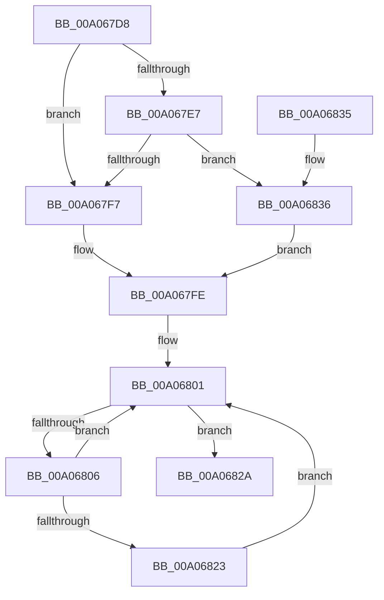

# PipAddDependentsToRebuildPowerRelationsQueue

- RVA: `0x00A067D8`–`0x00A0683C` (길이 `100` bytes)
- VA: `0x0000000140A067D8`
- 실행 섹션: `PAGE`
- PDB 이름 있음: `예`; PDB Function 태그: `아니요`
- unwind 정보 RVA: `0x0008AB4C`
- 디코드: `30`개 명령, `100/100` bytes 표시
- 미해석 바이트: `0` (있으면 어셈블리에 `.byte`로 보존)

> 이 문서는 커널 이미지의 기계어와 PDB 기호를 분석해 생성했습니다. 4번과 5번은 함수 원형과 자료형을 바이너리 사용 방식에서 추정한 C 해석이며 원본 소스 복구 결과는 아닙니다.

## 1. Dependencies

- 직접 호출 지점: **2**; 고유 호출 대상: **2**
- 직접 호출자로 확인된 함수: **3**
- RIP 상대 이미지 참조: **1**

### Outgoing calls
- `0x00A0680E` → [PiListEntryToDependencyEdge](../../text/4F/PiListEntryToDependencyEdge_function_004F9648.md) (function, `0x004F9648`)
- `0x00A06823` → [PipAddtoRebuildPowerRelationsQueue](PipAddtoRebuildPowerRelationsQueue_function_00A07174.md) (function, `0x00A07174`)

### Direct callers
- [IoResolveDependency](../../text/4C/IoResolveDependency_function_004C4380.md) at `0x004C44DA`
- [IoDuplicateDependency](../72/IoDuplicateDependency_function_00727580.md) at `0x00727668`
- [PnpDeleteAllDependencyRelations](PnpDeleteAllDependencyRelations_function_00A06724.md) at `0x00A0674F`

### Static image references
- `0x00A067F7` → RVA `0x00F8CE70` (`.data`; read)

## 2. Other-region calls and transfers

- 다른 실행 섹션으로 향하는 call: **1**
  - `0x00A0680E` → [PiListEntryToDependencyEdge](../../text/4F/PiListEntryToDependencyEdge_function_004F9648.md) (`PAGE` → `.text`)
- 별도 외부 분기/꼬리 이동을 확인하지 못했습니다.

## 3. Assembly (complete function range)

```asm
00A067D8  48 89 5C 24 08                  mov qword ptr [rsp + 8], rbx
00A067DD  57                              push rdi
00A067DE  48 83 EC 20                     sub rsp, 0x20
00A067E2  48 85 C9                        test rcx, rcx
00A067E5  74 10                           je 0x140a067f7
00A067E7  48 8B 81 38 01 00 00            mov rax, qword ptr [rcx + 0x138]
00A067EE  48 8B 58 50                     mov rbx, qword ptr [rax + 0x50]
00A067F2  48 85 DB                        test rbx, rbx
00A067F5  75 3F                           jne 0x140a06836
00A067F7  48 8D 1D 72 66 58 00            lea rbx, [rip + 0x586672]
00A067FE  48 8B 3B                        mov rdi, qword ptr [rbx]
00A06801  48 3B FB                        cmp rdi, rbx
00A06804  74 24                           je 0x140a0682a
00A06806  BA 01 00 00 00                  mov edx, 1
00A0680B  48 8B CF                        mov rcx, rdi
00A0680E  E8 35 2E AF FF                  call 0x1404f9648
00A06813  48 8B 3F                        mov rdi, qword ptr [rdi]
00A06816  48 8B 48 28                     mov rcx, qword ptr [rax + 0x28]
00A0681A  48 8B 49 30                     mov rcx, qword ptr [rcx + 0x30]
00A0681E  48 85 C9                        test rcx, rcx
00A06821  74 DE                           je 0x140a06801
00A06823  E8 4C 09 00 00                  call 0x140a07174
00A06828  EB D7                           jmp 0x140a06801
00A0682A  48 8B 5C 24 30                  mov rbx, qword ptr [rsp + 0x30]
00A0682F  48 83 C4 20                     add rsp, 0x20
00A06833  5F                              pop rdi
00A06834  C3                              ret
00A06835  CC                              int3
00A06836  48 83 C3 20                     add rbx, 0x20
00A0683A  EB C2                           jmp 0x140a067fe
```

## 4. C-style interpretation (structured pseudocode)

```c
__int64 __fastcall PipAddDependentsToRebuildPowerRelationsQueue(__int64 a1)
{
    __int64 result;
    __int64 v_rbx;
    __int64 v_rsp;
    unsigned __int64 v_stack_p8;

    v_stack_p8 = v_rbx;
    v_rsp = (v_rsp) - (32);
    if (a1 == 0) goto loc_00A067F7;
    if (*(unsigned __int64 *)(*(unsigned __int64 *)(a1 + 312) + 80) != 0) goto loc_00A06836;
loc_00A067F7:
loc_00A067FE:
loc_00A06801:
    if ((*(unsigned __int64 *)(v_rip + 5793394)) == (v_rip + 5793394)) goto loc_00A0682A;
    result = PiListEntryToDependencyEdge(*(unsigned __int64 *)(v_rip + 5793394), 1, a3, a4);
    if (*(unsigned __int64 *)(*(unsigned __int64 *)(result + 40) + 48) == 0) goto loc_00A06801;
    result = PipAddtoRebuildPowerRelationsQueue(*(unsigned __int64 *)(*(unsigned __int64 *)(result + 40) + 48), 1, a3, a4);
    goto loc_00A06801;
loc_00A0682A:
    v_rsp = (v_rsp) + (32);
    return result;
loc_00A06836:
    v_rbx = (v_stack_p8) + (32);
    goto loc_00A067FE;
}
```

## 5. (Beta) C Style

```c
int64_t PipAddDependentsToRebuildPowerRelationsQueue(int64_t Arg1)
{
    int64_t result;
    int64_t local_rbx;
    int64_t local_rsp;
    uint64_t v_stack_p8;

    v_stack_p8 = local_rbx;
    local_rsp = (local_rsp) - (32);
    if (Arg1 == 0) goto loc_00A067F7;
    if (*(uint64_t *)(*(uint64_t *)(Arg1 + 0x138) + 0x50) != 0) goto loc_00A06836;
loc_00A067F7:
loc_00A067FE:
loc_00A06801:
    if ((*(uint64_t *)(v_rip + 0x586672)) == (v_rip + 5793394)) goto loc_00A0682A;
    result = PiListEntryToDependencyEdge(*(uint64_t *)(v_rip + 0x586672), 1, a3, a4);
    if (*(uint64_t *)(*(uint64_t *)(result + 0x28) + 0x30) == 0) goto loc_00A06801;
    result = PipAddtoRebuildPowerRelationsQueue(*(uint64_t *)(*(uint64_t *)(result + 0x28) + 0x30), 1, a3, a4);
    goto loc_00A06801;
loc_00A0682A:
    local_rsp = (local_rsp) + (32);
    return result;
loc_00A06836:
    local_rbx = (v_stack_p8) + (32);
    goto loc_00A067FE;
}
```

## 6. Execution-region graph

[열기: 2D/3D 그래프와 함수 탐색 컨트롤 패널](../../../control-panel.html?section=page&rva=0x00A067D8&view=graph)

- 2D 그래프는 위에서 아래로 흐르고, 3D 그래프는 빈 공간을 드래그해 회전합니다. Shift+드래그는 이동, 휠은 확대·축소, 함수 노드 선택은 대상 보고서 이동입니다.

### Static fallback


