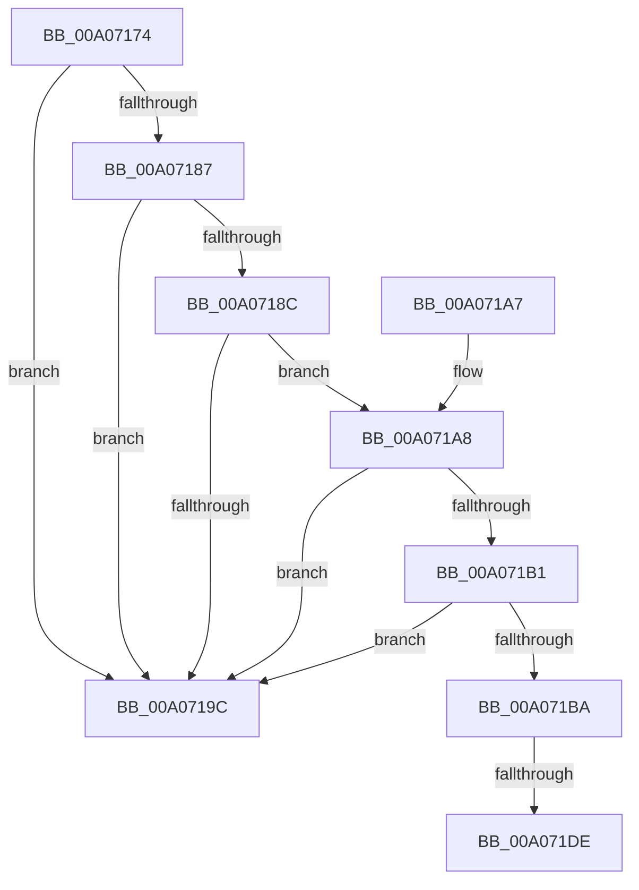

# PipAddtoRebuildPowerRelationsQueue

- RVA: `0x00A07174`–`0x00A071E5` (길이 `113` bytes)
- VA: `0x0000000140A07174`
- 실행 섹션: `PAGE`
- PDB 이름 있음: `예`; PDB Function 태그: `예`
- unwind 정보 RVA: `0x00074B1C`
- 디코드: `32`개 명령, `113/113` bytes 표시
- 미해석 바이트: `0` (있으면 어셈블리에 `.byte`로 보존)

> 이 문서는 커널 이미지의 기계어와 PDB 기호를 분석해 생성했습니다. 4번과 5번은 함수 원형과 자료형을 바이너리 사용 방식에서 추정한 C 해석이며 원본 소스 복구 결과는 아닙니다.

## 1. Dependencies

- 직접 호출 지점: **2**; 고유 호출 대상: **2**
- 직접 호출자로 확인된 함수: **4**
- RIP 상대 이미지 참조: **2**

### Outgoing calls
- `0x00A0717E` → [PipIsDeviceReadyForPowerRelations](PipIsDeviceReadyForPowerRelations_function_00A071EC.md) (function, `0x00A071EC`)
- `0x00A071BF` → [ObfReferenceObjectWithTag](../../text/21/ObfReferenceObjectWithTag_function_00210710.md) (function, `0x00210710`)

### Direct callers
- [IoResolveDependency](../../text/4C/IoResolveDependency_function_004C4380.md) at `0x004C44D2`
- [PipAddDependencyEdgeBetweenNodes](../../text/5A/PipAddDependencyEdgeBetweenNodes_function_005A5520.md) at `0x005A559E`
- [PnpNewDeviceNodeDependencyCheck](PnpNewDeviceNodeDependencyCheck_function_00A062A0.md) at `0x00A062C3`
- [PipAddDependentsToRebuildPowerRelationsQueue](PipAddDependentsToRebuildPowerRelationsQueue_function_00A067D8.md) at `0x00A06823`

### Static image references
- `0x00A071C7` → RVA `0x00F8CE60` (`.data`; read)
- `0x00A071CE` → RVA `0x00F8CE68` (`.data`; read)

## 2. Other-region calls and transfers

- 다른 실행 섹션으로 향하는 call: **1**
  - `0x00A071BF` → [ObfReferenceObjectWithTag](../../text/21/ObfReferenceObjectWithTag_function_00210710.md) (`PAGE` → `.text`)
- call이 아닌 외부 분기/꼬리 이동: **1**
  - `0x00A071D8` → [sub_00B34640](../B3/Unknown_function_00B34640.md) (`tail-transfer`)

## 3. Assembly (complete function range)

```asm
00A07174  48 89 5C 24 08                  mov qword ptr [rsp + 8], rbx
00A07179  57                              push rdi
00A0717A  48 83 EC 20                     sub rsp, 0x20
00A0717E  E8 69 00 00 00                  call 0x140a071ec
00A07183  84 C0                           test al, al
00A07185  74 15                           je 0x140a0719c
00A07187  48 85 C9                        test rcx, rcx
00A0718A  74 10                           je 0x140a0719c
00A0718C  48 8B 81 38 01 00 00            mov rax, qword ptr [rcx + 0x138]
00A07193  48 8B 78 50                     mov rdi, qword ptr [rax + 0x50]
00A07197  48 85 FF                        test rdi, rdi
00A0719A  75 0C                           jne 0x140a071a8
00A0719C  48 8B 5C 24 30                  mov rbx, qword ptr [rsp + 0x30]
00A071A1  48 83 C4 20                     add rsp, 0x20
00A071A5  5F                              pop rdi
00A071A6  C3                              ret
00A071A7  CC                              int3
00A071A8  48 8B 4F 30                     mov rcx, qword ptr [rdi + 0x30]
00A071AC  48 85 C9                        test rcx, rcx
00A071AF  74 EB                           je 0x140a0719c
00A071B1  48 8D 5F 48                     lea rbx, [rdi + 0x48]
00A071B5  48 39 1B                        cmp qword ptr [rbx], rbx
00A071B8  75 E2                           jne 0x140a0719c
00A071BA  BA 50 6E 70 44                  mov edx, 0x44706e50
00A071BF  E8 4C 95 80 FF                  call 0x140210710
00A071C4  FF 47 58                        inc dword ptr [rdi + 0x58]
00A071C7  48 8D 0D 92 5C 58 00            lea rcx, [rip + 0x585c92]
00A071CE  48 8B 05 93 5C 58 00            mov rax, qword ptr [rip + 0x585c93]
00A071D5  48 39 08                        cmp qword ptr [rax], rcx
00A071D8  0F 84 62 D4 12 00               je 0x140b34640
00A071DE  B9 03 00 00 00                  mov ecx, 3
00A071E3  CD 29                           int 0x29
```

## 4. C-style interpretation (structured pseudocode)

```c
__int64 __fastcall PipAddtoRebuildPowerRelationsQueue(__int64 a1)
{
    __int64 result;
    __int64 v_rsp;
    unsigned __int64 v_stack_p8;

    v_stack_p8 = v_rbx;
    v_rsp = (v_rsp) - (32);
    result = PipIsDeviceReadyForPowerRelations(a1, a2, a3, a4);
    if ((unsigned __int8)(result) == 0) goto loc_00A0719C;
    if (a1 == 0) goto loc_00A0719C;
    if (*(unsigned __int64 *)(*(unsigned __int64 *)(a1 + 312) + 80) != 0) goto loc_00A071A8;
loc_00A0719C:
    v_rsp = (v_rsp) + (32);
    return *(unsigned __int64 *)(a1 + 312);
loc_00A071A8:
    if (*(unsigned __int64 *)(*(unsigned __int64 *)(*(unsigned __int64 *)(a1 + 312) + 80) + 48) == 0) goto loc_00A0719C;
    if ((*(unsigned __int64 *)(*(unsigned __int64 *)(*(unsigned __int64 *)(a1 + 312) + 80) + 72)) != (*(unsigned __int64 *)(*(unsigned __int64 *)(a1 + 312) + 80) + 72)) goto loc_00A0719C;
    result = ObfReferenceObjectWithTag(*(unsigned __int64 *)(*(unsigned __int64 *)(*(unsigned __int64 *)(a1 + 312) + 80) + 48), (unsigned int)(0x44706E50ULL), a3, a4);
    return *(unsigned __int64 *)(v_rip + 5790867);
}
```

## 5. (Beta) C Style

```c
int64_t PipAddtoRebuildPowerRelationsQueue(int64_t Arg1)
{
    int64_t result;
    int64_t local_rsp;
    uint64_t v_stack_p8;

    v_stack_p8 = local_rbx;
    local_rsp = (local_rsp) - (32);
    result = PipIsDeviceReadyForPowerRelations(Arg1, a2, a3, a4);
    if ((uint8_t)(result) == 0) goto loc_00A0719C;
    if (Arg1 == 0) goto loc_00A0719C;
    if (*(uint64_t *)(*(uint64_t *)(Arg1 + 0x138) + 0x50) != 0) goto loc_00A071A8;
loc_00A0719C:
    local_rsp = (local_rsp) + (32);
    return *(uint64_t *)(Arg1 + 0x138);
loc_00A071A8:
    if (*(uint64_t *)(*(uint64_t *)(*(uint64_t *)(Arg1 + 0x138) + 0x50) + 0x30) == 0) goto loc_00A0719C;
    if ((*(uint64_t *)(*(uint64_t *)(*(uint64_t *)(Arg1 + 0x138) + 0x50) + 0x48)) != (*(uint64_t *)(*(uint64_t *)(Arg1 + 0x138) + 0x50) + 72)) goto loc_00A0719C;
    result = ObfReferenceObjectWithTag(*(uint64_t *)(*(uint64_t *)(*(uint64_t *)(Arg1 + 0x138) + 0x50) + 0x30), (uint32_t)(0x44706E50ULL), a3, a4);
    return *(uint64_t *)(v_rip + 0x585C93);
}
```

## 6. Execution-region graph

[열기: 2D/3D 그래프와 함수 탐색 컨트롤 패널](../../../control-panel.html?section=page&rva=0x00A07174&view=graph)

- 2D 그래프는 위에서 아래로 흐르고, 3D 그래프는 빈 공간을 드래그해 회전합니다. Shift+드래그는 이동, 휠은 확대·축소, 함수 노드 선택은 대상 보고서 이동입니다.

### Static fallback


