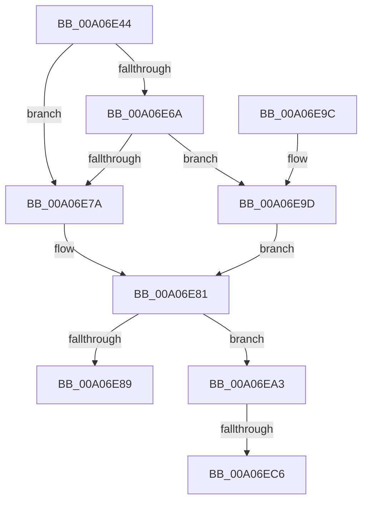

# PipCheckForUnsatisfiedDependencies

- RVA: `0x00A06E44`–`0x00A06ED6` (길이 `146` bytes)
- VA: `0x0000000140A06E44`
- 실행 섹션: `PAGE`
- PDB 이름 있음: `예`; PDB Function 태그: `예`
- unwind 정보 RVA: `0x000A858C`
- 디코드: `40`개 명령, `146/146` bytes 표시
- 미해석 바이트: `0` (있으면 어셈블리에 `.byte`로 보존)

> 이 문서는 커널 이미지의 기계어와 PDB 기호를 분석해 생성했습니다. 4번과 5번은 함수 원형과 자료형을 바이너리 사용 방식에서 추정한 C 해석이며 원본 소스 복구 결과는 아닙니다.

## 1. Dependencies

- 직접 호출 지점: **1**; 고유 호출 대상: **1**
- 직접 호출자로 확인된 함수: **2**
- RIP 상대 이미지 참조: **1**

### Outgoing calls
- `0x00A06EB0` → [PiEnumerateProviderListEntry](../72/PiEnumerateProviderListEntry_function_007277E4.md) (function, `0x007277E4`)

### Direct callers
- [PipAttemptDependentStart](../72/PipAttemptDependentStart_function_007279F0.md) at `0x00727A2F`
- [PnpCheckForActiveDependencies](PnpCheckForActiveDependencies_function_00A06DA4.md) at `0x00A06DFC`

### Static image references
- `0x00A06E7A` → RVA `0x00F8CE70` (`.data`; read)

## 2. Other-region calls and transfers

- 다른 실행 섹션으로 향하는 call: **0**
- call이 아닌 외부 분기/꼬리 이동: **2**
  - `0x00A06EC0` → [sub_00B34610](../B3/Unknown_function_00B34610.md) (`tail-transfer`)
  - `0x00A06ED1` → [sub_00B34610 + 0x3](../B3/Unknown_function_00B34610.md) (`tail-transfer`)

## 3. Assembly (complete function range)

```asm
00A06E44  48 8B C4                        mov rax, rsp
00A06E47  48 89 58 10                     mov qword ptr [rax + 0x10], rbx
00A06E4B  48 89 70 20                     mov qword ptr [rax + 0x20], rsi
00A06E4F  57                              push rdi
00A06E50  48 83 EC 20                     sub rsp, 0x20
00A06E54  45 33 DB                        xor r11d, r11d
00A06E57  8B F2                           mov esi, edx
00A06E59  44 89 58 08                     mov dword ptr [rax + 8], r11d
00A06E5D  4C 89 58 18                     mov qword ptr [rax + 0x18], r11
00A06E61  48 8B 41 20                     mov rax, qword ptr [rcx + 0x20]
00A06E65  48 85 C0                        test rax, rax
00A06E68  74 10                           je 0x140a06e7a
00A06E6A  48 8B 80 38 01 00 00            mov rax, qword ptr [rax + 0x138]
00A06E71  48 8B 58 50                     mov rbx, qword ptr [rax + 0x50]
00A06E75  48 85 DB                        test rbx, rbx
00A06E78  75 23                           jne 0x140a06e9d
00A06E7A  48 8D 1D EF 5F 58 00            lea rbx, [rip + 0x585fef]
00A06E81  48 8B 3B                        mov rdi, qword ptr [rbx]
00A06E84  48 3B FB                        cmp rdi, rbx
00A06E87  75 1A                           jne 0x140a06ea3
00A06E89  48 8B 5C 24 38                  mov rbx, qword ptr [rsp + 0x38]
00A06E8E  41 8A C3                        mov al, r11b
00A06E91  48 8B 74 24 48                  mov rsi, qword ptr [rsp + 0x48]
00A06E96  48 83 C4 20                     add rsp, 0x20
00A06E9A  5F                              pop rdi
00A06E9B  C3                              ret
00A06E9C  CC                              int3
00A06E9D  48 83 C3 10                     add rbx, 0x10
00A06EA1  EB DE                           jmp 0x140a06e81
00A06EA3  4C 8D 44 24 30                  lea r8, [rsp + 0x30]
00A06EA8  48 8B CF                        mov rcx, rdi
00A06EAB  48 8D 54 24 40                  lea rdx, [rsp + 0x40]
00A06EB0  E8 2F 09 D2 FF                  call 0x1407277e4
00A06EB5  48 8B 54 24 40                  mov rdx, qword ptr [rsp + 0x40]
00A06EBA  48 8B 3F                        mov rdi, qword ptr [rdi]
00A06EBD  48 85 D2                        test rdx, rdx
00A06EC0  0F 84 4A D7 12 00               je 0x140b34610
00A06EC6  48 8B 82 38 01 00 00            mov rax, qword ptr [rdx + 0x138]
00A06ECD  48 8B 48 28                     mov rcx, qword ptr [rax + 0x28]
00A06ED1  E9 3D D7 12 00                  jmp 0x140b34613
```

## 4. C-style interpretation (structured pseudocode)

```c
__int64 __fastcall PipCheckForUnsatisfiedDependencies(__int64 a1, int a2)
{
    __int64 result;
    __int64 v_r11;
    __int64 v_rbx;
    __int64 v_rsp;
    unsigned __int64 v_stack_p10;
    unsigned __int64 v_stack_p20;
    unsigned __int64 v_stack_p30;
    unsigned __int64 v_stack_p40;

    *(unsigned __int64 *)(v_rsp + 16) = v_rbx;
    *(unsigned __int64 *)(v_rsp + 32) = v_rsi;
    v_rsp = (v_rsp) - (32);
    v_r11 = 0;
    *(unsigned int *)(v_rsp + 8) = 0;
    *(unsigned __int64 *)(v_rsp + 24) = 0;
    if (*(unsigned __int64 *)(a1 + 32) == 0) goto loc_00A06E7A;
    if (*(unsigned __int64 *)(*(unsigned __int64 *)(*(unsigned __int64 *)(a1 + 32) + 312) + 80) != 0) goto loc_00A06E9D;
loc_00A06E7A:
loc_00A06E81:
    if ((*(unsigned __int64 *)(v_rip + 5791727)) != (v_rip + 5791727)) goto loc_00A06EA3;
    v_rsp = (v_rsp) + (32);
    return 0;
loc_00A06E9D:
    v_rbx = (v_stack_p10) + (16);
    goto loc_00A06E81;
loc_00A06EA3:
    result = PiEnumerateProviderListEntry(*(unsigned __int64 *)(v_rip + 5791727), v_stack_p40, v_stack_p30, a4);
}
```

## 5. (Beta) C Style

```c
int64_t PipCheckForUnsatisfiedDependencies(void *Arg1, int32_t Arg2)
{
    uint8_t *arg1 = (uint8_t *)Arg1;

    int64_t result;
    int64_t local_r11;
    int64_t local_rbx;
    int64_t local_rsp;
    uint64_t v_stack_p10;
    uint64_t v_stack_p20;
    uint64_t v_stack_p30;
    uint64_t v_stack_p40;

    *(uint64_t *)(local_rsp + 0x10) = local_rbx;
    *(uint64_t *)(local_rsp + 0x20) = local_rsi;
    local_rsp = (local_rsp) - (32);
    local_r11 = 0;
    *(uint32_t *)(local_rsp + 0x8) = 0;
    *(uint64_t *)(local_rsp + 0x18) = 0;
    if (*(uint64_t *)(arg1 + 0x20) == 0) goto loc_00A06E7A;
    if (*(uint64_t *)(*(uint64_t *)(*(uint64_t *)(arg1 + 0x20) + 0x138) + 0x50) != 0) goto loc_00A06E9D;
loc_00A06E7A:
loc_00A06E81:
    if ((*(uint64_t *)(v_rip + 0x585FEF)) != (v_rip + 5791727)) goto loc_00A06EA3;
    local_rsp = (local_rsp) + (32);
    return 0;
loc_00A06E9D:
    local_rbx = (v_stack_p10) + (16);
    goto loc_00A06E81;
loc_00A06EA3:
    result = PiEnumerateProviderListEntry(*(uint64_t *)(v_rip + 0x585FEF), v_stack_p40, v_stack_p30, a4);
}
```

### 관측된 메모리 오프셋

구조체 형식이 확인되지 않은 접근은 인자 기준의 오프셋으로만 기록했습니다.

| 기준 인자 | 오프셋 표현 | 폭 (bit) | 접근 |
|---|---:|---:|---|
| `Arg1` | `+ 0x20` | `64` | `R` |

## 6. Execution-region graph

[열기: 2D/3D 그래프와 함수 탐색 컨트롤 패널](../../../control-panel.html?section=page&rva=0x00A06E44&view=graph)

- 2D 그래프는 위에서 아래로 흐르고, 3D 그래프는 빈 공간을 드래그해 회전합니다. Shift+드래그는 이동, 휠은 확대·축소, 함수 노드 선택은 대상 보고서 이동입니다.

### Static fallback


