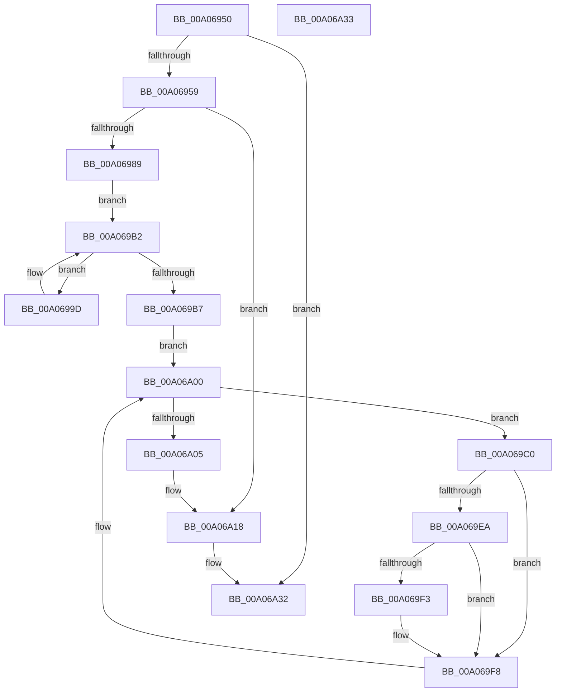

# PipDeleteAllDependencyRelations

- RVA: `0x00A06950`–`0x00A06A34` (길이 `228` bytes)
- VA: `0x0000000140A06950`
- 실행 섹션: `PAGE`
- PDB 이름 있음: `예`; PDB Function 태그: `아니요`
- unwind 정보 RVA: `0x000A851C`
- 디코드: `64`개 명령, `228/228` bytes 표시
- 미해석 바이트: `0` (있으면 어셈블리에 `.byte`로 보존)

> 이 문서는 커널 이미지의 기계어와 PDB 기호를 분석해 생성했습니다. 4번과 5번은 함수 원형과 자료형을 바이너리 사용 방식에서 추정한 C 해석이며 원본 소스 복구 결과는 아닙니다.

## 1. Dependencies

- 직접 호출 지점: **9**; 고유 호출 대상: **6**
- 직접 호출자로 확인된 함수: **1**
- RIP 상대 이미지 참조: **0**

### Outgoing calls
- `0x00A0698F` → [PipConvertResolutionsToReservations](../AD/PipConvertResolutionsToReservations_function_00AD59D4.md) (function, `0x00AD59D4`)
- `0x00A069A2` → [PiListEntryToDependencyEdge](../../text/4F/PiListEntryToDependencyEdge_function_004F9648.md) (function, `0x004F9648`)
- `0x00A069AD` → [PipFreeDependencyEdge](../../text/4D/PipFreeDependencyEdge_function_004D7658.md) (function, `0x004D7658`)
- `0x00A069C8` → [PiListEntryToDependencyEdge](../../text/4F/PiListEntryToDependencyEdge_function_004F9648.md) (function, `0x004F9648`)
- `0x00A069DC` → [PipFreeDependencyEdge](../../text/4D/PipFreeDependencyEdge_function_004D7658.md) (function, `0x004D7658`)
- `0x00A069F3` → [PipAttemptDependentStart](../72/PipAttemptDependentStart_function_007279F0.md) (function, `0x007279F0`)
- `0x00A069FB` → [PipDereferenceDependencyNode](../AC/PipDereferenceDependencyNode_function_00ACD5A0.md) (function, `0x00ACD5A0`)
- `0x00A06A0B` → [PipUnlinkDeviceObjectAndDependencyNode](../AC/PipUnlinkDeviceObjectAndDependencyNode_function_00ACD550.md) (function, `0x00ACD550`)
- `0x00A06A13` → [PipDereferenceDependencyNode](../AC/PipDereferenceDependencyNode_function_00ACD5A0.md) (function, `0x00ACD5A0`)

### Direct callers
- [PnpDeleteAllDependencyRelations](PnpDeleteAllDependencyRelations_function_00A06724.md) at `0x00A06757`

### Static image references
- 디코드된 RIP-relative 메모리 참조가 없습니다.

## 2. Other-region calls and transfers

- 다른 실행 섹션으로 향하는 call: **4**
  - `0x00A069A2` → [PiListEntryToDependencyEdge](../../text/4F/PiListEntryToDependencyEdge_function_004F9648.md) (`PAGE` → `.text`)
  - `0x00A069AD` → [PipFreeDependencyEdge](../../text/4D/PipFreeDependencyEdge_function_004D7658.md) (`PAGE` → `.text`)
  - `0x00A069C8` → [PiListEntryToDependencyEdge](../../text/4F/PiListEntryToDependencyEdge_function_004F9648.md) (`PAGE` → `.text`)
  - `0x00A069DC` → [PipFreeDependencyEdge](../../text/4D/PipFreeDependencyEdge_function_004D7658.md) (`PAGE` → `.text`)
- 별도 외부 분기/꼬리 이동을 확인하지 못했습니다.

## 3. Assembly (complete function range)

```asm
00A06950  48 85 C9                        test rcx, rcx
00A06953  0F 84 D9 00 00 00               je 0x140a06a32
00A06959  48 8B C4                        mov rax, rsp
00A0695C  48 89 58 08                     mov qword ptr [rax + 8], rbx
00A06960  48 89 68 10                     mov qword ptr [rax + 0x10], rbp
00A06964  48 89 70 18                     mov qword ptr [rax + 0x18], rsi
00A06968  48 89 78 20                     mov qword ptr [rax + 0x20], rdi
00A0696C  41 56                           push r14
00A0696E  48 83 EC 20                     sub rsp, 0x20
00A06972  48 8B 81 38 01 00 00            mov rax, qword ptr [rcx + 0x138]
00A06979  48 8B F9                        mov rdi, rcx
00A0697C  48 8B 58 50                     mov rbx, qword ptr [rax + 0x50]
00A06980  48 85 DB                        test rbx, rbx
00A06983  0F 84 8F 00 00 00               je 0x140a06a18
00A06989  FF 43 58                        inc dword ptr [rbx + 0x58]
00A0698C  48 8B CB                        mov rcx, rbx
00A0698F  E8 40 F0 0C 00                  call 0x140ad59d4
00A06994  4C 8D 73 10                     lea r14, [rbx + 0x10]
00A06998  49 8B 36                        mov rsi, qword ptr [r14]
00A0699B  EB 15                           jmp 0x140a069b2
00A0699D  33 D2                           xor edx, edx
00A0699F  48 8B CE                        mov rcx, rsi
00A069A2  E8 A1 2C AF FF                  call 0x1404f9648
00A069A7  48 8B 36                        mov rsi, qword ptr [rsi]
00A069AA  48 8B C8                        mov rcx, rax
00A069AD  E8 A6 0C AD FF                  call 0x1404d7658
00A069B2  49 3B F6                        cmp rsi, r14
00A069B5  75 E6                           jne 0x140a0699d
00A069B7  4C 8D 73 20                     lea r14, [rbx + 0x20]
00A069BB  49 8B 36                        mov rsi, qword ptr [r14]
00A069BE  EB 40                           jmp 0x140a06a00
00A069C0  BA 01 00 00 00                  mov edx, 1
00A069C5  48 8B CE                        mov rcx, rsi
00A069C8  E8 7B 2C AF FF                  call 0x1404f9648
00A069CD  48 8B 36                        mov rsi, qword ptr [rsi]
00A069D0  33 D2                           xor edx, edx
00A069D2  48 8B C8                        mov rcx, rax
00A069D5  48 8B 68 28                     mov rbp, qword ptr [rax + 0x28]
00A069D9  FF 45 58                        inc dword ptr [rbp + 0x58]
00A069DC  E8 77 0C AD FF                  call 0x1404d7658
00A069E1  48 8B 4D 30                     mov rcx, qword ptr [rbp + 0x30]
00A069E5  48 85 C9                        test rcx, rcx
00A069E8  74 0E                           je 0x140a069f8
00A069EA  48 8D 45 10                     lea rax, [rbp + 0x10]
00A069EE  48 39 00                        cmp qword ptr [rax], rax
00A069F1  74 05                           je 0x140a069f8
00A069F3  E8 F8 0F D2 FF                  call 0x1407279f0
00A069F8  48 8B CD                        mov rcx, rbp
00A069FB  E8 A0 6B 0C 00                  call 0x140acd5a0
00A06A00  49 3B F6                        cmp rsi, r14
00A06A03  75 BB                           jne 0x140a069c0
00A06A05  48 8B D3                        mov rdx, rbx
00A06A08  48 8B CF                        mov rcx, rdi
00A06A0B  E8 40 6B 0C 00                  call 0x140acd550
00A06A10  48 8B CB                        mov rcx, rbx
00A06A13  E8 88 6B 0C 00                  call 0x140acd5a0
00A06A18  48 8B 5C 24 30                  mov rbx, qword ptr [rsp + 0x30]
00A06A1D  48 8B 6C 24 38                  mov rbp, qword ptr [rsp + 0x38]
00A06A22  48 8B 74 24 40                  mov rsi, qword ptr [rsp + 0x40]
00A06A27  48 8B 7C 24 48                  mov rdi, qword ptr [rsp + 0x48]
00A06A2C  48 83 C4 20                     add rsp, 0x20
00A06A30  41 5E                           pop r14
00A06A32  C3                              ret
00A06A33  CC                              int3
```

## 4. C-style interpretation (structured pseudocode)

```c
__int64 __fastcall PipDeleteAllDependencyRelations(__int64 a1, int a2)
{
    __int64 result;
    __int64 v_rsp;
    unsigned __int64 v_stack_p10;
    unsigned __int64 v_stack_p18;
    unsigned __int64 v_stack_p20;
    unsigned __int64 v_stack_p8;

    if (a1 == 0) goto loc_00A06A32;
    *(unsigned __int64 *)(v_rsp + 8) = v_rbx;
    *(unsigned __int64 *)(v_rsp + 16) = v_rbp;
    *(unsigned __int64 *)(v_rsp + 24) = v_rsi;
    *(unsigned __int64 *)(v_rsp + 32) = v_rdi;
    v_rsp = (v_rsp) - (32);
    if (*(unsigned __int64 *)(*(unsigned __int64 *)(a1 + 312) + 80) == 0) goto loc_00A06A18;
    result = PipConvertResolutionsToReservations(*(unsigned __int64 *)(*(unsigned __int64 *)(a1 + 312) + 80), a2, a3, a4);
    goto loc_00A069B2;
loc_00A0699D:
    a2 = 0;
    result = PiListEntryToDependencyEdge(*(unsigned __int64 *)(*(unsigned __int64 *)(*(unsigned __int64 *)(a1 + 312) + 80) + 16), a2, a3, a4);
    result = PipFreeDependencyEdge(result, a2, a3, a4);
loc_00A069B2:
    if ((*(unsigned __int64 *)(*(unsigned __int64 *)(*(unsigned __int64 *)(*(unsigned __int64 *)(a1 + 312) + 80) + 16))) != (*(unsigned __int64 *)(*(unsigned __int64 *)(a1 + 312) + 80) + 16)) goto loc_00A0699D;
    goto loc_00A06A00;
loc_00A069C0:
    result = PiListEntryToDependencyEdge(*(unsigned __int64 *)(*(unsigned __int64 *)(*(unsigned __int64 *)(a1 + 312) + 80) + 32), 1, a3, a4);
    a2 = 0;
    result = PipFreeDependencyEdge(result, a2, a3, a4);
    if (*(unsigned __int64 *)(*(unsigned __int64 *)(result + 40) + 48) == 0) goto loc_00A069F8;
    result = *(unsigned __int64 *)(result + 40) + 16;
    if ((*(unsigned __int64 *)(*(unsigned __int64 *)(result + 40) + 16)) != (*(unsigned __int64 *)(result + 40) + 16)) {
        result = PipAttemptDependentStart(*(unsigned __int64 *)(*(unsigned __int64 *)(result + 40) + 48), a2, a3, a4);
    }
    result = PipDereferenceDependencyNode(*(unsigned __int64 *)(result + 40), a2, a3, a4);
loc_00A06A00:
    if ((*(unsigned __int64 *)(*(unsigned __int64 *)(*(unsigned __int64 *)(*(unsigned __int64 *)(a1 + 312) + 80) + 32))) != (*(unsigned __int64 *)(*(unsigned __int64 *)(a1 + 312) + 80) + 32)) goto loc_00A069C0;
    result = PipUnlinkDeviceObjectAndDependencyNode(a1, *(unsigned __int64 *)(*(unsigned __int64 *)(a1 + 312) + 80), a3, a4);
    result = PipDereferenceDependencyNode(*(unsigned __int64 *)(*(unsigned __int64 *)(a1 + 312) + 80), *(unsigned __int64 *)(*(unsigned __int64 *)(a1 + 312) + 80), a3, a4);
loc_00A06A18:
    v_rsp = (v_rsp) + (32);
loc_00A06A32:
    return result;
}
```

## 5. (Beta) C Style

```c
int64_t PipDeleteAllDependencyRelations(int64_t Arg1, int32_t Arg2)
{
    int64_t result;
    int64_t local_rsp;
    uint64_t v_stack_p10;
    uint64_t v_stack_p18;
    uint64_t v_stack_p20;
    uint64_t v_stack_p8;

    if (Arg1 == 0) goto loc_00A06A32;
    *(uint64_t *)(local_rsp + 0x8) = local_rbx;
    *(uint64_t *)(local_rsp + 0x10) = local_rbp;
    *(uint64_t *)(local_rsp + 0x18) = local_rsi;
    *(uint64_t *)(local_rsp + 0x20) = local_rdi;
    local_rsp = (local_rsp) - (32);
    if (*(uint64_t *)(*(uint64_t *)(Arg1 + 0x138) + 0x50) == 0) goto loc_00A06A18;
    result = PipConvertResolutionsToReservations(*(uint64_t *)(*(uint64_t *)(Arg1 + 0x138) + 0x50), Arg2, a3, a4);
    goto loc_00A069B2;
loc_00A0699D:
    Arg2 = 0;
    result = PiListEntryToDependencyEdge(*(uint64_t *)(*(uint64_t *)(*(uint64_t *)(Arg1 + 0x138) + 0x50) + 0x10), Arg2, a3, a4);
    result = PipFreeDependencyEdge(result, Arg2, a3, a4);
loc_00A069B2:
    if ((*(uint64_t *)(*(uint64_t *)(*(uint64_t *)(*(uint64_t *)(Arg1 + 0x138) + 0x50) + 0x10))) != (*(uint64_t *)(*(uint64_t *)(Arg1 + 0x138) + 0x50) + 16)) goto loc_00A0699D;
    goto loc_00A06A00;
loc_00A069C0:
    result = PiListEntryToDependencyEdge(*(uint64_t *)(*(uint64_t *)(*(uint64_t *)(Arg1 + 0x138) + 0x50) + 0x20), 1, a3, a4);
    Arg2 = 0;
    result = PipFreeDependencyEdge(result, Arg2, a3, a4);
    if (*(uint64_t *)(*(uint64_t *)(result + 0x28) + 0x30) == 0) goto loc_00A069F8;
    result = *(uint64_t *)(result + 0x28) + 16;
    if ((*(uint64_t *)(*(uint64_t *)(result + 0x28) + 0x10)) != (*(uint64_t *)(result + 0x28) + 16)) {
        result = PipAttemptDependentStart(*(uint64_t *)(*(uint64_t *)(result + 0x28) + 0x30), Arg2, a3, a4);
    }
    result = PipDereferenceDependencyNode(*(uint64_t *)(result + 0x28), Arg2, a3, a4);
loc_00A06A00:
    if ((*(uint64_t *)(*(uint64_t *)(*(uint64_t *)(*(uint64_t *)(Arg1 + 0x138) + 0x50) + 0x20))) != (*(uint64_t *)(*(uint64_t *)(Arg1 + 0x138) + 0x50) + 32)) goto loc_00A069C0;
    result = PipUnlinkDeviceObjectAndDependencyNode(Arg1, *(uint64_t *)(*(uint64_t *)(Arg1 + 0x138) + 0x50), a3, a4);
    result = PipDereferenceDependencyNode(*(uint64_t *)(*(uint64_t *)(Arg1 + 0x138) + 0x50), *(uint64_t *)(*(uint64_t *)(Arg1 + 0x138) + 0x50), a3, a4);
loc_00A06A18:
    local_rsp = (local_rsp) + (32);
loc_00A06A32:
    return result;
}
```

## 6. Execution-region graph

[열기: 2D/3D 그래프와 함수 탐색 컨트롤 패널](../../../control-panel.html?section=page&rva=0x00A06950&view=graph)

- 2D 그래프는 위에서 아래로 흐르고, 3D 그래프는 빈 공간을 드래그해 회전합니다. Shift+드래그는 이동, 휠은 확대·축소, 함수 노드 선택은 대상 보고서 이동입니다.

### Static fallback


