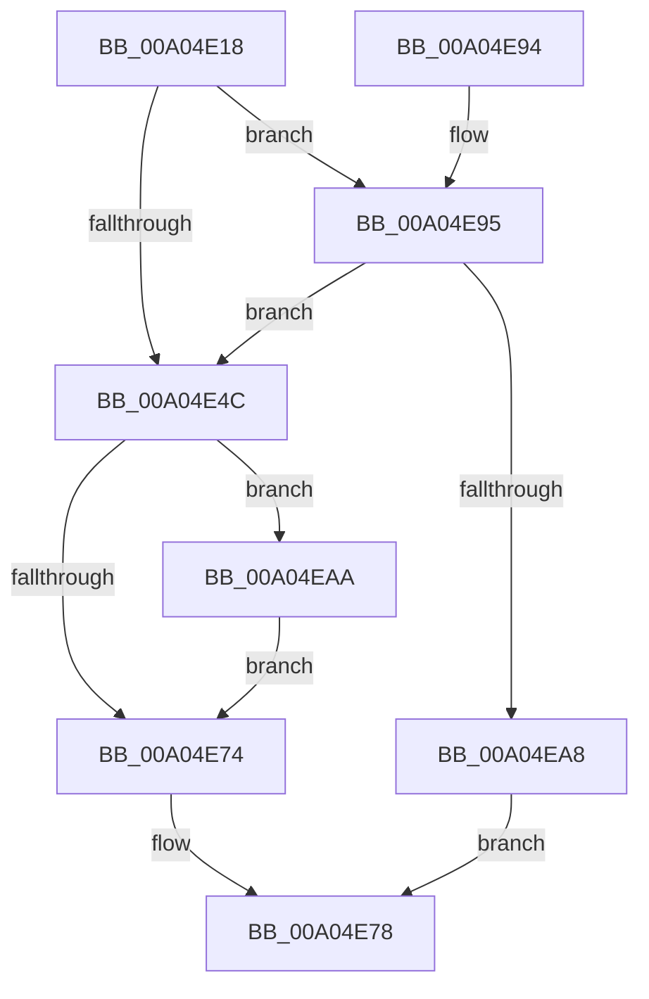

# PipDeviceObjectListAdd

- RVA: `0x00A04E18`–`0x00A04EB7` (길이 `159` bytes)
- VA: `0x0000000140A04E18`
- 실행 섹션: `PAGE`
- PDB 이름 있음: `예`; PDB Function 태그: `아니요`
- unwind 정보 RVA: `0x000A8368`
- 디코드: `49`개 명령, `159/159` bytes 표시
- 미해석 바이트: `0` (있으면 어셈블리에 `.byte`로 보존)

> 이 문서는 커널 이미지의 기계어와 PDB 기호를 분석해 생성했습니다. 4번과 5번은 함수 원형과 자료형을 바이너리 사용 방식에서 추정한 C 해석이며 원본 소스 복구 결과는 아닙니다.

## 1. Dependencies

- 직접 호출 지점: **2**; 고유 호출 대상: **2**
- 직접 호출자로 확인된 함수: **2**
- RIP 상대 이미지 참조: **0**

### Outgoing calls
- `0x00A04E5A` → [ObfReferenceObjectWithTag](../../text/21/ObfReferenceObjectWithTag_function_00210710.md) (function, `0x00210710`)
- `0x00A04E9A` → [PipGrowDeviceObjectList](PipGrowDeviceObjectList_function_00A04620.md) (function, `0x00A04620`)

### Direct callers
- [PipGrowDeviceObjectList](PipGrowDeviceObjectList_function_00A04620.md) at `0x00A0468E`
- [IopAddRelationToList](IopAddRelationToList_function_00A04D04.md) at `0x00A04D55`

### Static image references
- 디코드된 RIP-relative 메모리 참조가 없습니다.

## 2. Other-region calls and transfers

- 다른 실행 섹션으로 향하는 call: **1**
  - `0x00A04E5A` → [ObfReferenceObjectWithTag](../../text/21/ObfReferenceObjectWithTag_function_00210710.md) (`PAGE` → `.text`)
- 별도 외부 분기/꼬리 이동을 확인하지 못했습니다.

## 3. Assembly (complete function range)

```asm
00A04E18  48 8B C4                        mov rax, rsp
00A04E1B  48 89 58 10                     mov qword ptr [rax + 0x10], rbx
00A04E1F  48 89 68 18                     mov qword ptr [rax + 0x18], rbp
00A04E23  48 89 70 20                     mov qword ptr [rax + 0x20], rsi
00A04E27  57                              push rdi
00A04E28  41 56                           push r14
00A04E2A  41 57                           push r15
00A04E2C  48 83 EC 20                     sub rsp, 0x20
00A04E30  48 8B 19                        mov rbx, qword ptr [rcx]
00A04E33  45 8B F1                        mov r14d, r9d
00A04E36  48 89 58 08                     mov qword ptr [rax + 8], rbx
00A04E3A  45 8B F8                        mov r15d, r8d
00A04E3D  48 8B EA                        mov rbp, rdx
00A04E40  48 8B F1                        mov rsi, rcx
00A04E43  8B 03                           mov eax, dword ptr [rbx]
00A04E45  FF C0                           inc eax
00A04E47  3B 43 04                        cmp eax, dword ptr [rbx + 4]
00A04E4A  74 49                           je 0x140a04e95
00A04E4C  8B 03                           mov eax, dword ptr [rbx]
00A04E4E  BA 50 6E 70 4C                  mov edx, 0x4c706e50
00A04E53  48 8B CD                        mov rcx, rbp
00A04E56  48 8D 3C 40                     lea rdi, [rax + rax*2]
00A04E5A  E8 B1 B8 80 FF                  call 0x140210710
00A04E5F  83 64 FB 20 00                  and dword ptr [rbx + rdi*8 + 0x20], 0
00A04E64  48 89 6C FB 10                  mov qword ptr [rbx + rdi*8 + 0x10], rbp
00A04E69  44 89 7C FB 18                  mov dword ptr [rbx + rdi*8 + 0x18], r15d
00A04E6E  41 83 FE 01                     cmp r14d, 1
00A04E72  74 36                           je 0x140a04eaa
00A04E74  FF 03                           inc dword ptr [rbx]
00A04E76  33 C0                           xor eax, eax
00A04E78  48 8B 6C 24 50                  mov rbp, qword ptr [rsp + 0x50]
00A04E7D  48 89 1E                        mov qword ptr [rsi], rbx
00A04E80  48 8B 5C 24 48                  mov rbx, qword ptr [rsp + 0x48]
00A04E85  48 8B 74 24 58                  mov rsi, qword ptr [rsp + 0x58]
00A04E8A  48 83 C4 20                     add rsp, 0x20
00A04E8E  41 5F                           pop r15
00A04E90  41 5E                           pop r14
00A04E92  5F                              pop rdi
00A04E93  C3                              ret
00A04E94  CC                              int3
00A04E95  48 8D 4C 24 40                  lea rcx, [rsp + 0x40]
00A04E9A  E8 81 F7 FF FF                  call 0x140a04620
00A04E9F  48 8B 5C 24 40                  mov rbx, qword ptr [rsp + 0x40]
00A04EA4  85 C0                           test eax, eax
00A04EA6  79 A4                           jns 0x140a04e4c
00A04EA8  EB CE                           jmp 0x140a04e78
00A04EAA  C7 44 FB 20 01 00 00 00         mov dword ptr [rbx + rdi*8 + 0x20], 1
00A04EB2  FF 43 08                        inc dword ptr [rbx + 8]
00A04EB5  EB BD                           jmp 0x140a04e74
```

## 4. C-style interpretation (structured pseudocode)

```c
__int64 __fastcall PipDeviceObjectListAdd(__int64 a1, __int64 a2, int a3, int a4)
{
    __int64 result;
    __int64 v_rsp;
    unsigned __int64 v_stack_p10;
    unsigned __int64 v_stack_p18;
    unsigned __int64 v_stack_p20;
    unsigned __int64 v_stack_p40;

    *(unsigned __int64 *)(v_rsp + 16) = v_rbx;
    *(unsigned __int64 *)(v_rsp + 24) = v_rbp;
    *(unsigned __int64 *)(v_rsp + 32) = v_rsi;
    v_rsp = (v_rsp) - (32);
    *(unsigned __int64 *)(v_rsp + 8) = *(unsigned __int64 *)(a1);
    result = (unsigned int)(((unsigned int)(*(unsigned int *)(*(unsigned __int64 *)(a1)))) + 1);
    if (((unsigned int)(result)) == (*(unsigned int *)(*(unsigned __int64 *)(a1) + 4))) goto loc_00A04E95;
loc_00A04E4C:
    result = ObfReferenceObjectWithTag(a2, (unsigned int)(0x4C706E50ULL), a3, a4);
    *(unsigned __int64 *)(*(unsigned __int64 *)(a1) + (unsigned int)(*(unsigned int *)(*(unsigned __int64 *)(a1))) + (unsigned int)(*(unsigned int *)(*(unsigned __int64 *)(a1))) * 2 * 8 + 16) = a2;
    *(unsigned int *)(*(unsigned __int64 *)(a1) + (unsigned int)(*(unsigned int *)(*(unsigned __int64 *)(a1))) + (unsigned int)(*(unsigned int *)(*(unsigned __int64 *)(a1))) * 2 * 8 + 24) = (unsigned int)((unsigned int)(a3));
    if (((unsigned int)((unsigned int)(a4))) == 1) goto loc_00A04EAA;
loc_00A04E74:
    result = 0;
loc_00A04E78:
    *(unsigned __int64 *)(a1) = *(unsigned __int64 *)(a1);
    v_rsp = (v_rsp) + (32);
    return result;
loc_00A04E95:
    result = PipGrowDeviceObjectList(v_stack_p40, (unsigned int)(0x4C706E50ULL), a3, a4);
    if (!sign_flag) goto loc_00A04E4C;
    goto loc_00A04E78;
loc_00A04EAA:
    *(unsigned int *)(v_stack_p40 + (unsigned int)(*(unsigned int *)(*(unsigned __int64 *)(a1))) + (unsigned int)(*(unsigned int *)(*(unsigned __int64 *)(a1))) * 2 * 8 + 32) = 1;
    goto loc_00A04E74;
}
```

## 5. (Beta) C Style

```c
int64_t PipDeviceObjectListAdd(void *Arg1, int64_t Arg2, int32_t Arg3, int32_t Arg4)
{
    uint8_t *arg1 = (uint8_t *)Arg1;

    int64_t result;
    int64_t local_rsp;
    uint64_t v_stack_p10;
    uint64_t v_stack_p18;
    uint64_t v_stack_p20;
    uint64_t v_stack_p40;

    *(uint64_t *)(local_rsp + 0x10) = local_rbx;
    *(uint64_t *)(local_rsp + 0x18) = local_rbp;
    *(uint64_t *)(local_rsp + 0x20) = local_rsi;
    local_rsp = (local_rsp) - (32);
    *(uint64_t *)(local_rsp + 0x8) = *(uint64_t *)(arg1);
    result = (uint32_t)(((uint32_t)(*(uint32_t *)(*(uint64_t *)(arg1)))) + 1);
    if (((uint32_t)(result)) == (*(uint32_t *)(*(uint64_t *)(arg1) + 0x4))) goto loc_00A04E95;
loc_00A04E4C:
    result = ObfReferenceObjectWithTag(Arg2, (uint32_t)(0x4C706E50ULL), Arg3, Arg4);
    *(uint64_t *)(*(uint64_t *)(arg1) + (uint32_t)(*(uint32_t *)(*(uint64_t *)(arg1))) + (uint32_t)(*(uint32_t *)(*(uint64_t *)(arg1))) * 2 * 8 + 0x10) = Arg2;
    *(uint32_t *)(*(uint64_t *)(arg1) + (uint32_t)(*(uint32_t *)(*(uint64_t *)(arg1))) + (uint32_t)(*(uint32_t *)(*(uint64_t *)(arg1))) * 2 * 8 + 0x18) = (uint32_t)((uint32_t)(Arg3));
    if (((uint32_t)((uint32_t)(Arg4))) == 1) goto loc_00A04EAA;
loc_00A04E74:
    result = 0;
loc_00A04E78:
    *(uint64_t *)(arg1) = *(uint64_t *)(arg1);
    local_rsp = (local_rsp) + (32);
    return result;
loc_00A04E95:
    result = PipGrowDeviceObjectList(v_stack_p40, (uint32_t)(0x4C706E50ULL), Arg3, Arg4);
    if (!sign_flag) goto loc_00A04E4C;
    goto loc_00A04E78;
loc_00A04EAA:
    *(uint32_t *)(v_stack_p40 + (uint32_t)(*(uint32_t *)(*(uint64_t *)(arg1))) + (uint32_t)(*(uint32_t *)(*(uint64_t *)(arg1))) * 2 * 8 + 0x20) = 1;
    goto loc_00A04E74;
}
```

### 관측된 메모리 오프셋

구조체 형식이 확인되지 않은 접근은 인자 기준의 오프셋으로만 기록했습니다.

| 기준 인자 | 오프셋 표현 | 폭 (bit) | 접근 |
|---|---:|---:|---|
| `Arg1` | `+ 0x0` | `64` | `R` |
| `Arg1` | `+ 0x0` | `64` | `W` |

## 6. Execution-region graph

[열기: 2D/3D 그래프와 함수 탐색 컨트롤 패널](../../../control-panel.html?section=page&rva=0x00A04E18&view=graph)

- 2D 그래프는 위에서 아래로 흐르고, 3D 그래프는 빈 공간을 드래그해 회전합니다. Shift+드래그는 이동, 휠은 확대·축소, 함수 노드 선택은 대상 보고서 이동입니다.

### Static fallback


