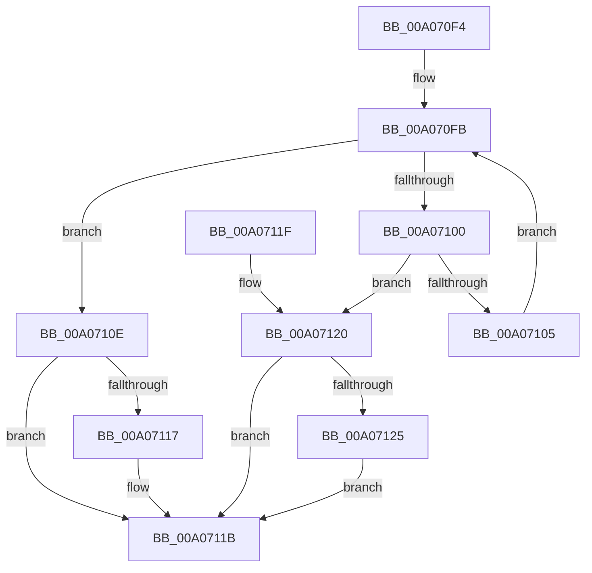

# PipDeviceObjectListIndexOf

- RVA: `0x00A070F4`–`0x00A07139` (길이 `69` bytes)
- VA: `0x0000000140A070F4`
- 실행 섹션: `PAGE`
- PDB 이름 있음: `예`; PDB Function 태그: `아니요`
- unwind 정보 RVA: `0x000DB714`
- 디코드: `24`개 명령, `69/69` bytes 표시
- 미해석 바이트: `0` (있으면 어셈블리에 `.byte`로 보존)

> 이 문서는 커널 이미지의 기계어와 PDB 기호를 분석해 생성했습니다. 4번과 5번은 함수 원형과 자료형을 바이너리 사용 방식에서 추정한 C 해석이며 원본 소스 복구 결과는 아닙니다.

## 1. Dependencies

- 직접 호출 지점: **0**; 고유 호출 대상: **0**
- 직접 호출자로 확인된 함수: **3**
- RIP 상대 이미지 참조: **0**

### Outgoing calls
- 직접 디코드된 call 명령이 없습니다.

### Direct callers
- [IopMergeRelationLists](../73/IopMergeRelationLists_function_0073DA50.md) at `0x0073DA9D`
- [IopRemoveRelationFromList](../73/IopRemoveRelationFromList_function_0073DBB8.md) at `0x0073DBCA`
- [PipIsDeviceInDeviceObjectList](PipIsDeviceInDeviceObjectList_function_00A070D0.md) at `0x00A070DA`

### Static image references
- 디코드된 RIP-relative 메모리 참조가 없습니다.

## 2. Other-region calls and transfers

- 다른 실행 섹션으로 향하는 call: **0**
- 별도 외부 분기/꼬리 이동을 확인하지 못했습니다.

## 3. Assembly (complete function range)

```asm
00A070F4  45 33 D2                        xor r10d, r10d
00A070F7  48 8D 41 10                     lea rax, [rcx + 0x10]
00A070FB  45 3B D0                        cmp r10d, r8d
00A070FE  7D 0E                           jge 0x140a0710e
00A07100  48 3B 10                        cmp rdx, qword ptr [rax]
00A07103  74 1B                           je 0x140a07120
00A07105  41 FF C2                        inc r10d
00A07108  48 83 C0 18                     add rax, 0x18
00A0710C  EB ED                           jmp 0x140a070fb
00A0710E  41 83 CA FF                     or r10d, 0xffffffff
00A07112  4D 85 C9                        test r9, r9
00A07115  74 04                           je 0x140a0711b
00A07117  49 83 21 00                     and qword ptr [r9], 0
00A0711B  41 8B C2                        mov eax, r10d
00A0711E  C3                              ret
00A0711F  CC                              int3
00A07120  4D 85 C9                        test r9, r9
00A07123  74 F6                           je 0x140a0711b
00A07125  49 63 C2                        movsxd rax, r10d
00A07128  48 8D 04 40                     lea rax, [rax + rax*2]
00A0712C  48 8D 40 02                     lea rax, [rax + 2]
00A07130  48 8D 04 C1                     lea rax, [rcx + rax*8]
00A07134  49 89 01                        mov qword ptr [r9], rax
00A07137  EB E2                           jmp 0x140a0711b
```

## 4. C-style interpretation (structured pseudocode)

```c
__int64 __fastcall PipDeviceObjectListIndexOf(__int64 a1, __int64 a2, int a3, __int64 a4)
{
    __int64 result;
    __int64 v_r10;

    v_r10 = 0;
loc_00A070FB:
    if (0 >= a3) goto loc_00A0710E;
    if (a2 == (*(unsigned __int64 *)(a1 + 16))) goto loc_00A07120;
    v_r10 = (unsigned int)((v_r10) + 1);
    result = (a1 + 16) + (24);
    goto loc_00A070FB;
loc_00A0710E:
    v_r10 = (unsigned int)((v_r10) | (0xFFFFFFFFULL));
    if (a4 != 0) {
    }
    return (unsigned int)((unsigned int)(v_r10));
loc_00A07120:
    if (a4 == 0) goto loc_00A0711B;
    *(unsigned __int64 *)(a4) = a1 + (int)((unsigned int)(v_r10)) + (int)((unsigned int)(v_r10)) * 2 + 2 * 8;
    goto loc_00A0711B;
}
```

## 5. (Beta) C Style

```c
int64_t PipDeviceObjectListIndexOf(void *Arg1, int64_t Arg2, int32_t Arg3, int64_t Arg4)
{
    uint8_t *arg1 = (uint8_t *)Arg1;

    int64_t result;
    int64_t local_r10;

    local_r10 = 0;
loc_00A070FB:
    if (0 >= Arg3) goto loc_00A0710E;
    if (Arg2 == (*(uint64_t *)(arg1 + 0x10))) goto loc_00A07120;
    local_r10 = (uint32_t)((local_r10) + 1);
    result = (Arg1 + 16) + (24);
    goto loc_00A070FB;
loc_00A0710E:
    local_r10 = (uint32_t)((local_r10) | (0xFFFFFFFFULL));
    if (Arg4 != 0) {
    }
    return (uint32_t)((uint32_t)(local_r10));
loc_00A07120:
    if (Arg4 == 0) goto loc_00A0711B;
    *(void **)(Arg4) = Arg1 + (int32_t)((uint32_t)(local_r10)) + (int32_t)((uint32_t)(local_r10)) * 2 + 2 * 8;
    goto loc_00A0711B;
}
```

### 관측된 메모리 오프셋

구조체 형식이 확인되지 않은 접근은 인자 기준의 오프셋으로만 기록했습니다.

| 기준 인자 | 오프셋 표현 | 폭 (bit) | 접근 |
|---|---:|---:|---|
| `Arg1` | `+ 0x0` | `64` | `R` |
| `Arg1` | `+ 0x0 + rax*8` | `64` | `R` |
| `Arg1` | `+ 0x10` | `64` | `R` |

## 6. Execution-region graph

[열기: 2D/3D 그래프와 함수 탐색 컨트롤 패널](../../../control-panel.html?section=page&rva=0x00A070F4&view=graph)

- 2D 그래프는 위에서 아래로 흐르고, 3D 그래프는 빈 공간을 드래그해 회전합니다. Shift+드래그는 이동, 휠은 확대·축소, 함수 노드 선택은 대상 보고서 이동입니다.

### Static fallback


