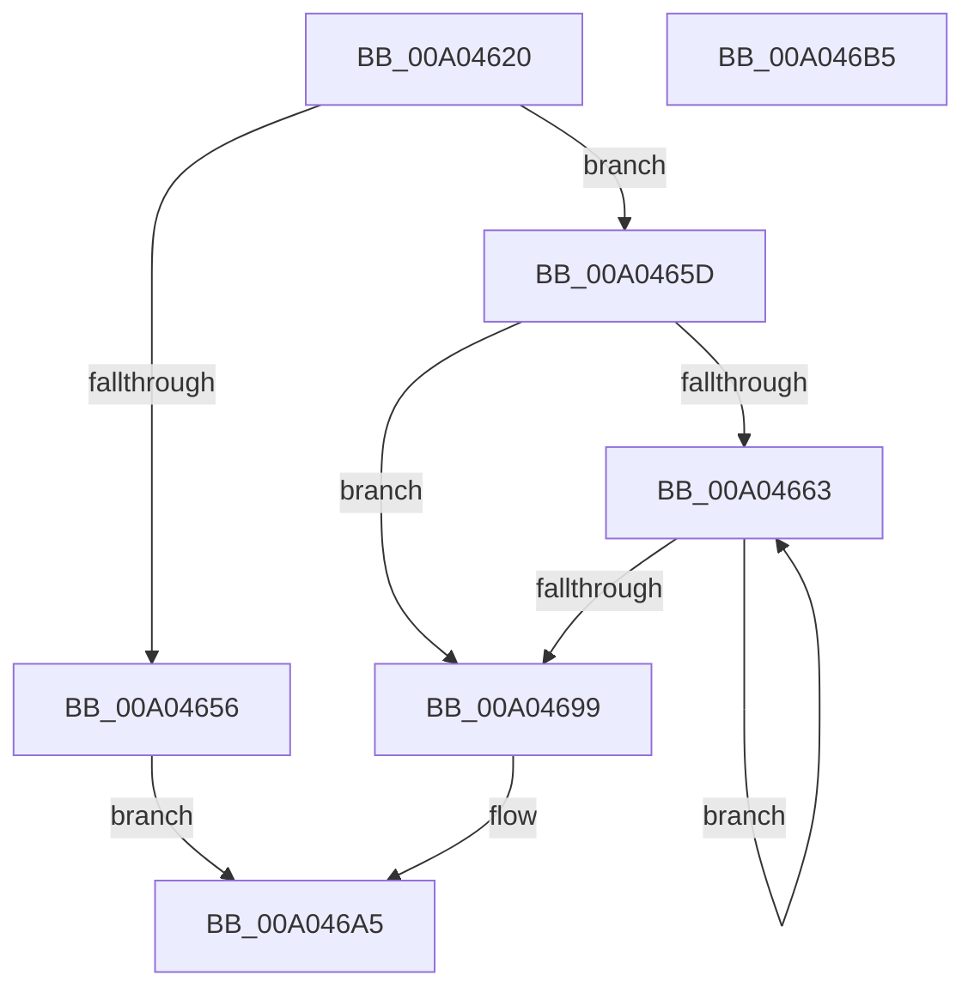

# PipGrowDeviceObjectList

- RVA: `0x00A04620`–`0x00A046B6` (길이 `150` bytes)
- VA: `0x0000000140A04620`
- 실행 섹션: `PAGE`
- PDB 이름 있음: `예`; PDB Function 태그: `아니요`
- unwind 정보 RVA: `0x000A82BC`
- 디코드: `53`개 명령, `150/150` bytes 표시
- 미해석 바이트: `0` (있으면 어셈블리에 `.byte`로 보존)

> 이 문서는 커널 이미지의 기계어와 PDB 기호를 분석해 생성했습니다. 4번과 5번은 함수 원형과 자료형을 바이너리 사용 방식에서 추정한 C 해석이며 원본 소스 복구 결과는 아닙니다.

## 1. Dependencies

- 직접 호출 지점: **4**; 고유 호출 대상: **4**
- 직접 호출자로 확인된 함수: **1**
- RIP 상대 이미지 참조: **0**

### Outgoing calls
- `0x00A04648` → [PiAllocateDeviceObjectList](PiAllocateDeviceObjectList_function_00A078B4.md) (function, `0x00A078B4`)
- `0x00A04679` → [PipDeviceObjectListElementAt](../A6/PipDeviceObjectListElementAt_function_00A6E450.md) (function, `0x00A6E450`)
- `0x00A0468E` → [PipDeviceObjectListAdd](PipDeviceObjectListAdd_function_00A04E18.md) (function, `0x00A04E18`)
- `0x00A0469C` → [PipFreeDeviceObjectList](PipFreeDeviceObjectList_function_00A08348.md) (function, `0x00A08348`)

### Direct callers
- [PipDeviceObjectListAdd](PipDeviceObjectListAdd_function_00A04E18.md) at `0x00A04E9A`

### Static image references
- 디코드된 RIP-relative 메모리 참조가 없습니다.

## 2. Other-region calls and transfers

- 다른 실행 섹션으로 향하는 call: **0**
- 별도 외부 분기/꼬리 이동을 확인하지 못했습니다.

## 3. Assembly (complete function range)

```asm
00A04620  40 55                           push rbp
00A04622  53                              push rbx
00A04623  56                              push rsi
00A04624  57                              push rdi
00A04625  41 56                           push r14
00A04627  48 8B EC                        mov rbp, rsp
00A0462A  48 83 EC 30                     sub rsp, 0x30
00A0462E  48 8B 39                        mov rdi, qword ptr [rcx]
00A04631  33 DB                           xor ebx, ebx
00A04633  4C 8B F1                        mov r14, rcx
00A04636  48 89 5D 40                     mov qword ptr [rbp + 0x40], rbx
00A0463A  89 5D 38                        mov dword ptr [rbp + 0x38], ebx
00A0463D  89 5D 30                        mov dword ptr [rbp + 0x30], ebx
00A04640  8B 57 04                        mov edx, dword ptr [rdi + 4]
00A04643  8B 4F 0C                        mov ecx, dword ptr [rdi + 0xc]
00A04646  03 D2                           add edx, edx
00A04648  E8 67 32 00 00                  call 0x140a078b4
00A0464D  48 89 45 48                     mov qword ptr [rbp + 0x48], rax
00A04651  48 85 C0                        test rax, rax
00A04654  75 07                           jne 0x140a0465d
00A04656  BB 9A 00 00 C0                  mov ebx, 0xc000009a
00A0465B  EB 48                           jmp 0x140a046a5
00A0465D  8B F3                           mov esi, ebx
00A0465F  39 1F                           cmp dword ptr [rdi], ebx
00A04661  76 36                           jbe 0x140a04699
00A04663  48 8D 45 30                     lea rax, [rbp + 0x30]
00A04667  8B D6                           mov edx, esi
00A04669  4C 8D 4D 38                     lea r9, [rbp + 0x38]
00A0466D  48 89 44 24 20                  mov qword ptr [rsp + 0x20], rax
00A04672  4C 8D 45 40                     lea r8, [rbp + 0x40]
00A04676  48 8B CF                        mov rcx, rdi
00A04679  E8 D2 9D 06 00                  call 0x140a6e450
00A0467E  48 8B 55 40                     mov rdx, qword ptr [rbp + 0x40]
00A04682  48 8D 4D 48                     lea rcx, [rbp + 0x48]
00A04686  44 8B 4D 30                     mov r9d, dword ptr [rbp + 0x30]
00A0468A  44 8B 45 38                     mov r8d, dword ptr [rbp + 0x38]
00A0468E  E8 85 07 00 00                  call 0x140a04e18
00A04693  FF C6                           inc esi
00A04695  3B 37                           cmp esi, dword ptr [rdi]
00A04697  72 CA                           jb 0x140a04663
00A04699  48 8B CF                        mov rcx, rdi
00A0469C  E8 A7 3C 00 00                  call 0x140a08348
00A046A1  48 8B 45 48                     mov rax, qword ptr [rbp + 0x48]
00A046A5  49 89 06                        mov qword ptr [r14], rax
00A046A8  8B C3                           mov eax, ebx
00A046AA  48 83 C4 30                     add rsp, 0x30
00A046AE  41 5E                           pop r14
00A046B0  5F                              pop rdi
00A046B1  5E                              pop rsi
00A046B2  5B                              pop rbx
00A046B3  5D                              pop rbp
00A046B4  C3                              ret
00A046B5  CC                              int3
```

## 4. C-style interpretation (structured pseudocode)

```c
__int64 __fastcall PipGrowDeviceObjectList(__int64 a1)
{
    __int64 result;
    __int64 v_rbx;
    __int64 v_rsi;
    __int64 v_rsp;
    unsigned __int64 v_stack_m38;
    unsigned int v_stack_p10;
    unsigned __int64 v_stack_p18;
    unsigned __int64 v_stack_p20;
    unsigned int v_stack_p8;

    v_rsp = (v_rsp) - (48);
    v_rbx = 0;
    v_stack_p18 = 0;
    v_stack_p10 = 0;
    v_stack_p8 = 0;
    a2 = (unsigned int)(((unsigned int)(*(unsigned int *)(*(unsigned __int64 *)(a1) + 4))) + ((unsigned int)((unsigned int)(*(unsigned int *)(*(unsigned __int64 *)(a1) + 4)))));
    result = PiAllocateDeviceObjectList((unsigned int)(*(unsigned int *)(*(unsigned __int64 *)(a1) + 12)), a2, a3, a4);
    v_stack_p20 = result;
    if (result != 0) goto loc_00A0465D;
    goto loc_00A046A5;
loc_00A0465D:
    if ((*(unsigned int *)(*(unsigned __int64 *)(a1))) <= ((unsigned int)((unsigned int)(0xC000009AULL)))) goto loc_00A04699;
loc_00A04663:
    v_stack_m38 = v_stack_p8;
    result = PipDeviceObjectListElementAt(*(unsigned __int64 *)(a1), (unsigned int)((unsigned int)((unsigned int)((unsigned int)((unsigned int)(0xC000009AULL))))), v_stack_p18, v_stack_p10);
    result = PipDeviceObjectListAdd(v_stack_p20, v_stack_p18, (unsigned int)(v_stack_p10), (unsigned int)(v_stack_p8));
    v_rsi = (unsigned int)(((unsigned int)((unsigned int)((unsigned int)(0xC000009AULL)))) + 1);
    if (((unsigned int)(v_rsi)) < (*(unsigned int *)(*(unsigned __int64 *)(a1)))) goto loc_00A04663;
loc_00A04699:
    result = PipFreeDeviceObjectList(*(unsigned __int64 *)(a1), v_stack_p18, (unsigned int)(v_stack_p10), (unsigned int)(v_stack_p8));
loc_00A046A5:
    *(unsigned __int64 *)(a1) = v_stack_p20;
    v_rsp = (v_rsp) + (48);
    return (unsigned int)((unsigned int)((unsigned int)(0xC000009AULL)));
}
```

## 5. (Beta) C Style

```c
int64_t PipGrowDeviceObjectList(void *Arg1)
{
    uint8_t *arg1 = (uint8_t *)Arg1;

    int64_t result;
    int64_t local_rbx;
    int64_t local_rsi;
    int64_t local_rsp;
    uint64_t v_stack_m38;
    uint32_t v_stack_p10;
    uint64_t v_stack_p18;
    uint64_t v_stack_p20;
    uint32_t v_stack_p8;

    local_rsp = (local_rsp) - (48);
    local_rbx = 0;
    v_stack_p18 = 0;
    v_stack_p10 = 0;
    v_stack_p8 = 0;
    a2 = (uint32_t)(((uint32_t)(*(uint32_t *)(*(uint64_t *)(arg1) + 0x4))) + ((uint32_t)((uint32_t)(*(uint32_t *)(*(uint64_t *)(arg1) + 0x4)))));
    result = PiAllocateDeviceObjectList((uint32_t)(*(uint32_t *)(*(uint64_t *)(arg1) + 0xC)), a2, a3, a4);
    v_stack_p20 = result;
    if (result != 0) goto loc_00A0465D;
    goto loc_00A046A5;
loc_00A0465D:
    if ((*(uint32_t *)(*(uint64_t *)(arg1))) <= ((uint32_t)((uint32_t)(0xC000009AULL)))) goto loc_00A04699;
loc_00A04663:
    v_stack_m38 = v_stack_p8;
    result = PipDeviceObjectListElementAt(*(uint64_t *)(arg1), (uint32_t)((uint32_t)((uint32_t)((uint32_t)((uint32_t)(0xC000009AULL))))), v_stack_p18, v_stack_p10);
    result = PipDeviceObjectListAdd(v_stack_p20, v_stack_p18, (uint32_t)(v_stack_p10), (uint32_t)(v_stack_p8));
    local_rsi = (uint32_t)(((uint32_t)((uint32_t)((uint32_t)(0xC000009AULL)))) + 1);
    if (((uint32_t)(local_rsi)) < (*(uint32_t *)(*(uint64_t *)(arg1)))) goto loc_00A04663;
loc_00A04699:
    result = PipFreeDeviceObjectList(*(uint64_t *)(arg1), v_stack_p18, (uint32_t)(v_stack_p10), (uint32_t)(v_stack_p8));
loc_00A046A5:
    *(uint64_t *)(arg1) = v_stack_p20;
    local_rsp = (local_rsp) + (48);
    return (uint32_t)((uint32_t)((uint32_t)(0xC000009AULL)));
}
```

### 관측된 메모리 오프셋

구조체 형식이 확인되지 않은 접근은 인자 기준의 오프셋으로만 기록했습니다.

| 기준 인자 | 오프셋 표현 | 폭 (bit) | 접근 |
|---|---:|---:|---|
| `Arg1` | `+ 0x0` | `64` | `R` |
| `Arg1` | `+ 0x0` | `64` | `W` |

## 6. Execution-region graph

[열기: 2D/3D 그래프와 함수 탐색 컨트롤 패널](../../../control-panel.html?section=page&rva=0x00A04620&view=graph)

- 2D 그래프는 위에서 아래로 흐르고, 3D 그래프는 빈 공간을 드래그해 회전합니다. Shift+드래그는 이동, 휠은 확대·축소, 함수 노드 선택은 대상 보고서 이동입니다.

### Static fallback


