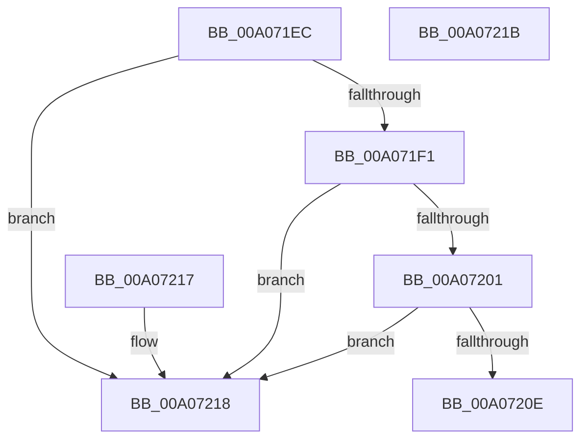

# PipIsDeviceReadyForPowerRelations

- RVA: `0x00A071EC`–`0x00A0721C` (길이 `48` bytes)
- VA: `0x0000000140A071EC`
- 실행 섹션: `PAGE`
- PDB 이름 있음: `예`; PDB Function 태그: `아니요`
- unwind 정보 RVA: `0x000DB714`
- 디코드: `16`개 명령, `48/48` bytes 표시
- 미해석 바이트: `0` (있으면 어셈블리에 `.byte`로 보존)

> 이 문서는 커널 이미지의 기계어와 PDB 기호를 분석해 생성했습니다. 4번과 5번은 함수 원형과 자료형을 바이너리 사용 방식에서 추정한 C 해석이며 원본 소스 복구 결과는 아닙니다.

## 1. Dependencies

- 직접 호출 지점: **0**; 고유 호출 대상: **0**
- 직접 호출자로 확인된 함수: **3**
- RIP 상대 이미지 참조: **0**

### Outgoing calls
- 직접 디코드된 call 명령이 없습니다.

### Direct callers
- [PipCheckIfAllProvidersHaveDevnodes](../6F/PipCheckIfAllProvidersHaveDevnodes_function_006FF944.md) at `0x006FF993`
- [PipProcessRebuildPowerRelationsQueue](PipProcessRebuildPowerRelationsQueue_function_00A06844.md) at `0x00A068AD`
- [PipAddtoRebuildPowerRelationsQueue](PipAddtoRebuildPowerRelationsQueue_function_00A07174.md) at `0x00A0717E`

### Static image references
- 디코드된 RIP-relative 메모리 참조가 없습니다.

## 2. Other-region calls and transfers

- 다른 실행 섹션으로 향하는 call: **0**
- 별도 외부 분기/꼬리 이동을 확인하지 못했습니다.

## 3. Assembly (complete function range)

```asm
00A071EC  48 85 C9                        test rcx, rcx
00A071EF  74 27                           je 0x140a07218
00A071F1  48 8B 81 38 01 00 00            mov rax, qword ptr [rcx + 0x138]
00A071F8  48 8B 40 28                     mov rax, qword ptr [rax + 0x28]
00A071FC  48 85 C0                        test rax, rax
00A071FF  74 17                           je 0x140a07218
00A07201  8B 80 2C 01 00 00               mov eax, dword ptr [rax + 0x12c]
00A07207  3D 01 03 00 00                  cmp eax, 0x301
00A0720C  74 0A                           je 0x140a07218
00A0720E  3D 02 03 00 00                  cmp eax, 0x302
00A07213  0F 95 C0                        setne al
00A07216  C3                              ret
00A07217  CC                              int3
00A07218  32 C0                           xor al, al
00A0721A  C3                              ret
00A0721B  CC                              int3
```

## 4. C-style interpretation (structured pseudocode)

```c
__int64 __fastcall PipIsDeviceReadyForPowerRelations(__int64 a1)
{
    __int64 result;

    if (a1 == 0) goto loc_00A07218;
    if (*(unsigned __int64 *)(*(unsigned __int64 *)(a1 + 312) + 40) == 0) goto loc_00A07218;
    if (((unsigned int)((unsigned int)(*(unsigned int *)(*(unsigned __int64 *)(*(unsigned __int64 *)(a1 + 312) + 40) + 300)))) == 769) goto loc_00A07218;
    result = (((unsigned int)((unsigned int)(*(unsigned int *)(*(unsigned __int64 *)(*(unsigned __int64 *)(a1 + 312) + 40) + 300)))) != 770) ? 1 : 0;
    return result;
loc_00A07218:
    result = 0;
    return result;
}
```

## 5. (Beta) C Style

```c
int64_t PipIsDeviceReadyForPowerRelations(int64_t Arg1)
{
    int64_t result;

    if (Arg1 == 0) goto loc_00A07218;
    if (*(uint64_t *)(*(uint64_t *)(Arg1 + 0x138) + 0x28) == 0) goto loc_00A07218;
    if (((uint32_t)((uint32_t)(*(uint32_t *)(*(uint64_t *)(*(uint64_t *)(Arg1 + 0x138) + 0x28) + 0x12C)))) == 769) goto loc_00A07218;
    result = (((uint32_t)((uint32_t)(*(uint32_t *)(*(uint64_t *)(*(uint64_t *)(Arg1 + 0x138) + 0x28) + 0x12C)))) != 770) ? 1 : 0;
    return result;
loc_00A07218:
    result = 0;
    return result;
}
```

## 6. Execution-region graph

[열기: 2D/3D 그래프와 함수 탐색 컨트롤 패널](../../../control-panel.html?section=page&rva=0x00A071EC&view=graph)

- 2D 그래프는 위에서 아래로 흐르고, 3D 그래프는 빈 공간을 드래그해 회전합니다. Shift+드래그는 이동, 휠은 확대·축소, 함수 노드 선택은 대상 보고서 이동입니다.

### Static fallback


