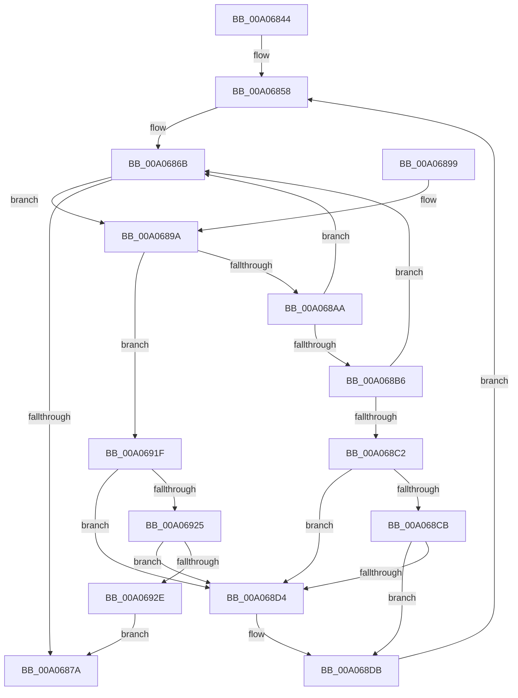

# PipProcessRebuildPowerRelationsQueue

- RVA: `0x00A06844`–`0x00A06949` (길이 `261` bytes)
- VA: `0x0000000140A06844`
- 실행 섹션: `PAGE`
- PDB 이름 있음: `예`; PDB Function 태그: `아니요`
- unwind 정보 RVA: `0x000A8504`
- 디코드: `71`개 명령, `261/261` bytes 표시
- 미해석 바이트: `0` (있으면 어셈블리에 `.byte`로 보존)

> 이 문서는 커널 이미지의 기계어와 PDB 기호를 분석해 생성했습니다. 4번과 5번은 함수 원형과 자료형을 바이너리 사용 방식에서 추정한 C 해석이며 원본 소스 복구 결과는 아닙니다.

## 1. Dependencies

- 직접 호출 지점: **12**; 고유 호출 대상: **9**
- 직접 호출자로 확인된 함수: **6**
- RIP 상대 이미지 참조: **1**

### Outgoing calls
- `0x00A0685A` → [PnpAcquireDependencyRelationsLock](PnpAcquireDependencyRelationsLock_function_00A06788.md) (function, `0x00A06788`)
- `0x00A0685F` → [PnpAcquirePowerRelationsQueueLock](../../text/4B/PnpAcquirePowerRelationsQueueLock_function_004B9534.md) (function, `0x004B9534`)
- `0x00A0687A` → [PnpReleasePowerRelationsQueueLock](../../text/4B/PnpReleasePowerRelationsQueueLock_function_004BE70C.md) (function, `0x004BE70C`)
- `0x00A0687F` → [PnpReleaseDependencyRelationsLock](PnpReleaseDependencyRelationsLock_function_00A06E14.md) (function, `0x00A06E14`)
- `0x00A068AD` → [PipIsDeviceReadyForPowerRelations](PipIsDeviceReadyForPowerRelations_function_00A071EC.md) (function, `0x00A071EC`)
- `0x00A068B9` → [PipCheckIfAllProvidersHaveDevnodes](../6F/PipCheckIfAllProvidersHaveDevnodes_function_006FF944.md) (function, `0x006FF944`)
- `0x00A068EC` → [PipDereferenceDependencyNode](../AC/PipDereferenceDependencyNode_function_00ACD5A0.md) (function, `0x00ACD5A0`)
- `0x00A068F1` → [PnpReleasePowerRelationsQueueLock](../../text/4B/PnpReleasePowerRelationsQueueLock_function_004BE70C.md) (function, `0x004BE70C`)
- `0x00A068F6` → [PnpReleaseDependencyRelationsLock](PnpReleaseDependencyRelationsLock_function_00A06E14.md) (function, `0x00A06E14`)
- `0x00A06908` → [PiQueryPowerRelations](../AA/PiQueryPowerRelations_function_00AA3F9C.md) (function, `0x00AA3F9C`)
- `0x00A06915` → [ObfDereferenceObjectWithTag](../../text/2F/ObfDereferenceObjectWithTag_function_002F78E0.md) (function, `0x002F78E0`)
- `0x00A0693F` → [PipDereferenceDependencyNode](../AC/PipDereferenceDependencyNode_function_00ACD5A0.md) (function, `0x00ACD5A0`)

### Direct callers
- [IoResolveDependency](../../text/4C/IoResolveDependency_function_004C4380.md) at `0x004C44E4`
- [IoDuplicateDependency](../72/IoDuplicateDependency_function_00727580.md) at `0x00727672`
- [IoSetDependency](../72/IoSetDependency_function_00727740.md) at `0x007277C7`
- [PnpNewDeviceNodeDependencyCheck](PnpNewDeviceNodeDependencyCheck_function_00A062A0.md) at `0x00A062CD`
- [PnpDeleteAllDependencyRelations](PnpDeleteAllDependencyRelations_function_00A06724.md) at `0x00A06761`
- [PnpSurpriseRemovedDeviceNodeDependencyCheck](PnpSurpriseRemovedDeviceNodeDependencyCheck_function_00A0861C.md) at `0x00A0865A`

### Static image references
- `0x00A06864` → RVA `0x00F8CE60` (`.data`; read)

## 2. Other-region calls and transfers

- 다른 실행 섹션으로 향하는 call: **4**
  - `0x00A0685F` → [PnpAcquirePowerRelationsQueueLock](../../text/4B/PnpAcquirePowerRelationsQueueLock_function_004B9534.md) (`PAGE` → `.text`)
  - `0x00A0687A` → [PnpReleasePowerRelationsQueueLock](../../text/4B/PnpReleasePowerRelationsQueueLock_function_004BE70C.md) (`PAGE` → `.text`)
  - `0x00A068F1` → [PnpReleasePowerRelationsQueueLock](../../text/4B/PnpReleasePowerRelationsQueueLock_function_004BE70C.md) (`PAGE` → `.text`)
  - `0x00A06915` → [ObfDereferenceObjectWithTag](../../text/2F/ObfDereferenceObjectWithTag_function_002F78E0.md) (`PAGE` → `.text`)
- 별도 외부 분기/꼬리 이동을 확인하지 못했습니다.

## 3. Assembly (complete function range)

```asm
00A06844  48 89 5C 24 08                  mov qword ptr [rsp + 8], rbx
00A06849  48 89 6C 24 10                  mov qword ptr [rsp + 0x10], rbp
00A0684E  48 89 74 24 18                  mov qword ptr [rsp + 0x18], rsi
00A06853  57                              push rdi
00A06854  48 83 EC 20                     sub rsp, 0x20
00A06858  B1 01                           mov cl, 1
00A0685A  E8 29 FF FF FF                  call 0x140a06788
00A0685F  E8 D0 2C AB FF                  call 0x1404b9534
00A06864  48 8B 3D F5 65 58 00            mov rdi, qword ptr [rip + 0x5865f5]
00A0686B  48 8D 05 EE 65 58 00            lea rax, [rip + 0x5865ee]
00A06872  48 8B DF                        mov rbx, rdi
00A06875  48 3B F8                        cmp rdi, rax
00A06878  75 20                           jne 0x140a0689a
00A0687A  E8 8D 7E AB FF                  call 0x1404be70c
00A0687F  E8 90 05 00 00                  call 0x140a06e14
00A06884  48 8B 5C 24 30                  mov rbx, qword ptr [rsp + 0x30]
00A06889  48 8B 6C 24 38                  mov rbp, qword ptr [rsp + 0x38]
00A0688E  48 8B 74 24 40                  mov rsi, qword ptr [rsp + 0x40]
00A06893  48 83 C4 20                     add rsp, 0x20
00A06897  5F                              pop rdi
00A06898  C3                              ret
00A06899  CC                              int3
00A0689A  48 8D 77 B8                     lea rsi, [rdi - 0x48]
00A0689E  48 8B 3F                        mov rdi, qword ptr [rdi]
00A068A1  48 8B 6E 30                     mov rbp, qword ptr [rsi + 0x30]
00A068A5  48 85 ED                        test rbp, rbp
00A068A8  74 75                           je 0x140a0691f
00A068AA  48 8B CD                        mov rcx, rbp
00A068AD  E8 3A 09 00 00                  call 0x140a071ec
00A068B2  84 C0                           test al, al
00A068B4  74 B5                           je 0x140a0686b
00A068B6  48 8B CE                        mov rcx, rsi
00A068B9  E8 86 90 CF FF                  call 0x1406ff944
00A068BE  84 C0                           test al, al
00A068C0  74 A9                           je 0x140a0686b
00A068C2  48 8B 03                        mov rax, qword ptr [rbx]
00A068C5  48 39 58 08                     cmp qword ptr [rax + 8], rbx
00A068C9  75 09                           jne 0x140a068d4
00A068CB  48 8B 4B 08                     mov rcx, qword ptr [rbx + 8]
00A068CF  48 39 19                        cmp qword ptr [rcx], rbx
00A068D2  74 07                           je 0x140a068db
00A068D4  B9 03 00 00 00                  mov ecx, 3
00A068D9  CD 29                           int 0x29
00A068DB  48 89 01                        mov qword ptr [rcx], rax
00A068DE  48 89 48 08                     mov qword ptr [rax + 8], rcx
00A068E2  48 8B CE                        mov rcx, rsi
00A068E5  48 89 5B 08                     mov qword ptr [rbx + 8], rbx
00A068E9  48 89 1B                        mov qword ptr [rbx], rbx
00A068EC  E8 AF 6C 0C 00                  call 0x140acd5a0
00A068F1  E8 16 7E AB FF                  call 0x1404be70c
00A068F6  E8 19 05 00 00                  call 0x140a06e14
00A068FB  48 8B 8D 38 01 00 00            mov rcx, qword ptr [rbp + 0x138]
00A06902  B2 01                           mov dl, 1
00A06904  48 8B 49 28                     mov rcx, qword ptr [rcx + 0x28]
00A06908  E8 8F D6 09 00                  call 0x140aa3f9c
00A0690D  BA 50 6E 70 44                  mov edx, 0x44706e50
00A06912  48 8B CD                        mov rcx, rbp
00A06915  E8 C6 0F 8F FF                  call 0x1402f78e0
00A0691A  E9 39 FF FF FF                  jmp 0x140a06858
00A0691F  48 39 5F 08                     cmp qword ptr [rdi + 8], rbx
00A06923  75 AF                           jne 0x140a068d4
00A06925  48 8B 43 08                     mov rax, qword ptr [rbx + 8]
00A06929  48 39 18                        cmp qword ptr [rax], rbx
00A0692C  75 A6                           jne 0x140a068d4
00A0692E  48 89 38                        mov qword ptr [rax], rdi
00A06931  48 8B CE                        mov rcx, rsi
00A06934  48 89 47 08                     mov qword ptr [rdi + 8], rax
00A06938  48 89 5B 08                     mov qword ptr [rbx + 8], rbx
00A0693C  48 89 1B                        mov qword ptr [rbx], rbx
00A0693F  E8 5C 6C 0C 00                  call 0x140acd5a0
00A06944  E9 31 FF FF FF                  jmp 0x140a0687a
```

## 4. C-style interpretation (structured pseudocode)

```c
__int64 __fastcall PipProcessRebuildPowerRelationsQueue(void)
{
    __int64 result;
    __int64 v_rsp;
    unsigned __int64 v_stack_p10;
    unsigned __int64 v_stack_p18;
    unsigned __int64 v_stack_p8;

    v_stack_p8 = v_rbx;
    v_stack_p10 = v_rbp;
    v_stack_p18 = v_rsi;
    v_rsp = (v_rsp) - (32);
loc_00A06858:
    result = PnpAcquireDependencyRelationsLock(1, a2, a3, a4);
    result = PnpAcquirePowerRelationsQueueLock(1, a2, a3, a4);
loc_00A0686B:
    if ((*(unsigned __int64 *)(v_rip + 5793269)) != (v_rip + 5793262)) goto loc_00A0689A;
loc_00A0687A:
    result = PnpReleasePowerRelationsQueueLock(1, a2, a3, a4);
    result = PnpReleaseDependencyRelationsLock(1, a2, a3, a4);
    v_rsp = (v_rsp) + (32);
    return result;
loc_00A0689A:
    if (*(unsigned __int64 *)(*(unsigned __int64 *)(v_rip + 5793269) - 72 + 48) == 0) goto loc_00A0691F;
    result = PipIsDeviceReadyForPowerRelations(*(unsigned __int64 *)(*(unsigned __int64 *)(v_rip + 5793269) - 72 + 48), a2, a3, a4);
    if ((unsigned __int8)(result) == 0) goto loc_00A0686B;
    result = PipCheckIfAllProvidersHaveDevnodes(*(unsigned __int64 *)(v_rip + 5793269) - 72, a2, a3, a4);
    if ((unsigned __int8)(result) == 0) goto loc_00A0686B;
    if ((*(unsigned __int64 *)(*(unsigned __int64 *)(v_stack_p8) + 8)) != v_stack_p8) goto loc_00A068D4;
    if ((*(unsigned __int64 *)(*(unsigned __int64 *)(v_stack_p8 + 8))) != v_stack_p8) {
        a1 = 3;
    }
    *(unsigned __int64 *)(a1) = *(unsigned __int64 *)(v_stack_p8);
    *(unsigned __int64 *)(*(unsigned __int64 *)(v_stack_p8) + 8) = a1;
    *(unsigned __int64 *)(v_stack_p8 + 8) = v_stack_p8;
    *(unsigned __int64 *)(v_stack_p8) = v_stack_p8;
    result = PipDereferenceDependencyNode(*(unsigned __int64 *)(v_rip + 5793269) - 72, a2, a3, a4);
    result = PnpReleasePowerRelationsQueueLock(*(unsigned __int64 *)(v_rip + 5793269) - 72, a2, a3, a4);
    result = PnpReleaseDependencyRelationsLock(*(unsigned __int64 *)(v_rip + 5793269) - 72, a2, a3, a4);
    result = PiQueryPowerRelations(*(unsigned __int64 *)(*(unsigned __int64 *)(*(unsigned __int64 *)(*(unsigned __int64 *)(v_rip + 5793269) - 72 + 48) + 312) + 40), 1, a3, a4);
    result = ObfDereferenceObjectWithTag(*(unsigned __int64 *)(*(unsigned __int64 *)(v_rip + 5793269) - 72 + 48), (unsigned int)(0x44706E50ULL), a3, a4);
    goto loc_00A06858;
loc_00A0691F:
    if ((*(unsigned __int64 *)(*(unsigned __int64 *)(*(unsigned __int64 *)(v_rip + 5793269)) + 8)) != v_stack_p8) goto loc_00A068D4;
    if ((*(unsigned __int64 *)(*(unsigned __int64 *)(v_stack_p8 + 8))) != v_stack_p8) goto loc_00A068D4;
    *(unsigned __int64 *)(*(unsigned __int64 *)(v_stack_p8 + 8)) = *(unsigned __int64 *)(*(unsigned __int64 *)(v_rip + 5793269));
    *(unsigned __int64 *)(*(unsigned __int64 *)(*(unsigned __int64 *)(v_rip + 5793269)) + 8) = *(unsigned __int64 *)(v_stack_p8 + 8);
    *(unsigned __int64 *)(v_stack_p8 + 8) = v_stack_p8;
    *(unsigned __int64 *)(v_stack_p8) = v_stack_p8;
    result = PipDereferenceDependencyNode(*(unsigned __int64 *)(v_rip + 5793269) - 72, (unsigned int)(0x44706E50ULL), a3, a4);
    goto loc_00A0687A;
}
```

## 5. (Beta) C Style

```c
void PipProcessRebuildPowerRelationsQueue(void)
{
    int64_t result;
    int64_t local_rsp;
    uint64_t v_stack_p10;
    uint64_t v_stack_p18;
    uint64_t v_stack_p8;

    v_stack_p8 = local_rbx;
    v_stack_p10 = local_rbp;
    v_stack_p18 = local_rsi;
    local_rsp = (local_rsp) - (32);
loc_00A06858:
    result = PnpAcquireDependencyRelationsLock(1, a2, a3, a4);
    result = PnpAcquirePowerRelationsQueueLock(1, a2, a3, a4);
loc_00A0686B:
    if ((*(uint64_t *)(v_rip + 0x5865F5)) != (v_rip + 5793262)) goto loc_00A0689A;
loc_00A0687A:
    result = PnpReleasePowerRelationsQueueLock(1, a2, a3, a4);
    result = PnpReleaseDependencyRelationsLock(1, a2, a3, a4);
    local_rsp = (local_rsp) + (32);
    return result;
loc_00A0689A:
    if (*(uint64_t *)(*(uint64_t *)(v_rip + 0x5865F5) - 0x48 + 0x30) == 0) goto loc_00A0691F;
    result = PipIsDeviceReadyForPowerRelations(*(uint64_t *)(*(uint64_t *)(v_rip + 0x5865F5) - 0x48 + 0x30), a2, a3, a4);
    if ((uint8_t)(result) == 0) goto loc_00A0686B;
    result = PipCheckIfAllProvidersHaveDevnodes(*(uint64_t *)(v_rip + 0x5865F5) - 72, a2, a3, a4);
    if ((uint8_t)(result) == 0) goto loc_00A0686B;
    if ((*(uint64_t *)(*(uint64_t *)(v_stack_p8) + 0x8)) != v_stack_p8) goto loc_00A068D4;
    if ((*(uint64_t *)(*(uint64_t *)(v_stack_p8 + 0x8))) != v_stack_p8) {
        a1 = 3;
    }
    *(uint64_t *)(a1) = *(uint64_t *)(v_stack_p8);
    *(uint64_t *)(*(uint64_t *)(v_stack_p8) + 0x8) = a1;
    *(uint64_t *)(v_stack_p8 + 0x8) = v_stack_p8;
    *(uint64_t *)(v_stack_p8) = v_stack_p8;
    result = PipDereferenceDependencyNode(*(uint64_t *)(v_rip + 0x5865F5) - 72, a2, a3, a4);
    result = PnpReleasePowerRelationsQueueLock(*(uint64_t *)(v_rip + 0x5865F5) - 72, a2, a3, a4);
    result = PnpReleaseDependencyRelationsLock(*(uint64_t *)(v_rip + 0x5865F5) - 72, a2, a3, a4);
    result = PiQueryPowerRelations(*(uint64_t *)(*(uint64_t *)(*(uint64_t *)(*(uint64_t *)(v_rip + 0x5865F5) - 0x48 + 0x30) + 0x138) + 0x28), 1, a3, a4);
    result = ObfDereferenceObjectWithTag(*(uint64_t *)(*(uint64_t *)(v_rip + 0x5865F5) - 0x48 + 0x30), (uint32_t)(0x44706E50ULL), a3, a4);
    goto loc_00A06858;
loc_00A0691F:
    if ((*(uint64_t *)(*(uint64_t *)(*(uint64_t *)(v_rip + 0x5865F5)) + 0x8)) != v_stack_p8) goto loc_00A068D4;
    if ((*(uint64_t *)(*(uint64_t *)(v_stack_p8 + 0x8))) != v_stack_p8) goto loc_00A068D4;
    *(uint64_t *)(*(uint64_t *)(v_stack_p8 + 0x8)) = *(uint64_t *)(*(uint64_t *)(v_rip + 0x5865F5));
    *(uint64_t *)(*(uint64_t *)(*(uint64_t *)(v_rip + 0x5865F5)) + 0x8) = *(uint64_t *)(v_stack_p8 + 0x8);
    *(uint64_t *)(v_stack_p8 + 0x8) = v_stack_p8;
    *(uint64_t *)(v_stack_p8) = v_stack_p8;
    result = PipDereferenceDependencyNode(*(uint64_t *)(v_rip + 0x5865F5) - 72, (uint32_t)(0x44706E50ULL), a3, a4);
    goto loc_00A0687A;
}
```

## 6. Execution-region graph

[열기: 2D/3D 그래프와 함수 탐색 컨트롤 패널](../../../control-panel.html?section=page&rva=0x00A06844&view=graph)

- 2D 그래프는 위에서 아래로 흐르고, 3D 그래프는 빈 공간을 드래그해 회전합니다. Shift+드래그는 이동, 휠은 확대·축소, 함수 노드 선택은 대상 보고서 이동입니다.

### Static fallback


