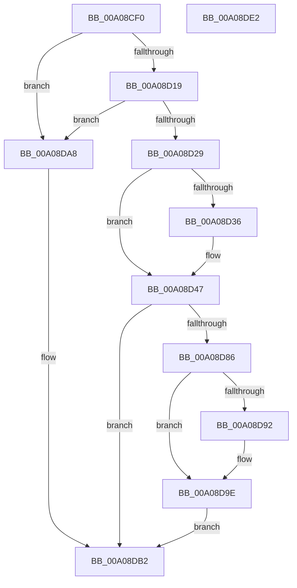

# PipRemoveDevicesInRelationList

- RVA: `0x00A08CF0`–`0x00A08DE3` (길이 `243` bytes)
- VA: `0x0000000140A08CF0`
- 실행 섹션: `PAGE`
- PDB 이름 있음: `예`; PDB Function 태그: `아니요`
- unwind 정보 RVA: `0x00060130`
- 디코드: `63`개 명령, `243/243` bytes 표시
- 미해석 바이트: `0` (있으면 어셈블리에 `.byte`로 보존)

> 이 문서는 커널 이미지의 기계어와 PDB 기호를 분석해 생성했습니다. 4번과 5번은 함수 원형과 자료형을 바이너리 사용 방식에서 추정한 C 해석이며 원본 소스 복구 결과는 아닙니다.

## 1. Dependencies

- 직접 호출 지점: **6**; 고유 호출 대상: **6**
- 직접 호출자로 확인된 함수: **1**
- RIP 상대 이미지 참조: **0**

### Outgoing calls
- `0x00A08D4E` → [IopSortRelationListForRemove](IopSortRelationListForRemove_function_00A06C30.md) (function, `0x00A06C30`)
- `0x00A08D7C` → [PnpDeleteLockedDeviceNodes](PnpDeleteLockedDeviceNodes_function_00A09B30.md) (function, `0x00A09B30`)
- `0x00A08D99` → [IopRemoveRelationFromList](../73/IopRemoveRelationFromList_function_0073DBB8.md) (function, `0x0073DBB8`)
- `0x00A08DA1` → [PnpUnlinkDeviceRemovalRelations](PnpUnlinkDeviceRemovalRelations_function_00A063D8.md) (function, `0x00A063D8`)
- `0x00A08DB5` → [IopFreeRelationList](IopFreeRelationList_function_00A08310.md) (function, `0x00A08310`)
- `0x00A08DBF` → [ExFreePoolWithTag](../../poolcode/B8/ExFreePoolWithTag_function_00B82870.md) (function, `0x00B82870`)

### Direct callers
- [PnpDelayedRemoveWorker](PnpDelayedRemoveWorker_function_00A08AE0.md) at `0x00A08C53`

### Static image references
- 디코드된 RIP-relative 메모리 참조가 없습니다.

## 2. Other-region calls and transfers

- 다른 실행 섹션으로 향하는 call: **1**
  - `0x00A08DBF` → [ExFreePoolWithTag](../../poolcode/B8/ExFreePoolWithTag_function_00B82870.md) (`PAGE` → `POOLCODE`)
- 별도 외부 분기/꼬리 이동을 확인하지 못했습니다.

## 3. Assembly (complete function range)

```asm
00A08CF0  48 8B C4                        mov rax, rsp
00A08CF3  48 89 58 08                     mov qword ptr [rax + 8], rbx
00A08CF7  48 89 68 10                     mov qword ptr [rax + 0x10], rbp
00A08CFB  48 89 70 18                     mov qword ptr [rax + 0x18], rsi
00A08CFF  48 89 78 20                     mov qword ptr [rax + 0x20], rdi
00A08D03  41 56                           push r14
00A08D05  48 83 EC 40                     sub rsp, 0x40
00A08D09  48 8B 41 38                     mov rax, qword ptr [rcx + 0x38]
00A08D0D  48 8B F9                        mov rdi, rcx
00A08D10  48 85 C0                        test rax, rax
00A08D13  0F 84 8F 00 00 00               je 0x140a08da8
00A08D19  48 8B 80 38 01 00 00            mov rax, qword ptr [rax + 0x138]
00A08D20  48 8B 68 28                     mov rbp, qword ptr [rax + 0x28]
00A08D24  48 85 ED                        test rbp, rbp
00A08D27  74 7F                           je 0x140a08da8
00A08D29  8B 85 8C 01 00 00               mov eax, dword ptr [rbp + 0x18c]
00A08D2F  40 32 F6                        xor sil, sil
00A08D32  A8 10                           test al, 0x10
00A08D34  75 11                           jne 0x140a08d47
00A08D36  48 83 7D 10 00                  cmp qword ptr [rbp + 0x10], 0
00A08D3B  B8 01 00 00 00                  mov eax, 1
00A08D40  40 0F B6 F6                     movzx esi, sil
00A08D44  0F 45 F0                        cmovne esi, eax
00A08D47  48 8D 59 40                     lea rbx, [rcx + 0x40]
00A08D4B  48 8B 0B                        mov rcx, qword ptr [rbx]
00A08D4E  E8 DD DE FF FF                  call 0x140a06c30
00A08D53  48 83 64 24 38 00               and qword ptr [rsp + 0x38], 0
00A08D59  45 33 C9                        xor r9d, r9d
00A08D5C  8B 4F 54                        mov ecx, dword ptr [rdi + 0x54]
00A08D5F  44 8B F0                        mov r14d, eax
00A08D62  48 83 64 24 30 00               and qword ptr [rsp + 0x30], 0
00A08D68  83 64 24 28 00                  and dword ptr [rsp + 0x28], 0
00A08D6D  48 8B 13                        mov rdx, qword ptr [rbx]
00A08D70  45 8D 41 02                     lea r8d, [r9 + 2]
00A08D74  89 4C 24 20                     mov dword ptr [rsp + 0x20], ecx
00A08D78  48 8B 4F 38                     mov rcx, qword ptr [rdi + 0x38]
00A08D7C  E8 AF 0D 00 00                  call 0x140a09b30
00A08D81  40 84 F6                        test sil, sil
00A08D84  74 2C                           je 0x140a08db2
00A08D86  81 BD 2C 01 00 00 10 03 00 00   cmp dword ptr [rbp + 0x12c], 0x310
00A08D90  75 0C                           jne 0x140a08d9e
00A08D92  48 8B 57 38                     mov rdx, qword ptr [rdi + 0x38]
00A08D96  48 8B 0B                        mov rcx, qword ptr [rbx]
00A08D99  E8 1A 4E D3 FF                  call 0x14073dbb8
00A08D9E  48 8B 13                        mov rdx, qword ptr [rbx]
00A08DA1  E8 32 D6 FF FF                  call 0x140a063d8
00A08DA6  EB 0A                           jmp 0x140a08db2
00A08DA8  41 BE 01 00 00 C0               mov r14d, 0xc0000001
00A08DAE  48 8D 59 40                     lea rbx, [rcx + 0x40]
00A08DB2  48 8B 0B                        mov rcx, qword ptr [rbx]
00A08DB5  E8 56 F5 FF FF                  call 0x140a08310
00A08DBA  33 D2                           xor edx, edx
00A08DBC  48 8B CF                        mov rcx, rdi
00A08DBF  E8 AC 9A 17 00                  call 0x140b82870
00A08DC4  48 8B 5C 24 50                  mov rbx, qword ptr [rsp + 0x50]
00A08DC9  41 8B C6                        mov eax, r14d
00A08DCC  48 8B 6C 24 58                  mov rbp, qword ptr [rsp + 0x58]
00A08DD1  48 8B 74 24 60                  mov rsi, qword ptr [rsp + 0x60]
00A08DD6  48 8B 7C 24 68                  mov rdi, qword ptr [rsp + 0x68]
00A08DDB  48 83 C4 40                     add rsp, 0x40
00A08DDF  41 5E                           pop r14
00A08DE1  C3                              ret
00A08DE2  CC                              int3
```

## 4. C-style interpretation (structured pseudocode)

```c
__int64 __fastcall PipRemoveDevicesInRelationList(__int64 a1, __int64 a2, __int64 a3, int a4)
{
    __int64 result;
    __int64 v_rsi;
    __int64 v_rsp;
    unsigned __int64 v_stack_m10;
    unsigned __int64 v_stack_m18;
    unsigned int v_stack_m20;
    unsigned int v_stack_m28;
    unsigned __int64 v_stack_p10;
    unsigned __int64 v_stack_p18;
    unsigned __int64 v_stack_p20;
    unsigned __int64 v_stack_p8;

    *(unsigned __int64 *)(v_rsp + 8) = v_rbx;
    *(unsigned __int64 *)(v_rsp + 16) = v_rbp;
    *(unsigned __int64 *)(v_rsp + 24) = v_rsi;
    *(unsigned __int64 *)(v_rsp + 32) = v_rdi;
    v_rsp = (v_rsp) - (64);
    if (*(unsigned __int64 *)(a1 + 56) == 0) goto loc_00A08DA8;
    if (*(unsigned __int64 *)(*(unsigned __int64 *)(*(unsigned __int64 *)(a1 + 56) + 312) + 40) == 0) goto loc_00A08DA8;
    v_rsi = 0;
    result = (unsigned int)(*(unsigned int *)(*(unsigned __int64 *)(*(unsigned __int64 *)(*(unsigned __int64 *)(a1 + 56) + 312) + 40) + 396));
    if ((((unsigned __int8)((unsigned int)(*(unsigned int *)(*(unsigned __int64 *)(*(unsigned __int64 *)(*(unsigned __int64 *)(a1 + 56) + 312) + 40) + 396)))) & (16)) == 0) {
        result = 1;
        v_rsi = 0;
        if ((*(unsigned __int64 *)(*(unsigned __int64 *)(*(unsigned __int64 *)(*(unsigned __int64 *)(a1 + 56) + 312) + 40) + 16)) != 0) { v_rsi = (unsigned int)(result); }
    }
    result = IopSortRelationListForRemove(*(unsigned __int64 *)(a1 + 64), a2, a3, a4);
    a4 = 0;
    v_stack_m28 = (unsigned int)((unsigned int)(*(unsigned int *)(a1 + 84)));
    result = PnpDeleteLockedDeviceNodes(*(unsigned __int64 *)(a1 + 56), *(unsigned __int64 *)(a1 + 64), a4 + 2, a4);
    if ((unsigned __int8)(v_rsi) == 0) goto loc_00A08DB2;
    if ((*(unsigned int *)(*(unsigned __int64 *)(*(unsigned __int64 *)(*(unsigned __int64 *)(a1 + 56) + 312) + 40) + 300)) == 784) {
        a2 = *(unsigned __int64 *)(a1 + 56);
        a1 = *(unsigned __int64 *)(a1 + 64);
        result = IopRemoveRelationFromList(a1, a2, a4 + 2, a4);
    }
    result = PnpUnlinkDeviceRemovalRelations(a1, *(unsigned __int64 *)(a1 + 64), a4 + 2, a4);
    goto loc_00A08DB2;
loc_00A08DA8:
loc_00A08DB2:
    result = IopFreeRelationList(*(unsigned __int64 *)(a1 + 64), *(unsigned __int64 *)(a1 + 64), a4 + 2, a4);
    a2 = 0;
    result = ExFreePoolWithTag(a1, a2, a4 + 2, a4);
    v_rsp = (v_rsp) + (64);
    return (unsigned int)((unsigned int)((unsigned int)(0xC0000001ULL)));
}
```

## 5. (Beta) C Style

```c
int64_t PipRemoveDevicesInRelationList(void *Arg1, int64_t Arg2, int64_t Arg3, int32_t Arg4)
{
    uint8_t *arg1 = (uint8_t *)Arg1;

    int64_t result;
    int64_t local_rsi;
    int64_t local_rsp;
    uint64_t v_stack_m10;
    uint64_t v_stack_m18;
    uint32_t v_stack_m20;
    uint32_t v_stack_m28;
    uint64_t v_stack_p10;
    uint64_t v_stack_p18;
    uint64_t v_stack_p20;
    uint64_t v_stack_p8;

    *(uint64_t *)(local_rsp + 0x8) = local_rbx;
    *(uint64_t *)(local_rsp + 0x10) = local_rbp;
    *(uint64_t *)(local_rsp + 0x18) = local_rsi;
    *(uint64_t *)(local_rsp + 0x20) = local_rdi;
    local_rsp = (local_rsp) - (64);
    if (*(uint64_t *)(arg1 + 0x38) == 0) goto loc_00A08DA8;
    if (*(uint64_t *)(*(uint64_t *)(*(uint64_t *)(arg1 + 0x38) + 0x138) + 0x28) == 0) goto loc_00A08DA8;
    local_rsi = 0;
    result = (uint32_t)(*(uint32_t *)(*(uint64_t *)(*(uint64_t *)(*(uint64_t *)(arg1 + 0x38) + 0x138) + 0x28) + 0x18C));
    if ((((uint8_t)((uint32_t)(*(uint32_t *)(*(uint64_t *)(*(uint64_t *)(*(uint64_t *)(arg1 + 0x38) + 0x138) + 0x28) + 0x18C)))) & (16)) == 0) {
        result = 1;
        local_rsi = 0;
        if ((*(uint64_t *)(*(uint64_t *)(*(uint64_t *)(*(uint64_t *)(arg1 + 0x38) + 0x138) + 0x28) + 0x10)) != 0) { local_rsi = (uint32_t)(result); }
    }
    result = IopSortRelationListForRemove(*(uint64_t *)(arg1 + 0x40), Arg2, Arg3, Arg4);
    Arg4 = 0;
    v_stack_m28 = (uint32_t)((uint32_t)(*(uint32_t *)(arg1 + 0x54)));
    result = PnpDeleteLockedDeviceNodes(*(uint64_t *)(arg1 + 0x38), *(uint64_t *)(arg1 + 0x40), Arg4 + 2, Arg4);
    if ((uint8_t)(local_rsi) == 0) goto loc_00A08DB2;
    if ((*(uint32_t *)(*(uint64_t *)(*(uint64_t *)(*(uint64_t *)(arg1 + 0x38) + 0x138) + 0x28) + 0x12C)) == 784) {
        Arg2 = *(uint64_t *)(arg1 + 0x38);
        Arg1 = *(uint64_t *)(arg1 + 0x40);
        result = IopRemoveRelationFromList(Arg1, Arg2, Arg4 + 2, Arg4);
    }
    result = PnpUnlinkDeviceRemovalRelations(Arg1, *(uint64_t *)(arg1 + 0x40), Arg4 + 2, Arg4);
    goto loc_00A08DB2;
loc_00A08DA8:
loc_00A08DB2:
    result = IopFreeRelationList(*(uint64_t *)(arg1 + 0x40), *(uint64_t *)(arg1 + 0x40), Arg4 + 2, Arg4);
    Arg2 = 0;
    result = ExFreePoolWithTag(Arg1, Arg2, Arg4 + 2, Arg4);
    local_rsp = (local_rsp) + (64);
    return (uint32_t)((uint32_t)((uint32_t)(0xC0000001ULL)));
}
```

### 관측된 메모리 오프셋

구조체 형식이 확인되지 않은 접근은 인자 기준의 오프셋으로만 기록했습니다.

| 기준 인자 | 오프셋 표현 | 폭 (bit) | 접근 |
|---|---:|---:|---|
| `Arg1` | `+ 0x0` | `64` | `R` |
| `Arg1` | `+ 0x38` | `64` | `R` |
| `Arg1` | `+ 0x40` | `64` | `R` |
| `Arg1` | `+ 0x54` | `32` | `R` |

## 6. Execution-region graph

[열기: 2D/3D 그래프와 함수 탐색 컨트롤 패널](../../../control-panel.html?section=page&rva=0x00A08CF0&view=graph)

- 2D 그래프는 위에서 아래로 흐르고, 3D 그래프는 빈 공간을 드래그해 회전합니다. Shift+드래그는 이동, 휠은 확대·축소, 함수 노드 선택은 대상 보고서 이동입니다.

### Static fallback


