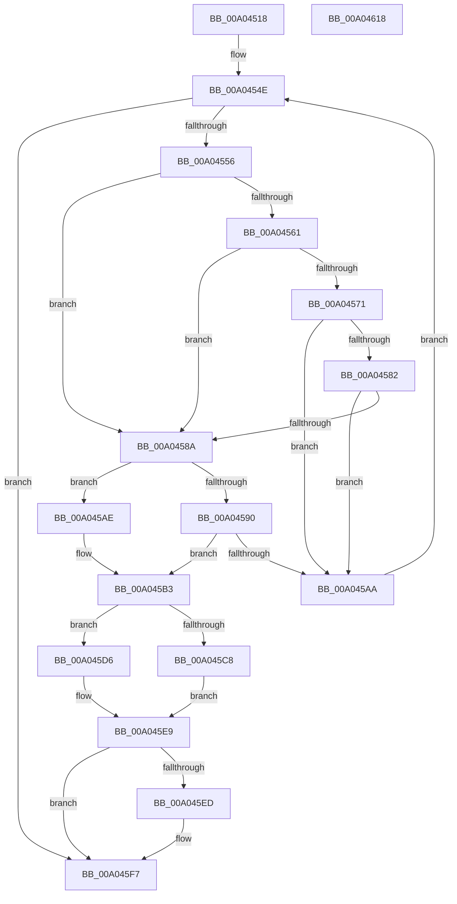

# PipSendTargetDeviceQueryRemoveNotification

- RVA: `0x00A04518`–`0x00A04619` (길이 `257` bytes)
- VA: `0x0000000140A04518`
- 실행 섹션: `PAGE`
- PDB 이름 있음: `예`; PDB Function 태그: `아니요`
- unwind 정보 RVA: `0x000847EC`
- 디코드: `75`개 명령, `257/257` bytes 표시
- 미해석 바이트: `0` (있으면 어셈블리에 `.byte`로 보존)

> 이 문서는 커널 이미지의 기계어와 PDB 기호를 분석해 생성했습니다. 4번과 5번은 함수 원형과 자료형을 바이너리 사용 방식에서 추정한 C 해석이며 원본 소스 복구 결과는 아닙니다.

## 1. Dependencies

- 직접 호출 지점: **4**; 고유 호출 대상: **4**
- 직접 호출자로 확인된 함수: **1**
- RIP 상대 이미지 참조: **1**

### Outgoing calls
- `0x00A0459F` → [PnpNotifyTargetDeviceChange](../95/PnpNotifyTargetDeviceChange_function_00954790.md) (function, `0x00954790`)
- `0x00A045CF` → [RtlCopyUnicodeString](../../text/3F/RtlCopyUnicodeString_function_003FEF30.md) (function, `0x003FEF30`)
- `0x00A045E0` → [memset](../../text/6C/memset_function_006C6C40.md) (function, `0x006C6C40`)
- `0x00A045F2` → [PiSendTargetDeviceRemoveCanceledNotification](../74/PiSendTargetDeviceRemoveCanceledNotification_function_00744364.md) (function, `0x00744364`)

### Direct callers
- [PiProcessQueryAndCancelRemoval](PiProcessQueryAndCancelRemoval_function_00A05A58.md) at `0x00A05B6E`

### Static image references
- `0x00A04598` → RVA `0x0001A210` (`.rdata`; read)

## 2. Other-region calls and transfers

- 다른 실행 섹션으로 향하는 call: **2**
  - `0x00A045CF` → [RtlCopyUnicodeString](../../text/3F/RtlCopyUnicodeString_function_003FEF30.md) (`PAGE` → `.text`)
  - `0x00A045E0` → [memset](../../text/6C/memset_function_006C6C40.md) (`PAGE` → `.text`)
- 별도 외부 분기/꼬리 이동을 확인하지 못했습니다.

## 3. Assembly (complete function range)

```asm
00A04518  48 8B C4                        mov rax, rsp
00A0451B  48 89 58 08                     mov qword ptr [rax + 8], rbx
00A0451F  48 89 68 10                     mov qword ptr [rax + 0x10], rbp
00A04523  48 89 70 18                     mov qword ptr [rax + 0x18], rsi
00A04527  48 89 78 20                     mov qword ptr [rax + 0x20], rdi
00A0452B  41 54                           push r12
00A0452D  41 56                           push r14
00A0452F  41 57                           push r15
00A04531  48 83 EC 30                     sub rsp, 0x30
00A04535  45 33 E4                        xor r12d, r12d
00A04538  4D 8B F1                        mov r14, r9
00A0453B  41 8B F4                        mov esi, r12d
00A0453E  4C 89 60 D8                     mov qword ptr [rax - 0x28], r12
00A04542  41 8B DC                        mov ebx, r12d
00A04545  41 8B F8                        mov edi, r8d
00A04548  4C 8B FA                        mov r15, rdx
00A0454B  48 8B E9                        mov rbp, rcx
00A0454E  3B DF                           cmp ebx, edi
00A04550  0F 83 A1 00 00 00               jae 0x140a045f7
00A04556  8B C3                           mov eax, ebx
00A04558  49 8B 14 C7                     mov rdx, qword ptr [r15 + rax*8]
00A0455C  48 85 D2                        test rdx, rdx
00A0455F  74 29                           je 0x140a0458a
00A04561  48 8B 82 38 01 00 00            mov rax, qword ptr [rdx + 0x138]
00A04568  48 8B 48 28                     mov rcx, qword ptr [rax + 0x28]
00A0456C  48 85 C9                        test rcx, rcx
00A0456F  74 19                           je 0x140a0458a
00A04571  8B 89 2C 01 00 00               mov ecx, dword ptr [rcx + 0x12c]
00A04577  8D 81 FF FC FF FF               lea eax, [rcx - 0x301]
00A0457D  83 F8 03                        cmp eax, 3
00A04580  76 28                           jbe 0x140a045aa
00A04582  81 F9 14 03 00 00               cmp ecx, 0x314
00A04588  74 20                           je 0x140a045aa
00A0458A  44 38 65 48                     cmp byte ptr [rbp + 0x48], r12b
00A0458E  75 1E                           jne 0x140a045ae
00A04590  4C 8D 4C 24 20                  lea r9, [rsp + 0x20]
00A04595  45 33 C0                        xor r8d, r8d
00A04598  48 8D 0D 71 5C 61 FF            lea rcx, [rip - 0x9ea38f]
00A0459F  E8 EC 01 F5 FF                  call 0x140954790
00A045A4  8B F0                           mov esi, eax
00A045A6  85 C0                           test eax, eax
00A045A8  78 09                           js 0x140a045b3
00A045AA  FF C3                           inc ebx
00A045AC  EB A0                           jmp 0x140a0454e
00A045AE  BE 20 01 00 C0                  mov esi, 0xc0000120
00A045B3  48 8B 54 24 20                  mov rdx, qword ptr [rsp + 0x20]
00A045B8  49 8D 7E 08                     lea rdi, [r14 + 8]
00A045BC  41 C7 06 07 00 00 00            mov dword ptr [r14], 7
00A045C3  48 85 D2                        test rdx, rdx
00A045C6  74 0E                           je 0x140a045d6
00A045C8  48 83 C2 38                     add rdx, 0x38
00A045CC  48 8B CF                        mov rcx, rdi
00A045CF  E8 5C A9 9F FF                  call 0x1403fef30
00A045D4  EB 13                           jmp 0x140a045e9
00A045D6  44 0F B7 07                     movzx r8d, word ptr [rdi]
00A045DA  33 D2                           xor edx, edx
00A045DC  49 8B 4E 10                     mov rcx, qword ptr [r14 + 0x10]
00A045E0  E8 5B 26 CC FF                  call 0x1406c6c40
00A045E5  66 44 89 27                     mov word ptr [rdi], r12w
00A045E9  85 DB                           test ebx, ebx
00A045EB  74 0A                           je 0x140a045f7
00A045ED  8B D3                           mov edx, ebx
00A045EF  49 8B CF                        mov rcx, r15
00A045F2  E8 6D FD D3 FF                  call 0x140744364
00A045F7  48 8B 5C 24 50                  mov rbx, qword ptr [rsp + 0x50]
00A045FC  8B C6                           mov eax, esi
00A045FE  48 8B 74 24 60                  mov rsi, qword ptr [rsp + 0x60]
00A04603  48 8B 6C 24 58                  mov rbp, qword ptr [rsp + 0x58]
00A04608  48 8B 7C 24 68                  mov rdi, qword ptr [rsp + 0x68]
00A0460D  48 83 C4 30                     add rsp, 0x30
00A04611  41 5F                           pop r15
00A04613  41 5E                           pop r14
00A04615  41 5C                           pop r12
00A04617  C3                              ret
00A04618  CC                              int3
```

## 4. C-style interpretation (structured pseudocode)

```c
__int64 __fastcall PipSendTargetDeviceQueryRemoveNotification(__int64 a1, __int64 a2, int a3, __int64 a4)
{
    __int64 result;
    __int64 v_r12;
    __int64 v_rbx;
    __int64 v_rsp;
    unsigned __int64 v_stack_m28;
    unsigned __int64 v_stack_p10;
    unsigned __int64 v_stack_p18;
    unsigned __int64 v_stack_p20;
    unsigned __int64 v_stack_p8;

    *(unsigned __int64 *)(v_rsp + 8) = v_rbx;
    *(unsigned __int64 *)(v_rsp + 16) = v_rbp;
    *(unsigned __int64 *)(v_rsp + 24) = v_rsi;
    *(unsigned __int64 *)(v_rsp + 32) = v_rdi;
    v_rsp = (v_rsp) - (48);
    v_r12 = 0;
    *(unsigned __int64 *)(v_rsp - 40) = 0;
loc_00A0454E:
    if (0 >= ((unsigned int)((unsigned int)(a3)))) goto loc_00A045F7;
    if (*(unsigned __int64 *)(a2 + 0 * 8) == 0) goto loc_00A0458A;
    if (*(unsigned __int64 *)(*(unsigned __int64 *)(*(unsigned __int64 *)(a2 + 0 * 8) + 312) + 40) == 0) goto loc_00A0458A;
    if (((unsigned int)((unsigned int)(*(unsigned int *)(*(unsigned __int64 *)(*(unsigned __int64 *)(*(unsigned __int64 *)(a2 + 0 * 8) + 312) + 40) + 300)) - 769)) <= 3) goto loc_00A045AA;
    if (((unsigned int)((unsigned int)(*(unsigned int *)(*(unsigned __int64 *)(*(unsigned __int64 *)(*(unsigned __int64 *)(a2 + 0 * 8) + 312) + 40) + 300)))) == 788) goto loc_00A045AA;
loc_00A0458A:
    if ((*(unsigned __int8 *)(a1 + 72)) != 0) goto loc_00A045AE;
    a3 = 0;
    result = PnpNotifyTargetDeviceChange(v_rip - 10396559, *(unsigned __int64 *)(a2 + 0 * 8), a3, v_stack_m28);
    if (sign_flag) goto loc_00A045B3;
loc_00A045AA:
    v_rbx = (unsigned int)((0) + 1);
    goto loc_00A0454E;
loc_00A045AE:
loc_00A045B3:
    *(unsigned int *)(a4) = 7;
    if (v_stack_m28 == 0) goto loc_00A045D6;
    a2 = (v_stack_m28) + (56);
    result = RtlCopyUnicodeString(a4 + 8, a2, a3, v_stack_m28);
    goto loc_00A045E9;
loc_00A045D6:
    a2 = 0;
    result = memset(*(unsigned __int64 *)(a4 + 16), a2, *(unsigned __int16 *)(a4 + 8), v_stack_m28);
    *(unsigned __int16 *)(a4 + 8) = 0;
loc_00A045E9:
    if ((unsigned int)(v_rbx) != 0) {
        a2 = (unsigned int)(v_rbx);
        a1 = a2;
        result = PiSendTargetDeviceRemoveCanceledNotification(a1, a2, *(unsigned __int16 *)(a4 + 8), v_stack_m28);
    }
    v_rsp = (v_rsp) + (48);
    return (unsigned int)((unsigned int)((unsigned int)(0xC0000120ULL)));
}
```

## 5. (Beta) C Style

```c
int64_t PipSendTargetDeviceQueryRemoveNotification(void *Arg1, void *Arg2, int32_t Arg3, void *Arg4)
{
    uint8_t *arg1 = (uint8_t *)Arg1;
    uint8_t *arg2 = (uint8_t *)Arg2;
    uint8_t *arg4 = (uint8_t *)Arg4;

    int64_t result;
    int64_t local_r12;
    int64_t local_rbx;
    int64_t local_rsp;
    uint64_t v_stack_m28;
    uint64_t v_stack_p10;
    uint64_t v_stack_p18;
    uint64_t v_stack_p20;
    uint64_t v_stack_p8;

    *(uint64_t *)(local_rsp + 0x8) = local_rbx;
    *(uint64_t *)(local_rsp + 0x10) = local_rbp;
    *(uint64_t *)(local_rsp + 0x18) = local_rsi;
    *(uint64_t *)(local_rsp + 0x20) = local_rdi;
    local_rsp = (local_rsp) - (48);
    local_r12 = 0;
    *(uint64_t *)(local_rsp - 0x28) = 0;
loc_00A0454E:
    if (0 >= ((uint32_t)((uint32_t)(Arg3)))) goto loc_00A045F7;
    if (*(uint64_t *)(arg2 + 0x0 * 8) == 0) goto loc_00A0458A;
    if (*(uint64_t *)(*(uint64_t *)(*(uint64_t *)(arg2 + 0x0 * 8) + 0x138) + 0x28) == 0) goto loc_00A0458A;
    if (((uint32_t)((uint32_t)(*(uint32_t *)(*(uint64_t *)(*(uint64_t *)(*(uint64_t *)(arg2 + 0x0 * 8) + 0x138) + 0x28) + 0x12C)) - 769)) <= 3) goto loc_00A045AA;
    if (((uint32_t)((uint32_t)(*(uint32_t *)(*(uint64_t *)(*(uint64_t *)(*(uint64_t *)(arg2 + 0x0 * 8) + 0x138) + 0x28) + 0x12C)))) == 788) goto loc_00A045AA;
loc_00A0458A:
    if ((*(uint8_t *)(arg1 + 0x48)) != 0) goto loc_00A045AE;
    Arg3 = 0;
    result = PnpNotifyTargetDeviceChange(v_rip - 10396559, *(uint64_t *)(arg2 + 0x0 * 8), Arg3, v_stack_m28);
    if (sign_flag) goto loc_00A045B3;
loc_00A045AA:
    local_rbx = (uint32_t)((0) + 1);
    goto loc_00A0454E;
loc_00A045AE:
loc_00A045B3:
    *(uint32_t *)(arg4) = 7;
    if (v_stack_m28 == 0) goto loc_00A045D6;
    Arg2 = (v_stack_m28) + (56);
    result = RtlCopyUnicodeString(Arg4 + 8, Arg2, Arg3, v_stack_m28);
    goto loc_00A045E9;
loc_00A045D6:
    Arg2 = 0;
    result = memset(*(uint64_t *)(arg4 + 0x10), Arg2, *(uint16_t *)(arg4 + 0x8), v_stack_m28);
    *(uint16_t *)(arg4 + 0x8) = 0;
loc_00A045E9:
    if ((uint32_t)(local_rbx) != 0) {
        Arg2 = (uint32_t)(local_rbx);
        Arg1 = Arg2;
        result = PiSendTargetDeviceRemoveCanceledNotification(Arg1, Arg2, *(uint16_t *)(arg4 + 0x8), v_stack_m28);
    }
    local_rsp = (local_rsp) + (48);
    return (uint32_t)((uint32_t)((uint32_t)(0xC0000120ULL)));
}
```

### 관측된 메모리 오프셋

구조체 형식이 확인되지 않은 접근은 인자 기준의 오프셋으로만 기록했습니다.

| 기준 인자 | 오프셋 표현 | 폭 (bit) | 접근 |
|---|---:|---:|---|
| `Arg1` | `+ 0x48` | `8` | `R` |
| `Arg2` | `+ 0x0 + rax*8` | `64` | `R` |
| `Arg4` | `+ 0x0` | `16` | `R` |
| `Arg4` | `+ 0x0` | `16` | `W` |
| `Arg4` | `+ 0x0` | `32` | `W` |
| `Arg4` | `+ 0x8` | `64` | `R` |
| `Arg4` | `+ 0x10` | `64` | `R` |

## 6. Execution-region graph

[열기: 2D/3D 그래프와 함수 탐색 컨트롤 패널](../../../control-panel.html?section=page&rva=0x00A04518&view=graph)

- 2D 그래프는 위에서 아래로 흐르고, 3D 그래프는 빈 공간을 드래그해 회전합니다. Shift+드래그는 이동, 휠은 확대·축소, 함수 노드 선택은 대상 보고서 이동입니다.

### Static fallback


