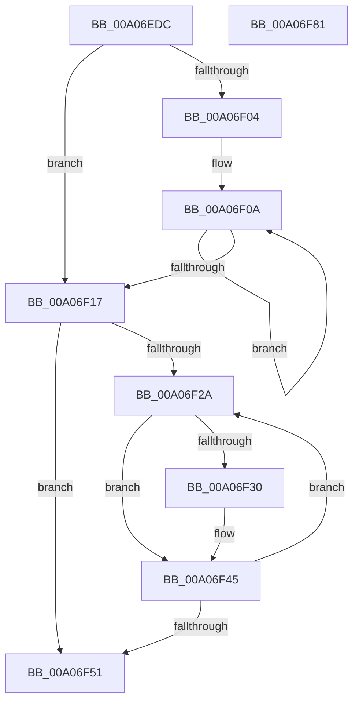

# PipSortDeviceObjectList

- RVA: `0x00A06EDC`–`0x00A06F82` (길이 `166` bytes)
- VA: `0x0000000140A06EDC`
- 실행 섹션: `PAGE`
- PDB 이름 있음: `예`; PDB Function 태그: `아니요`
- unwind 정보 RVA: `0x000A85B0`
- 디코드: `48`개 명령, `166/166` bytes 표시
- 미해석 바이트: `0` (있으면 어셈블리에 `.byte`로 보존)

> 이 문서는 커널 이미지의 기계어와 PDB 기호를 분석해 생성했습니다. 4번과 5번은 함수 원형과 자료형을 바이너리 사용 방식에서 추정한 C 해석이며 원본 소스 복구 결과는 아닙니다.

## 1. Dependencies

- 직접 호출 지점: **2**; 고유 호출 대상: **2**
- 직접 호출자로 확인된 함수: **1**
- RIP 상대 이미지 참조: **1**

### Outgoing calls
- `0x00A06F40` → [PipVisitDeviceObjectListEntry](PipVisitDeviceObjectListEntry_function_00A06F88.md) (function, `0x00A06F88`)
- `0x00A06F64` → [qsort](../../text/50/qsort_function_005009F0.md) (function, `0x005009F0`)

### Direct callers
- [IopSortRelationListForRemove](IopSortRelationListForRemove_function_00A06C30.md) at `0x00A06CA0`

### Static image references
- `0x00A06F54` → RVA `0x004C0270` (`PipSortDevicesByOrdinal`; read)

## 2. Other-region calls and transfers

- 다른 실행 섹션으로 향하는 call: **1**
  - `0x00A06F64` → [qsort](../../text/50/qsort_function_005009F0.md) (`PAGE` → `.text`)
- 별도 외부 분기/꼬리 이동을 확인하지 못했습니다.

## 3. Assembly (complete function range)

```asm
00A06EDC  48 89 5C 24 10                  mov qword ptr [rsp + 0x10], rbx
00A06EE1  48 89 74 24 18                  mov qword ptr [rsp + 0x18], rsi
00A06EE6  48 89 7C 24 20                  mov qword ptr [rsp + 0x20], rdi
00A06EEB  41 56                           push r14
00A06EED  48 83 EC 20                     sub rsp, 0x20
00A06EF1  48 8B 01                        mov rax, qword ptr [rcx]
00A06EF4  45 33 DB                        xor r11d, r11d
00A06EF7  4C 8B F1                        mov r14, rcx
00A06EFA  8B 18                           mov ebx, dword ptr [rax]
00A06EFC  48 8D 78 10                     lea rdi, [rax + 0x10]
00A06F00  85 DB                           test ebx, ebx
00A06F02  74 13                           je 0x140a06f17
00A06F04  48 8D 47 10                     lea rax, [rdi + 0x10]
00A06F08  8B D3                           mov edx, ebx
00A06F0A  83 20 FD                        and dword ptr [rax], 0xfffffffd
00A06F0D  48 8D 40 18                     lea rax, [rax + 0x18]
00A06F11  48 83 EA 01                     sub rdx, 1
00A06F15  75 F3                           jne 0x140a06f0a
00A06F17  48 8B F7                        mov rsi, rdi
00A06F1A  C7 44 24 30 01 00 00 00         mov dword ptr [rsp + 0x30], 1
00A06F22  48 83 C6 10                     add rsi, 0x10
00A06F26  85 DB                           test ebx, ebx
00A06F28  74 27                           je 0x140a06f51
00A06F2A  8B 06                           mov eax, dword ptr [rsi]
00A06F2C  A8 04                           test al, 4
00A06F2E  74 15                           je 0x140a06f45
00A06F30  49 8B 16                        mov rdx, qword ptr [r14]
00A06F33  4B 8D 0C 5B                     lea rcx, [r11 + r11*2]
00A06F37  48 8D 0C CF                     lea rcx, [rdi + rcx*8]
00A06F3B  4C 8D 44 24 30                  lea r8, [rsp + 0x30]
00A06F40  E8 43 00 00 00                  call 0x140a06f88
00A06F45  41 FF C3                        inc r11d
00A06F48  48 83 C6 18                     add rsi, 0x18
00A06F4C  44 3B DB                        cmp r11d, ebx
00A06F4F  72 D9                           jb 0x140a06f2a
00A06F51  48 8B D3                        mov rdx, rbx
00A06F54  4C 8D 0D 15 93 AB FF            lea r9, [rip - 0x546ceb]
00A06F5B  41 B8 18 00 00 00               mov r8d, 0x18
00A06F61  48 8B CF                        mov rcx, rdi
00A06F64  E8 87 9A AF FF                  call 0x1405009f0
00A06F69  48 8B 5C 24 38                  mov rbx, qword ptr [rsp + 0x38]
00A06F6E  33 C0                           xor eax, eax
00A06F70  48 8B 74 24 40                  mov rsi, qword ptr [rsp + 0x40]
00A06F75  48 8B 7C 24 48                  mov rdi, qword ptr [rsp + 0x48]
00A06F7A  48 83 C4 20                     add rsp, 0x20
00A06F7E  41 5E                           pop r14
00A06F80  C3                              ret
00A06F81  CC                              int3
```

## 4. C-style interpretation (structured pseudocode)

```c
__int64 __fastcall PipSortDeviceObjectList(__int64 a1)
{
    __int64 result;
    __int64 v_r11;
    __int64 v_rsi;
    __int64 v_rsp;
    unsigned __int64 v_stack_p10;
    unsigned __int64 v_stack_p18;
    unsigned __int64 v_stack_p20;
    unsigned int v_stack_p8;

    v_stack_p10 = v_rbx;
    v_stack_p18 = v_rsi;
    v_stack_p20 = v_rdi;
    v_rsp = (v_rsp) - (32);
    v_r11 = 0;
    if ((unsigned int)((unsigned int)(*(unsigned int *)(*(unsigned __int64 *)(a1)))) == 0) goto loc_00A06F17;
loc_00A06F0A:
    a2 = ((unsigned int)((unsigned int)((unsigned int)(*(unsigned int *)(*(unsigned __int64 *)(a1)))))) - (1);
    if (condition_is_not_equal) goto loc_00A06F0A;
loc_00A06F17:
    v_stack_p8 = 1;
    v_rsi = (*(unsigned __int64 *)(a1) + 16) + (16);
    if ((unsigned int)((unsigned int)(*(unsigned int *)(*(unsigned __int64 *)(a1)))) == 0) goto loc_00A06F51;
loc_00A06F2A:
    result = (unsigned int)(*(unsigned int *)(v_rsi));
    if ((((unsigned __int8)((unsigned int)(*(unsigned int *)(v_rsi)))) & (4)) != 0) {
        a2 = *(unsigned __int64 *)(a1);
        a1 = v_r11 + v_r11 * 2;
        a1 = *(unsigned __int64 *)(a1) + 16 + a1 * 8;
        a3 = v_stack_p8;
        result = PipVisitDeviceObjectListEntry(a1, a2, a3, a4);
    }
    v_r11 = (unsigned int)((v_r11) + 1);
    v_rsi = (v_rsi) + (24);
    if (((unsigned int)(v_r11)) < ((unsigned int)((unsigned int)(*(unsigned int *)(*(unsigned __int64 *)(a1)))))) goto loc_00A06F2A;
loc_00A06F51:
    result = qsort(*(unsigned __int64 *)(a1) + 16, (unsigned int)(*(unsigned int *)(*(unsigned __int64 *)(a1))), 24, v_rip - 5532907);
    result = 0;
    v_rsp = (v_rsp) + (32);
    return result;
}
```

## 5. (Beta) C Style

```c
int64_t PipSortDeviceObjectList(void *Arg1)
{
    uint8_t *arg1 = (uint8_t *)Arg1;

    int64_t result;
    int64_t local_r11;
    int64_t local_rsi;
    int64_t local_rsp;
    uint64_t v_stack_p10;
    uint64_t v_stack_p18;
    uint64_t v_stack_p20;
    uint32_t v_stack_p8;

    v_stack_p10 = local_rbx;
    v_stack_p18 = local_rsi;
    v_stack_p20 = local_rdi;
    local_rsp = (local_rsp) - (32);
    local_r11 = 0;
    if ((uint32_t)((uint32_t)(*(uint32_t *)(*(uint64_t *)(arg1)))) == 0) goto loc_00A06F17;
loc_00A06F0A:
    a2 = ((uint32_t)((uint32_t)((uint32_t)(*(uint32_t *)(*(uint64_t *)(arg1)))))) - (1);
    if (condition_is_not_equal) goto loc_00A06F0A;
loc_00A06F17:
    v_stack_p8 = 1;
    local_rsi = (*(uint64_t *)(arg1) + 16) + (16);
    if ((uint32_t)((uint32_t)(*(uint32_t *)(*(uint64_t *)(arg1)))) == 0) goto loc_00A06F51;
loc_00A06F2A:
    result = (uint32_t)(*(uint32_t *)(local_rsi));
    if ((((uint8_t)((uint32_t)(*(uint32_t *)(local_rsi)))) & (4)) != 0) {
        a2 = *(uint64_t *)(arg1);
        Arg1 = local_r11 + local_r11 * 2;
        Arg1 = *(uint64_t *)(arg1) + 16 + Arg1 * 8;
        a3 = v_stack_p8;
        result = PipVisitDeviceObjectListEntry(Arg1, a2, a3, a4);
    }
    local_r11 = (uint32_t)((local_r11) + 1);
    local_rsi = (local_rsi) + (24);
    if (((uint32_t)(local_r11)) < ((uint32_t)((uint32_t)(*(uint32_t *)(*(uint64_t *)(arg1)))))) goto loc_00A06F2A;
loc_00A06F51:
    result = qsort(*(uint64_t *)(arg1) + 16, (uint32_t)(*(uint32_t *)(*(uint64_t *)(arg1))), 24, v_rip - 5532907);
    result = 0;
    local_rsp = (local_rsp) + (32);
    return result;
}
```

### 관측된 메모리 오프셋

구조체 형식이 확인되지 않은 접근은 인자 기준의 오프셋으로만 기록했습니다.

| 기준 인자 | 오프셋 표현 | 폭 (bit) | 접근 |
|---|---:|---:|---|
| `Arg1` | `+ 0x0` | `64` | `R` |

## 6. Execution-region graph

[열기: 2D/3D 그래프와 함수 탐색 컨트롤 패널](../../../control-panel.html?section=page&rva=0x00A06EDC&view=graph)

- 2D 그래프는 위에서 아래로 흐르고, 3D 그래프는 빈 공간을 드래그해 회전합니다. Shift+드래그는 이동, 휠은 확대·축소, 함수 노드 선택은 대상 보고서 이동입니다.

### Static fallback


