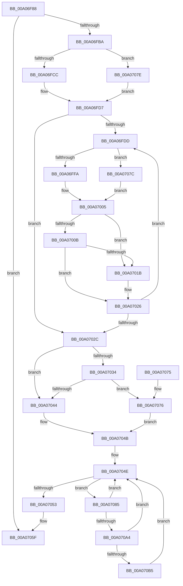

# PipVisitDeviceObjectListEntry

- RVA: `0x00A06F88`–`0x00A070C7` (길이 `319` bytes)
- VA: `0x0000000140A06F88`
- 실행 섹션: `PAGE`
- PDB 이름 있음: `예`; PDB Function 태그: `아니요`
- unwind 정보 RVA: `0x000A85C8`
- 디코드: `93`개 명령, `319/319` bytes 표시
- 미해석 바이트: `0` (있으면 어셈블리에 `.byte`로 보존)

> 이 문서는 커널 이미지의 기계어와 PDB 기호를 분석해 생성했습니다. 4번과 5번은 함수 원형과 자료형을 바이너리 사용 방식에서 추정한 C 해석이며 원본 소스 복구 결과는 아닙니다.

## 1. Dependencies

- 직접 호출 지점: **4**; 고유 호출 대상: **3**
- 직접 호출자로 확인된 함수: **2**
- RIP 상대 이미지 참조: **1**

### Outgoing calls
- `0x00A07021` → [PipVisitDeviceObjectListEntry](PipVisitDeviceObjectListEntry_function_00A06F88.md) (function, `0x00A06F88`)
- `0x00A07092` → [PiEnumerateDependentListEntry](../70/PiEnumerateDependentListEntry_function_00703008.md) (function, `0x00703008`)
- `0x00A070AC` → [PipIsDeviceInDeviceObjectList](PipIsDeviceInDeviceObjectList_function_00A070D0.md) (function, `0x00A070D0`)
- `0x00A070C0` → [PipVisitDeviceObjectListEntry](PipVisitDeviceObjectListEntry_function_00A06F88.md) (function, `0x00A06F88`)

### Direct callers
- [PipSortDeviceObjectList](PipSortDeviceObjectList_function_00A06EDC.md) at `0x00A06F40`
- [PipVisitDeviceObjectListEntry](PipVisitDeviceObjectListEntry_function_00A06F88.md) at `0x00A07021`
- [PipVisitDeviceObjectListEntry](PipVisitDeviceObjectListEntry_function_00A06F88.md) at `0x00A070C0`

### Static image references
- `0x00A07044` → RVA `0x00F8CE70` (`.data`; read)

## 2. Other-region calls and transfers

- 다른 실행 섹션으로 향하는 call: **0**
- 별도 외부 분기/꼬리 이동을 확인하지 못했습니다.

## 3. Assembly (complete function range)

```asm
00A06F88  48 8B C4                        mov rax, rsp
00A06F8B  48 89 58 10                     mov qword ptr [rax + 0x10], rbx
00A06F8F  48 89 70 18                     mov qword ptr [rax + 0x18], rsi
00A06F93  57                              push rdi
00A06F94  41 56                           push r14
00A06F96  41 57                           push r15
00A06F98  48 83 EC 30                     sub rsp, 0x30
00A06F9C  48 83 60 D8 00                  and qword ptr [rax - 0x28], 0
00A06FA1  4D 8B F0                        mov r14, r8
00A06FA4  48 83 60 20 00                  and qword ptr [rax + 0x20], 0
00A06FA9  48 8B F2                        mov rsi, rdx
00A06FAC  8B 41 10                        mov eax, dword ptr [rcx + 0x10]
00A06FAF  4C 8B F9                        mov r15, rcx
00A06FB2  A8 02                           test al, 2
00A06FB4  0F 85 A5 00 00 00               jne 0x140a0705f
00A06FBA  83 C8 02                        or eax, 2
00A06FBD  89 41 10                        mov dword ptr [rcx + 0x10], eax
00A06FC0  48 8B 01                        mov rax, qword ptr [rcx]
00A06FC3  48 85 C0                        test rax, rax
00A06FC6  0F 84 B2 00 00 00               je 0x140a0707e
00A06FCC  48 8B 80 38 01 00 00            mov rax, qword ptr [rax + 0x138]
00A06FD3  48 8B 78 28                     mov rdi, qword ptr [rax + 0x28]
00A06FD7  33 DB                           xor ebx, ebx
00A06FD9  39 1A                           cmp dword ptr [rdx], ebx
00A06FDB  76 4F                           jbe 0x140a0702c
00A06FDD  48 8D 4B 01                     lea rcx, [rbx + 1]
00A06FE1  48 8D 0C 4B                     lea rcx, [rbx + rcx*2]
00A06FE5  48 8D 0C CE                     lea rcx, [rsi + rcx*8]
00A06FE9  48 8B 01                        mov rax, qword ptr [rcx]
00A06FEC  48 89 4C 24 68                  mov qword ptr [rsp + 0x68], rcx
00A06FF1  48 85 C0                        test rax, rax
00A06FF4  0F 84 82 00 00 00               je 0x140a0707c
00A06FFA  48 8B 80 38 01 00 00            mov rax, qword ptr [rax + 0x138]
00A07001  48 8B 40 28                     mov rax, qword ptr [rax + 0x28]
00A07005  48 39 78 10                     cmp qword ptr [rax + 0x10], rdi
00A07009  74 10                           je 0x140a0701b
00A0700B  48 8B 80 88 02 00 00            mov rax, qword ptr [rax + 0x288]
00A07012  48 83 E0 FE                     and rax, 0xfffffffffffffffe
00A07016  48 3B C7                        cmp rax, rdi
00A07019  75 0B                           jne 0x140a07026
00A0701B  4D 8B C6                        mov r8, r14
00A0701E  48 8B D6                        mov rdx, rsi
00A07021  E8 62 FF FF FF                  call 0x140a06f88
00A07026  FF C3                           inc ebx
00A07028  3B 1E                           cmp ebx, dword ptr [rsi]
00A0702A  72 B1                           jb 0x140a06fdd
00A0702C  49 8B 07                        mov rax, qword ptr [r15]
00A0702F  48 85 C0                        test rax, rax
00A07032  74 10                           je 0x140a07044
00A07034  48 8B 80 38 01 00 00            mov rax, qword ptr [rax + 0x138]
00A0703B  48 8B 58 50                     mov rbx, qword ptr [rax + 0x50]
00A0703F  48 85 DB                        test rbx, rbx
00A07042  75 32                           jne 0x140a07076
00A07044  48 8D 1D 25 5E 58 00            lea rbx, [rip + 0x585e25]
00A0704B  48 8B 3B                        mov rdi, qword ptr [rbx]
00A0704E  48 3B FB                        cmp rdi, rbx
00A07051  75 32                           jne 0x140a07085
00A07053  41 8B 06                        mov eax, dword ptr [r14]
00A07056  41 89 47 0C                     mov dword ptr [r15 + 0xc], eax
00A0705A  FF C0                           inc eax
00A0705C  41 89 06                        mov dword ptr [r14], eax
00A0705F  48 8B 5C 24 58                  mov rbx, qword ptr [rsp + 0x58]
00A07064  33 C0                           xor eax, eax
00A07066  48 8B 74 24 60                  mov rsi, qword ptr [rsp + 0x60]
00A0706B  48 83 C4 30                     add rsp, 0x30
00A0706F  41 5F                           pop r15
00A07071  41 5E                           pop r14
00A07073  5F                              pop rdi
00A07074  C3                              ret
00A07075  CC                              int3
00A07076  48 83 C3 20                     add rbx, 0x20
00A0707A  EB CF                           jmp 0x140a0704b
00A0707C  EB 87                           jmp 0x140a07005
00A0707E  33 FF                           xor edi, edi
00A07080  E9 52 FF FF FF                  jmp 0x140a06fd7
00A07085  4C 8D 44 24 50                  lea r8, [rsp + 0x50]
00A0708A  48 8B CF                        mov rcx, rdi
00A0708D  48 8D 54 24 20                  lea rdx, [rsp + 0x20]
00A07092  E8 71 BF CF FF                  call 0x140703008
00A07097  48 8B 54 24 20                  mov rdx, qword ptr [rsp + 0x20]
00A0709C  48 8B 3F                        mov rdi, qword ptr [rdi]
00A0709F  48 85 D2                        test rdx, rdx
00A070A2  74 AA                           je 0x140a0704e
00A070A4  4C 8D 44 24 68                  lea r8, [rsp + 0x68]
00A070A9  48 8B CE                        mov rcx, rsi
00A070AC  E8 1F 00 00 00                  call 0x140a070d0
00A070B1  84 C0                           test al, al
00A070B3  74 99                           je 0x140a0704e
00A070B5  48 8B 4C 24 68                  mov rcx, qword ptr [rsp + 0x68]
00A070BA  4D 8B C6                        mov r8, r14
00A070BD  48 8B D6                        mov rdx, rsi
00A070C0  E8 C3 FE FF FF                  call 0x140a06f88
00A070C5  EB 87                           jmp 0x140a0704e
```

## 4. C-style interpretation (structured pseudocode)

```c
__int64 __fastcall PipVisitDeviceObjectListEntry(__int64 a1, __int64 a2, __int64 a3)
{
    __int64 result;
    __int64 v_rbx;
    __int64 v_rdi;
    __int64 v_rsp;
    unsigned __int64 v_stack_p10;
    unsigned __int64 v_stack_p18;
    unsigned __int64 v_stack_p20;
    unsigned __int64 v_stack_p50;
    unsigned __int64 v_stack_p68;

    *(unsigned __int64 *)(v_rsp + 16) = v_rbx;
    *(unsigned __int64 *)(v_rsp + 24) = v_rsi;
    v_rsp = (v_rsp) - (48);
    if ((((unsigned __int8)((unsigned int)(*(unsigned int *)(a1 + 16)))) & (2)) != 0) goto loc_00A0705F;
    result = (unsigned int)(((unsigned int)(*(unsigned int *)(a1 + 16))) | (2));
    *(unsigned int *)(a1 + 16) = (unsigned int)(result);
    if (*(unsigned __int64 *)(a1) == 0) goto loc_00A0707E;
loc_00A06FD7:
    v_rbx = 0;
    if ((*(unsigned int *)(a2)) <= 0) goto loc_00A0702C;
loc_00A06FDD:
    v_stack_p20 = a2 + v_rbx + v_rbx + 1 * 2 * 8;
    if (*(unsigned __int64 *)(a2 + v_rbx + v_rbx + 1 * 2 * 8) == 0) goto loc_00A0707C;
loc_00A07005:
    if ((*(unsigned __int64 *)(*(unsigned __int64 *)(*(unsigned __int64 *)(*(unsigned __int64 *)(a2 + v_rbx + v_rbx + 1 * 2 * 8) + 312) + 40) + 16)) == (*(unsigned __int64 *)(*(unsigned __int64 *)(*(unsigned __int64 *)(a1) + 312) + 40))) goto loc_00A0701B;
    result = (*(unsigned __int64 *)(*(unsigned __int64 *)(*(unsigned __int64 *)(*(unsigned __int64 *)(a2 + v_rbx + v_rbx + 1 * 2 * 8) + 312) + 40) + 648)) & (-2);
    if (result == (*(unsigned __int64 *)(*(unsigned __int64 *)(*(unsigned __int64 *)(a1) + 312) + 40))) {
        a3 = a3;
        a2 = a2;
        result = PipVisitDeviceObjectListEntry(a2 + v_rbx + v_rbx + 1 * 2 * 8, a2, a3, a4);
    }
    v_rbx = (unsigned int)((v_rbx) + 1);
    if (((unsigned int)(v_rbx)) < (*(unsigned int *)(a2))) goto loc_00A06FDD;
loc_00A0702C:
    if (*(unsigned __int64 *)(a1) == 0) goto loc_00A07044;
    if (*(unsigned __int64 *)(*(unsigned __int64 *)(*(unsigned __int64 *)(a1) + 312) + 80) != 0) goto loc_00A07076;
loc_00A07044:
loc_00A0704B:
loc_00A0704E:
    if ((*(unsigned __int64 *)(v_rip + 5791269)) != (v_rip + 5791269)) goto loc_00A07085;
    *(unsigned int *)(a1 + 12) = (unsigned int)((unsigned int)(*(unsigned int *)(a3)));
    result = (unsigned int)(((unsigned int)(*(unsigned int *)(a3))) + 1);
    *(unsigned int *)(a3) = (unsigned int)(result);
loc_00A0705F:
    result = 0;
    v_rsp = (v_rsp) + (48);
    return result;
loc_00A07076:
    v_rbx = (v_stack_p10) + (32);
    goto loc_00A0704B;
loc_00A0707C:
    goto loc_00A07005;
loc_00A0707E:
    v_rdi = 0;
    goto loc_00A06FD7;
loc_00A07085:
    result = PiEnumerateDependentListEntry(0, v_stack_p20, v_stack_p50, a4);
    if (v_stack_p20 == 0) goto loc_00A0704E;
    result = PipIsDeviceInDeviceObjectList(v_stack_p18, v_stack_p20, v_stack_p68, a4);
    if ((unsigned __int8)(result) == 0) goto loc_00A0704E;
    result = PipVisitDeviceObjectListEntry(v_stack_p68, v_stack_p18, a3, a4);
    goto loc_00A0704E;
}
```

## 5. (Beta) C Style

```c
int64_t PipVisitDeviceObjectListEntry(void *Arg1, void *Arg2, void *Arg3)
{
    uint8_t *arg1 = (uint8_t *)Arg1;
    uint8_t *arg2 = (uint8_t *)Arg2;
    uint8_t *arg3 = (uint8_t *)Arg3;

    int64_t result;
    int64_t local_rbx;
    int64_t local_rdi;
    int64_t local_rsp;
    uint64_t v_stack_p10;
    uint64_t v_stack_p18;
    uint64_t v_stack_p20;
    uint64_t v_stack_p50;
    uint64_t v_stack_p68;

    *(uint64_t *)(local_rsp + 0x10) = local_rbx;
    *(uint64_t *)(local_rsp + 0x18) = local_rsi;
    local_rsp = (local_rsp) - (48);
    if ((((uint8_t)((uint32_t)(*(uint32_t *)(arg1 + 0x10)))) & (2)) != 0) goto loc_00A0705F;
    result = (uint32_t)(((uint32_t)(*(uint32_t *)(arg1 + 0x10))) | (2));
    *(uint32_t *)(arg1 + 0x10) = (uint32_t)(result);
    if (*(uint64_t *)(arg1) == 0) goto loc_00A0707E;
loc_00A06FD7:
    local_rbx = 0;
    if ((*(uint32_t *)(arg2)) <= 0) goto loc_00A0702C;
loc_00A06FDD:
    v_stack_p20 = Arg2 + local_rbx + local_rbx + 1 * 2 * 8;
    if (*(uint64_t *)(arg2 + local_rbx + local_rbx + 0x1 * 2 * 8) == 0) goto loc_00A0707C;
loc_00A07005:
    if ((*(uint64_t *)(*(uint64_t *)(*(uint64_t *)(*(uint64_t *)(arg2 + local_rbx + local_rbx + 0x1 * 2 * 8) + 0x138) + 0x28) + 0x10)) == (*(uint64_t *)(*(uint64_t *)(*(uint64_t *)(arg1) + 0x138) + 0x28))) goto loc_00A0701B;
    result = (*(uint64_t *)(*(uint64_t *)(*(uint64_t *)(*(uint64_t *)(arg2 + local_rbx + local_rbx + 0x1 * 2 * 8) + 0x138) + 0x28) + 0x288)) & (-2);
    if (result == (*(uint64_t *)(*(uint64_t *)(*(uint64_t *)(arg1) + 0x138) + 0x28))) {
        Arg3 = Arg3;
        Arg2 = Arg2;
        result = PipVisitDeviceObjectListEntry(Arg2 + local_rbx + local_rbx + 1 * 2 * 8, Arg2, Arg3, a4);
    }
    local_rbx = (uint32_t)((local_rbx) + 1);
    if (((uint32_t)(local_rbx)) < (*(uint32_t *)(arg2))) goto loc_00A06FDD;
loc_00A0702C:
    if (*(uint64_t *)(arg1) == 0) goto loc_00A07044;
    if (*(uint64_t *)(*(uint64_t *)(*(uint64_t *)(arg1) + 0x138) + 0x50) != 0) goto loc_00A07076;
loc_00A07044:
loc_00A0704B:
loc_00A0704E:
    if ((*(uint64_t *)(v_rip + 0x585E25)) != (v_rip + 5791269)) goto loc_00A07085;
    *(uint32_t *)(arg1 + 0xC) = (uint32_t)((uint32_t)(*(uint32_t *)(arg3)));
    result = (uint32_t)(((uint32_t)(*(uint32_t *)(arg3))) + 1);
    *(uint32_t *)(arg3) = (uint32_t)(result);
loc_00A0705F:
    result = 0;
    local_rsp = (local_rsp) + (48);
    return result;
loc_00A07076:
    local_rbx = (v_stack_p10) + (32);
    goto loc_00A0704B;
loc_00A0707C:
    goto loc_00A07005;
loc_00A0707E:
    local_rdi = 0;
    goto loc_00A06FD7;
loc_00A07085:
    result = PiEnumerateDependentListEntry(0, v_stack_p20, v_stack_p50, a4);
    if (v_stack_p20 == 0) goto loc_00A0704E;
    result = PipIsDeviceInDeviceObjectList(v_stack_p18, v_stack_p20, v_stack_p68, a4);
    if ((uint8_t)(result) == 0) goto loc_00A0704E;
    result = PipVisitDeviceObjectListEntry(v_stack_p68, v_stack_p18, Arg3, a4);
    goto loc_00A0704E;
}
```

### 관측된 메모리 오프셋

구조체 형식이 확인되지 않은 접근은 인자 기준의 오프셋으로만 기록했습니다.

| 기준 인자 | 오프셋 표현 | 폭 (bit) | 접근 |
|---|---:|---:|---|
| `Arg1` | `+ 0x0` | `64` | `R` |
| `Arg1` | `+ 0xC` | `32` | `W` |
| `Arg1` | `+ 0x10` | `32` | `R` |
| `Arg1` | `+ 0x10` | `32` | `W` |
| `Arg2` | `+ 0x0` | `32` | `R` |
| `Arg2` | `+ 0x0` | `64` | `R` |
| `Arg2` | `+ 0x0 + rcx*8` | `64` | `R` |
| `Arg3` | `+ 0x0` | `32` | `R` |
| `Arg3` | `+ 0x0` | `32` | `W` |

## 6. Execution-region graph

[열기: 2D/3D 그래프와 함수 탐색 컨트롤 패널](../../../control-panel.html?section=page&rva=0x00A06F88&view=graph)

- 2D 그래프는 위에서 아래로 흐르고, 3D 그래프는 빈 공간을 드래그해 회전합니다. Shift+드래그는 이동, 휠은 확대·축소, 함수 노드 선택은 대상 보고서 이동입니다.

### Static fallback


