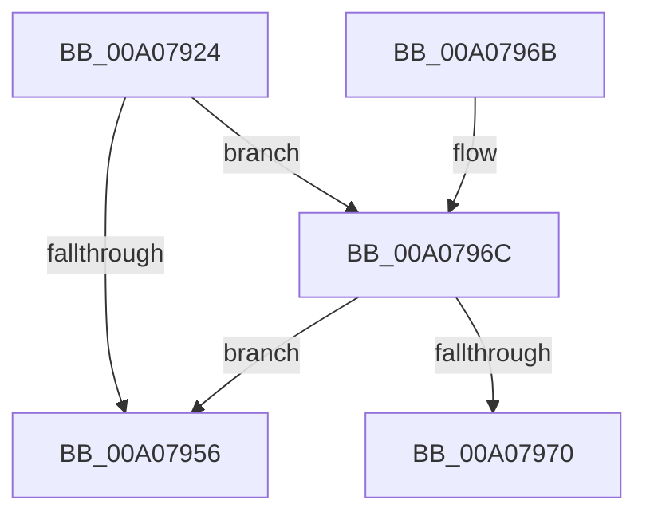

# PnpAllocateCriticalMemory

- RVA: `0x00A07924`–`0x00A07975` (길이 `81` bytes)
- VA: `0x0000000140A07924`
- 실행 섹션: `PAGE`
- PDB 이름 있음: `예`; PDB Function 태그: `예`
- unwind 정보 RVA: `0x000898D0`
- 디코드: `25`개 명령, `81/81` bytes 표시
- 미해석 바이트: `0` (있으면 어셈블리에 `.byte`로 보존)

> 이 문서는 커널 이미지의 기계어와 PDB 기호를 분석해 생성했습니다. 4번과 5번은 함수 원형과 자료형을 바이너리 사용 방식에서 추정한 C 해석이며 원본 소스 복구 결과는 아닙니다.

## 1. Dependencies

- 직접 호출 지점: **1**; 고유 호출 대상: **1**
- 직접 호출자로 확인된 함수: **10**
- RIP 상대 이미지 참조: **0**

### Outgoing calls
- `0x00A0794C` → [ExAllocatePool2](../../poolcode/B8/ExAllocatePool2_function_00B820F0.md) (function, `0x00B820F0`)

### Direct callers
- [PnpQueueQueryAndRemoveEvent](../94/PnpQueueQueryAndRemoveEvent_function_0094FD2C.md) at `0x0094FE77`
- [PiEventAllocateVetoBuffer](PiEventAllocateVetoBuffer_function_00A05840.md) at `0x00A05862`
- [PiEventAllocateVetoBuffer](PiEventAllocateVetoBuffer_function_00A05840.md) at `0x00A05898`
- [PiProcessQueryAndCancelRemoval](PiProcessQueryAndCancelRemoval_function_00A05A58.md) at `0x00A05B26`
- [PiEventBuildPdoList](PiEventBuildPdoList_function_00A05C8C.md) at `0x00A05CDF`
- [PnpResizeTargetDeviceBlock](PnpResizeTargetDeviceBlock_function_00A07638.md) at `0x00A076A7`
- [PnpCompileDeviceInstancePaths](PnpCompileDeviceInstancePaths_function_00A07708.md) at `0x00A077A3`
- [IopAllocateRelationList](IopAllocateRelationList_function_00A0784C.md) at `0x00A07869`
- [PiAllocateDeviceObjectList](PiAllocateDeviceObjectList_function_00A078B4.md) at `0x00A078E3`
- [sub_00B1FAB0](../B1/Unknown_function_00B1FAB0.md) at `0x00B1FAD0`
- [sub_00B49E1C](../B4/Unknown_function_00B49E1C.md) at `0x00B49E41`

### Static image references
- 디코드된 RIP-relative 메모리 참조가 없습니다.

## 2. Other-region calls and transfers

- 다른 실행 섹션으로 향하는 call: **1**
  - `0x00A0794C` → [ExAllocatePool2](../../poolcode/B8/ExAllocatePool2_function_00B820F0.md) (`PAGE` → `POOLCODE`)
- call이 아닌 외부 분기/꼬리 이동: **1**
  - `0x00A07970` → [sub_00B346BA](../B3/Unknown_function_00B346BA.md) (`tail-transfer`)

## 3. Assembly (complete function range)

```asm
00A07924  48 89 5C 24 08                  mov qword ptr [rsp + 8], rbx
00A07929  48 89 6C 24 10                  mov qword ptr [rsp + 0x10], rbp
00A0792E  48 89 74 24 18                  mov qword ptr [rsp + 0x18], rsi
00A07933  57                              push rdi
00A07934  48 83 EC 30                     sub rsp, 0x30
00A07938  49 8B F0                        mov rsi, r8
00A0793B  48 8B EA                        mov rbp, rdx
00A0793E  8B D9                           mov ebx, ecx
00A07940  48 8B D6                        mov rdx, rsi
00A07943  48 8B CD                        mov rcx, rbp
00A07946  45 8B C1                        mov r8d, r9d
00A07949  41 8B F9                        mov edi, r9d
00A0794C  E8 9F A7 17 00                  call 0x140b820f0
00A07951  48 85 C0                        test rax, rax
00A07954  74 16                           je 0x140a0796c
00A07956  48 8B 5C 24 40                  mov rbx, qword ptr [rsp + 0x40]
00A0795B  48 8B 6C 24 48                  mov rbp, qword ptr [rsp + 0x48]
00A07960  48 8B 74 24 50                  mov rsi, qword ptr [rsp + 0x50]
00A07965  48 83 C4 30                     add rsp, 0x30
00A07969  5F                              pop rdi
00A0796A  C3                              ret
00A0796B  CC                              int3
00A0796C  85 DB                           test ebx, ebx
00A0796E  74 E6                           je 0x140a07956
00A07970  E9 45 CD 12 00                  jmp 0x140b346ba
```

## 4. C-style interpretation (structured pseudocode)

```c
__int64 __fastcall PnpAllocateCriticalMemory(int a1, __int64 a2, __int64 a3, int a4)
{
    __int64 result;
    __int64 v_rsp;
    unsigned __int64 v_stack_p10;
    unsigned __int64 v_stack_p18;
    unsigned __int64 v_stack_p8;

    v_stack_p8 = v_rbx;
    v_stack_p10 = v_rbp;
    v_stack_p18 = v_rsi;
    v_rsp = (v_rsp) - (48);
    result = ExAllocatePool2(a2, a3, (unsigned int)(a4), a4);
    if (result == 0) goto loc_00A0796C;
loc_00A07956:
    v_rsp = (v_rsp) + (48);
    return result;
loc_00A0796C:
    if ((unsigned int)(v_stack_p8) == 0) goto loc_00A07956;
}
```

## 5. (Beta) C Style

```c
int64_t PnpAllocateCriticalMemory(int32_t Arg1, int64_t Arg2, int64_t Arg3, int32_t Arg4)
{
    int64_t result;
    int64_t local_rsp;
    uint64_t v_stack_p10;
    uint64_t v_stack_p18;
    uint64_t v_stack_p8;

    v_stack_p8 = local_rbx;
    v_stack_p10 = local_rbp;
    v_stack_p18 = local_rsi;
    local_rsp = (local_rsp) - (48);
    result = ExAllocatePool2(Arg2, Arg3, (uint32_t)(Arg4), Arg4);
    if (result == 0) goto loc_00A0796C;
loc_00A07956:
    local_rsp = (local_rsp) + (48);
    return result;
loc_00A0796C:
    if ((uint32_t)(v_stack_p8) == 0) goto loc_00A07956;
}
```

## 6. Execution-region graph

[열기: 2D/3D 그래프와 함수 탐색 컨트롤 패널](../../../control-panel.html?section=page&rva=0x00A07924&view=graph)

- 2D 그래프는 위에서 아래로 흐르고, 3D 그래프는 빈 공간을 드래그해 회전합니다. Shift+드래그는 이동, 휠은 확대·축소, 함수 노드 선택은 대상 보고서 이동입니다.

### Static fallback


