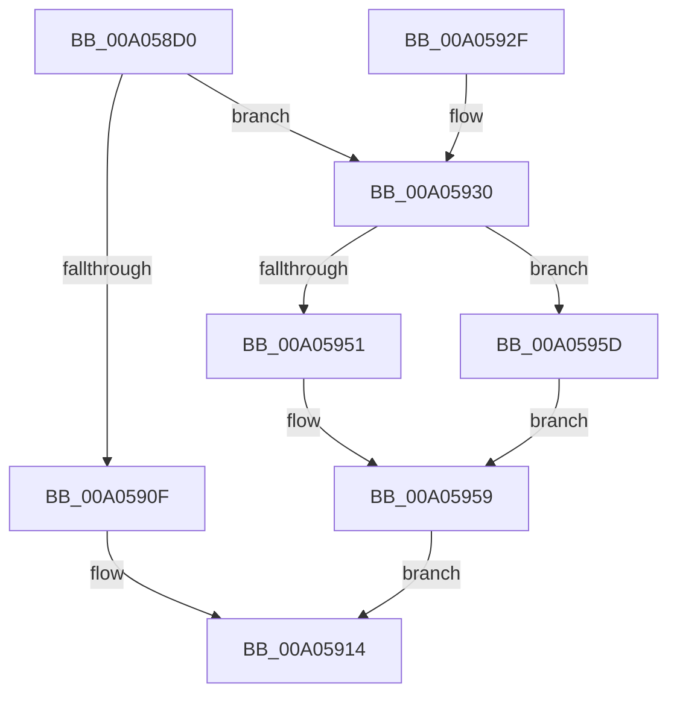

# PnpBuildRemovalRelationList

- RVA: `0x00A058D0`–`0x00A05964` (길이 `148` bytes)
- VA: `0x0000000140A058D0`
- 실행 섹션: `PAGE`
- PDB 이름 있음: `예`; PDB Function 태그: `아니요`
- unwind 정보 RVA: `0x000A841C`
- 디코드: `43`개 명령, `148/148` bytes 표시
- 미해석 바이트: `0` (있으면 어셈블리에 `.byte`로 보존)

> 이 문서는 커널 이미지의 기계어와 PDB 기호를 분석해 생성했습니다. 4번과 5번은 함수 원형과 자료형을 바이너리 사용 방식에서 추정한 C 해석이며 원본 소스 복구 결과는 아닙니다.

## 1. Dependencies

- 직접 호출 지점: **4**; 고유 호출 대상: **4**
- 직접 호출자로 확인된 함수: **1**
- RIP 상대 이미지 참조: **0**

### Outgoing calls
- `0x00A05902` → [IopAllocateRelationList](IopAllocateRelationList_function_00A0784C.md) (function, `0x00A0784C`)
- `0x00A05943` → [PnpProcessRelation](PnpProcessRelation_function_00A04A4C.md) (function, `0x00A04A4C`)
- `0x00A05954` → [IopSortRelationListForRemove](IopSortRelationListForRemove_function_00A06C30.md) (function, `0x00A06C30`)
- `0x00A0595D` → [IopFreeRelationList](IopFreeRelationList_function_00A08310.md) (function, `0x00A08310`)

### Direct callers
- [PnpProcessQueryRemoveAndEject](PnpProcessQueryRemoveAndEject_function_00A05170.md) at `0x00A05466`

### Static image references
- 디코드된 RIP-relative 메모리 참조가 없습니다.

## 2. Other-region calls and transfers

- 다른 실행 섹션으로 향하는 call: **0**
- 별도 외부 분기/꼬리 이동을 확인하지 못했습니다.

## 3. Assembly (complete function range)

```asm
00A058D0  48 8B C4                        mov rax, rsp
00A058D3  48 89 58 08                     mov qword ptr [rax + 8], rbx
00A058D7  48 89 68 10                     mov qword ptr [rax + 0x10], rbp
00A058DB  48 89 70 18                     mov qword ptr [rax + 0x18], rsi
00A058DF  48 89 78 20                     mov qword ptr [rax + 0x20], rdi
00A058E3  41 56                           push r14
00A058E5  48 83 EC 30                     sub rsp, 0x30
00A058E9  48 8B 81 38 01 00 00            mov rax, qword ptr [rcx + 0x138]
00A058F0  49 8B F1                        mov rsi, r9
00A058F3  49 83 21 00                     and qword ptr [r9], 0
00A058F7  8B CA                           mov ecx, edx
00A058F9  49 8B E8                        mov rbp, r8
00A058FC  8B FA                           mov edi, edx
00A058FE  4C 8B 70 28                     mov r14, qword ptr [rax + 0x28]
00A05902  E8 45 1F 00 00                  call 0x140a0784c
00A05907  48 8B D8                        mov rbx, rax
00A0590A  48 85 C0                        test rax, rax
00A0590D  75 21                           jne 0x140a05930
00A0590F  B8 9A 00 00 C0                  mov eax, 0xc000009a
00A05914  48 8B 5C 24 40                  mov rbx, qword ptr [rsp + 0x40]
00A05919  48 8B 6C 24 48                  mov rbp, qword ptr [rsp + 0x48]
00A0591E  48 8B 74 24 50                  mov rsi, qword ptr [rsp + 0x50]
00A05923  48 8B 7C 24 58                  mov rdi, qword ptr [rsp + 0x58]
00A05928  48 83 C4 30                     add rsp, 0x30
00A0592C  41 5E                           pop r14
00A0592E  C3                              ret
00A0592F  CC                              int3
00A05930  4C 8B CD                        mov r9, rbp
00A05933  48 89 5C 24 20                  mov qword ptr [rsp + 0x20], rbx
00A05938  41 B8 02 00 00 00               mov r8d, 2
00A0593E  8B D7                           mov edx, edi
00A05940  49 8B CE                        mov rcx, r14
00A05943  E8 04 F1 FF FF                  call 0x140a04a4c
00A05948  8B F8                           mov edi, eax
00A0594A  48 8B CB                        mov rcx, rbx
00A0594D  85 C0                           test eax, eax
00A0594F  78 0C                           js 0x140a0595d
00A05951  48 89 1E                        mov qword ptr [rsi], rbx
00A05954  E8 D7 12 00 00                  call 0x140a06c30
00A05959  8B C7                           mov eax, edi
00A0595B  EB B7                           jmp 0x140a05914
00A0595D  E8 AE 29 00 00                  call 0x140a08310
00A05962  EB F5                           jmp 0x140a05959
```

## 4. C-style interpretation (structured pseudocode)

```c
__int64 __fastcall PnpBuildRemovalRelationList(__int64 a1, int a2, __int64 a3, __int64 a4)
{
    __int64 result;
    __int64 v_rsp;
    unsigned __int64 v_stack_p10;
    unsigned __int64 v_stack_p18;
    unsigned __int64 v_stack_p20;
    unsigned __int64 v_stack_p8;

    *(unsigned __int64 *)(v_rsp + 8) = v_rbx;
    *(unsigned __int64 *)(v_rsp + 16) = v_rbp;
    *(unsigned __int64 *)(v_rsp + 24) = v_rsi;
    *(unsigned __int64 *)(v_rsp + 32) = v_rdi;
    v_rsp = (v_rsp) - (48);
    result = IopAllocateRelationList((unsigned int)(a2), a2, a3, a4);
    if (result != 0) goto loc_00A05930;
loc_00A05914:
    v_rsp = (v_rsp) + (48);
    return (unsigned int)(0xC000009AULL);
loc_00A05930:
    v_stack_p20 = v_stack_p8;
    result = PnpProcessRelation(*(unsigned __int64 *)(*(unsigned __int64 *)(a1 + 312) + 40), (unsigned int)((unsigned int)(v_stack_p20)), 2, v_stack_p10);
    if (sign_flag) goto loc_00A0595D;
    *(unsigned __int64 *)(v_stack_p18) = v_stack_p8;
    result = IopSortRelationListForRemove(v_stack_p8, (unsigned int)((unsigned int)(v_stack_p20)), 2, v_stack_p10);
loc_00A05959:
    goto loc_00A05914;
loc_00A0595D:
    result = IopFreeRelationList(v_stack_p8, (unsigned int)((unsigned int)(v_stack_p20)), 2, v_stack_p10);
    goto loc_00A05959;
}
```

## 5. (Beta) C Style

```c
int64_t PnpBuildRemovalRelationList(void *Arg1, int32_t Arg2, int64_t Arg3, void *Arg4)
{
    uint8_t *arg1 = (uint8_t *)Arg1;
    uint8_t *arg4 = (uint8_t *)Arg4;

    int64_t result;
    int64_t local_rsp;
    uint64_t v_stack_p10;
    uint64_t v_stack_p18;
    uint64_t v_stack_p20;
    uint64_t v_stack_p8;

    *(uint64_t *)(local_rsp + 0x8) = local_rbx;
    *(uint64_t *)(local_rsp + 0x10) = local_rbp;
    *(uint64_t *)(local_rsp + 0x18) = local_rsi;
    *(uint64_t *)(local_rsp + 0x20) = local_rdi;
    local_rsp = (local_rsp) - (48);
    result = IopAllocateRelationList((uint32_t)(Arg2), Arg2, Arg3, Arg4);
    if (result != 0) goto loc_00A05930;
loc_00A05914:
    local_rsp = (local_rsp) + (48);
    return (uint32_t)(0xC000009AULL);
loc_00A05930:
    v_stack_p20 = v_stack_p8;
    result = PnpProcessRelation(*(uint64_t *)(*(uint64_t *)(arg1 + 0x138) + 0x28), (uint32_t)((uint32_t)(v_stack_p20)), 2, v_stack_p10);
    if (sign_flag) goto loc_00A0595D;
    *(uint64_t *)(v_stack_p18) = v_stack_p8;
    result = IopSortRelationListForRemove(v_stack_p8, (uint32_t)((uint32_t)(v_stack_p20)), 2, v_stack_p10);
loc_00A05959:
    goto loc_00A05914;
loc_00A0595D:
    result = IopFreeRelationList(v_stack_p8, (uint32_t)((uint32_t)(v_stack_p20)), 2, v_stack_p10);
    goto loc_00A05959;
}
```

### 관측된 메모리 오프셋

구조체 형식이 확인되지 않은 접근은 인자 기준의 오프셋으로만 기록했습니다.

| 기준 인자 | 오프셋 표현 | 폭 (bit) | 접근 |
|---|---:|---:|---|
| `Arg1` | `+ 0x138` | `64` | `R` |
| `Arg4` | `+ 0x0` | `64` | `R/W` |
| `Arg4` | `+ 0x0` | `64` | `W` |

## 6. Execution-region graph

[열기: 2D/3D 그래프와 함수 탐색 컨트롤 패널](../../../control-panel.html?section=page&rva=0x00A058D0&view=graph)

- 2D 그래프는 위에서 아래로 흐르고, 3D 그래프는 빈 공간을 드래그해 회전합니다. Shift+드래그는 이동, 휠은 확대·축소, 함수 노드 선택은 대상 보고서 이동입니다.

### Static fallback


