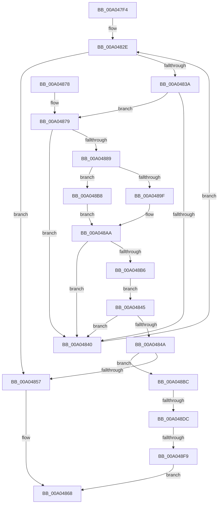

# PnpChainDereferenceComplete

- RVA: `0x00A047F4`–`0x00A04905` (길이 `273` bytes)
- VA: `0x0000000140A047F4`
- 실행 섹션: `PAGE`
- PDB 이름 있음: `예`; PDB Function 태그: `예`
- unwind 정보 RVA: `0x000A82E8`
- 디코드: `66`개 명령, `273/273` bytes 표시
- 미해석 바이트: `0` (있으면 어셈블리에 `.byte`로 보존)

> 이 문서는 커널 이미지의 기계어와 PDB 기호를 분석해 생성했습니다. 4번과 5번은 함수 원형과 자료형을 바이너리 사용 방식에서 추정한 C 해석이며 원본 소스 복구 결과는 아닙니다.

## 1. Dependencies

- 직접 호출 지점: **7**; 고유 호출 대상: **5**
- 직접 호출자로 확인된 함수: **2**
- RIP 상대 이미지 참조: **5**

### Outgoing calls
- `0x00A04822` → [ExAcquireResourceExclusiveLite](../../text/21/ExAcquireResourceExclusiveLite_function_00214E20.md) (function, `0x00214E20`)
- `0x00A0485E` → [ExReleaseResourceLite](../../text/25/ExReleaseResourceLite_function_0025FA10.md) (function, `0x0025FA10`)
- `0x00A04863` → [KeLeaveCriticalRegion](../../text/25/KeLeaveCriticalRegion_function_0025D8B0.md) (function, `0x0025D8B0`)
- `0x00A04880` → [IopSetRelationsTag](IopSetRelationsTag_function_00A0490C.md) (function, `0x00A0490C`)
- `0x00A048CA` → [ExReleaseResourceLite](../../text/25/ExReleaseResourceLite_function_0025FA10.md) (function, `0x0025FA10`)
- `0x00A048CF` → [KeLeaveCriticalRegion](../../text/25/KeLeaveCriticalRegion_function_0025D8B0.md) (function, `0x0025D8B0`)
- `0x00A048FB` → [PnpDelayedRemoveWorker](PnpDelayedRemoveWorker_function_00A08AE0.md) (function, `0x00A08AE0`)

### Direct callers
- [IopCompleteUnloadOrDelete](../../text/27/IopCompleteUnloadOrDelete_function_00270BC8.md) at `0x00270C5A`
- [PnpIsChainDereferenced](../../text/4A/PnpIsChainDereferenced_function_004ABAE8.md) at `0x004ABC01`

### Static image references
- `0x00A04813` → RVA `0x00F8C460` (`.data`; read)
- `0x00A04827` → RVA `0x00F8C550` (`.data`; read)
- `0x00A0484A` → RVA `0x00E66300` (`.data`; read)
- `0x00A048C3` → RVA `0x00E66300` (`.data`; write)
- `0x00A048E5` → RVA `0x00FC6AB0` (`ALMOSTRO`; read)

## 2. Other-region calls and transfers

- 다른 실행 섹션으로 향하는 call: **5**
  - `0x00A04822` → [ExAcquireResourceExclusiveLite](../../text/21/ExAcquireResourceExclusiveLite_function_00214E20.md) (`PAGE` → `.text`)
  - `0x00A0485E` → [ExReleaseResourceLite](../../text/25/ExReleaseResourceLite_function_0025FA10.md) (`PAGE` → `.text`)
  - `0x00A04863` → [KeLeaveCriticalRegion](../../text/25/KeLeaveCriticalRegion_function_0025D8B0.md) (`PAGE` → `.text`)
  - `0x00A048CA` → [ExReleaseResourceLite](../../text/25/ExReleaseResourceLite_function_0025FA10.md) (`PAGE` → `.text`)
  - `0x00A048CF` → [KeLeaveCriticalRegion](../../text/25/KeLeaveCriticalRegion_function_0025D8B0.md) (`PAGE` → `.text`)
- call이 아닌 외부 분기/꼬리 이동: **2**
  - `0x00A048D6` → [sub_00B33662](../B3/Unknown_function_00B33662.md) (`tail-transfer`)
  - `0x00A048F3` → [sub_00B33662](../B3/Unknown_function_00B33662.md) (`tail-transfer`)

## 3. Assembly (complete function range)

```asm
00A047F4  48 89 5C 24 08                  mov qword ptr [rsp + 8], rbx
00A047F9  48 89 74 24 10                  mov qword ptr [rsp + 0x10], rsi
00A047FE  57                              push rdi
00A047FF  48 83 EC 20                     sub rsp, 0x20
00A04803  65 48 8B 04 25 88 01 00 00      mov rax, qword ptr gs:[0x188]
00A0480C  8B FA                           mov edi, edx
00A0480E  48 8B F1                        mov rsi, rcx
00A04811  B2 01                           mov dl, 1
00A04813  48 8D 0D 46 7C 58 00            lea rcx, [rip + 0x587c46]
00A0481A  66 FF 88 E4 01 00 00            dec word ptr [rax + 0x1e4]
00A04821  90                              nop
00A04822  E8 F9 05 81 FF                  call 0x140214e20
00A04827  48 8B 1D 22 7D 58 00            mov rbx, qword ptr [rip + 0x587d22]
00A0482E  48 8D 05 1B 7D 58 00            lea rax, [rip + 0x587d1b]
00A04835  48 3B D8                        cmp rbx, rax
00A04838  74 1D                           je 0x140a04857
00A0483A  80 7B 68 00                     cmp byte ptr [rbx + 0x68], 0
00A0483E  74 39                           je 0x140a04879
00A04840  48 8B 1B                        mov rbx, qword ptr [rbx]
00A04843  EB E9                           jmp 0x140a0482e
00A04845  41 3B D0                        cmp edx, r8d
00A04848  75 F6                           jne 0x140a04840
00A0484A  80 3D AF 1A 46 00 00            cmp byte ptr [rip + 0x461aaf], 0
00A04851  C6 43 68 01                     mov byte ptr [rbx + 0x68], 1
00A04855  74 65                           je 0x140a048bc
00A04857  48 8D 0D 02 7C 58 00            lea rcx, [rip + 0x587c02]
00A0485E  E8 AD B1 85 FF                  call 0x14025fa10
00A04863  E8 48 90 85 FF                  call 0x14025d8b0
00A04868  48 8B 5C 24 30                  mov rbx, qword ptr [rsp + 0x30]
00A0486D  48 8B 74 24 38                  mov rsi, qword ptr [rsp + 0x38]
00A04872  48 83 C4 20                     add rsp, 0x20
00A04876  5F                              pop rdi
00A04877  C3                              ret
00A04878  CC                              int3
00A04879  48 8B 4B 40                     mov rcx, qword ptr [rbx + 0x40]
00A0487D  48 8B D6                        mov rdx, rsi
00A04880  E8 87 00 00 00                  call 0x140a0490c
00A04885  85 C0                           test eax, eax
00A04887  78 B7                           js 0x140a04840
00A04889  48 8B 43 40                     mov rax, qword ptr [rbx + 0x40]
00A0488D  48 8B 08                        mov rcx, qword ptr [rax]
00A04890  48 8B 43 38                     mov rax, qword ptr [rbx + 0x38]
00A04894  8B 51 08                        mov edx, dword ptr [rcx + 8]
00A04897  44 8B 01                        mov r8d, dword ptr [rcx]
00A0489A  48 85 C0                        test rax, rax
00A0489D  74 19                           je 0x140a048b8
00A0489F  48 8B 80 38 01 00 00            mov rax, qword ptr [rax + 0x138]
00A048A6  48 8B 48 28                     mov rcx, qword ptr [rax + 0x28]
00A048AA  81 B9 2C 01 00 00 10 03 00 00   cmp dword ptr [rcx + 0x12c], 0x310
00A048B4  74 8A                           je 0x140a04840
00A048B6  EB 8D                           jmp 0x140a04845
00A048B8  33 C9                           xor ecx, ecx
00A048BA  EB EE                           jmp 0x140a048aa
00A048BC  48 8D 0D 9D 7B 58 00            lea rcx, [rip + 0x587b9d]
00A048C3  C6 05 36 1A 46 00 01            mov byte ptr [rip + 0x461a36], 1
00A048CA  E8 41 B1 85 FF                  call 0x14025fa10
00A048CF  E8 DC 8F 85 FF                  call 0x14025d8b0
00A048D4  85 FF                           test edi, edi
00A048D6  0F 84 86 ED 12 00               je 0x140b33662
00A048DC  65 48 8B 0C 25 88 01 00 00      mov rcx, qword ptr gs:[0x188]
00A048E5  48 8B 05 C4 21 5C 00            mov rax, qword ptr [rip + 0x5c21c4]
00A048EC  48 39 81 B8 00 00 00            cmp qword ptr [rcx + 0xb8], rax
00A048F3  0F 85 69 ED 12 00               jne 0x140b33662
00A048F9  33 C9                           xor ecx, ecx
00A048FB  E8 E0 41 00 00                  call 0x140a08ae0
00A04900  E9 63 FF FF FF                  jmp 0x140a04868
```

## 4. C-style interpretation (structured pseudocode)

```c
__int64 __fastcall PnpChainDereferenceComplete(__int64 a1, int a2, int a3)
{
    __int64 result;
    __int64 v_rsp;
    unsigned __int64 v_stack_p10;
    unsigned __int64 v_stack_p8;

    v_stack_p8 = v_rbx;
    v_stack_p10 = v_rsi;
    v_rsp = (v_rsp) - (32);
    result = ExAcquireResourceExclusiveLite(v_rip + 5798982, 1, a3, a4);
loc_00A0482E:
    if ((*(unsigned __int64 *)(v_rip + 5799202)) == (v_rip + 5799195)) goto loc_00A04857;
    if ((*(unsigned __int8 *)(*(unsigned __int64 *)(v_rip + 5799202) + 104)) == 0) goto loc_00A04879;
loc_00A04840:
    goto loc_00A0482E;
loc_00A04845:
    if (1 != a3) goto loc_00A04840;
    *(unsigned __int8 *)(*(unsigned __int64 *)(*(unsigned __int64 *)(v_rip + 5799202)) + 104) = 1;
    if ((*(unsigned __int8 *)(v_rip + 4594351)) == 0) goto loc_00A048BC;
loc_00A04857:
    result = ExReleaseResourceLite(v_rip + 5798914, 1, a3, a4);
    result = KeLeaveCriticalRegion(v_rip + 5798914, 1, a3, a4);
loc_00A04868:
    v_rsp = (v_rsp) + (32);
    return result;
loc_00A04879:
    result = IopSetRelationsTag(*(unsigned __int64 *)(v_stack_p8 + 64), v_stack_p10, a3, a4);
    if (sign_flag) goto loc_00A04840;
    if (*(unsigned __int64 *)(v_stack_p8 + 56) == 0) goto loc_00A048B8;
loc_00A048AA:
    if ((*(unsigned int *)(*(unsigned __int64 *)(*(unsigned __int64 *)(*(unsigned __int64 *)(v_stack_p8 + 56) + 312) + 40) + 300)) == 784) goto loc_00A04840;
    goto loc_00A04845;
loc_00A048B8:
    a1 = 0;
    goto loc_00A048AA;
loc_00A048BC:
    *(unsigned __int8 *)(v_rip + 4594230) = 1;
    result = ExReleaseResourceLite(v_rip + 5798813, (unsigned int)(*(unsigned int *)(*(unsigned __int64 *)(*(unsigned __int64 *)(v_stack_p8 + 64)) + 8)), (unsigned int)(*(unsigned int *)(*(unsigned __int64 *)(*(unsigned __int64 *)(v_stack_p8 + 64)))), a4);
    result = KeLeaveCriticalRegion(v_rip + 5798813, (unsigned int)(*(unsigned int *)(*(unsigned __int64 *)(*(unsigned __int64 *)(v_stack_p8 + 64)) + 8)), (unsigned int)(*(unsigned int *)(*(unsigned __int64 *)(*(unsigned __int64 *)(v_stack_p8 + 64)))), a4);
    a1 = 0;
    result = PnpDelayedRemoveWorker(a1, (unsigned int)(*(unsigned int *)(*(unsigned __int64 *)(*(unsigned __int64 *)(v_stack_p8 + 64)) + 8)), (unsigned int)(*(unsigned int *)(*(unsigned __int64 *)(*(unsigned __int64 *)(v_stack_p8 + 64)))), a4);
    goto loc_00A04868;
}
```

## 5. (Beta) C Style

```c
int64_t PnpChainDereferenceComplete(int64_t Arg1, int32_t Arg2, int32_t Arg3)
{
    int64_t result;
    int64_t local_rsp;
    uint64_t v_stack_p10;
    uint64_t v_stack_p8;

    v_stack_p8 = local_rbx;
    v_stack_p10 = local_rsi;
    local_rsp = (local_rsp) - (32);
    result = ExAcquireResourceExclusiveLite(v_rip + 5798982, 1, Arg3, a4);
loc_00A0482E:
    if ((*(uint64_t *)(v_rip + 0x587D22)) == (v_rip + 5799195)) goto loc_00A04857;
    if ((*(uint8_t *)(*(uint64_t *)(v_rip + 0x587D22) + 0x68)) == 0) goto loc_00A04879;
loc_00A04840:
    goto loc_00A0482E;
loc_00A04845:
    if (1 != Arg3) goto loc_00A04840;
    *(uint8_t *)(*(uint64_t *)(*(uint64_t *)(v_rip + 0x587D22)) + 0x68) = 1;
    if ((*(uint8_t *)(v_rip + 0x461AAF)) == 0) goto loc_00A048BC;
loc_00A04857:
    result = ExReleaseResourceLite(v_rip + 5798914, 1, Arg3, a4);
    result = KeLeaveCriticalRegion(v_rip + 5798914, 1, Arg3, a4);
loc_00A04868:
    local_rsp = (local_rsp) + (32);
    return result;
loc_00A04879:
    result = IopSetRelationsTag(*(uint64_t *)(v_stack_p8 + 0x40), v_stack_p10, Arg3, a4);
    if (sign_flag) goto loc_00A04840;
    if (*(uint64_t *)(v_stack_p8 + 0x38) == 0) goto loc_00A048B8;
loc_00A048AA:
    if ((*(uint32_t *)(*(uint64_t *)(*(uint64_t *)(*(uint64_t *)(v_stack_p8 + 0x38) + 0x138) + 0x28) + 0x12C)) == 784) goto loc_00A04840;
    goto loc_00A04845;
loc_00A048B8:
    Arg1 = 0;
    goto loc_00A048AA;
loc_00A048BC:
    *(uint8_t *)(v_rip + 0x461A36) = 1;
    result = ExReleaseResourceLite(v_rip + 5798813, (uint32_t)(*(uint32_t *)(*(uint64_t *)(*(uint64_t *)(v_stack_p8 + 0x40)) + 0x8)), (uint32_t)(*(uint32_t *)(*(uint64_t *)(*(uint64_t *)(v_stack_p8 + 0x40)))), a4);
    result = KeLeaveCriticalRegion(v_rip + 5798813, (uint32_t)(*(uint32_t *)(*(uint64_t *)(*(uint64_t *)(v_stack_p8 + 0x40)) + 0x8)), (uint32_t)(*(uint32_t *)(*(uint64_t *)(*(uint64_t *)(v_stack_p8 + 0x40)))), a4);
    Arg1 = 0;
    result = PnpDelayedRemoveWorker(Arg1, (uint32_t)(*(uint32_t *)(*(uint64_t *)(*(uint64_t *)(v_stack_p8 + 0x40)) + 0x8)), (uint32_t)(*(uint32_t *)(*(uint64_t *)(*(uint64_t *)(v_stack_p8 + 0x40)))), a4);
    goto loc_00A04868;
}
```

## 6. Execution-region graph

[열기: 2D/3D 그래프와 함수 탐색 컨트롤 패널](../../../control-panel.html?section=page&rva=0x00A047F4&view=graph)

- 2D 그래프는 위에서 아래로 흐르고, 3D 그래프는 빈 공간을 드래그해 회전합니다. Shift+드래그는 이동, 휠은 확대·축소, 함수 노드 선택은 대상 보고서 이동입니다.

### Static fallback


