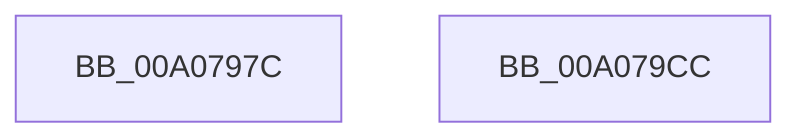

# PnpCleanupDeviceRegistryValues

- RVA: `0x00A0797C`–`0x00A079CD` (길이 `81` bytes)
- VA: `0x0000000140A0797C`
- 실행 섹션: `PAGE`
- PDB 이름 있음: `예`; PDB Function 태그: `아니요`
- unwind 정보 RVA: `0x00064C80`
- 디코드: `20`개 명령, `81/81` bytes 표시
- 미해석 바이트: `0` (있으면 어셈블리에 `.byte`로 보존)

> 이 문서는 커널 이미지의 기계어와 PDB 기호를 분석해 생성했습니다. 4번과 5번은 함수 원형과 자료형을 바이너리 사용 방식에서 추정한 C 해석이며 원본 소스 복구 결과는 아닙니다.

## 1. Dependencies

- 직접 호출 지점: **4**; 고유 호출 대상: **4**
- 직접 호출자로 확인된 함수: **4**
- RIP 상대 이미지 참조: **2**

### Outgoing calls
- `0x00A07997` → [ExAcquireFastMutex](../../text/20/ExAcquireFastMutex_function_0020E5A0.md) (function, `0x0020E5A0`)
- `0x00A079A8` → [RtlDeleteElementGenericTableAvl](../../text/3E/RtlDeleteElementGenericTableAvl_function_003EE750.md) (function, `0x003EE750`)
- `0x00A079B4` → [ExReleaseFastMutex](../../text/25/ExReleaseFastMutex_function_002519C0.md) (function, `0x002519C0`)
- `0x00A079C1` → [PiDeviceRegistration](PiDeviceRegistration_function_00A07A60.md) (function, `0x00A07A60`)

### Direct callers
- [IoReportDetectedDevice](../72/IoReportDetectedDevice_function_00725CD0.md) at `0x00726049`
- [IoReportRootDevice](../72/IoReportRootDevice_function_00726780.md) at `0x00726ACF`
- [PnpUnlinkDeviceRemovalRelations](PnpUnlinkDeviceRemovalRelations_function_00A063D8.md) at `0x00A06507`
- [sub_00B348E8](../B3/Unknown_function_00B348E8.md) at `0x00B348EC`

### Static image references
- `0x00A07990` → RVA `0x00F8CB40` (`.data`; read)
- `0x00A079A1` → RVA `0x00F8CB80` (`.data`; read)

## 2. Other-region calls and transfers

- 다른 실행 섹션으로 향하는 call: **3**
  - `0x00A07997` → [ExAcquireFastMutex](../../text/20/ExAcquireFastMutex_function_0020E5A0.md) (`PAGE` → `.text`)
  - `0x00A079A8` → [RtlDeleteElementGenericTableAvl](../../text/3E/RtlDeleteElementGenericTableAvl_function_003EE750.md) (`PAGE` → `.text`)
  - `0x00A079B4` → [ExReleaseFastMutex](../../text/25/ExReleaseFastMutex_function_002519C0.md) (`PAGE` → `.text`)
- 별도 외부 분기/꼬리 이동을 확인하지 못했습니다.

## 3. Assembly (complete function range)

```asm
00A0797C  40 53                           push rbx
00A0797E  48 83 EC 30                     sub rsp, 0x30
00A07982  48 83 64 24 20 00               and qword ptr [rsp + 0x20], 0
00A07988  48 8B D9                        mov rbx, rcx
00A0798B  48 89 4C 24 28                  mov qword ptr [rsp + 0x28], rcx
00A07990  48 8D 0D A9 51 58 00            lea rcx, [rip + 0x5851a9]
00A07997  E8 04 6C 80 FF                  call 0x14020e5a0
00A0799C  48 8D 54 24 20                  lea rdx, [rsp + 0x20]
00A079A1  48 8D 0D D8 51 58 00            lea rcx, [rip + 0x5851d8]
00A079A8  E8 A3 6D 9E FF                  call 0x1403ee750
00A079AD  48 8D 0D 8C 51 58 00            lea rcx, [rip + 0x58518c]
00A079B4  E8 07 A0 84 FF                  call 0x1402519c0
00A079B9  45 33 C0                        xor r8d, r8d
00A079BC  33 D2                           xor edx, edx
00A079BE  48 8B CB                        mov rcx, rbx
00A079C1  E8 9A 00 00 00                  call 0x140a07a60
00A079C6  48 83 C4 30                     add rsp, 0x30
00A079CA  5B                              pop rbx
00A079CB  C3                              ret
00A079CC  CC                              int3
```

## 4. C-style interpretation (structured pseudocode)

```c
__int64 __fastcall PnpCleanupDeviceRegistryValues(__int64 a1, __int64 a2, int a3)
{
    __int64 result;
    __int64 v_rsp;
    unsigned __int64 v_stack_m10;
    unsigned __int64 v_stack_m18;

    v_rsp = (v_rsp) - (48);
    v_stack_m10 = a1;
    result = ExAcquireFastMutex(v_rip + 5788073, a2, a3, a4);
    result = RtlDeleteElementGenericTableAvl(v_rip + 5788120, v_stack_m18, a3, a4);
    result = ExReleaseFastMutex(v_rip + 5788044, v_stack_m18, a3, a4);
    a3 = 0;
    a2 = 0;
    result = PiDeviceRegistration(a1, a2, a3, a4);
    v_rsp = (v_rsp) + (48);
    return result;
}
```

## 5. (Beta) C Style

```c
int64_t PnpCleanupDeviceRegistryValues(int64_t Arg1, int64_t Arg2, int32_t Arg3)
{
    int64_t result;
    int64_t local_rsp;
    uint64_t v_stack_m10;
    uint64_t v_stack_m18;

    local_rsp = (local_rsp) - (48);
    v_stack_m10 = Arg1;
    result = ExAcquireFastMutex(v_rip + 5788073, Arg2, Arg3, a4);
    result = RtlDeleteElementGenericTableAvl(v_rip + 5788120, v_stack_m18, Arg3, a4);
    result = ExReleaseFastMutex(v_rip + 5788044, v_stack_m18, Arg3, a4);
    Arg3 = 0;
    Arg2 = 0;
    result = PiDeviceRegistration(Arg1, Arg2, Arg3, a4);
    local_rsp = (local_rsp) + (48);
    return result;
}
```

## 6. Execution-region graph

[열기: 2D/3D 그래프와 함수 탐색 컨트롤 패널](../../../control-panel.html?section=page&rva=0x00A0797C&view=graph)

- 2D 그래프는 위에서 아래로 흐르고, 3D 그래프는 빈 공간을 드래그해 회전합니다. Shift+드래그는 이동, 휠은 확대·축소, 함수 노드 선택은 대상 보고서 이동입니다.

### Static fallback


