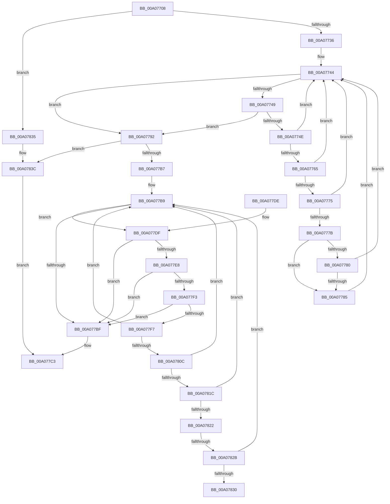

# PnpCompileDeviceInstancePaths

- RVA: `0x00A07708`–`0x00A07843` (길이 `315` bytes)
- VA: `0x0000000140A07708`
- 실행 섹션: `PAGE`
- PDB 이름 있음: `예`; PDB Function 태그: `예`
- unwind 정보 RVA: `0x000A8638`
- 디코드: `99`개 명령, `315/315` bytes 표시
- 미해석 바이트: `0` (있으면 어셈블리에 `.byte`로 보존)

> 이 문서는 커널 이미지의 기계어와 PDB 기호를 분석해 생성했습니다. 4번과 5번은 함수 원형과 자료형을 바이너리 사용 방식에서 추정한 C 해석이며 원본 소스 복구 결과는 아닙니다.

## 1. Dependencies

- 직접 호출 지점: **1**; 고유 호출 대상: **1**
- 직접 호출자로 확인된 함수: **1**
- RIP 상대 이미지 참조: **0**

### Outgoing calls
- `0x00A077A3` → [PnpAllocateCriticalMemory](PnpAllocateCriticalMemory_function_00A07924.md) (function, `0x00A07924`)

### Direct callers
- [PnpProcessQueryRemoveAndEject](PnpProcessQueryRemoveAndEject_function_00A05170.md) at `0x00A0553A`

### Static image references
- 디코드된 RIP-relative 메모리 참조가 없습니다.

## 2. Other-region calls and transfers

- 다른 실행 섹션으로 향하는 call: **0**
- call이 아닌 외부 분기/꼬리 이동: **2**
  - `0x00A07825` → [sub_00B3468E](../B3/Unknown_function_00B3468E.md) (`tail-transfer`)
  - `0x00A07830` → [sub_00B3468E](../B3/Unknown_function_00B3468E.md) (`tail-transfer`)

## 3. Assembly (complete function range)

```asm
00A07708  48 89 5C 24 08                  mov qword ptr [rsp + 8], rbx
00A0770D  48 89 6C 24 10                  mov qword ptr [rsp + 0x10], rbp
00A07712  48 89 74 24 18                  mov qword ptr [rsp + 0x18], rsi
00A07717  57                              push rdi
00A07718  41 56                           push r14
00A0771A  41 57                           push r15
00A0771C  48 83 EC 20                     sub rsp, 0x20
00A07720  33 FF                           xor edi, edi
00A07722  49 8B D9                        mov rbx, r9
00A07725  41 8A E8                        mov bpl, r8b
00A07728  4C 8B FA                        mov r15, rdx
00A0772B  8B F1                           mov esi, ecx
00A0772D  48 85 D2                        test rdx, rdx
00A07730  0F 84 FF 00 00 00               je 0x140a07835
00A07736  4D 8B 07                        mov r8, qword ptr [r15]
00A07739  8B D7                           mov edx, edi
00A0773B  49 89 39                        mov qword ptr [r9], rdi
00A0773E  44 8B CF                        mov r9d, edi
00A07741  45 8B 18                        mov r11d, dword ptr [r8]
00A07744  41 3B D3                        cmp edx, r11d
00A07747  73 49                           jae 0x140a07792
00A07749  4D 85 C0                        test r8, r8
00A0774C  74 44                           je 0x140a07792
00A0774E  8B C2                           mov eax, edx
00A07750  FF C2                           inc edx
00A07752  48 8D 0C 40                     lea rcx, [rax + rax*2]
00A07756  49 8B 44 C8 10                  mov rax, qword ptr [r8 + rcx*8 + 0x10]
00A0775B  45 8B 54 C8 18                  mov r10d, dword ptr [r8 + rcx*8 + 0x18]
00A07760  48 85 C0                        test rax, rax
00A07763  74 DF                           je 0x140a07744
00A07765  48 8B 80 38 01 00 00            mov rax, qword ptr [rax + 0x138]
00A0776C  48 8B 48 28                     mov rcx, qword ptr [rax + 0x28]
00A07770  48 85 C9                        test rcx, rcx
00A07773  74 CF                           je 0x140a07744
00A07775  48 39 79 30                     cmp qword ptr [rcx + 0x30], rdi
00A07779  74 C9                           je 0x140a07744
00A0777B  40 84 ED                        test bpl, bpl
00A0777E  74 05                           je 0x140a07785
00A07780  45 85 D2                        test r10d, r10d
00A07783  74 BF                           je 0x140a07744
00A07785  0F B7 41 28                     movzx eax, word ptr [rcx + 0x28]
00A07789  41 83 C1 02                     add r9d, 2
00A0778D  44 03 C8                        add r9d, eax
00A07790  EB B2                           jmp 0x140a07744
00A07792  45 8D 41 02                     lea r8d, [r9 + 2]
00A07796  BA 00 01 00 00                  mov edx, 0x100
00A0779B  41 B9 50 6E 70 4B               mov r9d, 0x4b706e50
00A077A1  8B CE                           mov ecx, esi
00A077A3  E8 7C 01 00 00                  call 0x140a07924
00A077A8  48 89 03                        mov qword ptr [rbx], rax
00A077AB  4C 8B F0                        mov r14, rax
00A077AE  48 85 C0                        test rax, rax
00A077B1  0F 84 85 00 00 00               je 0x140a0783c
00A077B7  8B F7                           mov esi, edi
00A077B9  41 38 7F 08                     cmp byte ptr [r15 + 8], dil
00A077BD  75 20                           jne 0x140a077df
00A077BF  66 41 89 3E                     mov word ptr [r14], di
00A077C3  48 8B 5C 24 40                  mov rbx, qword ptr [rsp + 0x40]
00A077C8  8B C7                           mov eax, edi
00A077CA  48 8B 6C 24 48                  mov rbp, qword ptr [rsp + 0x48]
00A077CF  48 8B 74 24 50                  mov rsi, qword ptr [rsp + 0x50]
00A077D4  48 83 C4 20                     add rsp, 0x20
00A077D8  41 5F                           pop r15
00A077DA  41 5E                           pop r14
00A077DC  5F                              pop rdi
00A077DD  C3                              ret
00A077DE  CC                              int3
00A077DF  49 8B 17                        mov rdx, qword ptr [r15]
00A077E2  8B 0A                           mov ecx, dword ptr [rdx]
00A077E4  3B F1                           cmp esi, ecx
00A077E6  73 D7                           jae 0x140a077bf
00A077E8  8B C6                           mov eax, esi
00A077EA  F7 D0                           not eax
00A077EC  03 C1                           add eax, ecx
00A077EE  48 85 D2                        test rdx, rdx
00A077F1  74 CC                           je 0x140a077bf
00A077F3  3B C1                           cmp eax, ecx
00A077F5  73 C8                           jae 0x140a077bf
00A077F7  48 8D 0C 40                     lea rcx, [rax + rax*2]
00A077FB  FF C6                           inc esi
00A077FD  4C 8B 44 CA 10                  mov r8, qword ptr [rdx + rcx*8 + 0x10]
00A07802  44 8B 4C CA 18                  mov r9d, dword ptr [rdx + rcx*8 + 0x18]
00A07807  4D 85 C0                        test r8, r8
00A0780A  74 AD                           je 0x140a077b9
00A0780C  49 8B 80 38 01 00 00            mov rax, qword ptr [r8 + 0x138]
00A07813  48 8B 48 28                     mov rcx, qword ptr [rax + 0x28]
00A07817  48 85 C9                        test rcx, rcx
00A0781A  74 9D                           je 0x140a077b9
00A0781C  48 39 79 30                     cmp qword ptr [rcx + 0x30], rdi
00A07820  74 97                           je 0x140a077b9
00A07822  40 84 ED                        test bpl, bpl
00A07825  0F 84 63 CE 12 00               je 0x140b3468e
00A0782B  45 85 C9                        test r9d, r9d
00A0782E  74 89                           je 0x140a077b9
00A07830  E9 59 CE 12 00                  jmp 0x140b3468e
00A07835  B9 05 00 00 00                  mov ecx, 5
00A0783A  CD 29                           int 0x29
00A0783C  BF 9A 00 00 C0                  mov edi, 0xc000009a
00A07841  EB 80                           jmp 0x140a077c3
```

## 4. C-style interpretation (structured pseudocode)

```c
__int64 __fastcall PnpCompileDeviceInstancePaths(int a1, __int64 a2, unsigned __int8 a3, __int64 a4)
{
    __int64 result;
    __int64 v_rdi;
    __int64 v_rsi;
    __int64 v_rsp;
    unsigned __int64 v_stack_p10;
    unsigned __int64 v_stack_p18;
    unsigned __int64 v_stack_p8;

    v_stack_p8 = v_rbx;
    v_stack_p10 = v_rbp;
    v_stack_p18 = v_rsi;
    v_rsp = (v_rsp) - (32);
    v_rdi = 0;
    if (a2 == 0) goto loc_00A07835;
    *(unsigned __int64 *)(a4) = 0;
loc_00A07744:
    if (0 >= ((unsigned int)((unsigned int)(*(unsigned int *)(*(unsigned __int64 *)(a2)))))) goto loc_00A07792;
    if (*(unsigned __int64 *)(a2) == 0) goto loc_00A07792;
    a2 = (unsigned int)((0) + 1);
    if (*(unsigned __int64 *)(*(unsigned __int64 *)(a2) + 0 + 0 * 2 * 8 + 16) == 0) goto loc_00A07744;
    if (*(unsigned __int64 *)(*(unsigned __int64 *)(*(unsigned __int64 *)(*(unsigned __int64 *)(a2) + 0 + 0 * 2 * 8 + 16) + 312) + 40) == 0) goto loc_00A07744;
    if ((*(unsigned __int64 *)(*(unsigned __int64 *)(*(unsigned __int64 *)(*(unsigned __int64 *)(*(unsigned __int64 *)(a2) + 0 + 0 * 2 * 8 + 16) + 312) + 40) + 48)) == 0) goto loc_00A07744;
    if (a3 == 0) goto loc_00A07785;
    if ((unsigned int)((unsigned int)(*(unsigned int *)(*(unsigned __int64 *)(a2) + 0 + 0 * 2 * 8 + 24))) == 0) goto loc_00A07744;
loc_00A07785:
    a4 = (unsigned int)((0) + (2));
    a4 = (unsigned int)((a4) + ((unsigned int)(*(unsigned __int16 *)(*(unsigned __int64 *)(*(unsigned __int64 *)(*(unsigned __int64 *)(*(unsigned __int64 *)(a2) + 0 + 0 * 2 * 8 + 16) + 312) + 40) + 40))));
    goto loc_00A07744;
loc_00A07792:
    result = PnpAllocateCriticalMemory((unsigned int)((unsigned int)((unsigned int)(a1))), 256, a4 + 2, (unsigned int)(0x4B706E50ULL));
    *(unsigned __int64 *)(a4) = result;
    if (result == 0) goto loc_00A0783C;
loc_00A077B9:
    if ((*(unsigned __int8 *)(a2 + 8)) != 0) goto loc_00A077DF;
loc_00A077BF:
    *(unsigned __int16 *)(result) = 0;
loc_00A077C3:
    v_rsp = (v_rsp) + (32);
    return 0;
loc_00A077DF:
    if (((unsigned int)(v_stack_p18)) >= ((unsigned int)((unsigned int)(*(unsigned int *)(*(unsigned __int64 *)(a2)))))) goto loc_00A077BF;
    result = (unsigned int)(~((unsigned int)((unsigned int)(v_stack_p18))));
    result = (unsigned int)((result) + ((unsigned int)((unsigned int)(*(unsigned int *)(*(unsigned __int64 *)(a2))))));
    if (*(unsigned __int64 *)(a2) == 0) goto loc_00A077BF;
    if (((unsigned int)(result)) >= ((unsigned int)((unsigned int)(*(unsigned int *)(*(unsigned __int64 *)(a2)))))) goto loc_00A077BF;
    v_rsi = (unsigned int)((v_stack_p18) + 1);
    if (*(unsigned __int64 *)(*(unsigned __int64 *)(a2) + result + result * 2 * 8 + 16) == 0) goto loc_00A077B9;
    if (*(unsigned __int64 *)(*(unsigned __int64 *)(*(unsigned __int64 *)(*(unsigned __int64 *)(a2) + result + result * 2 * 8 + 16) + 312) + 40) == 0) goto loc_00A077B9;
    if ((*(unsigned __int64 *)(*(unsigned __int64 *)(*(unsigned __int64 *)(*(unsigned __int64 *)(*(unsigned __int64 *)(a2) + result + result * 2 * 8 + 16) + 312) + 40) + 48)) == 0) goto loc_00A077B9;
    if ((unsigned int)((unsigned int)(*(unsigned int *)(*(unsigned __int64 *)(a2) + result + result * 2 * 8 + 24))) == 0) goto loc_00A077B9;
loc_00A07835:
loc_00A0783C:
    goto loc_00A077C3;
}
```

## 5. (Beta) C Style

```c
int64_t PnpCompileDeviceInstancePaths(int32_t Arg1, void *Arg2, uint8_t Arg3, void *Arg4)
{
    uint8_t *arg2 = (uint8_t *)Arg2;
    uint8_t *arg4 = (uint8_t *)Arg4;

    int64_t result;
    int64_t local_rdi;
    int64_t local_rsi;
    int64_t local_rsp;
    uint64_t v_stack_p10;
    uint64_t v_stack_p18;
    uint64_t v_stack_p8;

    v_stack_p8 = local_rbx;
    v_stack_p10 = local_rbp;
    v_stack_p18 = local_rsi;
    local_rsp = (local_rsp) - (32);
    local_rdi = 0;
    if (Arg2 == NULL) goto loc_00A07835;
    *(uint64_t *)(arg4) = 0;
loc_00A07744:
    if (0 >= ((uint32_t)((uint32_t)(*(uint32_t *)(*(uint64_t *)(arg2)))))) goto loc_00A07792;
    if (*(uint64_t *)(arg2) == 0) goto loc_00A07792;
    Arg2 = (uint32_t)((0) + 1);
    if (*(uint64_t *)(*(uint64_t *)(arg2) + 0x0 + 0x0 * 2 * 8 + 0x10) == 0) goto loc_00A07744;
    if (*(uint64_t *)(*(uint64_t *)(*(uint64_t *)(*(uint64_t *)(arg2) + 0x0 + 0x0 * 2 * 8 + 0x10) + 0x138) + 0x28) == 0) goto loc_00A07744;
    if ((*(uint64_t *)(*(uint64_t *)(*(uint64_t *)(*(uint64_t *)(*(uint64_t *)(arg2) + 0x0 + 0x0 * 2 * 8 + 0x10) + 0x138) + 0x28) + 0x30)) == 0) goto loc_00A07744;
    if (Arg3 == 0) goto loc_00A07785;
    if ((uint32_t)((uint32_t)(*(uint32_t *)(*(uint64_t *)(arg2) + 0x0 + 0x0 * 2 * 8 + 0x18))) == 0) goto loc_00A07744;
loc_00A07785:
    Arg4 = (uint32_t)((0) + (2));
    Arg4 = (uint32_t)((Arg4) + ((uint32_t)(*(uint16_t *)(*(uint64_t *)(*(uint64_t *)(*(uint64_t *)(*(uint64_t *)(arg2) + 0x0 + 0x0 * 2 * 8 + 0x10) + 0x138) + 0x28) + 0x28))));
    goto loc_00A07744;
loc_00A07792:
    result = PnpAllocateCriticalMemory((uint32_t)((uint32_t)((uint32_t)(Arg1))), 256, Arg4 + 2, (uint32_t)(0x4B706E50ULL));
    *(uint64_t *)(arg4) = result;
    if (result == 0) goto loc_00A0783C;
loc_00A077B9:
    if ((*(uint8_t *)(arg2 + 0x8)) != 0) goto loc_00A077DF;
loc_00A077BF:
    *(uint16_t *)(result) = 0;
loc_00A077C3:
    local_rsp = (local_rsp) + (32);
    return 0;
loc_00A077DF:
    if (((uint32_t)(v_stack_p18)) >= ((uint32_t)((uint32_t)(*(uint32_t *)(*(uint64_t *)(arg2)))))) goto loc_00A077BF;
    result = (uint32_t)(~((uint32_t)((uint32_t)(v_stack_p18))));
    result = (uint32_t)((result) + ((uint32_t)((uint32_t)(*(uint32_t *)(*(uint64_t *)(arg2))))));
    if (*(uint64_t *)(arg2) == 0) goto loc_00A077BF;
    if (((uint32_t)(result)) >= ((uint32_t)((uint32_t)(*(uint32_t *)(*(uint64_t *)(arg2)))))) goto loc_00A077BF;
    local_rsi = (uint32_t)((v_stack_p18) + 1);
    if (*(uint64_t *)(*(uint64_t *)(arg2) + result + result * 2 * 8 + 0x10) == 0) goto loc_00A077B9;
    if (*(uint64_t *)(*(uint64_t *)(*(uint64_t *)(*(uint64_t *)(arg2) + result + result * 2 * 8 + 0x10) + 0x138) + 0x28) == 0) goto loc_00A077B9;
    if ((*(uint64_t *)(*(uint64_t *)(*(uint64_t *)(*(uint64_t *)(*(uint64_t *)(arg2) + result + result * 2 * 8 + 0x10) + 0x138) + 0x28) + 0x30)) == 0) goto loc_00A077B9;
    if ((uint32_t)((uint32_t)(*(uint32_t *)(*(uint64_t *)(arg2) + result + result * 2 * 8 + 0x18))) == 0) goto loc_00A077B9;
loc_00A07835:
loc_00A0783C:
    goto loc_00A077C3;
}
```

### 관측된 메모리 오프셋

구조체 형식이 확인되지 않은 접근은 인자 기준의 오프셋으로만 기록했습니다.

| 기준 인자 | 오프셋 표현 | 폭 (bit) | 접근 |
|---|---:|---:|---|
| `Arg2` | `+ 0x0` | `64` | `R` |
| `Arg2` | `+ 0x8` | `8` | `R` |
| `Arg4` | `+ 0x0` | `64` | `W` |

## 6. Execution-region graph

[열기: 2D/3D 그래프와 함수 탐색 컨트롤 패널](../../../control-panel.html?section=page&rva=0x00A07708&view=graph)

- 2D 그래프는 위에서 아래로 흐르고, 3D 그래프는 빈 공간을 드래그해 회전합니다. Shift+드래그는 이동, 휠은 확대·축소, 함수 노드 선택은 대상 보고서 이동입니다.

### Static fallback


