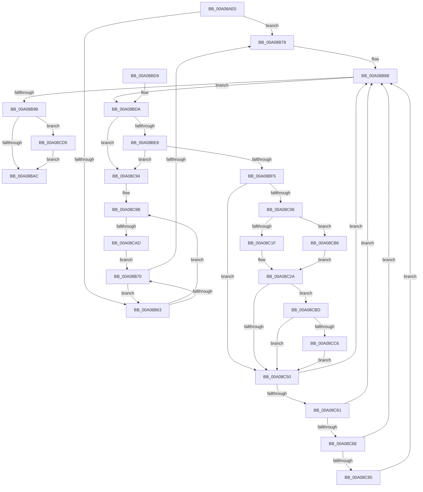

# PnpDelayedRemoveWorker

- RVA: `0x00A08AE0`–`0x00A08CE7` (길이 `519` bytes)
- VA: `0x0000000140A08AE0`
- 실행 섹션: `PAGE`
- PDB 이름 있음: `예`; PDB Function 태그: `예`
- unwind 정보 RVA: `0x000A874C`
- 디코드: `121`개 명령, `519/519` bytes 표시
- 미해석 바이트: `0` (있으면 어셈블리에 `.byte`로 보존)

> 이 문서는 커널 이미지의 기계어와 PDB 기호를 분석해 생성했습니다. 4번과 5번은 함수 원형과 자료형을 바이너리 사용 방식에서 추정한 C 해석이며 원본 소스 복구 결과는 아닙니다.

## 1. Dependencies

- 직접 호출 지점: **13**; 고유 호출 대상: **10**
- 직접 호출자로 확인된 함수: **1**
- RIP 상대 이미지 참조: **6**

### Outgoing calls
- `0x00A08B1F` → [ExAcquireResourceExclusiveLite](../../text/21/ExAcquireResourceExclusiveLite_function_00214E20.md) (function, `0x00214E20`)
- `0x00A08B2D` → [ExAcquireResourceSharedLite](../../text/21/ExAcquireResourceSharedLite_function_00211BC0.md) (function, `0x00211BC0`)
- `0x00A08B4B` → [ExAcquireResourceExclusiveLite](../../text/21/ExAcquireResourceExclusiveLite_function_00214E20.md) (function, `0x00214E20`)
- `0x00A08B86` → [ExReleaseResourceLite](../../text/25/ExReleaseResourceLite_function_0025FA10.md) (function, `0x0025FA10`)
- `0x00A08BB3` → [ExReleaseResourceLite](../../text/25/ExReleaseResourceLite_function_0025FA10.md) (function, `0x0025FA10`)
- `0x00A08BBF` → [ExReleaseResourceLite](../../text/25/ExReleaseResourceLite_function_0025FA10.md) (function, `0x0025FA10`)
- `0x00A08BC4` → [KeLeaveCriticalRegion](../../text/25/KeLeaveCriticalRegion_function_0025D8B0.md) (function, `0x0025D8B0`)
- `0x00A08C42` → [PnpEnableWatchdog](../8F/PnpEnableWatchdog_function_008FB5C8.md) (function, `0x008FB5C8`)
- `0x00A08C53` → [PipRemoveDevicesInRelationList](PipRemoveDevicesInRelationList_function_00A08CF0.md) (function, `0x00A08CF0`)
- `0x00A08C6E` → [PnpDisableWatchdog](../95/PnpDisableWatchdog_function_00955B00.md) (function, `0x00955B00`)
- `0x00A08C8A` → [ObfDereferenceObjectWithTag](../../text/2F/ObfDereferenceObjectWithTag_function_002F78E0.md) (function, `0x002F78E0`)
- `0x00A08CCB` → [ObfReferenceObjectWithTag](../../text/21/ObfReferenceObjectWithTag_function_00210710.md) (function, `0x00210710`)
- `0x00A08CDD` → [ExFreePoolWithTag](../../poolcode/B8/ExFreePoolWithTag_function_00B82870.md) (function, `0x00B82870`)

### Direct callers
- [PnpChainDereferenceComplete](PnpChainDereferenceComplete_function_00A047F4.md) at `0x00A048FB`

### Static image references
- `0x00A08AFD` → RVA `0x00F8C4E0` (`.data`; read)
- `0x00A08B26` → RVA `0x00F8C560` (`.data`; read)
- `0x00A08B3B` → RVA `0x00F8C460` (`.data`; read)
- `0x00A08B44` → RVA `0x00F8CB20` (`.data`; write)
- `0x00A08B50` → RVA `0x00F8C550` (`.data`; read)
- `0x00A08B7F` → RVA `0x00E66300` (`.data`; write)

## 2. Other-region calls and transfers

- 다른 실행 섹션으로 향하는 call: **10**
  - `0x00A08B1F` → [ExAcquireResourceExclusiveLite](../../text/21/ExAcquireResourceExclusiveLite_function_00214E20.md) (`PAGE` → `.text`)
  - `0x00A08B2D` → [ExAcquireResourceSharedLite](../../text/21/ExAcquireResourceSharedLite_function_00211BC0.md) (`PAGE` → `.text`)
  - `0x00A08B4B` → [ExAcquireResourceExclusiveLite](../../text/21/ExAcquireResourceExclusiveLite_function_00214E20.md) (`PAGE` → `.text`)
  - `0x00A08B86` → [ExReleaseResourceLite](../../text/25/ExReleaseResourceLite_function_0025FA10.md) (`PAGE` → `.text`)
  - `0x00A08BB3` → [ExReleaseResourceLite](../../text/25/ExReleaseResourceLite_function_0025FA10.md) (`PAGE` → `.text`)
  - `0x00A08BBF` → [ExReleaseResourceLite](../../text/25/ExReleaseResourceLite_function_0025FA10.md) (`PAGE` → `.text`)
  - `0x00A08BC4` → [KeLeaveCriticalRegion](../../text/25/KeLeaveCriticalRegion_function_0025D8B0.md) (`PAGE` → `.text`)
  - `0x00A08C8A` → [ObfDereferenceObjectWithTag](../../text/2F/ObfDereferenceObjectWithTag_function_002F78E0.md) (`PAGE` → `.text`)
  - `0x00A08CCB` → [ObfReferenceObjectWithTag](../../text/21/ObfReferenceObjectWithTag_function_00210710.md) (`PAGE` → `.text`)
  - `0x00A08CDD` → [ExFreePoolWithTag](../../poolcode/B8/ExFreePoolWithTag_function_00B82870.md) (`PAGE` → `POOLCODE`)
- call이 아닌 외부 분기/꼬리 이동: **1**
  - `0x00A08CA7` → [sub_00B348A2](../B3/Unknown_function_00B348A2.md) (`tail-transfer`)

## 3. Assembly (complete function range)

```asm
00A08AE0  48 89 5C 24 08                  mov qword ptr [rsp + 8], rbx
00A08AE5  48 89 7C 24 10                  mov qword ptr [rsp + 0x10], rdi
00A08AEA  55                              push rbp
00A08AEB  48 8B EC                        mov rbp, rsp
00A08AEE  48 83 EC 30                     sub rsp, 0x30
00A08AF2  48 8D 45 F0                     lea rax, [rbp - 0x10]
00A08AF6  48 8B D9                        mov rbx, rcx
00A08AF9  48 89 45 F8                     mov qword ptr [rbp - 8], rax
00A08AFD  48 8D 0D DC 39 58 00            lea rcx, [rip + 0x5839dc]
00A08B04  48 8D 45 F0                     lea rax, [rbp - 0x10]
00A08B08  B2 01                           mov dl, 1
00A08B0A  48 89 45 F0                     mov qword ptr [rbp - 0x10], rax
00A08B0E  65 48 8B 04 25 88 01 00 00      mov rax, qword ptr gs:[0x188]
00A08B17  66 FF 88 E4 01 00 00            dec word ptr [rax + 0x1e4]
00A08B1E  90                              nop
00A08B1F  E8 FC C2 80 FF                  call 0x140214e20
00A08B24  B2 01                           mov dl, 1
00A08B26  48 8D 0D 33 3A 58 00            lea rcx, [rip + 0x583a33]
00A08B2D  E8 8E 90 80 FF                  call 0x140211bc0
00A08B32  65 48 8B 04 25 88 01 00 00      mov rax, qword ptr gs:[0x188]
00A08B3B  48 8D 0D 1E 39 58 00            lea rcx, [rip + 0x58391e]
00A08B42  B2 01                           mov dl, 1
00A08B44  48 89 05 D5 3F 58 00            mov qword ptr [rip + 0x583fd5], rax
00A08B4B  E8 D0 C2 80 FF                  call 0x140214e20
00A08B50  48 8B 15 F9 39 58 00            mov rdx, qword ptr [rip + 0x5839f9]
00A08B57  4C 8D 15 F2 39 58 00            lea r10, [rip + 0x5839f2]
00A08B5E  49 3B D2                        cmp rdx, r10
00A08B61  74 15                           je 0x140a08b78
00A08B63  80 7A 68 00                     cmp byte ptr [rdx + 0x68], 0
00A08B67  4C 8B 02                        mov r8, qword ptr [rdx]
00A08B6A  0F 85 2B 01 00 00               jne 0x140a08c9b
00A08B70  49 8B D0                        mov rdx, r8
00A08B73  4D 3B C2                        cmp r8, r10
00A08B76  75 EB                           jne 0x140a08b63
00A08B78  48 8D 0D E1 38 58 00            lea rcx, [rip + 0x5838e1]
00A08B7F  C6 05 7A D7 45 00 00            mov byte ptr [rip + 0x45d77a], 0
00A08B86  E8 85 6E 85 FF                  call 0x14025fa10
00A08B8B  48 8B 7D F0                     mov rdi, qword ptr [rbp - 0x10]
00A08B8F  48 8D 45 F0                     lea rax, [rbp - 0x10]
00A08B93  48 3B F8                        cmp rdi, rax
00A08B96  75 42                           jne 0x140a08bda
00A08B98  48 C7 05 7D 3F 58 00 00 00 00 00  mov qword ptr [rip + 0x583f7d], 0
00A08BA3  48 85 DB                        test rbx, rbx
00A08BA6  0F 85 29 01 00 00               jne 0x140a08cd5
00A08BAC  48 8D 0D AD 39 58 00            lea rcx, [rip + 0x5839ad]
00A08BB3  E8 58 6E 85 FF                  call 0x14025fa10
00A08BB8  48 8D 0D 21 39 58 00            lea rcx, [rip + 0x583921]
00A08BBF  E8 4C 6E 85 FF                  call 0x14025fa10
00A08BC4  E8 E7 4C 85 FF                  call 0x14025d8b0
00A08BC9  48 8B 5C 24 40                  mov rbx, qword ptr [rsp + 0x40]
00A08BCE  48 8B 7C 24 48                  mov rdi, qword ptr [rsp + 0x48]
00A08BD3  48 83 C4 30                     add rsp, 0x30
00A08BD7  5D                              pop rbp
00A08BD8  C3                              ret
00A08BD9  CC                              int3
00A08BDA  48 8D 45 F0                     lea rax, [rbp - 0x10]
00A08BDE  48 39 47 08                     cmp qword ptr [rdi + 8], rax
00A08BE2  0F 85 AC 00 00 00               jne 0x140a08c94
00A08BE8  48 8B 07                        mov rax, qword ptr [rdi]
00A08BEB  48 39 78 08                     cmp qword ptr [rax + 8], rdi
00A08BEF  0F 85 9F 00 00 00               jne 0x140a08c94
00A08BF5  48 89 45 F0                     mov qword ptr [rbp - 0x10], rax
00A08BF9  48 8D 4D F0                     lea rcx, [rbp - 0x10]
00A08BFD  48 89 48 08                     mov qword ptr [rax + 8], rcx
00A08C01  48 85 DB                        test rbx, rbx
00A08C04  74 4A                           je 0x140a08c50
00A08C06  48 89 7B 10                     mov qword ptr [rbx + 0x10], rdi
00A08C0A  48 8B 47 38                     mov rax, qword ptr [rdi + 0x38]
00A08C0E  48 89 43 08                     mov qword ptr [rbx + 8], rax
00A08C12  48 8B 47 38                     mov rax, qword ptr [rdi + 0x38]
00A08C16  48 85 C0                        test rax, rax
00A08C19  0F 84 97 00 00 00               je 0x140a08cb6
00A08C1F  48 8B 80 38 01 00 00            mov rax, qword ptr [rax + 0x138]
00A08C26  48 8B 48 28                     mov rcx, qword ptr [rax + 0x28]
00A08C2A  48 8D 41 38                     lea rax, [rcx + 0x38]
00A08C2E  48 89 0B                        mov qword ptr [rbx], rcx
00A08C31  48 F7 D9                        neg rcx
00A08C34  48 8B D3                        mov rdx, rbx
00A08C37  B9 03 00 00 00                  mov ecx, 3
00A08C3C  4D 1B C0                        sbb r8, r8
00A08C3F  4C 23 C0                        and r8, rax
00A08C42  E8 81 29 EF FF                  call 0x1408fb5c8
00A08C47  48 89 43 18                     mov qword ptr [rbx + 0x18], rax
00A08C4B  48 85 C0                        test rax, rax
00A08C4E  75 6D                           jne 0x140a08cbd
00A08C50  48 8B CF                        mov rcx, rdi
00A08C53  E8 98 00 00 00                  call 0x140a08cf0
00A08C58  48 85 DB                        test rbx, rbx
00A08C5B  0F 84 2A FF FF FF               je 0x140a08b8b
00A08C61  48 8B 4B 18                     mov rcx, qword ptr [rbx + 0x18]
00A08C65  48 85 C9                        test rcx, rcx
00A08C68  0F 84 1D FF FF FF               je 0x140a08b8b
00A08C6E  E8 8D CE F4 FF                  call 0x140955b00
00A08C73  48 8B 4B 08                     mov rcx, qword ptr [rbx + 8]
00A08C77  48 83 63 18 00                  and qword ptr [rbx + 0x18], 0
00A08C7C  48 85 C9                        test rcx, rcx
00A08C7F  0F 84 06 FF FF FF               je 0x140a08b8b
00A08C85  BA 50 6E 70 56                  mov edx, 0x56706e50
00A08C8A  E8 51 EC 8E FF                  call 0x1402f78e0
00A08C8F  E9 F7 FE FF FF                  jmp 0x140a08b8b
00A08C94  B9 03 00 00 00                  mov ecx, 3
00A08C99  CD 29                           int 0x29
00A08C9B  48 8B 42 40                     mov rax, qword ptr [rdx + 0x40]
00A08C9F  48 8B 08                        mov rcx, qword ptr [rax]
00A08CA2  8B 01                           mov eax, dword ptr [rcx]
00A08CA4  39 41 08                        cmp dword ptr [rcx + 8], eax
00A08CA7  0F 84 F5 BB 12 00               je 0x140b348a2
00A08CAD  C6 42 68 00                     mov byte ptr [rdx + 0x68], 0
00A08CB1  E9 BA FE FF FF                  jmp 0x140a08b70
00A08CB6  33 C9                           xor ecx, ecx
00A08CB8  E9 6D FF FF FF                  jmp 0x140a08c2a
00A08CBD  48 8B 4B 08                     mov rcx, qword ptr [rbx + 8]
00A08CC1  48 85 C9                        test rcx, rcx
00A08CC4  74 8A                           je 0x140a08c50
00A08CC6  BA 50 6E 70 56                  mov edx, 0x56706e50
00A08CCB  E8 40 7A 80 FF                  call 0x140210710
00A08CD0  E9 7B FF FF FF                  jmp 0x140a08c50
00A08CD5  BA 50 6E 70 54                  mov edx, 0x54706e50
00A08CDA  48 8B CB                        mov rcx, rbx
00A08CDD  E8 8E 9B 17 00                  call 0x140b82870
00A08CE2  E9 C5 FE FF FF                  jmp 0x140a08bac
```

## 4. C-style interpretation (structured pseudocode)

```c
__int64 __fastcall PnpDelayedRemoveWorker(__int64 a1)
{
    __int64 result;
    __int64 v_rsp;
    unsigned __int64 v_stack_m10;
    unsigned __int64 v_stack_m18;
    unsigned __int64 v_stack_p10;
    unsigned __int64 v_stack_p8;

    v_stack_p8 = v_rbx;
    v_stack_p10 = v_rdi;
    v_rsp = (v_rsp) - (48);
    v_stack_m10 = v_stack_m18;
    v_stack_m18 = v_stack_m18;
    result = ExAcquireResourceExclusiveLite(v_rip + 5781980, 1, a3, a4);
    result = ExAcquireResourceSharedLite(v_rip + 5782067, 1, a3, a4);
    *(unsigned __int64 *)(v_rip + 5783509) = *(unsigned __int64 *)(gs_base + (0 + 392));
    result = ExAcquireResourceExclusiveLite(v_rip + 5781790, 1, a3, a4);
    if ((*(unsigned __int64 *)(v_rip + 5782009)) == (v_rip + 5782002)) goto loc_00A08B78;
loc_00A08B63:
    if ((*(unsigned __int8 *)(*(unsigned __int64 *)(v_rip + 5782009) + 104)) != 0) goto loc_00A08C9B;
loc_00A08B70:
    if ((*(unsigned __int64 *)(*(unsigned __int64 *)(v_rip + 5782009))) != (v_rip + 5782002)) goto loc_00A08B63;
loc_00A08B78:
    *(unsigned __int8 *)(v_rip + 4577146) = 0;
    result = ExReleaseResourceLite(v_rip + 5781729, *(unsigned __int64 *)(*(unsigned __int64 *)(v_rip + 5782009)), *(unsigned __int64 *)(*(unsigned __int64 *)(v_rip + 5782009)), a4);
loc_00A08B8B:
    if (v_stack_m18 != v_stack_m18) goto loc_00A08BDA;
    *(unsigned __int64 *)(v_rip + 5783421) = 0;
    if (a1 != 0) goto loc_00A08CD5;
loc_00A08BAC:
    result = ExReleaseResourceLite(v_rip + 5781933, *(unsigned __int64 *)(*(unsigned __int64 *)(v_rip + 5782009)), *(unsigned __int64 *)(*(unsigned __int64 *)(v_rip + 5782009)), a4);
    result = ExReleaseResourceLite(v_rip + 5781793, *(unsigned __int64 *)(*(unsigned __int64 *)(v_rip + 5782009)), *(unsigned __int64 *)(*(unsigned __int64 *)(v_rip + 5782009)), a4);
    result = KeLeaveCriticalRegion(v_rip + 5781793, *(unsigned __int64 *)(*(unsigned __int64 *)(v_rip + 5782009)), *(unsigned __int64 *)(*(unsigned __int64 *)(v_rip + 5782009)), a4);
    v_rsp = (v_rsp) + (48);
    return result;
loc_00A08BDA:
    if ((*(unsigned __int64 *)(v_stack_p10 + 8)) != v_stack_m18) goto loc_00A08C94;
    if ((*(unsigned __int64 *)(*(unsigned __int64 *)(v_stack_p10) + 8)) != v_stack_p10) goto loc_00A08C94;
    v_stack_m18 = *(unsigned __int64 *)(v_stack_p10);
    *(unsigned __int64 *)(*(unsigned __int64 *)(v_stack_p10) + 8) = v_stack_m18;
    if (v_stack_p8 == 0) goto loc_00A08C50;
    *(unsigned __int64 *)(v_stack_p8 + 16) = v_stack_p10;
    *(unsigned __int64 *)(v_stack_p8 + 8) = *(unsigned __int64 *)(v_stack_p10 + 56);
    if (*(unsigned __int64 *)(v_stack_p10 + 56) == 0) goto loc_00A08CB6;
loc_00A08C2A:
    *(unsigned __int64 *)(v_stack_p8) = *(unsigned __int64 *)(*(unsigned __int64 *)(*(unsigned __int64 *)(v_stack_p10 + 56) + 312) + 40);
    a1 = -(*(unsigned __int64 *)(*(unsigned __int64 *)(*(unsigned __int64 *)(v_stack_p10 + 56) + 312) + 40));
    a3 = (*(unsigned __int64 *)(*(unsigned __int64 *)(v_rip + 5782009))) & (*(unsigned __int64 *)(*(unsigned __int64 *)(*(unsigned __int64 *)(v_stack_p10 + 56) + 312) + 40) + 56);
    result = PnpEnableWatchdog(3, v_stack_p8, a3, a4);
    *(unsigned __int64 *)(v_stack_p8 + 24) = result;
    if (result != 0) goto loc_00A08CBD;
loc_00A08C50:
    result = PipRemoveDevicesInRelationList(v_stack_p10, v_stack_p8, a3, a4);
    if (v_stack_p8 == 0) goto loc_00A08B8B;
    if (*(unsigned __int64 *)(v_stack_p8 + 24) == 0) goto loc_00A08B8B;
    result = PnpDisableWatchdog(*(unsigned __int64 *)(v_stack_p8 + 24), v_stack_p8, a3, a4);
    if (*(unsigned __int64 *)(v_stack_p8 + 8) == 0) goto loc_00A08B8B;
    result = ObfDereferenceObjectWithTag(*(unsigned __int64 *)(v_stack_p8 + 8), (unsigned int)(0x56706E50ULL), a3, a4);
    goto loc_00A08B8B;
loc_00A08C94:
loc_00A08C9B:
    *(unsigned __int8 *)((unsigned int)(0x56706E50ULL) + 104) = 0;
    goto loc_00A08B70;
loc_00A08CB6:
    a1 = 0;
    goto loc_00A08C2A;
loc_00A08CBD:
    if (*(unsigned __int64 *)(v_stack_p8 + 8) == 0) goto loc_00A08C50;
    result = ObfReferenceObjectWithTag(*(unsigned __int64 *)(v_stack_p8 + 8), (unsigned int)(0x56706E50ULL), a3, a4);
    goto loc_00A08C50;
loc_00A08CD5:
    result = ExFreePoolWithTag(v_stack_p8, (unsigned int)(0x54706E50ULL), a3, a4);
    goto loc_00A08BAC;
}
```

## 5. (Beta) C Style

```c
int64_t PnpDelayedRemoveWorker(int64_t Arg1)
{
    int64_t result;
    int64_t local_rsp;
    uint64_t v_stack_m10;
    uint64_t v_stack_m18;
    uint64_t v_stack_p10;
    uint64_t v_stack_p8;

    v_stack_p8 = local_rbx;
    v_stack_p10 = local_rdi;
    local_rsp = (local_rsp) - (48);
    v_stack_m10 = v_stack_m18;
    v_stack_m18 = v_stack_m18;
    result = ExAcquireResourceExclusiveLite(v_rip + 5781980, 1, a3, a4);
    result = ExAcquireResourceSharedLite(v_rip + 5782067, 1, a3, a4);
    *(uint64_t *)(v_rip + 0x583FD5) = *(uint64_t *)(gs_base + (0 + 0x188));
    result = ExAcquireResourceExclusiveLite(v_rip + 5781790, 1, a3, a4);
    if ((*(uint64_t *)(v_rip + 0x5839F9)) == (v_rip + 5782002)) goto loc_00A08B78;
loc_00A08B63:
    if ((*(uint8_t *)(*(uint64_t *)(v_rip + 0x5839F9) + 0x68)) != 0) goto loc_00A08C9B;
loc_00A08B70:
    if ((*(uint64_t *)(*(uint64_t *)(v_rip + 0x5839F9))) != (v_rip + 5782002)) goto loc_00A08B63;
loc_00A08B78:
    *(uint8_t *)(v_rip + 0x45D77A) = 0;
    result = ExReleaseResourceLite(v_rip + 5781729, *(uint64_t *)(*(uint64_t *)(v_rip + 0x5839F9)), *(uint64_t *)(*(uint64_t *)(v_rip + 0x5839F9)), a4);
loc_00A08B8B:
    if (v_stack_m18 != v_stack_m18) goto loc_00A08BDA;
    *(uint64_t *)(v_rip + 0x583F7D) = 0;
    if (Arg1 != 0) goto loc_00A08CD5;
loc_00A08BAC:
    result = ExReleaseResourceLite(v_rip + 5781933, *(uint64_t *)(*(uint64_t *)(v_rip + 0x5839F9)), *(uint64_t *)(*(uint64_t *)(v_rip + 0x5839F9)), a4);
    result = ExReleaseResourceLite(v_rip + 5781793, *(uint64_t *)(*(uint64_t *)(v_rip + 0x5839F9)), *(uint64_t *)(*(uint64_t *)(v_rip + 0x5839F9)), a4);
    result = KeLeaveCriticalRegion(v_rip + 5781793, *(uint64_t *)(*(uint64_t *)(v_rip + 0x5839F9)), *(uint64_t *)(*(uint64_t *)(v_rip + 0x5839F9)), a4);
    local_rsp = (local_rsp) + (48);
    return result;
loc_00A08BDA:
    if ((*(uint64_t *)(v_stack_p10 + 0x8)) != v_stack_m18) goto loc_00A08C94;
    if ((*(uint64_t *)(*(uint64_t *)(v_stack_p10) + 0x8)) != v_stack_p10) goto loc_00A08C94;
    v_stack_m18 = *(uint64_t *)(v_stack_p10);
    *(uint64_t *)(*(uint64_t *)(v_stack_p10) + 0x8) = v_stack_m18;
    if (v_stack_p8 == 0) goto loc_00A08C50;
    *(uint64_t *)(v_stack_p8 + 0x10) = v_stack_p10;
    *(uint64_t *)(v_stack_p8 + 0x8) = *(uint64_t *)(v_stack_p10 + 0x38);
    if (*(uint64_t *)(v_stack_p10 + 0x38) == 0) goto loc_00A08CB6;
loc_00A08C2A:
    *(uint64_t *)(v_stack_p8) = *(uint64_t *)(*(uint64_t *)(*(uint64_t *)(v_stack_p10 + 0x38) + 0x138) + 0x28);
    Arg1 = -(*(uint64_t *)(*(uint64_t *)(*(uint64_t *)(v_stack_p10 + 0x38) + 0x138) + 0x28));
    a3 = (*(uint64_t *)(*(uint64_t *)(v_rip + 0x5839F9))) & (*(uint64_t *)(*(uint64_t *)(*(uint64_t *)(v_stack_p10 + 0x38) + 0x138) + 0x28) + 56);
    result = PnpEnableWatchdog(3, v_stack_p8, a3, a4);
    *(uint64_t *)(v_stack_p8 + 0x18) = result;
    if (result != 0) goto loc_00A08CBD;
loc_00A08C50:
    result = PipRemoveDevicesInRelationList(v_stack_p10, v_stack_p8, a3, a4);
    if (v_stack_p8 == 0) goto loc_00A08B8B;
    if (*(uint64_t *)(v_stack_p8 + 0x18) == 0) goto loc_00A08B8B;
    result = PnpDisableWatchdog(*(uint64_t *)(v_stack_p8 + 0x18), v_stack_p8, a3, a4);
    if (*(uint64_t *)(v_stack_p8 + 0x8) == 0) goto loc_00A08B8B;
    result = ObfDereferenceObjectWithTag(*(uint64_t *)(v_stack_p8 + 0x8), (uint32_t)(0x56706E50ULL), a3, a4);
    goto loc_00A08B8B;
loc_00A08C94:
loc_00A08C9B:
    *(uint8_t *)((uint32_t)(0x56706E50ULL) + 0x68) = 0;
    goto loc_00A08B70;
loc_00A08CB6:
    Arg1 = 0;
    goto loc_00A08C2A;
loc_00A08CBD:
    if (*(uint64_t *)(v_stack_p8 + 0x8) == 0) goto loc_00A08C50;
    result = ObfReferenceObjectWithTag(*(uint64_t *)(v_stack_p8 + 0x8), (uint32_t)(0x56706E50ULL), a3, a4);
    goto loc_00A08C50;
loc_00A08CD5:
    result = ExFreePoolWithTag(v_stack_p8, (uint32_t)(0x54706E50ULL), a3, a4);
    goto loc_00A08BAC;
}
```

## 6. Execution-region graph

[열기: 2D/3D 그래프와 함수 탐색 컨트롤 패널](../../../control-panel.html?section=page&rva=0x00A08AE0&view=graph)

- 2D 그래프는 위에서 아래로 흐르고, 3D 그래프는 빈 공간을 드래그해 회전합니다. Shift+드래그는 이동, 휠은 확대·축소, 함수 노드 선택은 대상 보고서 이동입니다.

### Static fallback


