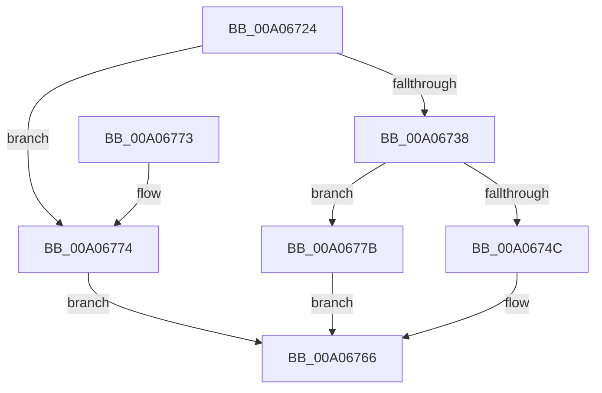

# PnpDeleteAllDependencyRelations

- RVA: `0x00A06724`–`0x00A06782` (길이 `94` bytes)
- VA: `0x0000000140A06724`
- 실행 섹션: `PAGE`
- PDB 이름 있음: `예`; PDB Function 태그: `아니요`
- unwind 정보 RVA: `0x0008A6D8`
- 디코드: `28`개 명령, `94/94` bytes 표시
- 미해석 바이트: `0` (있으면 어셈블리에 `.byte`로 보존)

> 이 문서는 커널 이미지의 기계어와 PDB 기호를 분석해 생성했습니다. 4번과 5번은 함수 원형과 자료형을 바이너리 사용 방식에서 추정한 C 해석이며 원본 소스 복구 결과는 아닙니다.

## 1. Dependencies

- 직접 호출 지점: **6**; 고유 호출 대상: **5**
- 직접 호출자로 확인된 함수: **2**
- RIP 상대 이미지 참조: **0**

### Outgoing calls
- `0x00A0673A` → [PnpAcquireDependencyRelationsLock](PnpAcquireDependencyRelationsLock_function_00A06788.md) (function, `0x00A06788`)
- `0x00A0674F` → [PipAddDependentsToRebuildPowerRelationsQueue](PipAddDependentsToRebuildPowerRelationsQueue_function_00A067D8.md) (function, `0x00A067D8`)
- `0x00A06757` → [PipDeleteAllDependencyRelations](PipDeleteAllDependencyRelations_function_00A06950.md) (function, `0x00A06950`)
- `0x00A0675C` → [PnpReleaseDependencyRelationsLock](PnpReleaseDependencyRelationsLock_function_00A06E14.md) (function, `0x00A06E14`)
- `0x00A06761` → [PipProcessRebuildPowerRelationsQueue](PipProcessRebuildPowerRelationsQueue_function_00A06844.md) (function, `0x00A06844`)
- `0x00A0677B` → [PnpReleaseDependencyRelationsLock](PnpReleaseDependencyRelationsLock_function_00A06E14.md) (function, `0x00A06E14`)

### Direct callers
- [PnpRemoveLockedDeviceNode](../../text/47/PnpRemoveLockedDeviceNode_function_004702AC.md) at `0x00470413`
- [IopDeleteDevice](IopDeleteDevice_function_00A066B0.md) at `0x00A066BD`

### Static image references
- 디코드된 RIP-relative 메모리 참조가 없습니다.

## 2. Other-region calls and transfers

- 다른 실행 섹션으로 향하는 call: **0**
- 별도 외부 분기/꼬리 이동을 확인하지 못했습니다.

## 3. Assembly (complete function range)

```asm
00A06724  48 89 5C 24 08                  mov qword ptr [rsp + 8], rbx
00A06729  57                              push rdi
00A0672A  48 83 EC 20                     sub rsp, 0x20
00A0672E  33 DB                           xor ebx, ebx
00A06730  48 8B F9                        mov rdi, rcx
00A06733  48 85 C9                        test rcx, rcx
00A06736  74 3C                           je 0x140a06774
00A06738  B1 01                           mov cl, 1
00A0673A  E8 49 00 00 00                  call 0x140a06788
00A0673F  48 8B 87 38 01 00 00            mov rax, qword ptr [rdi + 0x138]
00A06746  48 39 58 50                     cmp qword ptr [rax + 0x50], rbx
00A0674A  74 2F                           je 0x140a0677b
00A0674C  48 8B CF                        mov rcx, rdi
00A0674F  E8 84 00 00 00                  call 0x140a067d8
00A06754  48 8B CF                        mov rcx, rdi
00A06757  E8 F4 01 00 00                  call 0x140a06950
00A0675C  E8 B3 06 00 00                  call 0x140a06e14
00A06761  E8 DE 00 00 00                  call 0x140a06844
00A06766  8B C3                           mov eax, ebx
00A06768  48 8B 5C 24 30                  mov rbx, qword ptr [rsp + 0x30]
00A0676D  48 83 C4 20                     add rsp, 0x20
00A06771  5F                              pop rdi
00A06772  C3                              ret
00A06773  CC                              int3
00A06774  BB 0D 00 00 C0                  mov ebx, 0xc000000d
00A06779  EB EB                           jmp 0x140a06766
00A0677B  E8 94 06 00 00                  call 0x140a06e14
00A06780  EB E4                           jmp 0x140a06766
```

## 4. C-style interpretation (structured pseudocode)

```c
__int64 __fastcall PnpDeleteAllDependencyRelations(__int64 a1)
{
    __int64 result;
    __int64 v_rbx;
    __int64 v_rsp;
    unsigned __int64 v_stack_p8;

    v_stack_p8 = v_rbx;
    v_rsp = (v_rsp) - (32);
    v_rbx = 0;
    if (a1 == 0) goto loc_00A06774;
    result = PnpAcquireDependencyRelationsLock(1, a2, a3, a4);
    if ((*(unsigned __int64 *)(*(unsigned __int64 *)(a1 + 312) + 80)) == 0) goto loc_00A0677B;
    result = PipAddDependentsToRebuildPowerRelationsQueue(a1, a2, a3, a4);
    result = PipDeleteAllDependencyRelations(a1, a2, a3, a4);
    result = PnpReleaseDependencyRelationsLock(a1, a2, a3, a4);
    result = PipProcessRebuildPowerRelationsQueue(a1, a2, a3, a4);
loc_00A06766:
    v_rsp = (v_rsp) + (32);
    return 0;
loc_00A06774:
    goto loc_00A06766;
loc_00A0677B:
    result = PnpReleaseDependencyRelationsLock(a1, a2, a3, a4);
    goto loc_00A06766;
}
```

## 5. (Beta) C Style

```c
int64_t PnpDeleteAllDependencyRelations(void *Arg1)
{
    uint8_t *arg1 = (uint8_t *)Arg1;

    int64_t result;
    int64_t local_rbx;
    int64_t local_rsp;
    uint64_t v_stack_p8;

    v_stack_p8 = local_rbx;
    local_rsp = (local_rsp) - (32);
    local_rbx = 0;
    if (Arg1 == NULL) goto loc_00A06774;
    result = PnpAcquireDependencyRelationsLock(1, a2, a3, a4);
    if ((*(uint64_t *)(*(uint64_t *)(arg1 + 0x138) + 0x50)) == 0) goto loc_00A0677B;
    result = PipAddDependentsToRebuildPowerRelationsQueue(Arg1, a2, a3, a4);
    result = PipDeleteAllDependencyRelations(Arg1, a2, a3, a4);
    result = PnpReleaseDependencyRelationsLock(Arg1, a2, a3, a4);
    result = PipProcessRebuildPowerRelationsQueue(Arg1, a2, a3, a4);
loc_00A06766:
    local_rsp = (local_rsp) + (32);
    return 0;
loc_00A06774:
    goto loc_00A06766;
loc_00A0677B:
    result = PnpReleaseDependencyRelationsLock(Arg1, a2, a3, a4);
    goto loc_00A06766;
}
```

### 관측된 메모리 오프셋

구조체 형식이 확인되지 않은 접근은 인자 기준의 오프셋으로만 기록했습니다.

| 기준 인자 | 오프셋 표현 | 폭 (bit) | 접근 |
|---|---:|---:|---|
| `Arg1` | `+ 0x138` | `64` | `R` |

## 6. Execution-region graph

[열기: 2D/3D 그래프와 함수 탐색 컨트롤 패널](../../../control-panel.html?section=page&rva=0x00A06724&view=graph)

- 2D 그래프는 위에서 아래로 흐르고, 3D 그래프는 빈 공간을 드래그해 회전합니다. Shift+드래그는 이동, 휠은 확대·축소, 함수 노드 선택은 대상 보고서 이동입니다.

### Static fallback


