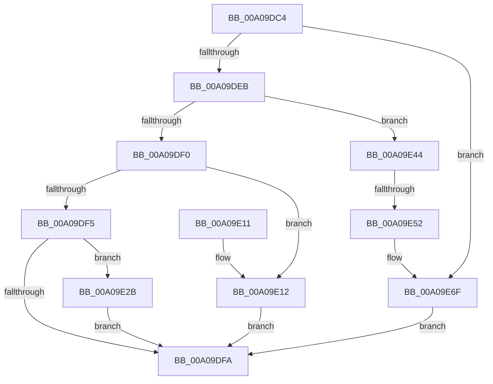

# PnpDeleteLockedDeviceNode

- RVA: `0x00A09DC4`–`0x00A09E92` (길이 `206` bytes)
- VA: `0x0000000140A09DC4`
- 실행 섹션: `PAGE`
- PDB 이름 있음: `예`; PDB Function 태그: `예`
- unwind 정보 RVA: `0x000A8898`
- 디코드: `57`개 명령, `206/206` bytes 표시
- 미해석 바이트: `0` (있으면 어셈블리에 `.byte`로 보존)

> 이 문서는 커널 이미지의 기계어와 PDB 기호를 분석해 생성했습니다. 4번과 5번은 함수 원형과 자료형을 바이너리 사용 방식에서 추정한 C 해석이며 원본 소스 복구 결과는 아닙니다.

## 1. Dependencies

- 직접 호출 지점: **7**; 고유 호출 대상: **5**
- 직접 호출자로 확인된 함수: **2**
- RIP 상대 이미지 참조: **0**

### Outgoing calls
- `0x00A09E17` → [PnpPoFxActivateDevice](../8F/PnpPoFxActivateDevice_function_008FB29C.md) (function, `0x008FB29C`)
- `0x00A09E24` → [PnpRemoveLockedDeviceNode](../../text/47/PnpRemoveLockedDeviceNode_function_004702AC.md) (function, `0x004702AC`)
- `0x00A09E30` → [PnpPoFxActivateDevice](../8F/PnpPoFxActivateDevice_function_008FB29C.md) (function, `0x008FB29C`)
- `0x00A09E3D` → [PnpSurpriseRemoveLockedDeviceNode](PnpSurpriseRemoveLockedDeviceNode_function_00A08370.md) (function, `0x00A08370`)
- `0x00A09E69` → [KeBugCheckEx](../../text/4F/KeBugCheckEx_function_004FD660.md) (function, `0x004FD660`)
- `0x00A09E74` → [PnpPoFxActivateDevice](../8F/PnpPoFxActivateDevice_function_008FB29C.md) (function, `0x008FB29C`)
- `0x00A09E86` → [PnpQueryRemoveLockedDeviceNode](../72/PnpQueryRemoveLockedDeviceNode_function_0072D210.md) (function, `0x0072D210`)

### Direct callers
- [PnpDeleteLockedDeviceNodes](PnpDeleteLockedDeviceNodes_function_00A09B30.md) at `0x00A09C34`
- [sub_00B34B5E](../B3/Unknown_function_00B34B5E.md) at `0x00B34BE8`

### Static image references
- 디코드된 RIP-relative 메모리 참조가 없습니다.

## 2. Other-region calls and transfers

- 다른 실행 섹션으로 향하는 call: **2**
  - `0x00A09E24` → [PnpRemoveLockedDeviceNode](../../text/47/PnpRemoveLockedDeviceNode_function_004702AC.md) (`PAGE` → `.text`)
  - `0x00A09E69` → [KeBugCheckEx](../../text/4F/KeBugCheckEx_function_004FD660.md) (`PAGE` → `.text`)
- call이 아닌 외부 분기/꼬리 이동: **1**
  - `0x00A09E4C` → [sub_00B34BF4](../B3/Unknown_function_00B34BF4.md) (`tail-transfer`)

## 3. Assembly (complete function range)

```asm
00A09DC4  48 89 5C 24 08                  mov qword ptr [rsp + 8], rbx
00A09DC9  48 89 6C 24 10                  mov qword ptr [rsp + 0x10], rbp
00A09DCE  48 89 74 24 18                  mov qword ptr [rsp + 0x18], rsi
00A09DD3  57                              push rdi
00A09DD4  48 83 EC 30                     sub rsp, 0x30
00A09DD8  33 FF                           xor edi, edi
00A09DDA  41 8B F1                        mov esi, r9d
00A09DDD  41 8B E8                        mov ebp, r8d
00A09DE0  48 8B D9                        mov rbx, rcx
00A09DE3  85 D2                           test edx, edx
00A09DE5  0F 84 84 00 00 00               je 0x140a09e6f
00A09DEB  83 EA 01                        sub edx, 1
00A09DEE  74 54                           je 0x140a09e44
00A09DF0  83 EA 01                        sub edx, 1
00A09DF3  74 1D                           je 0x140a09e12
00A09DF5  83 FA 01                        cmp edx, 1
00A09DF8  74 31                           je 0x140a09e2b
00A09DFA  48 8B 5C 24 40                  mov rbx, qword ptr [rsp + 0x40]
00A09DFF  8B C7                           mov eax, edi
00A09E01  48 8B 6C 24 48                  mov rbp, qword ptr [rsp + 0x48]
00A09E06  48 8B 74 24 50                  mov rsi, qword ptr [rsp + 0x50]
00A09E0B  48 83 C4 30                     add rsp, 0x30
00A09E0F  5F                              pop rdi
00A09E10  C3                              ret
00A09E11  CC                              int3
00A09E12  BA 10 00 00 00                  mov edx, 0x10
00A09E17  E8 80 14 EF FF                  call 0x1408fb29c
00A09E1C  44 8B C6                        mov r8d, esi
00A09E1F  8B D5                           mov edx, ebp
00A09E21  48 8B CB                        mov rcx, rbx
00A09E24  E8 83 64 A6 FF                  call 0x1404702ac
00A09E29  EB CF                           jmp 0x140a09dfa
00A09E2B  BA 08 00 00 00                  mov edx, 8
00A09E30  E8 67 14 EF FF                  call 0x1408fb29c
00A09E35  44 8B C6                        mov r8d, esi
00A09E38  8B D5                           mov edx, ebp
00A09E3A  48 8B CB                        mov rcx, rbx
00A09E3D  E8 2E E5 FF FF                  call 0x140a08370
00A09E42  EB B6                           jmp 0x140a09dfa
00A09E44  8B 81 C0 02 00 00               mov eax, dword ptr [rcx + 0x2c0]
00A09E4A  A8 04                           test al, 4
00A09E4C  0F 85 A2 AD 12 00               jne 0x140b34bf4
00A09E52  41 B9 04 00 00 00               mov r9d, 4
00A09E58  48 89 7C 24 20                  mov qword ptr [rsp + 0x20], rdi
00A09E5D  4C 8B C3                        mov r8, rbx
00A09E60  B9 CA 00 00 00                  mov ecx, 0xca
00A09E65  41 8D 51 09                     lea edx, [r9 + 9]
00A09E69  E8 F2 37 AF FF                  call 0x1404fd660
00A09E6E  CC                              int3
00A09E6F  BA 04 00 00 00                  mov edx, 4
00A09E74  E8 23 14 EF FF                  call 0x1408fb29c
00A09E79  4C 8B 44 24 68                  mov r8, qword ptr [rsp + 0x68]
00A09E7E  48 8B CB                        mov rcx, rbx
00A09E81  48 8B 54 24 60                  mov rdx, qword ptr [rsp + 0x60]
00A09E86  E8 85 33 D2 FF                  call 0x14072d210
00A09E8B  8B F8                           mov edi, eax
00A09E8D  E9 68 FF FF FF                  jmp 0x140a09dfa
```

## 4. C-style interpretation (structured pseudocode)

```c
__int64 __fastcall PnpDeleteLockedDeviceNode(__int64 a1, int a2, int a3, int a4, __int64 a5, __int64 a6)
{
    __int64 result;
    __int64 v_rdi;
    __int64 v_rsp;
    unsigned __int64 v_stack_p10;
    unsigned __int64 v_stack_p18;
    unsigned __int64 v_stack_p20;
    unsigned __int64 v_stack_p8;

    v_stack_p8 = v_rbx;
    v_stack_p10 = v_rbp;
    v_stack_p18 = v_rsi;
    v_rsp = (v_rsp) - (48);
    v_rdi = 0;
    if (a2 == 0) goto loc_00A09E6F;
    a2 = (unsigned int)((a2) - (1));
    if (condition_is_equal) goto loc_00A09E44;
    a2 = (unsigned int)((a2) - (1));
    if (condition_is_equal) goto loc_00A09E12;
    if (a2 == 1) goto loc_00A09E2B;
loc_00A09DFA:
    v_rsp = (v_rsp) + (48);
    return 0;
loc_00A09E12:
    result = PnpPoFxActivateDevice(a1, 16, a3, a4);
    result = PnpRemoveLockedDeviceNode(v_stack_p8, (unsigned int)((unsigned int)(v_stack_p10)), (unsigned int)((unsigned int)(v_stack_p18)), a4);
    goto loc_00A09DFA;
loc_00A09E2B:
    result = PnpPoFxActivateDevice(v_stack_p8, 8, (unsigned int)((unsigned int)(v_stack_p18)), a4);
    result = PnpSurpriseRemoveLockedDeviceNode(v_stack_p8, (unsigned int)((unsigned int)(v_stack_p10)), (unsigned int)((unsigned int)(v_stack_p18)), a4);
    goto loc_00A09DFA;
loc_00A09E44:
    v_stack_p20 = 0;
    result = KeBugCheckEx(202, 4 + 9, v_stack_p8, 4);
loc_00A09E6F:
    result = PnpPoFxActivateDevice(202, 4, v_stack_p8, 4);
    result = PnpQueryRemoveLockedDeviceNode(v_stack_p8, a5, a6, 4);
    goto loc_00A09DFA;
}
```

## 5. (Beta) C Style

```c
int64_t PnpDeleteLockedDeviceNode(void *Arg1, int32_t Arg2, int32_t Arg3, int32_t Arg4, int64_t Arg5, int64_t Arg6)
{
    uint8_t *arg1 = (uint8_t *)Arg1;

    int64_t result;
    int64_t local_rdi;
    int64_t local_rsp;
    uint64_t v_stack_p10;
    uint64_t v_stack_p18;
    uint64_t v_stack_p20;
    uint64_t v_stack_p8;

    v_stack_p8 = local_rbx;
    v_stack_p10 = local_rbp;
    v_stack_p18 = local_rsi;
    local_rsp = (local_rsp) - (48);
    local_rdi = 0;
    if (Arg2 == 0) goto loc_00A09E6F;
    Arg2 = (uint32_t)((Arg2) - (1));
    if (condition_is_equal) goto loc_00A09E44;
    Arg2 = (uint32_t)((Arg2) - (1));
    if (condition_is_equal) goto loc_00A09E12;
    if (Arg2 == 1) goto loc_00A09E2B;
loc_00A09DFA:
    local_rsp = (local_rsp) + (48);
    return 0;
loc_00A09E12:
    result = PnpPoFxActivateDevice(Arg1, 16, Arg3, Arg4);
    result = PnpRemoveLockedDeviceNode(v_stack_p8, (uint32_t)((uint32_t)(v_stack_p10)), (uint32_t)((uint32_t)(v_stack_p18)), Arg4);
    goto loc_00A09DFA;
loc_00A09E2B:
    result = PnpPoFxActivateDevice(v_stack_p8, 8, (uint32_t)((uint32_t)(v_stack_p18)), Arg4);
    result = PnpSurpriseRemoveLockedDeviceNode(v_stack_p8, (uint32_t)((uint32_t)(v_stack_p10)), (uint32_t)((uint32_t)(v_stack_p18)), Arg4);
    goto loc_00A09DFA;
loc_00A09E44:
    v_stack_p20 = 0;
    result = KeBugCheckEx(202, 4 + 9, v_stack_p8, 4);
loc_00A09E6F:
    result = PnpPoFxActivateDevice(202, 4, v_stack_p8, 4);
    result = PnpQueryRemoveLockedDeviceNode(v_stack_p8, Arg5, Arg6, 4);
    goto loc_00A09DFA;
}
```

### 관측된 메모리 오프셋

구조체 형식이 확인되지 않은 접근은 인자 기준의 오프셋으로만 기록했습니다.

| 기준 인자 | 오프셋 표현 | 폭 (bit) | 접근 |
|---|---:|---:|---|
| `Arg1` | `+ 0x2C0` | `32` | `R` |

## 6. Execution-region graph

[열기: 2D/3D 그래프와 함수 탐색 컨트롤 패널](../../../control-panel.html?section=page&rva=0x00A09DC4&view=graph)

- 2D 그래프는 위에서 아래로 흐르고, 3D 그래프는 빈 공간을 드래그해 회전합니다. Shift+드래그는 이동, 휠은 확대·축소, 함수 노드 선택은 대상 보고서 이동입니다.

### Static fallback


