# PnpDeleteLockedDeviceNodes

- RVA: `0x00A09B30`–`0x00A09DBD` (길이 `653` bytes)
- VA: `0x0000000140A09B30`
- 실행 섹션: `PAGE`
- PDB 이름 있음: `예`; PDB Function 태그: `예`
- unwind 정보 RVA: `0x000A886C`
- 디코드: `176`개 명령, `653/653` bytes 표시
- 미해석 바이트: `0` (있으면 어셈블리에 `.byte`로 보존)

> 이 문서는 커널 이미지의 기계어와 PDB 기호를 분석해 생성했습니다. 4번과 5번은 함수 원형과 자료형을 바이너리 사용 방식에서 추정한 C 해석이며 원본 소스 복구 결과는 아닙니다.

## 1. Dependencies

- 직접 호출 지점: **4**; 고유 호출 대상: **4**
- 직접 호출자로 확인된 함수: **4**
- RIP 상대 이미지 참조: **2**

### Outgoing calls
- `0x00A09C34` → [PnpDeleteLockedDeviceNode](PnpDeleteLockedDeviceNode_function_00A09DC4.md) (function, `0x00A09DC4`)
- `0x00A09C88` → [McTemplateK0z_EtwWriteTransfer](../../text/4D/McTemplateK0z_EtwWriteTransfer_function_004DEF6C.md) (function, `0x004DEF6C`)
- `0x00A09CE1` → [PoFxIdleDevice](../../text/48/PoFxIdleDevice_function_00483EE8.md) (function, `0x00483EE8`)
- `0x00A09D9E` → [KeBugCheckEx](../../text/4F/KeBugCheckEx_function_004FD660.md) (function, `0x004FD660`)

### Direct callers
- [PipSendQueryRemoveIrpAndCheckOpenHandles](../74/PipSendQueryRemoveIrpAndCheckOpenHandles_function_007443E8.md) at `0x00744448`
- [PipSendQueryRemoveIrpAndCheckOpenHandles](../74/PipSendQueryRemoveIrpAndCheckOpenHandles_function_007443E8.md) at `0x0074458B`
- [PnpProcessQueryRemoveAndEject](PnpProcessQueryRemoveAndEject_function_00A05170.md) at `0x00A0562C`
- [PipRemoveDevicesInRelationList](PipRemoveDevicesInRelationList_function_00A08CF0.md) at `0x00A08D7C`
- [sub_00B33FE8](../B3/Unknown_function_00B33FE8.md) at `0x00B341FD`

### Static image references
- `0x00A09C70` → RVA `0x00EF012C` (`.data`; read)
- `0x00A09C81` → RVA `0x000271F0` (`.rdata`; read)

## 2. Other-region calls and transfers

- 다른 실행 섹션으로 향하는 call: **3**
  - `0x00A09C88` → [McTemplateK0z_EtwWriteTransfer](../../text/4D/McTemplateK0z_EtwWriteTransfer_function_004DEF6C.md) (`PAGE` → `.text`)
  - `0x00A09CE1` → [PoFxIdleDevice](../../text/48/PoFxIdleDevice_function_00483EE8.md) (`PAGE` → `.text`)
  - `0x00A09D9E` → [KeBugCheckEx](../../text/4F/KeBugCheckEx_function_004FD660.md) (`PAGE` → `.text`)
- call이 아닌 외부 분기/꼬리 이동: **4**
  - `0x00A09C7B` → [sub_00B34B5E](../B3/Unknown_function_00B34B5E.md) (`tail-transfer`)
  - `0x00A09C8E` → [sub_00B34B5E](../B3/Unknown_function_00B34B5E.md) (`tail-transfer`)
  - `0x00A09D51` → [sub_00B34B5E + 0x64](../B3/Unknown_function_00B34B5E.md) (`tail-transfer`)
  - `0x00A09D62` → [sub_00B34B5E + 0x66](../B3/Unknown_function_00B34B5E.md) (`tail-transfer`)

## 3. Assembly (complete function range)

```asm
00A09B30  48 89 5C 24 18                  mov qword ptr [rsp + 0x18], rbx
00A09B35  44 88 4C 24 20                  mov byte ptr [rsp + 0x20], r9b
00A09B3A  48 89 4C 24 08                  mov qword ptr [rsp + 8], rcx
00A09B3F  55                              push rbp
00A09B40  56                              push rsi
00A09B41  57                              push rdi
00A09B42  41 54                           push r12
00A09B44  41 55                           push r13
00A09B46  41 56                           push r14
00A09B48  41 57                           push r15
00A09B4A  48 83 EC 50                     sub rsp, 0x50
00A09B4E  45 33 D2                        xor r10d, r10d
00A09B51  41 8A D9                        mov bl, r9b
00A09B54  45 8B F8                        mov r15d, r8d
00A09B57  4C 8B F2                        mov r14, rdx
00A09B5A  4C 8B D9                        mov r11, rcx
00A09B5D  44 38 52 08                     cmp byte ptr [rdx + 8], r10b
00A09B61  75 22                           jne 0x140a09b85
00A09B63  41 BA 01 00 00 C0               mov r10d, 0xc0000001
00A09B69  48 8B 9C 24 A0 00 00 00         mov rbx, qword ptr [rsp + 0xa0]
00A09B71  41 8B C2                        mov eax, r10d
00A09B74  48 83 C4 50                     add rsp, 0x50
00A09B78  41 5F                           pop r15
00A09B7A  41 5E                           pop r14
00A09B7C  41 5D                           pop r13
00A09B7E  41 5C                           pop r12
00A09B80  5F                              pop rdi
00A09B81  5E                              pop rsi
00A09B82  5D                              pop rbp
00A09B83  C3                              ret
00A09B84  CC                              int3
00A09B85  45 33 E4                        xor r12d, r12d
00A09B88  41 83 FF 01                     cmp r15d, 1
00A09B8C  41 0F 94 C4                     sete r12b
00A09B90  41 FF C4                        inc r12d
00A09B93  33 FF                           xor edi, edi
00A09B95  8B F7                           mov esi, edi
00A09B97  41 80 7E 08 00                  cmp byte ptr [r14 + 8], 0
00A09B9C  74 CB                           je 0x140a09b69
00A09B9E  4D 8B 0E                        mov r9, qword ptr [r14]
00A09BA1  45 8B 01                        mov r8d, dword ptr [r9]
00A09BA4  41 3B F8                        cmp edi, r8d
00A09BA7  73 C0                           jae 0x140a09b69
00A09BA9  41 8B D4                        mov edx, r12d
00A09BAC  45 85 E4                        test r12d, r12d
00A09BAF  0F 85 F0 00 00 00               jne 0x140a09ca5
00A09BB5  4D 85 C9                        test r9, r9
00A09BB8  74 AF                           je 0x140a09b69
00A09BBA  41 3B F8                        cmp edi, r8d
00A09BBD  73 AA                           jae 0x140a09b69
00A09BBF  48 8D 0C 7F                     lea rcx, [rdi + rdi*2]
00A09BC3  41 8B 54 C9 18                  mov edx, dword ptr [r9 + rcx*8 + 0x18]
00A09BC8  8D 7E 01                        lea edi, [rsi + 1]
00A09BCB  4D 8B 6C C9 10                  mov r13, qword ptr [r9 + rcx*8 + 0x10]
00A09BD0  8B F7                           mov esi, edi
00A09BD2  85 D2                           test edx, edx
00A09BD4  0F 84 38 01 00 00               je 0x140a09d12
00A09BDA  4D 85 ED                        test r13, r13
00A09BDD  0F 84 DE 00 00 00               je 0x140a09cc1
00A09BE3  49 8B 85 38 01 00 00            mov rax, qword ptr [r13 + 0x138]
00A09BEA  48 8B 58 28                     mov rbx, qword ptr [rax + 0x28]
00A09BEE  4D 3B EB                        cmp r13, r11
00A09BF1  0F 85 9C 00 00 00               jne 0x140a09c93
00A09BF7  8B B4 24 B0 00 00 00            mov esi, dword ptr [rsp + 0xb0]
00A09BFE  8B AC 24 B8 00 00 00            mov ebp, dword ptr [rsp + 0xb8]
00A09C05  41 8D 47 FE                     lea eax, [r15 - 2]
00A09C09  83 F8 01                        cmp eax, 1
00A09C0C  76 4A                           jbe 0x140a09c58
00A09C0E  48 8B 84 24 C8 00 00 00         mov rax, qword ptr [rsp + 0xc8]
00A09C16  44 8B CD                        mov r9d, ebp
00A09C19  48 89 44 24 28                  mov qword ptr [rsp + 0x28], rax
00A09C1E  44 8B C6                        mov r8d, esi
00A09C21  48 8B 84 24 C0 00 00 00         mov rax, qword ptr [rsp + 0xc0]
00A09C29  41 8B D7                        mov edx, r15d
00A09C2C  48 8B CB                        mov rcx, rbx
00A09C2F  48 89 44 24 20                  mov qword ptr [rsp + 0x20], rax
00A09C34  E8 8B 01 00 00                  call 0x140a09dc4
00A09C39  44 8B D0                        mov r10d, eax
00A09C3C  85 C0                           test eax, eax
00A09C3E  0F 88 84 00 00 00               js 0x140a09cc8
00A09C44  4C 8B 9C 24 90 00 00 00         mov r11, qword ptr [rsp + 0x90]
00A09C4C  8A 9C 24 A8 00 00 00            mov bl, byte ptr [rsp + 0xa8]
00A09C53  E9 3D FF FF FF                  jmp 0x140a09b95
00A09C58  8B 8B C0 02 00 00               mov ecx, dword ptr [rbx + 0x2c0]
00A09C5E  8B C1                           mov eax, ecx
00A09C60  0F BA F0 0D                     btr eax, 0xd
00A09C64  89 83 C0 02 00 00               mov dword ptr [rbx + 0x2c0], eax
00A09C6A  0F BA E1 0D                     bt ecx, 0xd
00A09C6E  73 9E                           jae 0x140a09c0e
00A09C70  F6 05 B5 64 4E 00 08            test byte ptr [rip + 0x4e64b5], 8
00A09C77  4C 8B 4B 30                     mov r9, qword ptr [rbx + 0x30]
00A09C7B  0F 84 DD AE 12 00               je 0x140b34b5e
00A09C81  48 8D 15 68 D5 61 FF            lea rdx, [rip - 0x9e2a98]
00A09C88  E8 DF 52 AD FF                  call 0x1404def6c
00A09C8D  90                              nop
00A09C8E  E9 CB AE 12 00                  jmp 0x140b34b5e
00A09C93  83 FA 01                        cmp edx, 1
00A09C96  0F 84 DB 00 00 00               je 0x140a09d77
00A09C9C  33 F6                           xor esi, esi
00A09C9E  33 ED                           xor ebp, ebp
00A09CA0  E9 60 FF FF FF                  jmp 0x140a09c05
00A09CA5  83 EA 01                        sub edx, 1
00A09CA8  0F 84 07 FF FF FF               je 0x140a09bb5
00A09CAE  83 FA 01                        cmp edx, 1
00A09CB1  0F 85 B2 FE FF FF               jne 0x140a09b69
00A09CB7  F7 D7                           not edi
00A09CB9  41 03 F8                        add edi, r8d
00A09CBC  E9 F4 FE FF FF                  jmp 0x140a09bb5
00A09CC1  33 DB                           xor ebx, ebx
00A09CC3  E9 26 FF FF FF                  jmp 0x140a09bee
00A09CC8  8B 83 C0 02 00 00               mov eax, dword ptr [rbx + 0x2c0]
00A09CCE  41 B9 04 00 00 00               mov r9d, 4
00A09CD4  41 84 C1                        test r9b, al
00A09CD7  0F 84 AE 00 00 00               je 0x140a09d8b
00A09CDD  48 8B 4B 20                     mov rcx, qword ptr [rbx + 0x20]
00A09CE1  E8 02 A2 A7 FF                  call 0x140483ee8
00A09CE6  83 A3 C0 02 00 00 FB            and dword ptr [rbx + 0x2c0], 0xfffffffb
00A09CED  41 83 FF 01                     cmp r15d, 1
00A09CF1  0F 85 AD 00 00 00               jne 0x140a09da4
00A09CF7  BF 03 00 00 00                  mov edi, 3
00A09CFC  33 DB                           xor ebx, ebx
00A09CFE  8B F3                           mov esi, ebx
00A09D00  41 80 7E 08 00                  cmp byte ptr [r14 + 8], 0
00A09D05  75 18                           jne 0x140a09d1f
00A09D07  41 BA 28 00 00 80               mov r10d, 0x80000028
00A09D0D  E9 57 FE FF FF                  jmp 0x140a09b69
00A09D12  84 DB                           test bl, bl
00A09D14  0F 85 C0 FE FF FF               jne 0x140a09bda
00A09D1A  E9 78 FE FF FF                  jmp 0x140a09b97
00A09D1F  4D 8B 06                        mov r8, qword ptr [r14]
00A09D22  41 8B 10                        mov edx, dword ptr [r8]
00A09D25  3B DA                           cmp ebx, edx
00A09D27  73 DE                           jae 0x140a09d07
00A09D29  8B CF                           mov ecx, edi
00A09D2B  85 FF                           test edi, edi
00A09D2D  75 38                           jne 0x140a09d67
00A09D2F  4D 85 C0                        test r8, r8
00A09D32  74 D3                           je 0x140a09d07
00A09D34  3B DA                           cmp ebx, edx
00A09D36  73 CF                           jae 0x140a09d07
00A09D38  0F AE E8                        lfence
00A09D3B  48 8D 0C 5B                     lea rcx, [rbx + rbx*2]
00A09D3F  49 8B 44 C8 10                  mov rax, qword ptr [r8 + rcx*8 + 0x10]
00A09D44  8D 5E 01                        lea ebx, [rsi + 1]
00A09D47  8B F3                           mov esi, ebx
00A09D49  4C 3B E8                        cmp r13, rax
00A09D4C  74 B0                           je 0x140a09cfe
00A09D4E  48 85 C0                        test rax, rax
00A09D51  0F 84 6B AE 12 00               je 0x140b34bc2
00A09D57  48 8B 80 38 01 00 00            mov rax, qword ptr [rax + 0x138]
00A09D5E  48 8B 48 28                     mov rcx, qword ptr [rax + 0x28]
00A09D62  E9 5D AE 12 00                  jmp 0x140b34bc4
00A09D67  83 E9 01                        sub ecx, 1
00A09D6A  74 C3                           je 0x140a09d2f
00A09D6C  83 F9 01                        cmp ecx, 1
00A09D6F  75 96                           jne 0x140a09d07
00A09D71  F7 D3                           not ebx
00A09D73  03 DA                           add ebx, edx
00A09D75  EB B8                           jmp 0x140a09d2f
00A09D77  41 83 FF 01                     cmp r15d, 1
00A09D7B  0F 84 1B FF FF FF               je 0x140a09c9c
00A09D81  BE 33 00 00 00                  mov esi, 0x33
00A09D86  E9 13 FF FF FF                  jmp 0x140a09c9e
00A09D8B  48 83 64 24 20 00               and qword ptr [rsp + 0x20], 0
00A09D91  4C 8B C3                        mov r8, rbx
00A09D94  BA 0D 00 00 00                  mov edx, 0xd
00A09D99  B9 CA 00 00 00                  mov ecx, 0xca
00A09D9E  E8 BD 38 AF FF                  call 0x1404fd660
00A09DA3  CC                              int3
00A09DA4  85 FF                           test edi, edi
00A09DA6  0F 84 4B FF FF FF               je 0x140a09cf7
00A09DAC  49 8B 06                        mov rax, qword ptr [r14]
00A09DAF  8B 18                           mov ebx, dword ptr [rax]
00A09DB1  2B DF                           sub ebx, edi
00A09DB3  BF 02 00 00 00                  mov edi, 2
00A09DB8  E9 41 FF FF FF                  jmp 0x140a09cfe
```

## 4. C-style interpretation (structured pseudocode)

```c
__int64 __fastcall PnpDeleteLockedDeviceNodes(__int64 a1, __int64 a2, int a3, unsigned __int8 a4, unsigned int a5, unsigned int a6, __int64 a7, __int64 a8)
{
    __int64 result;
    __int64 v_r10;
    __int64 v_r12;
    __int64 v_rbp;
    __int64 v_rbx;
    __int64 v_rdi;
    __int64 v_rsi;
    __int64 v_rsp;
    unsigned __int64 v_stack_p18;
    unsigned __int8 v_stack_p20;
    unsigned __int64 v_stack_p28;
    unsigned __int64 v_stack_p8;
    unsigned __int64 v_stack_p90;
    unsigned __int8 v_stack_pA8;

    v_stack_p18 = v_rbx;
    v_stack_p20 = a4;
    v_stack_p8 = a1;
    v_rsp = (v_rsp) - (80);
    v_r10 = 0;
    if ((*(unsigned __int8 *)(a2 + 8)) != 0) goto loc_00A09B85;
loc_00A09B69:
    v_rsp = (v_rsp) + (80);
    return (unsigned int)((unsigned int)((unsigned int)(0xC0000001ULL)));
loc_00A09B85:
    v_r12 = 0;
    v_r12 = (((unsigned int)((unsigned int)(a3))) == 1) ? 1 : 0;
    v_r12 = (unsigned int)((v_r12) + 1);
    v_rdi = 0;
loc_00A09B95:
loc_00A09B97:
    if ((*(unsigned __int8 *)(a2 + 8)) == 0) goto loc_00A09B69;
    if (0 >= ((unsigned int)((unsigned int)(*(unsigned int *)(*(unsigned __int64 *)(a2)))))) goto loc_00A09B69;
    if ((unsigned int)(v_r12) != 0) goto loc_00A09CA5;
loc_00A09BB5:
    if (*(unsigned __int64 *)(a2) == 0) goto loc_00A09B69;
    if (0 >= ((unsigned int)((unsigned int)(*(unsigned int *)(*(unsigned __int64 *)(a2)))))) goto loc_00A09B69;
    if ((unsigned int)((unsigned int)(*(unsigned int *)(*(unsigned __int64 *)(a2) + v_rdi + v_rdi * 2 * 8 + 24))) == 0) goto loc_00A09D12;
loc_00A09BDA:
    if (*(unsigned __int64 *)(*(unsigned __int64 *)(a2) + v_rdi + v_rdi * 2 * 8 + 16) == 0) goto loc_00A09CC1;
loc_00A09BEE:
    if ((*(unsigned __int64 *)(*(unsigned __int64 *)(a2) + v_rdi + v_rdi * 2 * 8 + 16)) != a1) goto loc_00A09C93;
loc_00A09C05:
    if (((unsigned int)((unsigned int)(a3) - 2)) <= 1) goto loc_00A09C58;
loc_00A09C0E:
    v_stack_p28 = a8;
    v_stack_p20 = a7;
    result = PnpDeleteLockedDeviceNode(*(unsigned __int64 *)(*(unsigned __int64 *)(*(unsigned __int64 *)(*(unsigned __int64 *)(a2) + v_rdi + v_rdi * 2 * 8 + 16) + 312) + 40), (unsigned int)((unsigned int)((unsigned int)(a3))), (unsigned int)((unsigned int)((unsigned int)(a5))), (unsigned int)((unsigned int)((unsigned int)(a6))));
    if (sign_flag) goto loc_00A09CC8;
    goto loc_00A09B95;
loc_00A09C58:
    *(unsigned int *)(v_stack_pA8 + 704) = (unsigned int)((unsigned int)((unsigned int)((unsigned int)(*(unsigned int *)(v_stack_pA8 + 704)))));
    if (condition_is_above_or_equal) goto loc_00A09C0E;
    result = McTemplateK0z_EtwWriteTransfer((unsigned int)(*(unsigned int *)(v_stack_pA8 + 704)), v_rip - 10365592, (unsigned int)((unsigned int)((unsigned int)(a5))), *(unsigned __int64 *)(v_stack_pA8 + 48));
loc_00A09C93:
    if (((unsigned int)(v_rip - 10365592)) == 1) goto loc_00A09D77;
loc_00A09C9C:
    v_rsi = 0;
loc_00A09C9E:
    v_rbp = 0;
    goto loc_00A09C05;
loc_00A09CA5:
    a2 = (unsigned int)((v_rip - 10365592) - (1));
    if (condition_is_equal) goto loc_00A09BB5;
    if (((unsigned int)(a2)) != 1) goto loc_00A09B69;
    v_rdi = (unsigned int)(~(0 + 1));
    v_rdi = (unsigned int)((v_rdi) + ((unsigned int)((unsigned int)((unsigned int)((unsigned int)(a5))))));
    goto loc_00A09BB5;
loc_00A09CC1:
    v_rbx = 0;
    goto loc_00A09BEE;
loc_00A09CC8:
    if (((4) & ((unsigned __int8)((unsigned int)(*(unsigned int *)(v_rbx + 704))))) == 0) goto loc_00A09D8B;
    result = PoFxIdleDevice(*(unsigned __int64 *)(v_rbx + 32), a2, (unsigned int)((unsigned int)((unsigned int)(a5))), 4);
    if (((unsigned int)((unsigned int)(a3))) != 1) goto loc_00A09DA4;
loc_00A09CF7:
    v_rbx = 0;
loc_00A09CFE:
    if ((*(unsigned __int8 *)(a2 + 8)) != 0) goto loc_00A09D1F;
loc_00A09D07:
    goto loc_00A09B69;
loc_00A09D12:
    if (0 != 0) goto loc_00A09BDA;
    goto loc_00A09B97;
loc_00A09D1F:
    if (0 >= ((unsigned int)((unsigned int)(*(unsigned int *)(*(unsigned __int64 *)(a2)))))) goto loc_00A09D07;
    if (3 != 0) goto loc_00A09D67;
loc_00A09D2F:
    if (*(unsigned __int64 *)(a2) == 0) goto loc_00A09D07;
    if (0 >= ((unsigned int)((unsigned int)(*(unsigned int *)(*(unsigned __int64 *)(a2)))))) goto loc_00A09D07;
    if ((*(unsigned __int64 *)(*(unsigned __int64 *)(a2) + v_rdi + v_rdi * 2 * 8 + 16)) == (*(unsigned __int64 *)(*(unsigned __int64 *)(a2) + v_rbx + v_rbx * 2 * 8 + 16))) goto loc_00A09CFE;
loc_00A09D67:
    a1 = (unsigned int)((*(unsigned __int64 *)(*(unsigned __int64 *)(*(unsigned __int64 *)(*(unsigned __int64 *)(a2) + v_rbx + v_rbx * 2 * 8 + 16) + 312) + 40)) - (1));
    if (condition_is_equal) goto loc_00A09D2F;
    if (((unsigned int)(a1)) != 1) goto loc_00A09D07;
    v_rbx = (unsigned int)(~(0 + 1));
    v_rbx = (unsigned int)((v_rbx) + ((unsigned int)((unsigned int)(*(unsigned int *)(*(unsigned __int64 *)(a2))))));
    goto loc_00A09D2F;
loc_00A09D77:
    if (((unsigned int)((unsigned int)(a3))) == 1) goto loc_00A09C9C;
    goto loc_00A09C9E;
loc_00A09D8B:
    result = KeBugCheckEx(202, 13, v_rbx, 4);
loc_00A09DA4:
    if (3 == 0) goto loc_00A09CF7;
    v_rbx = (unsigned int)(((unsigned int)(*(unsigned int *)(*(unsigned __int64 *)(a2)))) - (3));
    goto loc_00A09CFE;
}
```

## 5. (Beta) C Style

```c
int64_t PnpDeleteLockedDeviceNodes(int64_t Arg1, void *Arg2, int32_t Arg3, uint8_t Arg4, uint32_t Arg5, uint32_t Arg6, int64_t Arg7, int64_t Arg8)
{
    uint8_t *arg2 = (uint8_t *)Arg2;

    int64_t result;
    int64_t local_r10;
    int64_t local_r12;
    int64_t local_rbp;
    int64_t local_rbx;
    int64_t local_rdi;
    int64_t local_rsi;
    int64_t local_rsp;
    uint64_t v_stack_p18;
    uint8_t v_stack_p20;
    uint64_t v_stack_p28;
    uint64_t v_stack_p8;
    uint64_t v_stack_p90;
    uint8_t v_stack_pA8;

    v_stack_p18 = local_rbx;
    v_stack_p20 = Arg4;
    v_stack_p8 = Arg1;
    local_rsp = (local_rsp) - (80);
    local_r10 = 0;
    if ((*(uint8_t *)(arg2 + 0x8)) != 0) goto loc_00A09B85;
loc_00A09B69:
    local_rsp = (local_rsp) + (80);
    return (uint32_t)((uint32_t)((uint32_t)(0xC0000001ULL)));
loc_00A09B85:
    local_r12 = 0;
    local_r12 = (((uint32_t)((uint32_t)(Arg3))) == 1) ? 1 : 0;
    local_r12 = (uint32_t)((local_r12) + 1);
    local_rdi = 0;
loc_00A09B95:
loc_00A09B97:
    if ((*(uint8_t *)(arg2 + 0x8)) == 0) goto loc_00A09B69;
    if (0 >= ((uint32_t)((uint32_t)(*(uint32_t *)(*(uint64_t *)(arg2)))))) goto loc_00A09B69;
    if ((uint32_t)(local_r12) != 0) goto loc_00A09CA5;
loc_00A09BB5:
    if (*(uint64_t *)(arg2) == 0) goto loc_00A09B69;
    if (0 >= ((uint32_t)((uint32_t)(*(uint32_t *)(*(uint64_t *)(arg2)))))) goto loc_00A09B69;
    if ((uint32_t)((uint32_t)(*(uint32_t *)(*(uint64_t *)(arg2) + local_rdi + local_rdi * 2 * 8 + 0x18))) == 0) goto loc_00A09D12;
loc_00A09BDA:
    if (*(uint64_t *)(*(uint64_t *)(arg2) + local_rdi + local_rdi * 2 * 8 + 0x10) == 0) goto loc_00A09CC1;
loc_00A09BEE:
    if ((*(uint64_t *)(*(uint64_t *)(arg2) + local_rdi + local_rdi * 2 * 8 + 0x10)) != Arg1) goto loc_00A09C93;
loc_00A09C05:
    if (((uint32_t)((uint32_t)(Arg3) - 2)) <= 1) goto loc_00A09C58;
loc_00A09C0E:
    v_stack_p28 = Arg8;
    v_stack_p20 = Arg7;
    result = PnpDeleteLockedDeviceNode(*(uint64_t *)(*(uint64_t *)(*(uint64_t *)(*(uint64_t *)(arg2) + local_rdi + local_rdi * 2 * 8 + 0x10) + 0x138) + 0x28), (uint32_t)((uint32_t)((uint32_t)(Arg3))), (uint32_t)((uint32_t)((uint32_t)(Arg5))), (uint32_t)((uint32_t)((uint32_t)(Arg6))));
    if (sign_flag) goto loc_00A09CC8;
    goto loc_00A09B95;
loc_00A09C58:
    *(uint32_t *)(v_stack_pA8 + 0x2C0) = (uint32_t)((uint32_t)((uint32_t)((uint32_t)(*(uint32_t *)(v_stack_pA8 + 0x2C0)))));
    if (condition_is_above_or_equal) goto loc_00A09C0E;
    result = McTemplateK0z_EtwWriteTransfer((uint32_t)(*(uint32_t *)(v_stack_pA8 + 0x2C0)), v_rip - 10365592, (uint32_t)((uint32_t)((uint32_t)(Arg5))), *(uint64_t *)(v_stack_pA8 + 0x30));
loc_00A09C93:
    if (((uint32_t)(v_rip - 10365592)) == 1) goto loc_00A09D77;
loc_00A09C9C:
    local_rsi = 0;
loc_00A09C9E:
    local_rbp = 0;
    goto loc_00A09C05;
loc_00A09CA5:
    Arg2 = (uint32_t)((v_rip - 10365592) - (1));
    if (condition_is_equal) goto loc_00A09BB5;
    if (((uint32_t)(Arg2)) != 1) goto loc_00A09B69;
    local_rdi = (uint32_t)(~(0 + 1));
    local_rdi = (uint32_t)((local_rdi) + ((uint32_t)((uint32_t)((uint32_t)((uint32_t)(Arg5))))));
    goto loc_00A09BB5;
loc_00A09CC1:
    local_rbx = 0;
    goto loc_00A09BEE;
loc_00A09CC8:
    if (((4) & ((uint8_t)((uint32_t)(*(uint32_t *)(local_rbx + 0x2C0))))) == 0) goto loc_00A09D8B;
    result = PoFxIdleDevice(*(uint64_t *)(local_rbx + 0x20), Arg2, (uint32_t)((uint32_t)((uint32_t)(Arg5))), 4);
    if (((uint32_t)((uint32_t)(Arg3))) != 1) goto loc_00A09DA4;
loc_00A09CF7:
    local_rbx = 0;
loc_00A09CFE:
    if ((*(uint8_t *)(arg2 + 0x8)) != 0) goto loc_00A09D1F;
loc_00A09D07:
    goto loc_00A09B69;
loc_00A09D12:
    if (0 != 0) goto loc_00A09BDA;
    goto loc_00A09B97;
loc_00A09D1F:
    if (0 >= ((uint32_t)((uint32_t)(*(uint32_t *)(*(uint64_t *)(arg2)))))) goto loc_00A09D07;
    if (3 != 0) goto loc_00A09D67;
loc_00A09D2F:
    if (*(uint64_t *)(arg2) == 0) goto loc_00A09D07;
    if (0 >= ((uint32_t)((uint32_t)(*(uint32_t *)(*(uint64_t *)(arg2)))))) goto loc_00A09D07;
    if ((*(uint64_t *)(*(uint64_t *)(arg2) + local_rdi + local_rdi * 2 * 8 + 0x10)) == (*(uint64_t *)(*(uint64_t *)(arg2) + local_rbx + local_rbx * 2 * 8 + 0x10))) goto loc_00A09CFE;
loc_00A09D67:
    Arg1 = (uint32_t)((*(uint64_t *)(*(uint64_t *)(*(uint64_t *)(*(uint64_t *)(arg2) + local_rbx + local_rbx * 2 * 8 + 0x10) + 0x138) + 0x28)) - (1));
    if (condition_is_equal) goto loc_00A09D2F;
    if (((uint32_t)(Arg1)) != 1) goto loc_00A09D07;
    local_rbx = (uint32_t)(~(0 + 1));
    local_rbx = (uint32_t)((local_rbx) + ((uint32_t)((uint32_t)(*(uint32_t *)(*(uint64_t *)(arg2))))));
    goto loc_00A09D2F;
loc_00A09D77:
    if (((uint32_t)((uint32_t)(Arg3))) == 1) goto loc_00A09C9C;
    goto loc_00A09C9E;
loc_00A09D8B:
    result = KeBugCheckEx(202, 13, local_rbx, 4);
loc_00A09DA4:
    if (3 == 0) goto loc_00A09CF7;
    local_rbx = (uint32_t)(((uint32_t)(*(uint32_t *)(*(uint64_t *)(arg2)))) - (3));
    goto loc_00A09CFE;
}
```

### 관측된 메모리 오프셋

구조체 형식이 확인되지 않은 접근은 인자 기준의 오프셋으로만 기록했습니다.

| 기준 인자 | 오프셋 표현 | 폭 (bit) | 접근 |
|---|---:|---:|---|
| `Arg2` | `+ 0x0` | `64` | `R` |
| `Arg2` | `+ 0x8` | `8` | `R` |

## 6. Execution-region graph

[열기: 2D/3D 그래프와 함수 탐색 컨트롤 패널](../../../control-panel.html?section=page&rva=0x00A09B30&view=graph)

- 2D 그래프는 위에서 아래로 흐르고, 3D 그래프는 빈 공간을 드래그해 회전합니다. Shift+드래그는 이동, 휠은 확대·축소, 함수 노드 선택은 대상 보고서 이동입니다.

### Static fallback

```mermaid
flowchart TD
  bb_00A09B30[BB_00A09B30]
  bb_00A09B63[BB_00A09B63]
  bb_00A09B69[BB_00A09B69]
  bb_00A09B84[BB_00A09B84]
  bb_00A09B85[BB_00A09B85]
  bb_00A09B95[BB_00A09B95]
  bb_00A09B97[BB_00A09B97]
  bb_00A09B9E[BB_00A09B9E]
  bb_00A09BA9[BB_00A09BA9]
  bb_00A09BB5[BB_00A09BB5]
  bb_00A09BBA[BB_00A09BBA]
  bb_00A09BBF[BB_00A09BBF]
  bb_00A09BDA[BB_00A09BDA]
  bb_00A09BE3[BB_00A09BE3]
  bb_00A09BEE[BB_00A09BEE]
  bb_00A09BF7[BB_00A09BF7]
  bb_00A09C05[BB_00A09C05]
  bb_00A09C0E[BB_00A09C0E]
  bb_00A09C44[BB_00A09C44]
  bb_00A09C58[BB_00A09C58]
  bb_00A09C70[BB_00A09C70]
  bb_00A09C81[BB_00A09C81]
  bb_00A09C93[BB_00A09C93]
  bb_00A09C9C[BB_00A09C9C]
  bb_00A09C9E[BB_00A09C9E]
  bb_00A09CA5[BB_00A09CA5]
  bb_00A09CAE[BB_00A09CAE]
  bb_00A09CB7[BB_00A09CB7]
  bb_00A09CC1[BB_00A09CC1]
  bb_00A09CC8[BB_00A09CC8]
  bb_00A09CDD[BB_00A09CDD]
  bb_00A09CF7[BB_00A09CF7]
  bb_00A09CFE[BB_00A09CFE]
  bb_00A09D07[BB_00A09D07]
  bb_00A09D12[BB_00A09D12]
  bb_00A09D1A[BB_00A09D1A]
  bb_00A09D1F[BB_00A09D1F]
  bb_00A09D29[BB_00A09D29]
  bb_00A09D2F[BB_00A09D2F]
  bb_00A09D34[BB_00A09D34]
  bb_00A09D38[BB_00A09D38]
  bb_00A09D4E[BB_00A09D4E]
  bb_00A09D57[BB_00A09D57]
  bb_00A09D67[BB_00A09D67]
  bb_00A09D6C[BB_00A09D6C]
  bb_00A09D71[BB_00A09D71]
  bb_00A09D77[BB_00A09D77]
  bb_00A09D81[BB_00A09D81]
  bb_00A09D8B[BB_00A09D8B]
  bb_00A09DA4[BB_00A09DA4]
  bb_00A09DAC[BB_00A09DAC]
  bb_00A09B30 -->|branch| bb_00A09B85
  bb_00A09B30 -->|fallthrough| bb_00A09B63
  bb_00A09B63 -->|flow| bb_00A09B69
  bb_00A09B84 -->|flow| bb_00A09B85
  bb_00A09B85 -->|flow| bb_00A09B95
  bb_00A09B95 -->|flow| bb_00A09B97
  bb_00A09B97 -->|branch| bb_00A09B69
  bb_00A09B97 -->|fallthrough| bb_00A09B9E
  bb_00A09B9E -->|branch| bb_00A09B69
  bb_00A09B9E -->|fallthrough| bb_00A09BA9
  bb_00A09BA9 -->|branch| bb_00A09CA5
  bb_00A09BA9 -->|fallthrough| bb_00A09BB5
  bb_00A09BB5 -->|branch| bb_00A09B69
  bb_00A09BB5 -->|fallthrough| bb_00A09BBA
  bb_00A09BBA -->|branch| bb_00A09B69
  bb_00A09BBA -->|fallthrough| bb_00A09BBF
  bb_00A09BBF -->|branch| bb_00A09D12
  bb_00A09BBF -->|fallthrough| bb_00A09BDA
  bb_00A09BDA -->|branch| bb_00A09CC1
  bb_00A09BDA -->|fallthrough| bb_00A09BE3
  bb_00A09BE3 -->|flow| bb_00A09BEE
  bb_00A09BEE -->|branch| bb_00A09C93
  bb_00A09BEE -->|fallthrough| bb_00A09BF7
  bb_00A09BF7 -->|flow| bb_00A09C05
  bb_00A09C05 -->|branch| bb_00A09C58
  bb_00A09C05 -->|fallthrough| bb_00A09C0E
  bb_00A09C0E -->|branch| bb_00A09CC8
  bb_00A09C0E -->|fallthrough| bb_00A09C44
  bb_00A09C44 -->|branch| bb_00A09B95
  bb_00A09C58 -->|branch| bb_00A09C0E
  bb_00A09C58 -->|fallthrough| bb_00A09C70
  bb_00A09C70 -->|fallthrough| bb_00A09C81
  bb_00A09C93 -->|branch| bb_00A09D77
  bb_00A09C93 -->|fallthrough| bb_00A09C9C
  bb_00A09C9C -->|flow| bb_00A09C9E
  bb_00A09C9E -->|branch| bb_00A09C05
  bb_00A09CA5 -->|branch| bb_00A09BB5
  bb_00A09CA5 -->|fallthrough| bb_00A09CAE
  bb_00A09CAE -->|branch| bb_00A09B69
  bb_00A09CAE -->|fallthrough| bb_00A09CB7
  bb_00A09CB7 -->|branch| bb_00A09BB5
  bb_00A09CC1 -->|branch| bb_00A09BEE
  bb_00A09CC8 -->|branch| bb_00A09D8B
  bb_00A09CC8 -->|fallthrough| bb_00A09CDD
  bb_00A09CDD -->|branch| bb_00A09DA4
  bb_00A09CDD -->|fallthrough| bb_00A09CF7
  bb_00A09CF7 -->|flow| bb_00A09CFE
  bb_00A09CFE -->|branch| bb_00A09D1F
  bb_00A09CFE -->|fallthrough| bb_00A09D07
  bb_00A09D07 -->|branch| bb_00A09B69
  bb_00A09D12 -->|branch| bb_00A09BDA
  bb_00A09D12 -->|fallthrough| bb_00A09D1A
  bb_00A09D1A -->|branch| bb_00A09B97
  bb_00A09D1F -->|branch| bb_00A09D07
  bb_00A09D1F -->|fallthrough| bb_00A09D29
  bb_00A09D29 -->|branch| bb_00A09D67
  bb_00A09D29 -->|fallthrough| bb_00A09D2F
  bb_00A09D2F -->|branch| bb_00A09D07
  bb_00A09D2F -->|fallthrough| bb_00A09D34
  bb_00A09D34 -->|branch| bb_00A09D07
  bb_00A09D34 -->|fallthrough| bb_00A09D38
  bb_00A09D38 -->|branch| bb_00A09CFE
  bb_00A09D38 -->|fallthrough| bb_00A09D4E
  bb_00A09D4E -->|fallthrough| bb_00A09D57
  bb_00A09D67 -->|branch| bb_00A09D2F
  bb_00A09D67 -->|fallthrough| bb_00A09D6C
  bb_00A09D6C -->|branch| bb_00A09D07
  bb_00A09D6C -->|fallthrough| bb_00A09D71
  bb_00A09D71 -->|branch| bb_00A09D2F
  bb_00A09D77 -->|branch| bb_00A09C9C
  bb_00A09D77 -->|fallthrough| bb_00A09D81
  bb_00A09D81 -->|branch| bb_00A09C9E
  bb_00A09D8B -->|flow| bb_00A09DA4
  bb_00A09DA4 -->|branch| bb_00A09CF7
  bb_00A09DA4 -->|fallthrough| bb_00A09DAC
  bb_00A09DAC -->|branch| bb_00A09CFE
```


