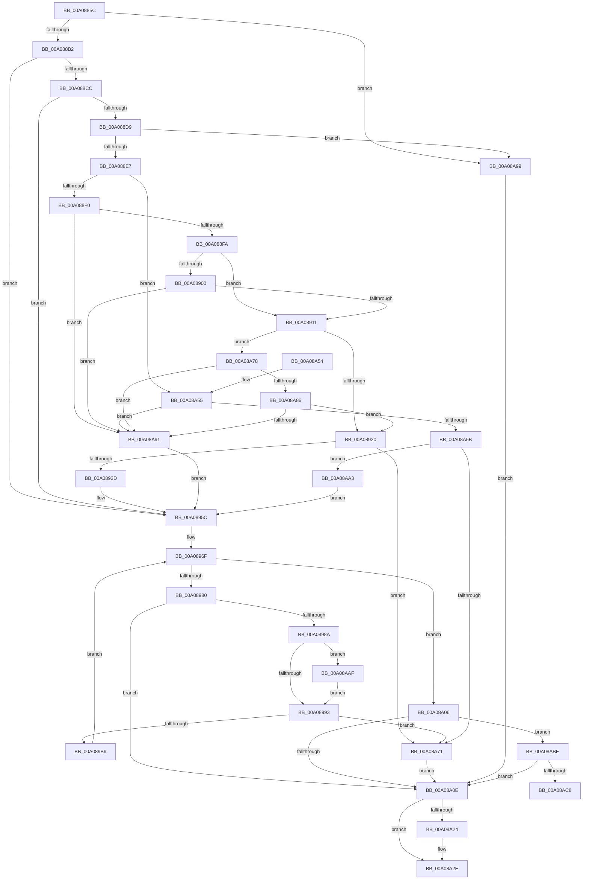

# PnpDisableDeviceInterfaces

- RVA: `0x00A0885C`–`0x00A08ACD` (길이 `625` bytes)
- VA: `0x0000000140A0885C`
- 실행 섹션: `PAGE`
- PDB 이름 있음: `예`; PDB Function 태그: `예`
- unwind 정보 RVA: `0x000A8720`
- 디코드: `154`개 명령, `625/625` bytes 표시
- 미해석 바이트: `0` (있으면 어셈블리에 `.byte`로 보존)

> 이 문서는 커널 이미지의 기계어와 PDB 기호를 분석해 생성했습니다. 4번과 5번은 함수 원형과 자료형을 바이너리 사용 방식에서 추정한 C 해석이며 원본 소스 복구 결과는 아닙니다.

## 1. Dependencies

- 직접 호출 지점: **11**; 고유 호출 대상: **8**
- 직접 호출자로 확인된 함수: **2**
- RIP 상대 이미지 참조: **2**

### Outgoing calls
- `0x00A088A4` → [ExAcquireResourceExclusiveLite](../../text/21/ExAcquireResourceExclusiveLite_function_00214E20.md) (function, `0x00214E20`)
- `0x00A0892C` → [ExAllocatePool2](../../poolcode/B8/ExAllocatePool2_function_00B820F0.md) (function, `0x00B820F0`)
- `0x00A08948` → [memcpy](../../text/6C/memcpy_function_006C6840.md) (function, `0x006C6840`)
- `0x00A089A8` → [ExAllocatePool2](../../poolcode/B8/ExAllocatePool2_function_00B820F0.md) (function, `0x00B820F0`)
- `0x00A089F7` → [_CmGetMatchingFilteredDeviceInterfaceList](_CmGetMatchingFilteredDeviceInterfaceList_function_00A09610.md) (function, `0x00A09610`)
- `0x00A08A15` → [ExReleaseResourceLite](../../text/25/ExReleaseResourceLite_function_0025FA10.md) (function, `0x0025FA10`)
- `0x00A08A1A` → [KeLeaveCriticalRegion](../../text/25/KeLeaveCriticalRegion_function_0025D8B0.md) (function, `0x0025D8B0`)
- `0x00A08A29` → [ExFreePoolWithTag](../../poolcode/B8/ExFreePoolWithTag_function_00B82870.md) (function, `0x00B82870`)
- `0x00A08A34` → [PnpUnicodeStringToWstrFree](../8F/PnpUnicodeStringToWstrFree_function_008F59F0.md) (function, `0x008F59F0`)
- `0x00A08A67` → [ExAllocatePool2](../../poolcode/B8/ExAllocatePool2_function_00B820F0.md) (function, `0x00B820F0`)
- `0x00A08AB4` → [ExFreePoolWithTag](../../poolcode/B8/ExFreePoolWithTag_function_00B82870.md) (function, `0x00B82870`)

### Direct callers
- [PnpRemoveLockedDeviceNode](../../text/47/PnpRemoveLockedDeviceNode_function_004702AC.md) at `0x004706A8`
- [PnpSurpriseRemoveLockedDeviceNode](PnpSurpriseRemoveLockedDeviceNode_function_00A08370.md) at `0x00A08451`

### Static image references
- `0x00A0888D` → RVA `0x00F8C600` (`.data`; read)
- `0x00A089B9` → RVA `0x00E66398` (`.data`; read)

## 2. Other-region calls and transfers

- 다른 실행 섹션으로 향하는 call: **9**
  - `0x00A088A4` → [ExAcquireResourceExclusiveLite](../../text/21/ExAcquireResourceExclusiveLite_function_00214E20.md) (`PAGE` → `.text`)
  - `0x00A0892C` → [ExAllocatePool2](../../poolcode/B8/ExAllocatePool2_function_00B820F0.md) (`PAGE` → `POOLCODE`)
  - `0x00A08948` → [memcpy](../../text/6C/memcpy_function_006C6840.md) (`PAGE` → `.text`)
  - `0x00A089A8` → [ExAllocatePool2](../../poolcode/B8/ExAllocatePool2_function_00B820F0.md) (`PAGE` → `POOLCODE`)
  - `0x00A08A15` → [ExReleaseResourceLite](../../text/25/ExReleaseResourceLite_function_0025FA10.md) (`PAGE` → `.text`)
  - `0x00A08A1A` → [KeLeaveCriticalRegion](../../text/25/KeLeaveCriticalRegion_function_0025D8B0.md) (`PAGE` → `.text`)
  - `0x00A08A29` → [ExFreePoolWithTag](../../poolcode/B8/ExFreePoolWithTag_function_00B82870.md) (`PAGE` → `POOLCODE`)
  - `0x00A08A67` → [ExAllocatePool2](../../poolcode/B8/ExAllocatePool2_function_00B820F0.md) (`PAGE` → `POOLCODE`)
  - `0x00A08AB4` → [ExFreePoolWithTag](../../poolcode/B8/ExFreePoolWithTag_function_00B82870.md) (`PAGE` → `POOLCODE`)
- call이 아닌 외부 분기/꼬리 이동: **1**
  - `0x00A08AC8` → [sub_00B34868](../B3/Unknown_function_00B34868.md) (`tail-transfer`)

## 3. Assembly (complete function range)

```asm
00A0885C  48 8B C4                        mov rax, rsp
00A0885F  48 89 58 08                     mov qword ptr [rax + 8], rbx
00A08863  48 89 68 18                     mov qword ptr [rax + 0x18], rbp
00A08867  56                              push rsi
00A08868  57                              push rdi
00A08869  41 54                           push r12
00A0886B  41 56                           push r14
00A0886D  41 57                           push r15
00A0886F  48 83 EC 60                     sub rsp, 0x60
00A08873  45 33 E4                        xor r12d, r12d
00A08876  0F 57 C0                        xorps xmm0, xmm0
00A08879  44 89 60 10                     mov dword ptr [rax + 0x10], r12d
00A0887D  4C 8B F1                        mov r14, rcx
00A08880  0F 11 40 C8                     movups xmmword ptr [rax - 0x38], xmm0
00A08884  65 48 8B 04 25 88 01 00 00      mov rax, qword ptr gs:[0x188]
00A0888D  48 8D 0D 6C 3D 58 00            lea rcx, [rip + 0x583d6c]
00A08894  B2 01                           mov dl, 1
00A08896  41 8B EC                        mov ebp, r12d
00A08899  41 8B F4                        mov esi, r12d
00A0889C  66 FF 88 E4 01 00 00            dec word ptr [rax + 0x1e4]
00A088A3  90                              nop
00A088A4  E8 77 C5 80 FF                  call 0x140214e20
00A088A9  4D 85 F6                        test r14, r14
00A088AC  0F 84 E7 01 00 00               je 0x140a08a99
00A088B2  45 0F B7 46 02                  movzx r8d, word ptr [r14 + 2]
00A088B7  45 8D 4C 24 02                  lea r9d, [r12 + 2]
00A088BC  41 BA 00 01 00 00               mov r10d, 0x100
00A088C2  66 45 3B C1                     cmp r8w, r9w
00A088C6  0F 82 90 00 00 00               jb 0x140a0895c
00A088CC  49 8B 4E 08                     mov rcx, qword ptr [r14 + 8]
00A088D0  48 85 C9                        test rcx, rcx
00A088D3  0F 84 83 00 00 00               je 0x140a0895c
00A088D9  41 0F B7 16                     movzx edx, word ptr [r14]
00A088DD  66 41 3B D0                     cmp dx, r8w
00A088E1  0F 87 B2 01 00 00               ja 0x140a08a99
00A088E7  66 85 D2                        test dx, dx
00A088EA  0F 84 65 01 00 00               je 0x140a08a55
00A088F0  66 44 39 21                     cmp word ptr [rcx], r12w
00A088F4  0F 84 97 01 00 00               je 0x140a08a91
00A088FA  66 41 3B D0                     cmp dx, r8w
00A088FE  75 11                           jne 0x140a08911
00A08900  8B C2                           mov eax, edx
00A08902  48 D1 E8                        shr rax, 1
00A08905  66 44 39 64 41 FE               cmp word ptr [rcx + rax*2 - 2], r12w
00A0890B  0F 84 80 01 00 00               je 0x140a08a91
00A08911  49 8B C0                        mov rax, r8
00A08914  49 2B C1                        sub rax, r9
00A08917  48 3B D0                        cmp rdx, rax
00A0891A  0F 86 58 01 00 00               jbe 0x140a08a78
00A08920  49 03 D1                        add rdx, r9
00A08923  41 B8 50 70 73 75               mov r8d, 0x75737050
00A08929  49 8B CA                        mov rcx, r10
00A0892C  E8 BF 97 17 00                  call 0x140b820f0
00A08931  48 8B D8                        mov rbx, rax
00A08934  48 85 C0                        test rax, rax
00A08937  0F 84 34 01 00 00               je 0x140a08a71
00A0893D  45 0F B7 06                     movzx r8d, word ptr [r14]
00A08941  48 8B C8                        mov rcx, rax
00A08944  49 8B 56 08                     mov rdx, qword ptr [r14 + 8]
00A08948  E8 F3 DE CB FF                  call 0x1406c6840
00A0894D  41 0F B7 06                     movzx eax, word ptr [r14]
00A08951  48 8B EB                        mov rbp, rbx
00A08954  48 D1 E8                        shr rax, 1
00A08957  66 44 89 24 43                  mov word ptr [rbx + rax*2], r12w
00A0895C  C7 84 24 98 00 00 00 00 10 00 00  mov dword ptr [rsp + 0x98], 0x1000
00A08967  BB 23 00 00 C0                  mov ebx, 0xc0000023
00A0896C  45 8B FC                        mov r15d, r12d
00A0896F  8B C3                           mov eax, ebx
00A08971  48 8B FE                        mov rdi, rsi
00A08974  81 FB 23 00 00 C0               cmp ebx, 0xc0000023
00A0897A  0F 85 86 00 00 00               jne 0x140a08a06
00A08980  41 83 FF 05                     cmp r15d, 5
00A08984  0F 83 84 00 00 00               jae 0x140a08a0e
00A0898A  48 85 F6                        test rsi, rsi
00A0898D  0F 85 1C 01 00 00               jne 0x140a08aaf
00A08993  8B 94 24 98 00 00 00            mov edx, dword ptr [rsp + 0x98]
00A0899A  B9 00 01 00 00                  mov ecx, 0x100
00A0899F  48 03 D2                        add rdx, rdx
00A089A2  41 B8 50 70 20 20               mov r8d, 0x20207050
00A089A8  E8 43 97 17 00                  call 0x140b820f0
00A089AD  48 8B F0                        mov rsi, rax
00A089B0  48 85 C0                        test rax, rax
00A089B3  0F 84 B8 00 00 00               je 0x140a08a71
00A089B9  48 8B 0D D8 D9 45 00            mov rcx, qword ptr [rip + 0x45d9d8]
00A089C0  48 8D 84 24 98 00 00 00         lea rax, [rsp + 0x98]
00A089C8  44 89 64 24 48                  mov dword ptr [rsp + 0x48], r12d
00A089CD  41 B9 01 00 00 00               mov r9d, 1
00A089D3  48 89 44 24 40                  mov qword ptr [rsp + 0x40], rax
00A089D8  4C 8B C5                        mov r8, rbp
00A089DB  8B 84 24 98 00 00 00            mov eax, dword ptr [rsp + 0x98]
00A089E2  33 D2                           xor edx, edx
00A089E4  89 44 24 38                     mov dword ptr [rsp + 0x38], eax
00A089E8  48 89 74 24 30                  mov qword ptr [rsp + 0x30], rsi
00A089ED  4C 89 64 24 28                  mov qword ptr [rsp + 0x28], r12
00A089F2  4C 89 64 24 20                  mov qword ptr [rsp + 0x20], r12
00A089F7  E8 14 0C 00 00                  call 0x140a09610
00A089FC  8B D8                           mov ebx, eax
00A089FE  41 FF C7                        inc r15d
00A08A01  E9 69 FF FF FF                  jmp 0x140a0896f
00A08A06  85 C0                           test eax, eax
00A08A08  0F 89 B0 00 00 00               jns 0x140a08abe
00A08A0E  48 8D 0D EB 3B 58 00            lea rcx, [rip + 0x583beb]
00A08A15  E8 F6 6F 85 FF                  call 0x14025fa10
00A08A1A  E8 91 4E 85 FF                  call 0x14025d8b0
00A08A1F  48 85 F6                        test rsi, rsi
00A08A22  74 0A                           je 0x140a08a2e
00A08A24  33 D2                           xor edx, edx
00A08A26  48 8B CE                        mov rcx, rsi
00A08A29  E8 42 9E 17 00                  call 0x140b82870
00A08A2E  49 8B D6                        mov rdx, r14
00A08A31  48 8B CD                        mov rcx, rbp
00A08A34  E8 B7 CF EE FF                  call 0x1408f59f0
00A08A39  4C 8D 5C 24 60                  lea r11, [rsp + 0x60]
00A08A3E  8B C3                           mov eax, ebx
00A08A40  49 8B 5B 30                     mov rbx, qword ptr [r11 + 0x30]
00A08A44  49 8B 6B 40                     mov rbp, qword ptr [r11 + 0x40]
00A08A48  49 8B E3                        mov rsp, r11
00A08A4B  41 5F                           pop r15
00A08A4D  41 5E                           pop r14
00A08A4F  41 5C                           pop r12
00A08A51  5F                              pop rdi
00A08A52  5E                              pop rsi
00A08A53  C3                              ret
00A08A54  CC                              int3
00A08A55  66 44 39 21                     cmp word ptr [rcx], r12w
00A08A59  74 36                           je 0x140a08a91
00A08A5B  41 B8 50 70 73 75               mov r8d, 0x75737050
00A08A61  49 8B D1                        mov rdx, r9
00A08A64  49 8B CA                        mov rcx, r10
00A08A67  E8 84 96 17 00                  call 0x140b820f0
00A08A6C  48 85 C0                        test rax, rax
00A08A6F  75 32                           jne 0x140a08aa3
00A08A71  BB 9A 00 00 C0                  mov ebx, 0xc000009a
00A08A76  EB 96                           jmp 0x140a08a0e
00A08A78  48 8B C2                        mov rax, rdx
00A08A7B  48 D1 E8                        shr rax, 1
00A08A7E  66 44 39 64 41 FE               cmp word ptr [rcx + rax*2 - 2], r12w
00A08A84  74 0B                           je 0x140a08a91
00A08A86  66 44 39 24 41                  cmp word ptr [rcx + rax*2], r12w
00A08A8B  0F 85 8F FE FF FF               jne 0x140a08920
00A08A91  48 8B E9                        mov rbp, rcx
00A08A94  E9 C3 FE FF FF                  jmp 0x140a0895c
00A08A99  BB 0D 00 00 C0                  mov ebx, 0xc000000d
00A08A9E  E9 6B FF FF FF                  jmp 0x140a08a0e
00A08AA3  66 44 89 20                     mov word ptr [rax], r12w
00A08AA7  48 8B E8                        mov rbp, rax
00A08AAA  E9 AD FE FF FF                  jmp 0x140a0895c
00A08AAF  33 D2                           xor edx, edx
00A08AB1  48 8B CE                        mov rcx, rsi
00A08AB4  E8 B7 9D 17 00                  call 0x140b82870
00A08AB9  E9 D5 FE FF FF                  jmp 0x140a08993
00A08ABE  66 44 39 26                     cmp word ptr [rsi], r12w
00A08AC2  0F 84 46 FF FF FF               je 0x140a08a0e
00A08AC8  E9 9B BD 12 00                  jmp 0x140b34868
```

## 4. C-style interpretation (structured pseudocode)

```c
__int64 __fastcall PnpDisableDeviceInterfaces(__int64 a1)
{
    __int64 result;
    __int64 v_r12;
    __int64 v_r15;
    __int64 v_rsp;
    unsigned __int64 v_stack_m28;
    unsigned int v_stack_m40;
    unsigned __int64 v_stack_m48;
    unsigned int v_stack_m50;
    unsigned __int64 v_stack_m58;
    unsigned __int64 v_stack_m60;
    unsigned __int64 v_stack_m68;
    unsigned int v_stack_p10;

    *(unsigned __int64 *)(v_rsp + 8) = v_rbx;
    *(unsigned __int64 *)(v_rsp + 24) = v_rbp;
    v_rsp = (v_rsp) - (96);
    v_r12 = 0;
    *(unsigned int *)(v_rsp + 16) = 0;
    *(unsigned __int64 *)(v_rsp - 56) = v_xmm0;
    result = ExAcquireResourceExclusiveLite(v_rip + 5782892, 1, a3, a4);
    if (a1 == 0) goto loc_00A08A99;
    if (((unsigned __int16)(*(unsigned __int16 *)(a1 + 2))) < ((unsigned __int16)(v_r12 + 2))) goto loc_00A0895C;
    if (*(unsigned __int64 *)(a1 + 8) == 0) goto loc_00A0895C;
    if (((unsigned __int16)(*(unsigned __int16 *)(a1))) > ((unsigned __int16)(*(unsigned __int16 *)(a1 + 2)))) goto loc_00A08A99;
    if ((unsigned __int16)(*(unsigned __int16 *)(a1)) == 0) goto loc_00A08A55;
    if ((*(unsigned __int16 *)(*(unsigned __int64 *)(a1 + 8))) == 0) goto loc_00A08A91;
    if (((unsigned __int16)(*(unsigned __int16 *)(a1))) != ((unsigned __int16)(*(unsigned __int16 *)(a1 + 2)))) goto loc_00A08911;
    result = ((unsigned int)((unsigned int)(*(unsigned __int16 *)(a1)))) >> (1);
    if ((*(unsigned __int16 *)(*(unsigned __int64 *)(a1 + 8) + result * 2 - 2)) == 0) goto loc_00A08A91;
loc_00A08911:
    result = (*(unsigned __int16 *)(a1 + 2)) - (v_r12 + 2);
    if ((*(unsigned __int16 *)(a1)) <= result) goto loc_00A08A78;
loc_00A08920:
    a2 = (*(unsigned __int16 *)(a1)) + (v_r12 + 2);
    result = ExAllocatePool2(256, a2, (unsigned int)(0x75737050ULL), v_r12 + 2);
    if (result == 0) goto loc_00A08A71;
    result = memcpy(result, *(unsigned __int64 *)(a1 + 8), *(unsigned __int16 *)(a1), v_r12 + 2);
    result = (*(unsigned __int16 *)(a1)) >> (1);
    *(unsigned __int16 *)(result + result * 2) = 0;
loc_00A0895C:
    v_stack_p10 = 0x1000ULL;
loc_00A0896F:
    if (((unsigned int)((unsigned int)(0xC0000023ULL))) != 0xC0000023ULL) goto loc_00A08A06;
    if (0 >= 5) goto loc_00A08A0E;
    if (0 != 0) goto loc_00A08AAF;
loc_00A08993:
    a2 = ((unsigned int)(v_stack_p10)) + ((unsigned int)(v_stack_p10));
    result = ExAllocatePool2(256, a2, (unsigned int)(0x20207050ULL), v_r12 + 2);
    if (result == 0) goto loc_00A08A71;
    v_stack_m40 = 0;
    v_stack_m48 = v_stack_p10;
    a2 = 0;
    v_stack_m50 = (unsigned int)((unsigned int)(v_stack_p10));
    v_stack_m58 = result;
    v_stack_m60 = 0;
    v_stack_m68 = 0;
    result = _CmGetMatchingFilteredDeviceInterfaceList(*(unsigned __int64 *)(v_rip + 4577752), a2, result, 1);
    v_r15 = (unsigned int)((0) + 1);
    goto loc_00A0896F;
loc_00A08A06:
    if (!sign_flag) goto loc_00A08ABE;
loc_00A08A0E:
    result = ExReleaseResourceLite(v_rip + 5782507, a2, result, 1);
    result = KeLeaveCriticalRegion(v_rip + 5782507, a2, result, 1);
    if (result != 0) {
        a2 = 0;
        a1 = result;
        result = ExFreePoolWithTag(a1, a2, result, 1);
    }
    result = PnpUnicodeStringToWstrFree(result, a1, result, 1);
    return (unsigned int)((unsigned int)((unsigned int)((unsigned int)(result))));
loc_00A08A55:
    if ((*(unsigned __int16 *)(result)) == 0) goto loc_00A08A91;
    result = ExAllocatePool2(256, 1, (unsigned int)(0x75737050ULL), 1);
    if (result != 0) goto loc_00A08AA3;
loc_00A08A71:
    goto loc_00A08A0E;
loc_00A08A78:
    result = (1) >> (1);
    if ((*(unsigned __int16 *)(256 + result * 2 - 2)) == 0) goto loc_00A08A91;
    if ((*(unsigned __int16 *)(256 + result * 2)) != 0) goto loc_00A08920;
loc_00A08A91:
    goto loc_00A0895C;
loc_00A08A99:
    goto loc_00A08A0E;
loc_00A08AA3:
    *(unsigned __int16 *)(result) = 0;
    goto loc_00A0895C;
loc_00A08AAF:
    a2 = 0;
    result = ExFreePoolWithTag(result, a2, (unsigned int)(0x75737050ULL), 1);
    goto loc_00A08993;
loc_00A08ABE:
    if ((*(unsigned __int16 *)(result)) == 0) goto loc_00A08A0E;
}
```

## 5. (Beta) C Style

```c
int64_t PnpDisableDeviceInterfaces(int64_t Arg1)
{
    int64_t result;
    int64_t local_r12;
    int64_t local_r15;
    int64_t local_rsp;
    uint64_t v_stack_m28;
    uint32_t v_stack_m40;
    uint64_t v_stack_m48;
    uint32_t v_stack_m50;
    uint64_t v_stack_m58;
    uint64_t v_stack_m60;
    uint64_t v_stack_m68;
    uint32_t v_stack_p10;

    *(uint64_t *)(local_rsp + 0x8) = local_rbx;
    *(uint64_t *)(local_rsp + 0x18) = local_rbp;
    local_rsp = (local_rsp) - (96);
    local_r12 = 0;
    *(uint32_t *)(local_rsp + 0x10) = 0;
    *(uint64_t *)(local_rsp - 0x38) = v_xmm0;
    result = ExAcquireResourceExclusiveLite(v_rip + 5782892, 1, a3, a4);
    if (Arg1 == 0) goto loc_00A08A99;
    if (((uint16_t)(*(uint16_t *)(Arg1 + 0x2))) < ((uint16_t)(local_r12 + 2))) goto loc_00A0895C;
    if (*(uint64_t *)(Arg1 + 0x8) == 0) goto loc_00A0895C;
    if (((uint16_t)(*(uint16_t *)(Arg1))) > ((uint16_t)(*(uint16_t *)(Arg1 + 0x2)))) goto loc_00A08A99;
    if ((uint16_t)(*(uint16_t *)(Arg1)) == 0) goto loc_00A08A55;
    if ((*(uint16_t *)(*(uint64_t *)(Arg1 + 0x8))) == 0) goto loc_00A08A91;
    if (((uint16_t)(*(uint16_t *)(Arg1))) != ((uint16_t)(*(uint16_t *)(Arg1 + 0x2)))) goto loc_00A08911;
    result = ((uint32_t)((uint32_t)(*(uint16_t *)(Arg1)))) >> (1);
    if ((*(uint16_t *)(*(uint64_t *)(Arg1 + 0x8) + result * 2 - 0x2)) == 0) goto loc_00A08A91;
loc_00A08911:
    result = (*(uint16_t *)(Arg1 + 0x2)) - (local_r12 + 2);
    if ((*(uint16_t *)(Arg1)) <= result) goto loc_00A08A78;
loc_00A08920:
    a2 = (*(uint16_t *)(Arg1)) + (local_r12 + 2);
    result = ExAllocatePool2(256, a2, (uint32_t)(0x75737050ULL), local_r12 + 2);
    if (result == 0) goto loc_00A08A71;
    result = memcpy(result, *(uint64_t *)(Arg1 + 0x8), *(uint16_t *)(Arg1), local_r12 + 2);
    result = (*(uint16_t *)(Arg1)) >> (1);
    *(uint16_t *)(result + result * 2) = 0;
loc_00A0895C:
    v_stack_p10 = 0x1000ULL;
loc_00A0896F:
    if (((uint32_t)((uint32_t)(0xC0000023ULL))) != 0xC0000023ULL) goto loc_00A08A06;
    if (0 >= 5) goto loc_00A08A0E;
    if (0 != 0) goto loc_00A08AAF;
loc_00A08993:
    a2 = ((uint32_t)(v_stack_p10)) + ((uint32_t)(v_stack_p10));
    result = ExAllocatePool2(256, a2, (uint32_t)(0x20207050ULL), local_r12 + 2);
    if (result == 0) goto loc_00A08A71;
    v_stack_m40 = 0;
    v_stack_m48 = v_stack_p10;
    a2 = 0;
    v_stack_m50 = (uint32_t)((uint32_t)(v_stack_p10));
    v_stack_m58 = result;
    v_stack_m60 = 0;
    v_stack_m68 = 0;
    result = _CmGetMatchingFilteredDeviceInterfaceList(*(uint64_t *)(v_rip + 0x45D9D8), a2, result, 1);
    local_r15 = (uint32_t)((0) + 1);
    goto loc_00A0896F;
loc_00A08A06:
    if (!sign_flag) goto loc_00A08ABE;
loc_00A08A0E:
    result = ExReleaseResourceLite(v_rip + 5782507, a2, result, 1);
    result = KeLeaveCriticalRegion(v_rip + 5782507, a2, result, 1);
    if (result != 0) {
        a2 = 0;
        Arg1 = result;
        result = ExFreePoolWithTag(Arg1, a2, result, 1);
    }
    result = PnpUnicodeStringToWstrFree(result, Arg1, result, 1);
    return (uint32_t)((uint32_t)((uint32_t)((uint32_t)(result))));
loc_00A08A55:
    if ((*(uint16_t *)(result)) == 0) goto loc_00A08A91;
    result = ExAllocatePool2(256, 1, (uint32_t)(0x75737050ULL), 1);
    if (result != 0) goto loc_00A08AA3;
loc_00A08A71:
    goto loc_00A08A0E;
loc_00A08A78:
    result = (1) >> (1);
    if ((*(uint16_t *)(256 + result * 2 - 0x2)) == 0) goto loc_00A08A91;
    if ((*(uint16_t *)(256 + result * 2)) != 0) goto loc_00A08920;
loc_00A08A91:
    goto loc_00A0895C;
loc_00A08A99:
    goto loc_00A08A0E;
loc_00A08AA3:
    *(uint16_t *)(result) = 0;
    goto loc_00A0895C;
loc_00A08AAF:
    a2 = 0;
    result = ExFreePoolWithTag(result, a2, (uint32_t)(0x75737050ULL), 1);
    goto loc_00A08993;
loc_00A08ABE:
    if ((*(uint16_t *)(result)) == 0) goto loc_00A08A0E;
}
```

## 6. Execution-region graph

[열기: 2D/3D 그래프와 함수 탐색 컨트롤 패널](../../../control-panel.html?section=page&rva=0x00A0885C&view=graph)

- 2D 그래프는 위에서 아래로 흐르고, 3D 그래프는 빈 공간을 드래그해 회전합니다. Shift+드래그는 이동, 휠은 확대·축소, 함수 노드 선택은 대상 보고서 이동입니다.

### Static fallback


