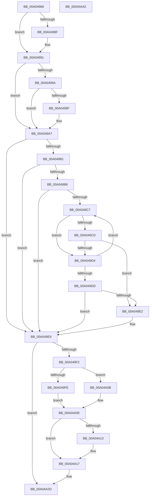

# PnpFinalizeVetoedRemove

- RVA: `0x00A04968`–`0x00A04A43` (길이 `219` bytes)
- VA: `0x0000000140A04968`
- 실행 섹션: `PAGE`
- PDB 이름 있음: `예`; PDB Function 태그: `아니요`
- unwind 정보 RVA: `0x00066400`
- 디코드: `67`개 명령, `219/219` bytes 표시
- 미해석 바이트: `0` (있으면 어셈블리에 `.byte`로 보존)

> 이 문서는 커널 이미지의 기계어와 PDB 기호를 분석해 생성했습니다. 4번과 5번은 함수 원형과 자료형을 바이너리 사용 방식에서 추정한 C 해석이며 원본 소스 복구 결과는 아닙니다.

## 1. Dependencies

- 직접 호출 지점: **2**; 고유 호출 대상: **2**
- 직접 호출자로 확인된 함수: **5**
- RIP 상대 이미지 참조: **1**

### Outgoing calls
- `0x00A049A2` → [RtlCopyUnicodeString](../../text/3F/RtlCopyUnicodeString_function_003FEF30.md) (function, `0x003FEF30`)
- `0x00A04A28` → [McTemplateK0zqz_EtwWriteTransfer](../../text/5A/McTemplateK0zqz_EtwWriteTransfer_function_005A8610.md) (function, `0x005A8610`)

### Direct callers
- [PnpProcessQueryRemoveAndEject](PnpProcessQueryRemoveAndEject_function_00A05170.md) at `0x00A05565`
- [PnpProcessQueryRemoveAndEject](PnpProcessQueryRemoveAndEject_function_00A05170.md) at `0x00A055CB`
- [PiProcessQueryAndCancelRemoval](PiProcessQueryAndCancelRemoval_function_00A05A58.md) at `0x00A05ACE`
- [PiProcessQueryAndCancelRemoval](PiProcessQueryAndCancelRemoval_function_00A05A58.md) at `0x00A05BBB`
- [PiEventBuildPdoList](PiEventBuildPdoList_function_00A05C8C.md) at `0x00A05DC0`
- [sub_00B33FE8](../B3/Unknown_function_00B33FE8.md) at `0x00B34030`
- [sub_00B33FE8](../B3/Unknown_function_00B33FE8.md) at `0x00B340F9`
- [sub_00B33FE8](../B3/Unknown_function_00B33FE8.md) at `0x00B3417F`
- [sub_00B3445E](../B3/Unknown_function_00B3445E.md) at `0x00B34462`

### Static image references
- `0x00A049E9` → RVA `0x00EF012C` (`.data`; read)

## 2. Other-region calls and transfers

- 다른 실행 섹션으로 향하는 call: **2**
  - `0x00A049A2` → [RtlCopyUnicodeString](../../text/3F/RtlCopyUnicodeString_function_003FEF30.md) (`PAGE` → `.text`)
  - `0x00A04A28` → [McTemplateK0zqz_EtwWriteTransfer](../../text/5A/McTemplateK0zqz_EtwWriteTransfer_function_005A8610.md) (`PAGE` → `.text`)
- 별도 외부 분기/꼬리 이동을 확인하지 못했습니다.

## 3. Assembly (complete function range)

```asm
00A04968  48 89 5C 24 08                  mov qword ptr [rsp + 8], rbx
00A0496D  48 89 6C 24 10                  mov qword ptr [rsp + 0x10], rbp
00A04972  48 89 74 24 18                  mov qword ptr [rsp + 0x18], rsi
00A04977  57                              push rdi
00A04978  48 83 EC 30                     sub rsp, 0x30
00A0497C  48 8B 41 30                     mov rax, qword ptr [rcx + 0x30]
00A04980  33 DB                           xor ebx, ebx
00A04982  49 8B F8                        mov rdi, r8
00A04985  8B EA                           mov ebp, edx
00A04987  48 8B F1                        mov rsi, rcx
00A0498A  48 85 C0                        test rax, rax
00A0498D  74 02                           je 0x140a04991
00A0498F  89 10                           mov dword ptr [rax], edx
00A04991  48 8B 49 38                     mov rcx, qword ptr [rcx + 0x38]
00A04995  48 85 C9                        test rcx, rcx
00A04998  74 0D                           je 0x140a049a7
00A0499A  48 85 FF                        test rdi, rdi
00A0499D  74 08                           je 0x140a049a7
00A0499F  48 8B D7                        mov rdx, rdi
00A049A2  E8 89 A5 9F FF                  call 0x1403fef30
00A049A7  8B 86 98 00 00 00               mov eax, dword ptr [rsi + 0x98]
00A049AD  A8 08                           test al, 8
00A049AF  74 38                           je 0x140a049e9
00A049B1  83 FD 06                        cmp ebp, 6
00A049B4  75 33                           jne 0x140a049e9
00A049B6  48 8B 47 08                     mov rax, qword ptr [rdi + 8]
00A049BA  8B CB                           mov ecx, ebx
00A049BC  0F B7 17                        movzx edx, word ptr [rdi]
00A049BF  48 03 D0                        add rdx, rax
00A049C2  48 3B C2                        cmp rax, rdx
00A049C5  73 22                           jae 0x140a049e9
00A049C7  66 83 38 5C                     cmp word ptr [rax], 0x5c
00A049CB  75 07                           jne 0x140a049d4
00A049CD  FF C1                           inc ecx
00A049CF  83 F9 03                        cmp ecx, 3
00A049D2  74 0E                           je 0x140a049e2
00A049D4  48 83 C0 02                     add rax, 2
00A049D8  48 3B C2                        cmp rax, rdx
00A049DB  72 EA                           jb 0x140a049c7
00A049DD  83 F9 03                        cmp ecx, 3
00A049E0  75 07                           jne 0x140a049e9
00A049E2  66 2B 47 08                     sub ax, word ptr [rdi + 8]
00A049E6  66 89 07                        mov word ptr [rdi], ax
00A049E9  F6 05 3C B7 4E 00 04            test byte ptr [rip + 0x4eb73c], 4
00A049F0  74 3B                           je 0x140a04a2d
00A049F2  48 8B 86 A0 00 00 00            mov rax, qword ptr [rsi + 0xa0]
00A049F9  48 85 C0                        test rax, rax
00A049FC  74 0D                           je 0x140a04a0b
00A049FE  48 8B 80 38 01 00 00            mov rax, qword ptr [rax + 0x138]
00A04A05  4C 8B 48 28                     mov r9, qword ptr [rax + 0x28]
00A04A09  EB 03                           jmp 0x140a04a0e
00A04A0B  4C 8B CB                        mov r9, rbx
00A04A0E  48 85 FF                        test rdi, rdi
00A04A11  74 04                           je 0x140a04a17
00A04A13  48 8B 5F 08                     mov rbx, qword ptr [rdi + 8]
00A04A17  4D 8B 49 30                     mov r9, qword ptr [r9 + 0x30]
00A04A1B  4C 8D 46 58                     lea r8, [rsi + 0x58]
00A04A1F  48 89 5C 24 28                  mov qword ptr [rsp + 0x28], rbx
00A04A24  89 6C 24 20                     mov dword ptr [rsp + 0x20], ebp
00A04A28  E8 E3 3B BA FF                  call 0x1405a8610
00A04A2D  48 8B 5C 24 40                  mov rbx, qword ptr [rsp + 0x40]
00A04A32  48 8B 6C 24 48                  mov rbp, qword ptr [rsp + 0x48]
00A04A37  48 8B 74 24 50                  mov rsi, qword ptr [rsp + 0x50]
00A04A3C  48 83 C4 30                     add rsp, 0x30
00A04A40  5F                              pop rdi
00A04A41  C3                              ret
00A04A42  CC                              int3
```

## 4. C-style interpretation (structured pseudocode)

```c
__int64 __fastcall PnpFinalizeVetoedRemove(__int64 a1, int a2, __int64 a3)
{
    __int64 result;
    __int64 v_rbx;
    __int64 v_rsp;
    unsigned __int64 v_stack_m10;
    unsigned int v_stack_m18;
    unsigned __int64 v_stack_p10;
    unsigned __int64 v_stack_p18;
    unsigned __int64 v_stack_p8;

    v_stack_p8 = v_rbx;
    v_stack_p10 = v_rbp;
    v_stack_p18 = v_rsi;
    v_rsp = (v_rsp) - (48);
    v_rbx = 0;
    if (*(unsigned __int64 *)(a1 + 48) != 0) {
        *(unsigned int *)(*(unsigned __int64 *)(a1 + 48)) = a2;
    }
    if (*(unsigned __int64 *)(a1 + 56) == 0) goto loc_00A049A7;
    result = *(unsigned __int64 *)(a1 + 48);
    if (a3 != 0) {
        a2 = a3;
        result = RtlCopyUnicodeString(*(unsigned __int64 *)(a1 + 56), a2, a3, a4);
    }
    if ((((unsigned __int8)((unsigned int)(*(unsigned int *)(a1 + 152)))) & (8)) == 0) goto loc_00A049E9;
    if (((unsigned int)((unsigned int)(a2))) != 6) goto loc_00A049E9;
    a2 = (*(unsigned __int16 *)(a3)) + (*(unsigned __int64 *)(a3 + 8));
    if ((*(unsigned __int64 *)(a3 + 8)) >= a2) goto loc_00A049E9;
loc_00A049C7:
    if ((*(unsigned __int16 *)(*(unsigned __int64 *)(a3 + 8))) != 92) goto loc_00A049D4;
    a1 = (unsigned int)((0) + 1);
    if (((unsigned int)(a1)) == 3) goto loc_00A049E2;
loc_00A049D4:
    result = (*(unsigned __int64 *)(a3 + 8)) + (2);
    if (result < a2) goto loc_00A049C7;
    if (((unsigned int)(a1)) == 3) {
        result = (unsigned __int16)((result) - (*(unsigned __int16 *)(a3 + 8)));
        *(unsigned __int16 *)(a3) = (unsigned __int16)(result);
    }
    if (((*(unsigned __int8 *)(v_rip + 5158716)) & (4)) == 0) goto loc_00A04A2D;
    if (*(unsigned __int64 *)(a1 + 160) == 0) goto loc_00A04A0B;
    goto loc_00A04A0E;
loc_00A04A0B:
loc_00A04A0E:
    if (a3 != 0) {
        v_rbx = *(unsigned __int64 *)(a3 + 8);
    }
    v_stack_m10 = v_rbx;
    v_stack_m18 = (unsigned int)((unsigned int)(a2));
    result = McTemplateK0zqz_EtwWriteTransfer(a1, a2, a1 + 88, *(unsigned __int64 *)(0 + 48));
loc_00A04A2D:
    v_rsp = (v_rsp) + (48);
    return result;
}
```

## 5. (Beta) C Style

```c
int64_t PnpFinalizeVetoedRemove(void *Arg1, int32_t Arg2, int64_t Arg3)
{
    uint8_t *arg1 = (uint8_t *)Arg1;

    int64_t result;
    int64_t local_rbx;
    int64_t local_rsp;
    uint64_t v_stack_m10;
    uint32_t v_stack_m18;
    uint64_t v_stack_p10;
    uint64_t v_stack_p18;
    uint64_t v_stack_p8;

    v_stack_p8 = local_rbx;
    v_stack_p10 = local_rbp;
    v_stack_p18 = local_rsi;
    local_rsp = (local_rsp) - (48);
    local_rbx = 0;
    if (*(uint64_t *)(arg1 + 0x30) != 0) {
        *(uint32_t *)(*(uint64_t *)(arg1 + 0x30)) = Arg2;
    }
    if (*(uint64_t *)(arg1 + 0x38) == 0) goto loc_00A049A7;
    result = *(uint64_t *)(arg1 + 0x30);
    if (Arg3 != 0) {
        Arg2 = Arg3;
        result = RtlCopyUnicodeString(*(uint64_t *)(arg1 + 0x38), Arg2, Arg3, a4);
    }
    if ((((uint8_t)((uint32_t)(*(uint32_t *)(arg1 + 0x98)))) & (8)) == 0) goto loc_00A049E9;
    if (((uint32_t)((uint32_t)(Arg2))) != 6) goto loc_00A049E9;
    Arg2 = (*(uint16_t *)(Arg3)) + (*(uint64_t *)(Arg3 + 0x8));
    if ((*(uint64_t *)(Arg3 + 0x8)) >= Arg2) goto loc_00A049E9;
loc_00A049C7:
    if ((*(uint16_t *)(*(uint64_t *)(Arg3 + 0x8))) != 92) goto loc_00A049D4;
    Arg1 = (uint32_t)((0) + 1);
    if (((uint32_t)(Arg1)) == 3) goto loc_00A049E2;
loc_00A049D4:
    result = (*(uint64_t *)(Arg3 + 0x8)) + (2);
    if (result < Arg2) goto loc_00A049C7;
    if (((uint32_t)(Arg1)) == 3) {
        result = (uint16_t)((result) - (*(uint16_t *)(Arg3 + 0x8)));
        *(uint16_t *)(Arg3) = (uint16_t)(result);
    }
    if (((*(uint8_t *)(v_rip + 0x4EB73C)) & (4)) == 0) goto loc_00A04A2D;
    if (*(uint64_t *)(arg1 + 0xA0) == 0) goto loc_00A04A0B;
    goto loc_00A04A0E;
loc_00A04A0B:
loc_00A04A0E:
    if (Arg3 != 0) {
        local_rbx = *(uint64_t *)(Arg3 + 0x8);
    }
    v_stack_m10 = local_rbx;
    v_stack_m18 = (uint32_t)((uint32_t)(Arg2));
    result = McTemplateK0zqz_EtwWriteTransfer(Arg1, Arg2, Arg1 + 88, *(uint64_t *)(0 + 0x30));
loc_00A04A2D:
    local_rsp = (local_rsp) + (48);
    return result;
}
```

### 관측된 메모리 오프셋

구조체 형식이 확인되지 않은 접근은 인자 기준의 오프셋으로만 기록했습니다.

| 기준 인자 | 오프셋 표현 | 폭 (bit) | 접근 |
|---|---:|---:|---|
| `Arg1` | `+ 0x30` | `64` | `R` |
| `Arg1` | `+ 0x38` | `64` | `R` |
| `Arg1` | `+ 0x58` | `64` | `R` |
| `Arg1` | `+ 0x98` | `32` | `R` |
| `Arg1` | `+ 0xA0` | `64` | `R` |

## 6. Execution-region graph

[열기: 2D/3D 그래프와 함수 탐색 컨트롤 패널](../../../control-panel.html?section=page&rva=0x00A04968&view=graph)

- 2D 그래프는 위에서 아래로 흐르고, 3D 그래프는 빈 공간을 드래그해 회전합니다. Shift+드래그는 이동, 휠은 확대·축소, 함수 노드 선택은 대상 보고서 이동입니다.

### Static fallback


