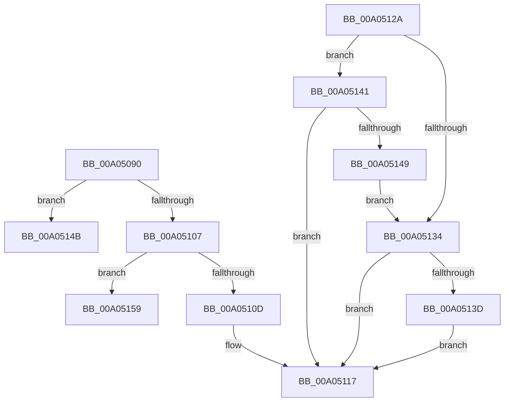

# PnpGetDeviceDependencyList

- RVA: `0x00A05090`–`0x00A05167` (길이 `215` bytes)
- VA: `0x0000000140A05090`
- 실행 섹션: `PAGE`
- PDB 이름 있음: `예`; PDB Function 태그: `예`
- unwind 정보 RVA: `0x000A83A0`
- 디코드: `69`개 명령, `215/215` bytes 표시
- 미해석 바이트: `0` (있으면 어셈블리에 `.byte`로 보존)

> 이 문서는 커널 이미지의 기계어와 PDB 기호를 분석해 생성했습니다. 4번과 5번은 함수 원형과 자료형을 바이너리 사용 방식에서 추정한 C 해석이며 원본 소스 복구 결과는 아닙니다.

## 1. Dependencies

- 직접 호출 지점: **6**; 고유 호출 대상: **4**
- 직접 호출자로 확인된 함수: **1**
- RIP 상대 이미지 참조: **2**

### Outgoing calls
- `0x00A050EF` → [ExAcquireResourceSharedLite](../../text/21/ExAcquireResourceSharedLite_function_00211BC0.md) (function, `0x00211BC0`)
- `0x00A050FD` → [ExAcquireResourceSharedLite](../../text/21/ExAcquireResourceSharedLite_function_00211BC0.md) (function, `0x00211BC0`)
- `0x00A05112` → [PnpReleaseDependencyRelationsLock](PnpReleaseDependencyRelationsLock_function_00A06E14.md) (function, `0x00A06E14`)
- `0x00A0512B` → [PnpReleaseDependencyRelationsLock](PnpReleaseDependencyRelationsLock_function_00A06E14.md) (function, `0x00A06E14`)
- `0x00A0514E` → [PiGetProviderList](PiGetProviderList_function_00A07140.md) (function, `0x00A07140`)
- `0x00A0515C` → [PiGetDependentList](PiGetDependentList_function_00A074BC.md) (function, `0x00A074BC`)

### Direct callers
- [PiControlGetPropertyData](../8F/PiControlGetPropertyData_function_008FA330.md) at `0x008FA66E`

### Static image references
- `0x00A050C1` → RVA `0x00F8C560` (`.data`; read)
- `0x00A050F6` → RVA `0x00F8CEA0` (`.data`; read)

## 2. Other-region calls and transfers

- 다른 실행 섹션으로 향하는 call: **2**
  - `0x00A050EF` → [ExAcquireResourceSharedLite](../../text/21/ExAcquireResourceSharedLite_function_00211BC0.md) (`PAGE` → `.text`)
  - `0x00A050FD` → [ExAcquireResourceSharedLite](../../text/21/ExAcquireResourceSharedLite_function_00211BC0.md) (`PAGE` → `.text`)
- call이 아닌 외부 분기/꼬리 이동: **2**
  - `0x00A05154` → [sub_00B33DD8](../B3/Unknown_function_00B33DD8.md) (`tail-transfer`)
  - `0x00A05162` → [sub_00B33DD8](../B3/Unknown_function_00B33DD8.md) (`tail-transfer`)

## 3. Assembly (complete function range)

```asm
00A05090  44 89 4C 24 20                  mov dword ptr [rsp + 0x20], r9d
00A05095  4C 89 44 24 18                  mov qword ptr [rsp + 0x18], r8
00A0509A  89 54 24 10                     mov dword ptr [rsp + 0x10], edx
00A0509E  55                              push rbp
00A0509F  53                              push rbx
00A050A0  56                              push rsi
00A050A1  57                              push rdi
00A050A2  41 54                           push r12
00A050A4  41 55                           push r13
00A050A6  41 56                           push r14
00A050A8  41 57                           push r15
00A050AA  48 8B EC                        mov rbp, rsp
00A050AD  48 83 EC 68                     sub rsp, 0x68
00A050B1  48 8B 71 20                     mov rsi, qword ptr [rcx + 0x20]
00A050B5  44 8B FA                        mov r15d, edx
00A050B8  65 48 8B 04 25 88 01 00 00      mov rax, qword ptr gs:[0x188]
00A050C1  48 8D 0D 98 74 58 00            lea rcx, [rip + 0x587498]
00A050C8  48 83 65 D8 00                  and qword ptr [rbp - 0x28], 0
00A050CD  B2 01                           mov dl, 1
00A050CF  45 8B E1                        mov r12d, r9d
00A050D2  4C 89 65 D0                     mov qword ptr [rbp - 0x30], r12
00A050D6  45 33 E4                        xor r12d, r12d
00A050D9  66 FF 88 E4 01 00 00            dec word ptr [rax + 0x1e4]
00A050E0  41 8B FC                        mov edi, r12d
00A050E3  90                              nop
00A050E4  4C 89 45 C8                     mov qword ptr [rbp - 0x38], r8
00A050E8  4C 89 65 F0                     mov qword ptr [rbp - 0x10], r12
00A050EC  41 8B DC                        mov ebx, r12d
00A050EF  E8 CC CA 80 FF                  call 0x140211bc0
00A050F4  B2 01                           mov dl, 1
00A050F6  48 8D 0D A3 7D 58 00            lea rcx, [rip + 0x587da3]
00A050FD  E8 BE CA 80 FF                  call 0x140211bc0
00A05102  45 85 FF                        test r15d, r15d
00A05105  74 44                           je 0x140a0514b
00A05107  41 83 FF 01                     cmp r15d, 1
00A0510B  74 4C                           je 0x140a05159
00A0510D  BB 0D 00 00 C0                  mov ebx, 0xc000000d
00A05112  E8 FD 1C 00 00                  call 0x140a06e14
00A05117  8B C3                           mov eax, ebx
00A05119  48 83 C4 68                     add rsp, 0x68
00A0511D  41 5F                           pop r15
00A0511F  41 5E                           pop r14
00A05121  41 5D                           pop r13
00A05123  41 5C                           pop r12
00A05125  5F                              pop rdi
00A05126  5E                              pop rsi
00A05127  5B                              pop rbx
00A05128  5D                              pop rbp
00A05129  C3                              ret
00A0512A  CC                              int3
00A0512B  E8 E4 1C 00 00                  call 0x140a06e14
00A05130  85 DB                           test ebx, ebx
00A05132  78 0D                           js 0x140a05141
00A05134  48 8B 45 68                     mov rax, qword ptr [rbp + 0x68]
00A05138  48 85 C0                        test rax, rax
00A0513B  74 DA                           je 0x140a05117
00A0513D  89 38                           mov dword ptr [rax], edi
00A0513F  EB D6                           jmp 0x140a05117
00A05141  81 FB 23 00 00 C0               cmp ebx, 0xc0000023
00A05147  75 CE                           jne 0x140a05117
00A05149  EB E9                           jmp 0x140a05134
00A0514B  48 8B CE                        mov rcx, rsi
00A0514E  E8 ED 1F 00 00                  call 0x140a07140
00A05153  90                              nop
00A05154  E9 7F EC 12 00                  jmp 0x140b33dd8
00A05159  48 8B CE                        mov rcx, rsi
00A0515C  E8 5B 23 00 00                  call 0x140a074bc
00A05161  90                              nop
00A05162  E9 71 EC 12 00                  jmp 0x140b33dd8
```

## 4. C-style interpretation (structured pseudocode)

```c
__int64 __fastcall PnpGetDeviceDependencyList(__int64 a1, int a2, __int64 a3, int a4)
{
    __int64 result;
    __int64 v_r12;
    __int64 v_rsp;
    unsigned __int64 v_stack_m50;
    unsigned __int64 v_stack_m68;
    unsigned __int64 v_stack_m70;
    unsigned __int64 v_stack_m78;
    unsigned int v_stack_p10;
    unsigned __int64 v_stack_p18;
    unsigned int v_stack_p20;
    unsigned __int64 v_stack_p28;

    v_stack_p20 = a4;
    v_stack_p18 = a3;
    v_stack_p10 = a2;
    v_rsp = (v_rsp) - (104);
    v_stack_m70 = (unsigned int)(a4);
    v_r12 = 0;
    v_stack_m78 = a3;
    v_stack_m50 = 0;
    result = ExAcquireResourceSharedLite(v_rip + 5797016, 1, a3, a4);
    result = ExAcquireResourceSharedLite(v_rip + 5799331, 1, a3, a4);
    if ((unsigned int)((unsigned int)(a2)) == 0) goto loc_00A0514B;
    if (((unsigned int)((unsigned int)(a2))) == 1) goto loc_00A05159;
    result = PnpReleaseDependencyRelationsLock(v_rip + 5799331, 1, a3, a4);
loc_00A05117:
    v_rsp = (v_rsp) + (104);
    return (unsigned int)((unsigned int)((unsigned int)(0xC000000DULL)));
loc_00A0514B:
    result = PiGetProviderList(*(unsigned __int64 *)(a1 + 32), 1, a3, a4);
loc_00A05159:
    result = PiGetDependentList(*(unsigned __int64 *)(a1 + 32), 1, a3, a4);
}
```

## 5. (Beta) C Style

```c
int64_t PnpGetDeviceDependencyList(void *Arg1, int32_t Arg2, int64_t Arg3, int32_t Arg4)
{
    uint8_t *arg1 = (uint8_t *)Arg1;

    int64_t result;
    int64_t local_r12;
    int64_t local_rsp;
    uint64_t v_stack_m50;
    uint64_t v_stack_m68;
    uint64_t v_stack_m70;
    uint64_t v_stack_m78;
    uint32_t v_stack_p10;
    uint64_t v_stack_p18;
    uint32_t v_stack_p20;
    uint64_t v_stack_p28;

    v_stack_p20 = Arg4;
    v_stack_p18 = Arg3;
    v_stack_p10 = Arg2;
    local_rsp = (local_rsp) - (104);
    v_stack_m70 = (uint32_t)(Arg4);
    local_r12 = 0;
    v_stack_m78 = Arg3;
    v_stack_m50 = 0;
    result = ExAcquireResourceSharedLite(v_rip + 5797016, 1, Arg3, Arg4);
    result = ExAcquireResourceSharedLite(v_rip + 5799331, 1, Arg3, Arg4);
    if ((uint32_t)((uint32_t)(Arg2)) == 0) goto loc_00A0514B;
    if (((uint32_t)((uint32_t)(Arg2))) == 1) goto loc_00A05159;
    result = PnpReleaseDependencyRelationsLock(v_rip + 5799331, 1, Arg3, Arg4);
loc_00A05117:
    local_rsp = (local_rsp) + (104);
    return (uint32_t)((uint32_t)((uint32_t)(0xC000000DULL)));
loc_00A0514B:
    result = PiGetProviderList(*(uint64_t *)(arg1 + 0x20), 1, Arg3, Arg4);
loc_00A05159:
    result = PiGetDependentList(*(uint64_t *)(arg1 + 0x20), 1, Arg3, Arg4);
}
```

### 관측된 메모리 오프셋

구조체 형식이 확인되지 않은 접근은 인자 기준의 오프셋으로만 기록했습니다.

| 기준 인자 | 오프셋 표현 | 폭 (bit) | 접근 |
|---|---:|---:|---|
| `Arg1` | `+ 0x20` | `64` | `R` |

## 6. Execution-region graph

[열기: 2D/3D 그래프와 함수 탐색 컨트롤 패널](../../../control-panel.html?section=page&rva=0x00A05090&view=graph)

- 2D 그래프는 위에서 아래로 흐르고, 3D 그래프는 빈 공간을 드래그해 회전합니다. Shift+드래그는 이동, 휠은 확대·축소, 함수 노드 선택은 대상 보고서 이동입니다.

### Static fallback


