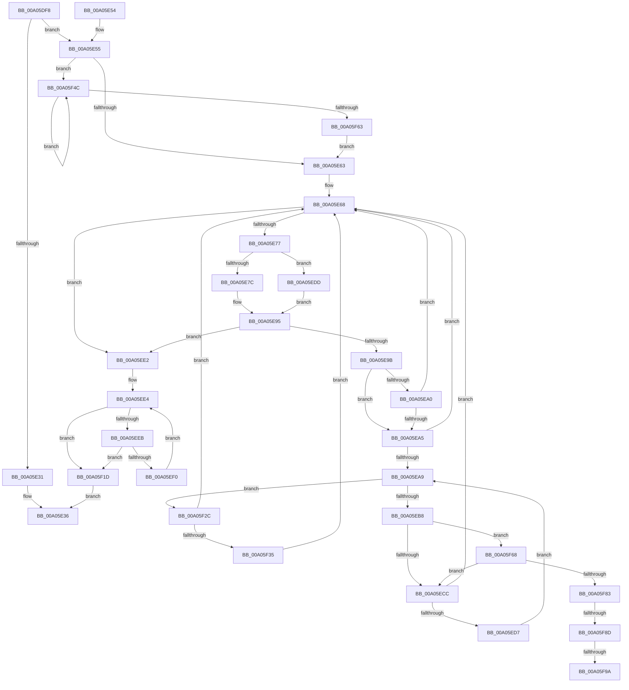

# PnpInvalidateRelationsInList

- RVA: `0x00A05DF8`–`0x00A05FA4` (길이 `428` bytes)
- VA: `0x0000000140A05DF8`
- 실행 섹션: `PAGE`
- PDB 이름 있음: `예`; PDB Function 태그: `예`
- unwind 정보 RVA: `0x000A8464`
- 디코드: `129`개 명령, `428/428` bytes 표시
- 미해석 바이트: `0` (있으면 어셈블리에 `.byte`로 보존)

> 이 문서는 커널 이미지의 기계어와 PDB 기호를 분석해 생성했습니다. 4번과 5번은 함수 원형과 자료형을 바이너리 사용 방식에서 추정한 C 해석이며 원본 소스 복구 결과는 아닙니다.

## 1. Dependencies

- 직접 호출 지점: **6**; 고유 호출 대상: **6**
- 직접 호출자로 확인된 함수: **3**
- RIP 상대 이미지 참조: **0**

### Outgoing calls
- `0x00A05E22` → [IopAllocateRelationList](IopAllocateRelationList_function_00A0784C.md) (function, `0x00A0784C`)
- `0x00A05EAF` → [IopSetRelationsTag](IopSetRelationsTag_function_00A0490C.md) (function, `0x00A0490C`)
- `0x00A05F16` → [PnpRequestDeviceAction](../../text/47/PnpRequestDeviceAction_function_00477FF8.md) (function, `0x00477FF8`)
- `0x00A05F20` → [IopFreeRelationList](IopFreeRelationList_function_00A08310.md) (function, `0x00A08310`)
- `0x00A05F42` → [IopAddRelationToList](IopAddRelationToList_function_00A04D04.md) (function, `0x00A04D04`)
- `0x00A05F70` → [PipClearDevNodeFlags](../8F/PipClearDevNodeFlags_function_008F9F54.md) (function, `0x008F9F54`)

### Direct callers
- [PnpProcessCompletedEject](../72/PnpProcessCompletedEject_function_0072D090.md) at `0x0072D182`
- [PnpProcessQueryRemoveAndEject](PnpProcessQueryRemoveAndEject_function_00A05170.md) at `0x00A0533C`
- [sub_00B33FE8](../B3/Unknown_function_00B33FE8.md) at `0x00B34160`

### Static image references
- 디코드된 RIP-relative 메모리 참조가 없습니다.

## 2. Other-region calls and transfers

- 다른 실행 섹션으로 향하는 call: **1**
  - `0x00A05F16` → [PnpRequestDeviceAction](../../text/47/PnpRequestDeviceAction_function_00477FF8.md) (`PAGE` → `.text`)
- call이 아닌 외부 분기/꼬리 이동: **3**
  - `0x00A05F87` → [sub_00B34472](../B3/Unknown_function_00B34472.md) (`tail-transfer`)
  - `0x00A05F94` → [sub_00B34472](../B3/Unknown_function_00B34472.md) (`tail-transfer`)
  - `0x00A05F9F` → [sub_00B34472 + 0xE](../B3/Unknown_function_00B34472.md) (`tail-transfer`)

## 3. Assembly (complete function range)

```asm
00A05DF8  48 89 5C 24 08                  mov qword ptr [rsp + 8], rbx
00A05DFD  48 89 6C 24 10                  mov qword ptr [rsp + 0x10], rbp
00A05E02  48 89 74 24 18                  mov qword ptr [rsp + 0x18], rsi
00A05E07  57                              push rdi
00A05E08  41 54                           push r12
00A05E0A  41 55                           push r13
00A05E0C  41 56                           push r14
00A05E0E  41 57                           push r15
00A05E10  48 83 EC 40                     sub rsp, 0x40
00A05E14  4C 8B F1                        mov r14, rcx
00A05E17  45 8A E1                        mov r12b, r9b
00A05E1A  8B CA                           mov ecx, edx
00A05E1C  45 8A E8                        mov r13b, r8b
00A05E1F  44 8B FA                        mov r15d, edx
00A05E22  E8 25 1A 00 00                  call 0x140a0784c
00A05E27  33 FF                           xor edi, edi
00A05E29  48 8B F0                        mov rsi, rax
00A05E2C  48 85 C0                        test rax, rax
00A05E2F  75 24                           jne 0x140a05e55
00A05E31  B8 9A 00 00 C0                  mov eax, 0xc000009a
00A05E36  4C 8D 5C 24 40                  lea r11, [rsp + 0x40]
00A05E3B  49 8B 5B 30                     mov rbx, qword ptr [r11 + 0x30]
00A05E3F  49 8B 6B 38                     mov rbp, qword ptr [r11 + 0x38]
00A05E43  49 8B 73 40                     mov rsi, qword ptr [r11 + 0x40]
00A05E47  49 8B E3                        mov rsp, r11
00A05E4A  41 5F                           pop r15
00A05E4C  41 5E                           pop r14
00A05E4E  41 5D                           pop r13
00A05E50  41 5C                           pop r12
00A05E52  5F                              pop rdi
00A05E53  C3                              ret
00A05E54  CC                              int3
00A05E55  49 8B 16                        mov rdx, qword ptr [r14]
00A05E58  44 8B C7                        mov r8d, edi
00A05E5B  39 3A                           cmp dword ptr [rdx], edi
00A05E5D  0F 87 E9 00 00 00               ja 0x140a05f4c
00A05E63  89 7A 08                        mov dword ptr [rdx + 8], edi
00A05E66  8B EF                           mov ebp, edi
00A05E68  49 8B 16                        mov rdx, qword ptr [r14]
00A05E6B  48 8B DF                        mov rbx, rdi
00A05E6E  44 8B C7                        mov r8d, edi
00A05E71  8B C7                           mov eax, edi
00A05E73  3B 2A                           cmp ebp, dword ptr [rdx]
00A05E75  73 6B                           jae 0x140a05ee2
00A05E77  48 85 D2                        test rdx, rdx
00A05E7A  74 61                           je 0x140a05edd
00A05E7C  8B C5                           mov eax, ebp
00A05E7E  48 8D 0C 40                     lea rcx, [rax + rax*2]
00A05E82  8B 44 CA 20                     mov eax, dword ptr [rdx + rcx*8 + 0x20]
00A05E86  48 8B 5C CA 10                  mov rbx, qword ptr [rdx + rcx*8 + 0x10]
00A05E8B  83 E0 01                        and eax, 1
00A05E8E  44 8B 44 CA 18                  mov r8d, dword ptr [rdx + rcx*8 + 0x18]
00A05E93  B1 01                           mov cl, 1
00A05E95  FF C5                           inc ebp
00A05E97  84 C9                           test cl, cl
00A05E99  74 47                           je 0x140a05ee2
00A05E9B  45 84 ED                        test r13b, r13b
00A05E9E  74 05                           je 0x140a05ea5
00A05EA0  45 85 C0                        test r8d, r8d
00A05EA3  75 C3                           jne 0x140a05e68
00A05EA5  85 C0                           test eax, eax
00A05EA7  75 BF                           jne 0x140a05e68
00A05EA9  48 8B D3                        mov rdx, rbx
00A05EAC  49 8B CE                        mov rcx, r14
00A05EAF  E8 58 EA FF FF                  call 0x140a0490c
00A05EB4  85 C0                           test eax, eax
00A05EB6  75 74                           jne 0x140a05f2c
00A05EB8  48 8B 83 38 01 00 00            mov rax, qword ptr [rbx + 0x138]
00A05EBF  48 8B 78 28                     mov rdi, qword ptr [rax + 0x28]
00A05EC3  45 84 E4                        test r12b, r12b
00A05EC6  0F 85 9C 00 00 00               jne 0x140a05f68
00A05ECC  48 8B 5F 10                     mov rbx, qword ptr [rdi + 0x10]
00A05ED0  33 FF                           xor edi, edi
00A05ED2  48 85 DB                        test rbx, rbx
00A05ED5  74 91                           je 0x140a05e68
00A05ED7  48 8B 5B 20                     mov rbx, qword ptr [rbx + 0x20]
00A05EDB  EB CC                           jmp 0x140a05ea9
00A05EDD  40 8A CF                        mov cl, dil
00A05EE0  EB B3                           jmp 0x140a05e95
00A05EE2  8B DF                           mov ebx, edi
00A05EE4  48 8B 16                        mov rdx, qword ptr [rsi]
00A05EE7  3B 1A                           cmp ebx, dword ptr [rdx]
00A05EE9  73 32                           jae 0x140a05f1d
00A05EEB  48 85 D2                        test rdx, rdx
00A05EEE  74 2D                           je 0x140a05f1d
00A05EF0  8B C3                           mov eax, ebx
00A05EF2  45 33 C9                        xor r9d, r9d
00A05EF5  48 89 7C 24 30                  mov qword ptr [rsp + 0x30], rdi
00A05EFA  FF C3                           inc ebx
00A05EFC  48 89 7C 24 28                  mov qword ptr [rsp + 0x28], rdi
00A05F01  45 33 C0                        xor r8d, r8d
00A05F04  48 89 7C 24 20                  mov qword ptr [rsp + 0x20], rdi
00A05F09  48 8D 0C 40                     lea rcx, [rax + rax*2]
00A05F0D  48 8B 4C CA 10                  mov rcx, qword ptr [rdx + rcx*8 + 0x10]
00A05F12  41 8D 51 09                     lea edx, [r9 + 9]
00A05F16  E8 DD 20 A7 FF                  call 0x140477ff8
00A05F1B  EB C7                           jmp 0x140a05ee4
00A05F1D  48 8B CE                        mov rcx, rsi
00A05F20  E8 EB 23 00 00                  call 0x140a08310
00A05F25  33 C0                           xor eax, eax
00A05F27  E9 0A FF FF FF                  jmp 0x140a05e36
00A05F2C  48 85 DB                        test rbx, rbx
00A05F2F  0F 84 33 FF FF FF               je 0x140a05e68
00A05F35  45 33 C9                        xor r9d, r9d
00A05F38  48 8B D3                        mov rdx, rbx
00A05F3B  48 8B CE                        mov rcx, rsi
00A05F3E  45 8D 41 02                     lea r8d, [r9 + 2]
00A05F42  E8 BD ED FF FF                  call 0x140a04d04
00A05F47  E9 1C FF FF FF                  jmp 0x140a05e68
00A05F4C  41 8B C0                        mov eax, r8d
00A05F4F  41 FF C0                        inc r8d
00A05F52  48 8D 0C 40                     lea rcx, [rax + rax*2]
00A05F56  83 64 CA 20 FE                  and dword ptr [rdx + rcx*8 + 0x20], 0xfffffffe
00A05F5B  49 8B 16                        mov rdx, qword ptr [r14]
00A05F5E  44 3B 02                        cmp r8d, dword ptr [rdx]
00A05F61  72 E9                           jb 0x140a05f4c
00A05F63  E9 FB FE FF FF                  jmp 0x140a05e63
00A05F68  BA 00 00 08 00                  mov edx, 0x80000
00A05F6D  48 8B CF                        mov rcx, rdi
00A05F70  E8 DF 3F EF FF                  call 0x1408f9f54
00A05F75  8B 87 8C 01 00 00               mov eax, dword ptr [rdi + 0x18c]
00A05F7B  A8 10                           test al, 0x10
00A05F7D  0F 84 49 FF FF FF               je 0x140a05ecc
00A05F83  0F BA E0 0D                     bt eax, 0xd
00A05F87  0F 83 E5 E4 12 00               jae 0x140b34472
00A05F8D  83 BF 94 01 00 00 2F            cmp dword ptr [rdi + 0x194], 0x2f
00A05F94  0F 85 D8 E4 12 00               jne 0x140b34472
00A05F9A  BA 03 00 00 00                  mov edx, 3
00A05F9F  E9 DC E4 12 00                  jmp 0x140b34480
```

## 4. C-style interpretation (structured pseudocode)

```c
__int64 __fastcall PnpInvalidateRelationsInList(__int64 a1, int a2, unsigned __int8 a3, int a4)
{
    __int64 result;
    __int64 v_rbp;
    __int64 v_rbx;
    __int64 v_rdi;
    __int64 v_rsp;
    unsigned __int64 v_stack_m10;
    unsigned __int64 v_stack_m18;
    unsigned __int64 v_stack_m20;
    unsigned __int64 v_stack_m28;
    unsigned __int64 v_stack_p10;
    unsigned __int64 v_stack_p18;
    unsigned __int64 v_stack_p8;

    v_stack_p8 = v_rbx;
    v_stack_p10 = v_rbp;
    v_stack_p18 = v_rsi;
    v_rsp = (v_rsp) - (64);
    result = IopAllocateRelationList((unsigned int)(a2), a2, a3, a4);
    v_rdi = 0;
    if (result != 0) goto loc_00A05E55;
loc_00A05E36:
    return (unsigned int)(0xC000009AULL);
loc_00A05E55:
    if ((*(unsigned int *)(*(unsigned __int64 *)(a1))) > 0) goto loc_00A05F4C;
loc_00A05E63:
    *(unsigned int *)(*(unsigned __int64 *)(a1) + 8) = 0;
loc_00A05E68:
    if (0 >= (*(unsigned int *)(*(unsigned __int64 *)(a1)))) goto loc_00A05EE2;
    if (*(unsigned __int64 *)(a1) == 0) goto loc_00A05EDD;
    result = (unsigned int)(((unsigned int)(*(unsigned int *)(*(unsigned __int64 *)(a1) + 0 + 0 * 2 * 8 + 32))) & (1));
loc_00A05E95:
    v_rbp = (unsigned int)((0) + 1);
    if (1 == 0) goto loc_00A05EE2;
    if (a3 == 0) goto loc_00A05EA5;
    if ((unsigned int)((unsigned int)(*(unsigned int *)(*(unsigned __int64 *)(a1) + 0 + 0 * 2 * 8 + 24))) != 0) goto loc_00A05E68;
loc_00A05EA5:
    if ((unsigned int)(result) != 0) goto loc_00A05E68;
loc_00A05EA9:
    result = IopSetRelationsTag(a1, *(unsigned __int64 *)(*(unsigned __int64 *)(a1) + 0 + 0 * 2 * 8 + 16), (unsigned int)(*(unsigned int *)(*(unsigned __int64 *)(a1) + 0 + 0 * 2 * 8 + 24)), a4);
    if ((unsigned int)(result) != 0) goto loc_00A05F2C;
    if ((unsigned __int8)((unsigned __int8)(a4)) != 0) goto loc_00A05F68;
loc_00A05ECC:
    v_rdi = 0;
    if (*(unsigned __int64 *)(*(unsigned __int64 *)(*(unsigned __int64 *)(*(unsigned __int64 *)(*(unsigned __int64 *)(a1) + 0 + 0 * 2 * 8 + 16) + 312) + 40) + 16) == 0) goto loc_00A05E68;
    goto loc_00A05EA9;
loc_00A05EDD:
    goto loc_00A05E95;
loc_00A05EE2:
loc_00A05EE4:
    if (0 >= (*(unsigned int *)(*(unsigned __int64 *)(*(unsigned __int64 *)(v_stack_m28 + 64))))) goto loc_00A05F1D;
    if (*(unsigned __int64 *)(*(unsigned __int64 *)(v_stack_m28 + 64)) == 0) goto loc_00A05F1D;
    a4 = 0;
    v_stack_m10 = 0;
    v_rbx = (unsigned int)((0) + 1);
    v_stack_m18 = 0;
    a3 = 0;
    v_stack_m20 = 0;
    result = PnpRequestDeviceAction(*(unsigned __int64 *)(*(unsigned __int64 *)(*(unsigned __int64 *)(v_stack_m28 + 64)) + 0 + 0 * 2 * 8 + 16), a4 + 9, a3, a4);
    goto loc_00A05EE4;
loc_00A05F1D:
    result = IopFreeRelationList(*(unsigned __int64 *)(v_stack_m28 + 64), a4 + 9, a3, a4);
    result = 0;
    goto loc_00A05E36;
loc_00A05F2C:
    if (v_rbx == 0) goto loc_00A05E68;
    a4 = 0;
    result = IopAddRelationToList(*(unsigned __int64 *)(v_stack_m28 + 64), v_rbx, a4 + 2, a4);
    goto loc_00A05E68;
loc_00A05F4C:
    a3 = (unsigned int)((a4 + 2) + 1);
    if (a3 < (*(unsigned int *)(*(unsigned __int64 *)(a1)))) goto loc_00A05F4C;
    goto loc_00A05E63;
loc_00A05F68:
    result = PipClearDevNodeFlags(0, (unsigned int)(0x80000ULL), a3, a4);
    if ((((unsigned __int8)((unsigned int)(*(unsigned int *)(v_rdi + 396)))) & (16)) == 0) goto loc_00A05ECC;
}
```

## 5. (Beta) C Style

```c
int64_t PnpInvalidateRelationsInList(void *Arg1, int32_t Arg2, uint8_t Arg3, int32_t Arg4)
{
    uint8_t *arg1 = (uint8_t *)Arg1;

    int64_t result;
    int64_t local_rbp;
    int64_t local_rbx;
    int64_t local_rdi;
    int64_t local_rsp;
    uint64_t v_stack_m10;
    uint64_t v_stack_m18;
    uint64_t v_stack_m20;
    uint64_t v_stack_m28;
    uint64_t v_stack_p10;
    uint64_t v_stack_p18;
    uint64_t v_stack_p8;

    v_stack_p8 = local_rbx;
    v_stack_p10 = local_rbp;
    v_stack_p18 = local_rsi;
    local_rsp = (local_rsp) - (64);
    result = IopAllocateRelationList((uint32_t)(Arg2), Arg2, Arg3, Arg4);
    local_rdi = 0;
    if (result != 0) goto loc_00A05E55;
loc_00A05E36:
    return (uint32_t)(0xC000009AULL);
loc_00A05E55:
    if ((*(uint32_t *)(*(uint64_t *)(arg1))) > 0) goto loc_00A05F4C;
loc_00A05E63:
    *(uint32_t *)(*(uint64_t *)(arg1) + 0x8) = 0;
loc_00A05E68:
    if (0 >= (*(uint32_t *)(*(uint64_t *)(arg1)))) goto loc_00A05EE2;
    if (*(uint64_t *)(arg1) == 0) goto loc_00A05EDD;
    result = (uint32_t)(((uint32_t)(*(uint32_t *)(*(uint64_t *)(arg1) + 0x0 + 0x0 * 2 * 8 + 0x20))) & (1));
loc_00A05E95:
    local_rbp = (uint32_t)((0) + 1);
    if (1 == 0) goto loc_00A05EE2;
    if (Arg3 == 0) goto loc_00A05EA5;
    if ((uint32_t)((uint32_t)(*(uint32_t *)(*(uint64_t *)(arg1) + 0x0 + 0x0 * 2 * 8 + 0x18))) != 0) goto loc_00A05E68;
loc_00A05EA5:
    if ((uint32_t)(result) != 0) goto loc_00A05E68;
loc_00A05EA9:
    result = IopSetRelationsTag(Arg1, *(uint64_t *)(*(uint64_t *)(arg1) + 0x0 + 0x0 * 2 * 8 + 0x10), (uint32_t)(*(uint32_t *)(*(uint64_t *)(arg1) + 0x0 + 0x0 * 2 * 8 + 0x18)), Arg4);
    if ((uint32_t)(result) != 0) goto loc_00A05F2C;
    if ((uint8_t)((uint8_t)(Arg4)) != 0) goto loc_00A05F68;
loc_00A05ECC:
    local_rdi = 0;
    if (*(uint64_t *)(*(uint64_t *)(*(uint64_t *)(*(uint64_t *)(*(uint64_t *)(arg1) + 0x0 + 0x0 * 2 * 8 + 0x10) + 0x138) + 0x28) + 0x10) == 0) goto loc_00A05E68;
    goto loc_00A05EA9;
loc_00A05EDD:
    goto loc_00A05E95;
loc_00A05EE2:
loc_00A05EE4:
    if (0 >= (*(uint32_t *)(*(uint64_t *)(*(uint64_t *)(v_stack_m28 + 0x40))))) goto loc_00A05F1D;
    if (*(uint64_t *)(*(uint64_t *)(v_stack_m28 + 0x40)) == 0) goto loc_00A05F1D;
    Arg4 = 0;
    v_stack_m10 = 0;
    local_rbx = (uint32_t)((0) + 1);
    v_stack_m18 = 0;
    Arg3 = 0;
    v_stack_m20 = 0;
    result = PnpRequestDeviceAction(*(uint64_t *)(*(uint64_t *)(*(uint64_t *)(v_stack_m28 + 0x40)) + 0x0 + 0x0 * 2 * 8 + 0x10), Arg4 + 9, Arg3, Arg4);
    goto loc_00A05EE4;
loc_00A05F1D:
    result = IopFreeRelationList(*(uint64_t *)(v_stack_m28 + 0x40), Arg4 + 9, Arg3, Arg4);
    result = 0;
    goto loc_00A05E36;
loc_00A05F2C:
    if (local_rbx == 0) goto loc_00A05E68;
    Arg4 = 0;
    result = IopAddRelationToList(*(uint64_t *)(v_stack_m28 + 0x40), local_rbx, Arg4 + 2, Arg4);
    goto loc_00A05E68;
loc_00A05F4C:
    Arg3 = (uint32_t)((Arg4 + 2) + 1);
    if (Arg3 < (*(uint32_t *)(*(uint64_t *)(arg1)))) goto loc_00A05F4C;
    goto loc_00A05E63;
loc_00A05F68:
    result = PipClearDevNodeFlags(0, (uint32_t)(0x80000ULL), Arg3, Arg4);
    if ((((uint8_t)((uint32_t)(*(uint32_t *)(local_rdi + 0x18C)))) & (16)) == 0) goto loc_00A05ECC;
}
```

### 관측된 메모리 오프셋

구조체 형식이 확인되지 않은 접근은 인자 기준의 오프셋으로만 기록했습니다.

| 기준 인자 | 오프셋 표현 | 폭 (bit) | 접근 |
|---|---:|---:|---|
| `Arg1` | `+ 0x0` | `64` | `R` |

## 6. Execution-region graph

[열기: 2D/3D 그래프와 함수 탐색 컨트롤 패널](../../../control-panel.html?section=page&rva=0x00A05DF8&view=graph)

- 2D 그래프는 위에서 아래로 흐르고, 3D 그래프는 빈 공간을 드래그해 회전합니다. Shift+드래그는 이동, 휠은 확대·축소, 함수 노드 선택은 대상 보고서 이동입니다.

### Static fallback


