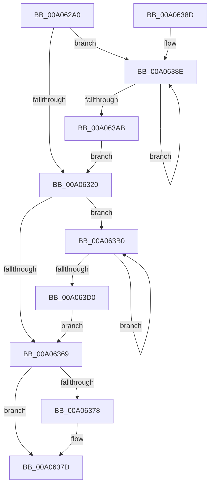

# PnpNewDeviceNodeDependencyCheck

- RVA: `0x00A062A0`–`0x00A063D2` (길이 `306` bytes)
- VA: `0x0000000140A062A0`
- 실행 섹션: `PAGE`
- PDB 이름 있음: `예`; PDB Function 태그: `아니요`
- unwind 정보 RVA: `0x000A84D8`
- 디코드: `78`개 명령, `306/306` bytes 표시
- 미해석 바이트: `0` (있으면 어셈블리에 `.byte`로 보존)

> 이 문서는 커널 이미지의 기계어와 PDB 기호를 분석해 생성했습니다. 4번과 5번은 함수 원형과 자료형을 바이너리 사용 방식에서 추정한 C 해석이며 원본 소스 복구 결과는 아닙니다.

## 1. Dependencies

- 직접 호출 지점: **18**; 고유 호출 대상: **11**
- 직접 호출자로 확인된 함수: **1**
- RIP 상대 이미지 참조: **2**

### Outgoing calls
- `0x00A062BA` → [PnpAcquireDependencyRelationsLock](PnpAcquireDependencyRelationsLock_function_00A06788.md) (function, `0x00A06788`)
- `0x00A062C3` → [PipAddtoRebuildPowerRelationsQueue](PipAddtoRebuildPowerRelationsQueue_function_00A07174.md) (function, `0x00A07174`)
- `0x00A062C8` → [PnpReleaseDependencyRelationsLock](PnpReleaseDependencyRelationsLock_function_00A06E14.md) (function, `0x00A06E14`)
- `0x00A062CD` → [PipProcessRebuildPowerRelationsQueue](PipProcessRebuildPowerRelationsQueue_function_00A06844.md) (function, `0x00A06844`)
- `0x00A062D7` → [PiPnpRtlBeginOperation](../8E/PiPnpRtlBeginOperation_function_008E033C.md) (function, `0x008E033C`)
- `0x00A062FA` → [ExAcquireResourceSharedLite](../../text/21/ExAcquireResourceSharedLite_function_00211BC0.md) (function, `0x00211BC0`)
- `0x00A06308` → [ExAcquireResourceSharedLite](../../text/21/ExAcquireResourceSharedLite_function_00211BC0.md) (function, `0x00211BC0`)
- `0x00A06310` → [PiGetProviderList](PiGetProviderList_function_00A07140.md) (function, `0x00A07140`)
- `0x00A06320` → [PnpReleaseDependencyRelationsLock](PnpReleaseDependencyRelationsLock_function_00A06E14.md) (function, `0x00A06E14`)
- `0x00A06343` → [ExAcquireResourceSharedLite](../../text/21/ExAcquireResourceSharedLite_function_00211BC0.md) (function, `0x00211BC0`)
- `0x00A06351` → [ExAcquireResourceSharedLite](../../text/21/ExAcquireResourceSharedLite_function_00211BC0.md) (function, `0x00211BC0`)
- `0x00A06359` → [PiGetDependentList](PiGetDependentList_function_00A074BC.md) (function, `0x00A074BC`)
- `0x00A06369` → [PnpReleaseDependencyRelationsLock](PnpReleaseDependencyRelationsLock_function_00A06E14.md) (function, `0x00A06E14`)
- `0x00A06378` → [PiPnpRtlEndOperation](../8E/PiPnpRtlEndOperation_function_008E0518.md) (function, `0x008E0518`)
- `0x00A06393` → [PiListEntryToDependencyEdge](../../text/4F/PiListEntryToDependencyEdge_function_004F9648.md) (function, `0x004F9648`)
- `0x00A063A1` → [PipNotifyDependenciesChanged](../70/PipNotifyDependenciesChanged_function_007038F8.md) (function, `0x007038F8`)
- `0x00A063B8` → [PiListEntryToDependencyEdge](../../text/4F/PiListEntryToDependencyEdge_function_004F9648.md) (function, `0x004F9648`)
- `0x00A063C6` → [PipNotifyDependenciesChanged](../70/PipNotifyDependenciesChanged_function_007038F8.md) (function, `0x007038F8`)

### Direct callers
- [PiProcessNewDeviceNode](../A2/PiProcessNewDeviceNode_function_00A28F20.md) at `0x00A2A37C`

### Static image references
- `0x00A062E5` → RVA `0x00F8C560` (`.data`; read)
- `0x00A06301` → RVA `0x00F8CEA0` (`.data`; read)

## 2. Other-region calls and transfers

- 다른 실행 섹션으로 향하는 call: **6**
  - `0x00A062FA` → [ExAcquireResourceSharedLite](../../text/21/ExAcquireResourceSharedLite_function_00211BC0.md) (`PAGE` → `.text`)
  - `0x00A06308` → [ExAcquireResourceSharedLite](../../text/21/ExAcquireResourceSharedLite_function_00211BC0.md) (`PAGE` → `.text`)
  - `0x00A06343` → [ExAcquireResourceSharedLite](../../text/21/ExAcquireResourceSharedLite_function_00211BC0.md) (`PAGE` → `.text`)
  - `0x00A06351` → [ExAcquireResourceSharedLite](../../text/21/ExAcquireResourceSharedLite_function_00211BC0.md) (`PAGE` → `.text`)
  - `0x00A06393` → [PiListEntryToDependencyEdge](../../text/4F/PiListEntryToDependencyEdge_function_004F9648.md) (`PAGE` → `.text`)
  - `0x00A063B8` → [PiListEntryToDependencyEdge](../../text/4F/PiListEntryToDependencyEdge_function_004F9648.md) (`PAGE` → `.text`)
- 별도 외부 분기/꼬리 이동을 확인하지 못했습니다.

## 3. Assembly (complete function range)

```asm
00A062A0  48 89 5C 24 10                  mov qword ptr [rsp + 0x10], rbx
00A062A5  48 89 74 24 18                  mov qword ptr [rsp + 0x18], rsi
00A062AA  57                              push rdi
00A062AB  48 83 EC 20                     sub rsp, 0x20
00A062AF  48 83 64 24 30 00               and qword ptr [rsp + 0x30], 0
00A062B5  48 8B F1                        mov rsi, rcx
00A062B8  B1 01                           mov cl, 1
00A062BA  E8 C9 04 00 00                  call 0x140a06788
00A062BF  48 8B 4E 20                     mov rcx, qword ptr [rsi + 0x20]
00A062C3  E8 AC 0E 00 00                  call 0x140a07174
00A062C8  E8 47 0B 00 00                  call 0x140a06e14
00A062CD  E8 72 05 00 00                  call 0x140a06844
00A062D2  48 8D 4C 24 30                  lea rcx, [rsp + 0x30]
00A062D7  E8 60 A0 ED FF                  call 0x1408e033c
00A062DC  65 48 8B 04 25 88 01 00 00      mov rax, qword ptr gs:[0x188]
00A062E5  48 8D 0D 74 62 58 00            lea rcx, [rip + 0x586274]
00A062EC  48 8B 5E 20                     mov rbx, qword ptr [rsi + 0x20]
00A062F0  B2 01                           mov dl, 1
00A062F2  66 FF 88 E4 01 00 00            dec word ptr [rax + 0x1e4]
00A062F9  90                              nop
00A062FA  E8 C1 B8 80 FF                  call 0x140211bc0
00A062FF  B2 01                           mov dl, 1
00A06301  48 8D 0D 98 6B 58 00            lea rcx, [rip + 0x586b98]
00A06308  E8 B3 B8 80 FF                  call 0x140211bc0
00A0630D  48 8B CB                        mov rcx, rbx
00A06310  E8 2B 0E 00 00                  call 0x140a07140
00A06315  48 8B F8                        mov rdi, rax
00A06318  48 8B 18                        mov rbx, qword ptr [rax]
00A0631B  48 3B D8                        cmp rbx, rax
00A0631E  75 6E                           jne 0x140a0638e
00A06320  E8 EF 0A 00 00                  call 0x140a06e14
00A06325  65 48 8B 04 25 88 01 00 00      mov rax, qword ptr gs:[0x188]
00A0632E  48 8D 0D 2B 62 58 00            lea rcx, [rip + 0x58622b]
00A06335  48 8B 5E 20                     mov rbx, qword ptr [rsi + 0x20]
00A06339  B2 01                           mov dl, 1
00A0633B  66 FF 88 E4 01 00 00            dec word ptr [rax + 0x1e4]
00A06342  90                              nop
00A06343  E8 78 B8 80 FF                  call 0x140211bc0
00A06348  B2 01                           mov dl, 1
00A0634A  48 8D 0D 4F 6B 58 00            lea rcx, [rip + 0x586b4f]
00A06351  E8 6A B8 80 FF                  call 0x140211bc0
00A06356  48 8B CB                        mov rcx, rbx
00A06359  E8 5E 11 00 00                  call 0x140a074bc
00A0635E  48 8B F8                        mov rdi, rax
00A06361  48 8B 18                        mov rbx, qword ptr [rax]
00A06364  48 3B D8                        cmp rbx, rax
00A06367  75 47                           jne 0x140a063b0
00A06369  E8 A6 0A 00 00                  call 0x140a06e14
00A0636E  48 8B 4C 24 30                  mov rcx, qword ptr [rsp + 0x30]
00A06373  48 85 C9                        test rcx, rcx
00A06376  74 05                           je 0x140a0637d
00A06378  E8 9B A1 ED FF                  call 0x1408e0518
00A0637D  48 8B 5C 24 38                  mov rbx, qword ptr [rsp + 0x38]
00A06382  48 8B 74 24 40                  mov rsi, qword ptr [rsp + 0x40]
00A06387  48 83 C4 20                     add rsp, 0x20
00A0638B  5F                              pop rdi
00A0638C  C3                              ret
00A0638D  CC                              int3
00A0638E  33 D2                           xor edx, edx
00A06390  48 8B CB                        mov rcx, rbx
00A06393  E8 B0 32 AF FF                  call 0x1404f9648
00A06398  48 8B 1B                        mov rbx, qword ptr [rbx]
00A0639B  33 C9                           xor ecx, ecx
00A0639D  48 8B 50 20                     mov rdx, qword ptr [rax + 0x20]
00A063A1  E8 52 D5 CF FF                  call 0x1407038f8
00A063A6  48 3B DF                        cmp rbx, rdi
00A063A9  75 E3                           jne 0x140a0638e
00A063AB  E9 70 FF FF FF                  jmp 0x140a06320
00A063B0  BA 01 00 00 00                  mov edx, 1
00A063B5  48 8B CB                        mov rcx, rbx
00A063B8  E8 8B 32 AF FF                  call 0x1404f9648
00A063BD  48 8B 1B                        mov rbx, qword ptr [rbx]
00A063C0  33 D2                           xor edx, edx
00A063C2  48 8B 48 28                     mov rcx, qword ptr [rax + 0x28]
00A063C6  E8 2D D5 CF FF                  call 0x1407038f8
00A063CB  48 3B DF                        cmp rbx, rdi
00A063CE  75 E0                           jne 0x140a063b0
00A063D0  EB 97                           jmp 0x140a06369
```

## 4. C-style interpretation (structured pseudocode)

```c
__int64 __fastcall PnpNewDeviceNodeDependencyCheck(__int64 a1)
{
    __int64 result;
    __int64 v_rsp;
    unsigned __int64 v_stack_p10;
    unsigned __int64 v_stack_p18;
    unsigned __int64 v_stack_p8;

    v_stack_p10 = v_rbx;
    v_stack_p18 = v_rsi;
    v_rsp = (v_rsp) - (32);
    result = PnpAcquireDependencyRelationsLock(1, a2, a3, a4);
    result = PipAddtoRebuildPowerRelationsQueue(*(unsigned __int64 *)(a1 + 32), a2, a3, a4);
    result = PnpReleaseDependencyRelationsLock(*(unsigned __int64 *)(a1 + 32), a2, a3, a4);
    result = PipProcessRebuildPowerRelationsQueue(*(unsigned __int64 *)(a1 + 32), a2, a3, a4);
    result = PiPnpRtlBeginOperation(v_stack_p8, a2, a3, a4);
    result = ExAcquireResourceSharedLite(v_rip + 5792372, 1, a3, a4);
    result = ExAcquireResourceSharedLite(v_rip + 5794712, 1, a3, a4);
    result = PiGetProviderList(*(unsigned __int64 *)(a1 + 32), 1, a3, a4);
    if ((*(unsigned __int64 *)(result)) != result) goto loc_00A0638E;
loc_00A06320:
    result = PnpReleaseDependencyRelationsLock(*(unsigned __int64 *)(a1 + 32), 1, a3, a4);
    result = ExAcquireResourceSharedLite(v_rip + 5792299, 1, a3, a4);
    result = ExAcquireResourceSharedLite(v_rip + 5794639, 1, a3, a4);
    result = PiGetDependentList(*(unsigned __int64 *)(a1 + 32), 1, a3, a4);
    if ((*(unsigned __int64 *)(result)) != result) goto loc_00A063B0;
loc_00A06369:
    result = PnpReleaseDependencyRelationsLock(*(unsigned __int64 *)(a1 + 32), 1, a3, a4);
    if (v_stack_p8 != 0) {
        result = PiPnpRtlEndOperation(v_stack_p8, 1, a3, a4);
    }
    v_rsp = (v_rsp) + (32);
    return result;
loc_00A0638E:
    a2 = 0;
    result = PiListEntryToDependencyEdge(v_stack_p10, a2, a3, a4);
    a1 = 0;
    result = PipNotifyDependenciesChanged(a1, *(unsigned __int64 *)(result + 32), a3, a4);
    if ((*(unsigned __int64 *)(v_stack_p10)) != result) goto loc_00A0638E;
    goto loc_00A06320;
loc_00A063B0:
    result = PiListEntryToDependencyEdge(*(unsigned __int64 *)(v_stack_p10), 1, a3, a4);
    a2 = 0;
    result = PipNotifyDependenciesChanged(*(unsigned __int64 *)(result + 40), a2, a3, a4);
    if ((*(unsigned __int64 *)(*(unsigned __int64 *)(v_stack_p10))) != result) goto loc_00A063B0;
    goto loc_00A06369;
}
```

## 5. (Beta) C Style

```c
int64_t PnpNewDeviceNodeDependencyCheck(void *Arg1)
{
    uint8_t *arg1 = (uint8_t *)Arg1;

    int64_t result;
    int64_t local_rsp;
    uint64_t v_stack_p10;
    uint64_t v_stack_p18;
    uint64_t v_stack_p8;

    v_stack_p10 = local_rbx;
    v_stack_p18 = local_rsi;
    local_rsp = (local_rsp) - (32);
    result = PnpAcquireDependencyRelationsLock(1, a2, a3, a4);
    result = PipAddtoRebuildPowerRelationsQueue(*(uint64_t *)(arg1 + 0x20), a2, a3, a4);
    result = PnpReleaseDependencyRelationsLock(*(uint64_t *)(arg1 + 0x20), a2, a3, a4);
    result = PipProcessRebuildPowerRelationsQueue(*(uint64_t *)(arg1 + 0x20), a2, a3, a4);
    result = PiPnpRtlBeginOperation(v_stack_p8, a2, a3, a4);
    result = ExAcquireResourceSharedLite(v_rip + 5792372, 1, a3, a4);
    result = ExAcquireResourceSharedLite(v_rip + 5794712, 1, a3, a4);
    result = PiGetProviderList(*(uint64_t *)(arg1 + 0x20), 1, a3, a4);
    if ((*(uint64_t *)(result)) != result) goto loc_00A0638E;
loc_00A06320:
    result = PnpReleaseDependencyRelationsLock(*(uint64_t *)(arg1 + 0x20), 1, a3, a4);
    result = ExAcquireResourceSharedLite(v_rip + 5792299, 1, a3, a4);
    result = ExAcquireResourceSharedLite(v_rip + 5794639, 1, a3, a4);
    result = PiGetDependentList(*(uint64_t *)(arg1 + 0x20), 1, a3, a4);
    if ((*(uint64_t *)(result)) != result) goto loc_00A063B0;
loc_00A06369:
    result = PnpReleaseDependencyRelationsLock(*(uint64_t *)(arg1 + 0x20), 1, a3, a4);
    if (v_stack_p8 != 0) {
        result = PiPnpRtlEndOperation(v_stack_p8, 1, a3, a4);
    }
    local_rsp = (local_rsp) + (32);
    return result;
loc_00A0638E:
    a2 = 0;
    result = PiListEntryToDependencyEdge(v_stack_p10, a2, a3, a4);
    Arg1 = 0;
    result = PipNotifyDependenciesChanged(Arg1, *(uint64_t *)(result + 0x20), a3, a4);
    if ((*(uint64_t *)(v_stack_p10)) != result) goto loc_00A0638E;
    goto loc_00A06320;
loc_00A063B0:
    result = PiListEntryToDependencyEdge(*(uint64_t *)(v_stack_p10), 1, a3, a4);
    a2 = 0;
    result = PipNotifyDependenciesChanged(*(uint64_t *)(result + 0x28), a2, a3, a4);
    if ((*(uint64_t *)(*(uint64_t *)(v_stack_p10))) != result) goto loc_00A063B0;
    goto loc_00A06369;
}
```

### 관측된 메모리 오프셋

구조체 형식이 확인되지 않은 접근은 인자 기준의 오프셋으로만 기록했습니다.

| 기준 인자 | 오프셋 표현 | 폭 (bit) | 접근 |
|---|---:|---:|---|
| `Arg1` | `+ 0x20` | `64` | `R` |

## 6. Execution-region graph

[열기: 2D/3D 그래프와 함수 탐색 컨트롤 패널](../../../control-panel.html?section=page&rva=0x00A062A0&view=graph)

- 2D 그래프는 위에서 아래로 흐르고, 3D 그래프는 빈 공간을 드래그해 회전합니다. Shift+드래그는 이동, 휠은 확대·축소, 함수 노드 선택은 대상 보고서 이동입니다.

### Static fallback


