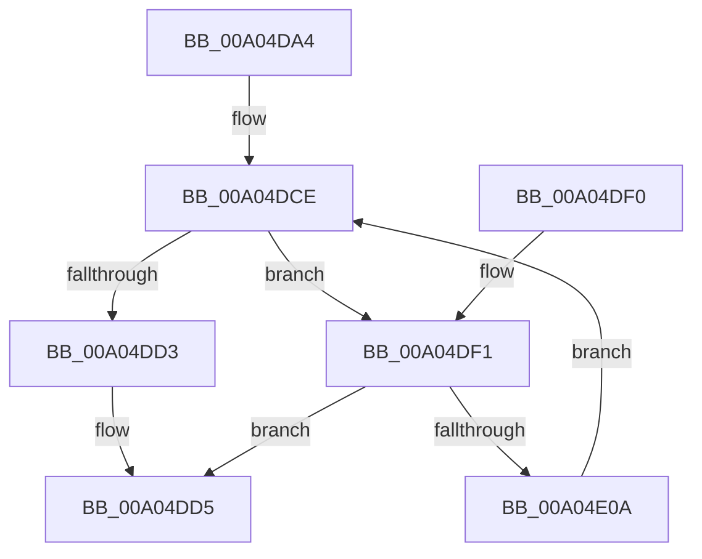

# PnpProcessBusRelations

- RVA: `0x00A04DA4`–`0x00A04E0F` (길이 `107` bytes)
- VA: `0x0000000140A04DA4`
- 실행 섹션: `PAGE`
- PDB 이름 있음: `예`; PDB Function 태그: `아니요`
- unwind 정보 RVA: `0x000A834C`
- 디코드: `33`개 명령, `107/107` bytes 표시
- 미해석 바이트: `0` (있으면 어셈블리에 `.byte`로 보존)

> 이 문서는 커널 이미지의 기계어와 PDB 기호를 분석해 생성했습니다. 4번과 5번은 함수 원형과 자료형을 바이너리 사용 방식에서 추정한 C 해석이며 원본 소스 복구 결과는 아닙니다.

## 1. Dependencies

- 직접 호출 지점: **1**; 고유 호출 대상: **1**
- 직접 호출자로 확인된 함수: **1**
- RIP 상대 이미지 참조: **0**

### Outgoing calls
- `0x00A04E01` → [PnpProcessRelation](PnpProcessRelation_function_00A04A4C.md) (function, `0x00A04A4C`)

### Direct callers
- [PnpProcessRelation](PnpProcessRelation_function_00A04A4C.md) at `0x00A04AE0`
- [PnpProcessRelation](PnpProcessRelation_function_00A04A4C.md) at `0x00A04CEE`

### Static image references
- 디코드된 RIP-relative 메모리 참조가 없습니다.

## 2. Other-region calls and transfers

- 다른 실행 섹션으로 향하는 call: **0**
- 별도 외부 분기/꼬리 이동을 확인하지 못했습니다.

## 3. Assembly (complete function range)

```asm
00A04DA4  48 8B C4                        mov rax, rsp
00A04DA7  48 89 58 08                     mov qword ptr [rax + 8], rbx
00A04DAB  48 89 68 10                     mov qword ptr [rax + 0x10], rbp
00A04DAF  48 89 70 18                     mov qword ptr [rax + 0x18], rsi
00A04DB3  48 89 78 20                     mov qword ptr [rax + 0x20], rdi
00A04DB7  41 56                           push r14
00A04DB9  48 83 EC 30                     sub rsp, 0x30
00A04DBD  48 8B 59 08                     mov rbx, qword ptr [rcx + 8]
00A04DC1  49 8B F9                        mov rdi, r9
00A04DC4  4C 8B 74 24 60                  mov r14, qword ptr [rsp + 0x60]
00A04DC9  41 8B F0                        mov esi, r8d
00A04DCC  8B EA                           mov ebp, edx
00A04DCE  48 85 DB                        test rbx, rbx
00A04DD1  75 1E                           jne 0x140a04df1
00A04DD3  33 C0                           xor eax, eax
00A04DD5  48 8B 5C 24 40                  mov rbx, qword ptr [rsp + 0x40]
00A04DDA  48 8B 6C 24 48                  mov rbp, qword ptr [rsp + 0x48]
00A04DDF  48 8B 74 24 50                  mov rsi, qword ptr [rsp + 0x50]
00A04DE4  48 8B 7C 24 58                  mov rdi, qword ptr [rsp + 0x58]
00A04DE9  48 83 C4 30                     add rsp, 0x30
00A04DED  41 5E                           pop r14
00A04DEF  C3                              ret
00A04DF0  CC                              int3
00A04DF1  4C 8B CF                        mov r9, rdi
00A04DF4  4C 89 74 24 20                  mov qword ptr [rsp + 0x20], r14
00A04DF9  44 8B C6                        mov r8d, esi
00A04DFC  8B D5                           mov edx, ebp
00A04DFE  48 8B CB                        mov rcx, rbx
00A04E01  E8 46 FC FF FF                  call 0x140a04a4c
00A04E06  85 C0                           test eax, eax
00A04E08  78 CB                           js 0x140a04dd5
00A04E0A  48 8B 1B                        mov rbx, qword ptr [rbx]
00A04E0D  EB BF                           jmp 0x140a04dce
```

## 4. C-style interpretation (structured pseudocode)

```c
__int64 __fastcall PnpProcessBusRelations(__int64 a1, int a2, int a3, __int64 a4, __int64 a5)
{
    __int64 result;
    __int64 v_rsp;
    unsigned __int64 v_stack_p10;
    unsigned __int64 v_stack_p18;
    unsigned __int64 v_stack_p20;
    unsigned __int64 v_stack_p8;

    *(unsigned __int64 *)(v_rsp + 8) = v_rbx;
    *(unsigned __int64 *)(v_rsp + 16) = v_rbp;
    *(unsigned __int64 *)(v_rsp + 24) = v_rsi;
    *(unsigned __int64 *)(v_rsp + 32) = v_rdi;
    v_rsp = (v_rsp) - (48);
loc_00A04DCE:
    if (*(unsigned __int64 *)(a1 + 8) != 0) goto loc_00A04DF1;
    result = 0;
loc_00A04DD5:
    v_rsp = (v_rsp) + (48);
    return result;
loc_00A04DF1:
    v_stack_p20 = a5;
    result = PnpProcessRelation(v_stack_p8, (unsigned int)((unsigned int)(v_stack_p10)), (unsigned int)((unsigned int)(v_stack_p18)), v_stack_p20);
    if (sign_flag) goto loc_00A04DD5;
    goto loc_00A04DCE;
}
```

## 5. (Beta) C Style

```c
int64_t PnpProcessBusRelations(void *Arg1, int32_t Arg2, int32_t Arg3, int64_t Arg4, int64_t Arg5)
{
    uint8_t *arg1 = (uint8_t *)Arg1;

    int64_t result;
    int64_t local_rsp;
    uint64_t v_stack_p10;
    uint64_t v_stack_p18;
    uint64_t v_stack_p20;
    uint64_t v_stack_p8;

    *(uint64_t *)(local_rsp + 0x8) = local_rbx;
    *(uint64_t *)(local_rsp + 0x10) = local_rbp;
    *(uint64_t *)(local_rsp + 0x18) = local_rsi;
    *(uint64_t *)(local_rsp + 0x20) = local_rdi;
    local_rsp = (local_rsp) - (48);
loc_00A04DCE:
    if (*(uint64_t *)(arg1 + 0x8) != 0) goto loc_00A04DF1;
    result = 0;
loc_00A04DD5:
    local_rsp = (local_rsp) + (48);
    return result;
loc_00A04DF1:
    v_stack_p20 = Arg5;
    result = PnpProcessRelation(v_stack_p8, (uint32_t)((uint32_t)(v_stack_p10)), (uint32_t)((uint32_t)(v_stack_p18)), v_stack_p20);
    if (sign_flag) goto loc_00A04DD5;
    goto loc_00A04DCE;
}
```

### 관측된 메모리 오프셋

구조체 형식이 확인되지 않은 접근은 인자 기준의 오프셋으로만 기록했습니다.

| 기준 인자 | 오프셋 표현 | 폭 (bit) | 접근 |
|---|---:|---:|---|
| `Arg1` | `+ 0x8` | `64` | `R` |

## 6. Execution-region graph

[열기: 2D/3D 그래프와 함수 탐색 컨트롤 패널](../../../control-panel.html?section=page&rva=0x00A04DA4&view=graph)

- 2D 그래프는 위에서 아래로 흐르고, 3D 그래프는 빈 공간을 드래그해 회전합니다. Shift+드래그는 이동, 휠은 확대·축소, 함수 노드 선택은 대상 보고서 이동입니다.

### Static fallback


