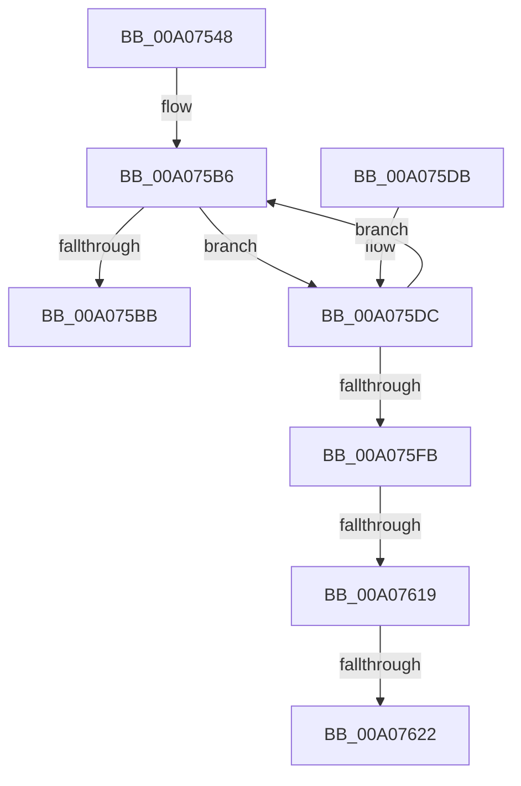

# PnpProcessDependencyRelations

- RVA: `0x00A07548`–`0x00A07631` (길이 `233` bytes)
- VA: `0x0000000140A07548`
- 실행 섹션: `PAGE`
- PDB 이름 있음: `예`; PDB Function 태그: `예`
- unwind 정보 RVA: `0x000A860C`
- 디코드: `62`개 명령, `233/233` bytes 표시
- 미해석 바이트: `0` (있으면 어셈블리에 `.byte`로 보존)

> 이 문서는 커널 이미지의 기계어와 PDB 기호를 분석해 생성했습니다. 4번과 5번은 함수 원형과 자료형을 바이너리 사용 방식에서 추정한 C 해석이며 원본 소스 복구 결과는 아닙니다.

## 1. Dependencies

- 직접 호출 지점: **6**; 고유 호출 대상: **5**
- 직접 호출자로 확인된 함수: **1**
- RIP 상대 이미지 참조: **2**

### Outgoing calls
- `0x00A0758D` → [ExAcquireResourceSharedLite](../../text/21/ExAcquireResourceSharedLite_function_00211BC0.md) (function, `0x00211BC0`)
- `0x00A0759B` → [ExAcquireResourceSharedLite](../../text/21/ExAcquireResourceSharedLite_function_00211BC0.md) (function, `0x00211BC0`)
- `0x00A075A3` → [PiGetDependentList](PiGetDependentList_function_00A074BC.md) (function, `0x00A074BC`)
- `0x00A075BB` → [PnpReleaseDependencyRelationsLock](PnpReleaseDependencyRelationsLock_function_00A06E14.md) (function, `0x00A06E14`)
- `0x00A075E9` → [PiEnumerateDependentListEntry](../70/PiEnumerateDependentListEntry_function_00703008.md) (function, `0x00703008`)
- `0x00A07625` → [PipIsDevNodeDNStarted](../../text/47/PipIsDevNodeDNStarted_function_00470870.md) (function, `0x00470870`)

### Direct callers
- [PnpProcessRelation](PnpProcessRelation_function_00A04A4C.md) at `0x00A04B58`

### Static image references
- `0x00A0756E` → RVA `0x00F8C560` (`.data`; read)
- `0x00A07594` → RVA `0x00F8CEA0` (`.data`; read)

## 2. Other-region calls and transfers

- 다른 실행 섹션으로 향하는 call: **3**
  - `0x00A0758D` → [ExAcquireResourceSharedLite](../../text/21/ExAcquireResourceSharedLite_function_00211BC0.md) (`PAGE` → `.text`)
  - `0x00A0759B` → [ExAcquireResourceSharedLite](../../text/21/ExAcquireResourceSharedLite_function_00211BC0.md) (`PAGE` → `.text`)
  - `0x00A07625` → [PipIsDevNodeDNStarted](../../text/47/PipIsDevNodeDNStarted_function_00470870.md) (`PAGE` → `.text`)
- call이 아닌 외부 분기/꼬리 이동: **3**
  - `0x00A07613` → [sub_00B34656](../B3/Unknown_function_00B34656.md) (`tail-transfer`)
  - `0x00A0761C` → [sub_00B34656](../B3/Unknown_function_00B34656.md) (`tail-transfer`)
  - `0x00A0762C` → [sub_00B34656 + 0x11](../B3/Unknown_function_00B34656.md) (`tail-transfer`)

## 3. Assembly (complete function range)

```asm
00A07548  48 89 5C 24 10                  mov qword ptr [rsp + 0x10], rbx
00A0754D  48 89 6C 24 18                  mov qword ptr [rsp + 0x18], rbp
00A07552  56                              push rsi
00A07553  57                              push rdi
00A07554  41 54                           push r12
00A07556  41 56                           push r14
00A07558  41 57                           push r15
00A0755A  48 83 EC 40                     sub rsp, 0x40
00A0755E  48 8B 59 20                     mov rbx, qword ptr [rcx + 0x20]
00A07562  44 8B FA                        mov r15d, edx
00A07565  65 48 8B 04 25 88 01 00 00      mov rax, qword ptr gs:[0x188]
00A0756E  48 8D 0D EB 4F 58 00            lea rcx, [rip + 0x584feb]
00A07575  48 83 64 24 30 00               and qword ptr [rsp + 0x30], 0
00A0757B  33 FF                           xor edi, edi
00A0757D  B2 01                           mov dl, 1
00A0757F  49 8B E9                        mov rbp, r9
00A07582  45 8B F0                        mov r14d, r8d
00A07585  66 FF 88 E4 01 00 00            dec word ptr [rax + 0x1e4]
00A0758C  90                              nop
00A0758D  E8 2E A6 80 FF                  call 0x140211bc0
00A07592  B2 01                           mov dl, 1
00A07594  48 8D 0D 05 59 58 00            lea rcx, [rip + 0x585905]
00A0759B  E8 20 A6 80 FF                  call 0x140211bc0
00A075A0  48 8B CB                        mov rcx, rbx
00A075A3  E8 14 FF FF FF                  call 0x140a074bc
00A075A8  4C 8B A4 24 90 00 00 00         mov r12, qword ptr [rsp + 0x90]
00A075B0  48 8B F0                        mov rsi, rax
00A075B3  48 8B 18                        mov rbx, qword ptr [rax]
00A075B6  48 3B DE                        cmp rbx, rsi
00A075B9  75 21                           jne 0x140a075dc
00A075BB  E8 54 F8 FF FF                  call 0x140a06e14
00A075C0  4C 8D 5C 24 40                  lea r11, [rsp + 0x40]
00A075C5  8B C7                           mov eax, edi
00A075C7  49 8B 5B 38                     mov rbx, qword ptr [r11 + 0x38]
00A075CB  49 8B 6B 40                     mov rbp, qword ptr [r11 + 0x40]
00A075CF  49 8B E3                        mov rsp, r11
00A075D2  41 5F                           pop r15
00A075D4  41 5E                           pop r14
00A075D6  41 5C                           pop r12
00A075D8  5F                              pop rdi
00A075D9  5E                              pop rsi
00A075DA  C3                              ret
00A075DB  CC                              int3
00A075DC  4C 8D 44 24 70                  lea r8, [rsp + 0x70]
00A075E1  48 8B CB                        mov rcx, rbx
00A075E4  48 8D 54 24 30                  lea rdx, [rsp + 0x30]
00A075E9  E8 1A BA CF FF                  call 0x140703008
00A075EE  48 8B 44 24 30                  mov rax, qword ptr [rsp + 0x30]
00A075F3  48 8B 1B                        mov rbx, qword ptr [rbx]
00A075F6  48 85 C0                        test rax, rax
00A075F9  74 BB                           je 0x140a075b6
00A075FB  48 8B 80 38 01 00 00            mov rax, qword ptr [rax + 0x138]
00A07602  4C 8B 50 28                     mov r10, qword ptr [rax + 0x28]
00A07606  41 8B 8A 2C 01 00 00            mov ecx, dword ptr [r10 + 0x12c]
00A0760D  81 E9 10 03 00 00               sub ecx, 0x310
00A07613  0F 84 3D D0 12 00               je 0x140b34656
00A07619  83 E9 01                        sub ecx, 1
00A0761C  0F 84 34 D0 12 00               je 0x140b34656
00A07622  49 8B CA                        mov rcx, r10
00A07625  E8 46 92 A6 FF                  call 0x140470870
00A0762A  84 C0                           test al, al
00A0762C  E9 36 D0 12 00                  jmp 0x140b34667
```

## 4. C-style interpretation (structured pseudocode)

```c
__int64 __fastcall PnpProcessDependencyRelations(__int64 a1, int a2, int a3, __int64 a4, __int64 a5)
{
    __int64 result;
    __int64 v_rdi;
    __int64 v_rsp;
    unsigned __int64 v_stack_m10;
    unsigned __int64 v_stack_m28;
    unsigned __int64 v_stack_m38;
    unsigned __int64 v_stack_p10;
    unsigned __int64 v_stack_p18;
    unsigned __int64 v_stack_p30;

    v_stack_p10 = v_rbx;
    v_stack_p18 = v_rbp;
    v_rsp = (v_rsp) - (64);
    v_rdi = 0;
    result = ExAcquireResourceSharedLite(v_rip + 5787627, 1, a3, a4);
    result = ExAcquireResourceSharedLite(v_rip + 5789957, 1, a3, a4);
    result = PiGetDependentList(*(unsigned __int64 *)(a1 + 32), 1, a3, a4);
loc_00A075B6:
    if ((*(unsigned __int64 *)(result)) != result) goto loc_00A075DC;
    result = PnpReleaseDependencyRelationsLock(*(unsigned __int64 *)(a1 + 32), 1, a3, a4);
    return 0;
loc_00A075DC:
    result = PiEnumerateDependentListEntry(*(unsigned __int64 *)(v_stack_m28 + 56), v_stack_m10, v_stack_p30, a4);
    if (v_stack_m10 == 0) goto loc_00A075B6;
    a1 = (unsigned int)(((unsigned int)(*(unsigned int *)(*(unsigned __int64 *)(*(unsigned __int64 *)(v_stack_m10 + 312) + 40) + 300))) - (784));
    a1 = (unsigned int)((a1) - (1));
    result = PipIsDevNodeDNStarted(*(unsigned __int64 *)(*(unsigned __int64 *)(v_stack_m10 + 312) + 40), v_stack_m10, v_stack_p30, a4);
}
```

## 5. (Beta) C Style

```c
int64_t PnpProcessDependencyRelations(void *Arg1, int32_t Arg2, int32_t Arg3, int64_t Arg4, int64_t Arg5)
{
    uint8_t *arg1 = (uint8_t *)Arg1;

    int64_t result;
    int64_t local_rdi;
    int64_t local_rsp;
    uint64_t v_stack_m10;
    uint64_t v_stack_m28;
    uint64_t v_stack_m38;
    uint64_t v_stack_p10;
    uint64_t v_stack_p18;
    uint64_t v_stack_p30;

    v_stack_p10 = local_rbx;
    v_stack_p18 = local_rbp;
    local_rsp = (local_rsp) - (64);
    local_rdi = 0;
    result = ExAcquireResourceSharedLite(v_rip + 5787627, 1, Arg3, Arg4);
    result = ExAcquireResourceSharedLite(v_rip + 5789957, 1, Arg3, Arg4);
    result = PiGetDependentList(*(uint64_t *)(arg1 + 0x20), 1, Arg3, Arg4);
loc_00A075B6:
    if ((*(uint64_t *)(result)) != result) goto loc_00A075DC;
    result = PnpReleaseDependencyRelationsLock(*(uint64_t *)(arg1 + 0x20), 1, Arg3, Arg4);
    return 0;
loc_00A075DC:
    result = PiEnumerateDependentListEntry(*(uint64_t *)(v_stack_m28 + 0x38), v_stack_m10, v_stack_p30, Arg4);
    if (v_stack_m10 == 0) goto loc_00A075B6;
    Arg1 = (uint32_t)(((uint32_t)(*(uint32_t *)(*(uint64_t *)(*(uint64_t *)(v_stack_m10 + 0x138) + 0x28) + 0x12C))) - (784));
    Arg1 = (uint32_t)((Arg1) - (1));
    result = PipIsDevNodeDNStarted(*(uint64_t *)(*(uint64_t *)(v_stack_m10 + 0x138) + 0x28), v_stack_m10, v_stack_p30, Arg4);
}
```

### 관측된 메모리 오프셋

구조체 형식이 확인되지 않은 접근은 인자 기준의 오프셋으로만 기록했습니다.

| 기준 인자 | 오프셋 표현 | 폭 (bit) | 접근 |
|---|---:|---:|---|
| `Arg1` | `+ 0x20` | `64` | `R` |

## 6. Execution-region graph

[열기: 2D/3D 그래프와 함수 탐색 컨트롤 패널](../../../control-panel.html?section=page&rva=0x00A07548&view=graph)

- 2D 그래프는 위에서 아래로 흐르고, 3D 그래프는 빈 공간을 드래그해 회전합니다. Shift+드래그는 이동, 휠은 확대·축소, 함수 노드 선택은 대상 보고서 이동입니다.

### Static fallback


