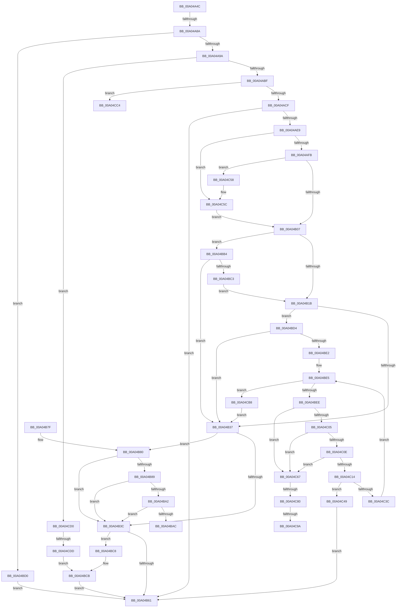

# PnpProcessRelation

- RVA: `0x00A04A4C`–`0x00A04CFB` (길이 `687` bytes)
- VA: `0x0000000140A04A4C`
- 실행 섹션: `PAGE`
- PDB 이름 있음: `예`; PDB Function 태그: `예`
- unwind 정보 RVA: `0x000A830C`
- 디코드: `177`개 명령, `687/687` bytes 표시
- 미해석 바이트: `0` (있으면 어셈블리에 `.byte`로 보존)

> 이 문서는 커널 이미지의 기계어와 PDB 기호를 분석해 생성했습니다. 4번과 5번은 함수 원형과 자료형을 바이너리 사용 방식에서 추정한 C 해석이며 원본 소스 복구 결과는 아닙니다.

## 1. Dependencies

- 직접 호출 지점: **14**; 고유 호출 대상: **8**
- 직접 호출자로 확인된 함수: **5**
- RIP 상대 이미지 참조: **1**

### Outgoing calls
- `0x00A04AAF` → [IopAddRelationToList](IopAddRelationToList_function_00A04D04.md) (function, `0x00A04D04`)
- `0x00A04AE0` → [PnpProcessBusRelations](PnpProcessBusRelations_function_00A04DA4.md) (function, `0x00A04DA4`)
- `0x00A04B2A` → [PnpQueryDeviceRelations](../8F/PnpQueryDeviceRelations_function_008F9FE0.md) (function, `0x008F9FE0`)
- `0x00A04B58` → [PnpProcessDependencyRelations](PnpProcessDependencyRelations_function_00A07548.md) (function, `0x00A07548`)
- `0x00A04B99` → [PnpQueryDeviceRelations](../8F/PnpQueryDeviceRelations_function_008F9FE0.md) (function, `0x008F9FE0`)
- `0x00A04C22` → [PnpProcessRelation](PnpProcessRelation_function_00A04A4C.md) (function, `0x00A04A4C`)
- `0x00A04C2D` → [ObfDereferenceObject](../../text/2F/ObfDereferenceObject_function_002F9350.md) (function, `0x002F9350`)
- `0x00A04C4B` → [ExFreePoolWithTag](../../poolcode/B8/ExFreePoolWithTag_function_00B82870.md) (function, `0x00B82870`)
- `0x00A04C6E` → [IoAddTriageDumpDataBlock](../../text/42/IoAddTriageDumpDataBlock_function_00428374.md) (function, `0x00428374`)
- `0x00A04C84` → [IoAddTriageDumpDataBlock](../../text/42/IoAddTriageDumpDataBlock_function_00428374.md) (function, `0x00428374`)
- `0x00A04C9C` → [IoAddTriageDumpDataBlock](../../text/42/IoAddTriageDumpDataBlock_function_00428374.md) (function, `0x00428374`)
- `0x00A04CAD` → [IoAddTriageDumpDataBlock](../../text/42/IoAddTriageDumpDataBlock_function_00428374.md) (function, `0x00428374`)
- `0x00A04CBA` → [ExFreePoolWithTag](../../poolcode/B8/ExFreePoolWithTag_function_00B82870.md) (function, `0x00B82870`)
- `0x00A04CEE` → [PnpProcessBusRelations](PnpProcessBusRelations_function_00A04DA4.md) (function, `0x00A04DA4`)

### Direct callers
- [PnpProcessRelation](PnpProcessRelation_function_00A04A4C.md) at `0x00A04C22`
- [PnpProcessBusRelations](PnpProcessBusRelations_function_00A04DA4.md) at `0x00A04E01`
- [PnpBuildRemovalRelationList](PnpBuildRemovalRelationList_function_00A058D0.md) at `0x00A05943`
- [sub_00B336B0](../B3/Unknown_function_00B336B0.md) at `0x00B33816`
- [sub_00B34656](../B3/Unknown_function_00B34656.md) at `0x00B3467A`

### Static image references
- `0x00A04CC4` → RVA `0x00F8C450` (`.data`; read)

## 2. Other-region calls and transfers

- 다른 실행 섹션으로 향하는 call: **7**
  - `0x00A04C2D` → [ObfDereferenceObject](../../text/2F/ObfDereferenceObject_function_002F9350.md) (`PAGE` → `.text`)
  - `0x00A04C4B` → [ExFreePoolWithTag](../../poolcode/B8/ExFreePoolWithTag_function_00B82870.md) (`PAGE` → `POOLCODE`)
  - `0x00A04C6E` → [IoAddTriageDumpDataBlock](../../text/42/IoAddTriageDumpDataBlock_function_00428374.md) (`PAGE` → `.text`)
  - `0x00A04C84` → [IoAddTriageDumpDataBlock](../../text/42/IoAddTriageDumpDataBlock_function_00428374.md) (`PAGE` → `.text`)
  - `0x00A04C9C` → [IoAddTriageDumpDataBlock](../../text/42/IoAddTriageDumpDataBlock_function_00428374.md) (`PAGE` → `.text`)
  - `0x00A04CAD` → [IoAddTriageDumpDataBlock](../../text/42/IoAddTriageDumpDataBlock_function_00428374.md) (`PAGE` → `.text`)
  - `0x00A04CBA` → [ExFreePoolWithTag](../../poolcode/B8/ExFreePoolWithTag_function_00B82870.md) (`PAGE` → `POOLCODE`)
- call이 아닌 외부 분기/꼬리 이동: **7**
  - `0x00A04A84` → [sub_00B336B0](../B3/Unknown_function_00B336B0.md) (`tail-transfer`)
  - `0x00A04BAF` → [sub_00B336B0 + 0x129](../B3/Unknown_function_00B336B0.md) (`tail-transfer`)
  - `0x00A04C7A` → [sub_00B336B0 + 0x5C](../B3/Unknown_function_00B336B0.md) (`tail-transfer`)
  - `0x00A04C94` → [sub_00B336B0 + 0x5C](../B3/Unknown_function_00B336B0.md) (`tail-transfer`)
  - `0x00A04CB3` → [sub_00B336B0 + 0x5C](../B3/Unknown_function_00B336B0.md) (`tail-transfer`)
  - `0x00A04CCB` → [sub_00B336B0 + 0x2AE](../B3/Unknown_function_00B336B0.md) (`tail-transfer`)
  - `0x00A04CD7` → [sub_00B336B0 + 0x524](../B3/Unknown_function_00B336B0.md) (`tail-transfer`)

## 3. Assembly (complete function range)

```asm
00A04A4C  48 8B C4                        mov rax, rsp
00A04A4F  48 89 58 08                     mov qword ptr [rax + 8], rbx
00A04A53  48 89 68 10                     mov qword ptr [rax + 0x10], rbp
00A04A57  48 89 70 20                     mov qword ptr [rax + 0x20], rsi
00A04A5B  44 89 40 18                     mov dword ptr [rax + 0x18], r8d
00A04A5F  57                              push rdi
00A04A60  41 54                           push r12
00A04A62  41 55                           push r13
00A04A64  41 56                           push r14
00A04A66  41 57                           push r15
00A04A68  48 83 EC 40                     sub rsp, 0x40
00A04A6C  33 DB                           xor ebx, ebx
00A04A6E  4D 8B F1                        mov r14, r9
00A04A71  48 89 58 C8                     mov qword ptr [rax - 0x38], rbx
00A04A75  41 8B E8                        mov ebp, r8d
00A04A78  44 8B EA                        mov r13d, edx
00A04A7B  48 8B F9                        mov rdi, rcx
00A04A7E  F7 C2 FB FF FF FF               test edx, 0xfffffffb
00A04A84  0F 84 26 EC 12 00               je 0x140b336b0
00A04A8A  81 B9 2C 01 00 00 16 03 00 00   cmp dword ptr [rcx + 0x12c], 0x316
00A04A94  0F 84 36 01 00 00               je 0x140a04bd0
00A04A9A  4C 8B A4 24 90 00 00 00         mov r12, qword ptr [rsp + 0x90]
00A04AA2  48 8D 77 20                     lea rsi, [rdi + 0x20]
00A04AA6  48 8B 16                        mov rdx, qword ptr [rsi]
00A04AA9  49 8B CC                        mov rcx, r12
00A04AAC  45 33 C9                        xor r9d, r9d
00A04AAF  E8 50 02 00 00                  call 0x140a04d04
00A04AB4  4C 63 F8                        movsxd r15, eax
00A04AB7  85 C0                           test eax, eax
00A04AB9  0F 85 11 02 00 00               jne 0x140a04cd0
00A04ABF  F7 87 8C 01 00 00 00 00 08 00   test dword ptr [rdi + 0x18c], 0x80000
00A04AC9  0F 85 F5 01 00 00               jne 0x140a04cc4
00A04ACF  4D 8B CE                        mov r9, r14
00A04AD2  4C 89 64 24 20                  mov qword ptr [rsp + 0x20], r12
00A04AD7  44 8B C5                        mov r8d, ebp
00A04ADA  41 8B D5                        mov edx, r13d
00A04ADD  48 8B CF                        mov rcx, rdi
00A04AE0  E8 BF 02 00 00                  call 0x140a04da4
00A04AE5  85 C0                           test eax, eax
00A04AE7  78 78                           js 0x140a04b61
00A04AE9  8B 8F 2C 01 00 00               mov ecx, dword ptr [rdi + 0x12c]
00A04AEF  81 F9 11 03 00 00               cmp ecx, 0x311
00A04AF5  0F 84 61 01 00 00               je 0x140a04c5c
00A04AFB  81 F9 10 03 00 00               cmp ecx, 0x310
00A04B01  0F 84 51 01 00 00               je 0x140a04c58
00A04B07  8D 81 F7 FC FF FF               lea eax, [rcx - 0x309]
00A04B0D  BD 02 00 00 00                  mov ebp, 2
00A04B12  83 F8 01                        cmp eax, 1
00A04B15  0F 87 99 00 00 00               ja 0x140a04bb4
00A04B1B  48 8B 0E                        mov rcx, qword ptr [rsi]
00A04B1E  4C 8D 4C 24 30                  lea r9, [rsp + 0x30]
00A04B23  45 33 C0                        xor r8d, r8d
00A04B26  41 8D 50 03                     lea edx, [r8 + 3]
00A04B2A  E8 B1 54 EF FF                  call 0x1408f9fe0
00A04B2F  85 C0                           test eax, eax
00A04B31  0F 89 9D 00 00 00               jns 0x140a04bd4
00A04B37  45 85 ED                        test r13d, r13d
00A04B3A  75 44                           jne 0x140a04b80
00A04B3C  39 9C 24 80 00 00 00            cmp dword ptr [rsp + 0x80], ebx
00A04B43  44 8B C3                        mov r8d, ebx
00A04B46  4D 8B CE                        mov r9, r14
00A04B49  4C 89 64 24 20                  mov qword ptr [rsp + 0x20], r12
00A04B4E  41 0F 95 C0                     setne r8b
00A04B52  41 8B D5                        mov edx, r13d
00A04B55  48 8B CF                        mov rcx, rdi
00A04B58  E8 EB 29 00 00                  call 0x140a07548
00A04B5D  85 C0                           test eax, eax
00A04B5F  79 67                           jns 0x140a04bc8
00A04B61  4C 8D 5C 24 40                  lea r11, [rsp + 0x40]
00A04B66  49 8B 5B 30                     mov rbx, qword ptr [r11 + 0x30]
00A04B6A  49 8B 6B 38                     mov rbp, qword ptr [r11 + 0x38]
00A04B6E  49 8B 73 48                     mov rsi, qword ptr [r11 + 0x48]
00A04B72  49 8B E3                        mov rsp, r11
00A04B75  41 5F                           pop r15
00A04B77  41 5E                           pop r14
00A04B79  41 5D                           pop r13
00A04B7B  41 5C                           pop r12
00A04B7D  5F                              pop rdi
00A04B7E  C3                              ret
00A04B7F  CC                              int3
00A04B80  41 8D 45 FB                     lea eax, [r13 - 5]
00A04B84  83 F8 01                        cmp eax, 1
00A04B87  76 B3                           jbe 0x140a04b3c
00A04B89  48 8B 4F 20                     mov rcx, qword ptr [rdi + 0x20]
00A04B8D  4C 8D 4C 24 30                  lea r9, [rsp + 0x30]
00A04B92  45 33 C0                        xor r8d, r8d
00A04B95  41 8D 50 01                     lea edx, [r8 + 1]
00A04B99  E8 42 54 EF FF                  call 0x1408f9fe0
00A04B9E  85 C0                           test eax, eax
00A04BA0  78 9A                           js 0x140a04b3c
00A04BA2  48 8B 4C 24 30                  mov rcx, qword ptr [rsp + 0x30]
00A04BA7  48 85 C9                        test rcx, rcx
00A04BAA  74 90                           je 0x140a04b3c
00A04BAC  44 8B FB                        mov r15d, ebx
00A04BAF  E9 25 EC 12 00                  jmp 0x140b337d9
00A04BB4  8D 81 F4 FC FF FF               lea eax, [rcx - 0x30c]
00A04BBA  83 F8 01                        cmp eax, 1
00A04BBD  0F 87 74 FF FF FF               ja 0x140a04b37
00A04BC3  E9 53 FF FF FF                  jmp 0x140a04b1b
00A04BC8  44 8B FB                        mov r15d, ebx
00A04BCB  41 8B C7                        mov eax, r15d
00A04BCE  EB 91                           jmp 0x140a04b61
00A04BD0  33 C0                           xor eax, eax
00A04BD2  EB 8D                           jmp 0x140a04b61
00A04BD4  48 8B 4C 24 30                  mov rcx, qword ptr [rsp + 0x30]
00A04BD9  48 85 C9                        test rcx, rcx
00A04BDC  0F 84 55 FF FF FF               je 0x140a04b37
00A04BE2  44 8B FB                        mov r15d, ebx
00A04BE5  44 3B 39                        cmp r15d, dword ptr [rcx]
00A04BE8  0F 83 CA 00 00 00               jae 0x140a04cb8
00A04BEE  41 8B C7                        mov eax, r15d
00A04BF1  48 8B 74 C1 08                  mov rsi, qword ptr [rcx + rax*8 + 8]
00A04BF6  48 8B 8E 38 01 00 00            mov rcx, qword ptr [rsi + 0x138]
00A04BFD  8B 41 20                        mov eax, dword ptr [rcx + 0x20]
00A04C00  40 84 C5                        test bpl, al
00A04C03  75 62                           jne 0x140a04c67
00A04C05  48 8B 49 28                     mov rcx, qword ptr [rcx + 0x28]
00A04C09  48 85 C9                        test rcx, rcx
00A04C0C  74 59                           je 0x140a04c67
00A04C0E  48 39 59 10                     cmp qword ptr [rcx + 0x10], rbx
00A04C12  74 53                           je 0x140a04c67
00A04C14  4D 8B CE                        mov r9, r14
00A04C17  4C 89 64 24 20                  mov qword ptr [rsp + 0x20], r12
00A04C1C  45 33 C0                        xor r8d, r8d
00A04C1F  41 8B D5                        mov edx, r13d
00A04C22  E8 25 FE FF FF                  call 0x140a04a4c
00A04C27  48 8B CE                        mov rcx, rsi
00A04C2A  44 8B E0                        mov r12d, eax
00A04C2D  E8 1E 47 8F FF                  call 0x1402f9350
00A04C32  48 8B 4C 24 30                  mov rcx, qword ptr [rsp + 0x30]
00A04C37  45 85 E4                        test r12d, r12d
00A04C3A  78 0D                           js 0x140a04c49
00A04C3C  4C 8B A4 24 90 00 00 00         mov r12, qword ptr [rsp + 0x90]
00A04C44  41 FF C7                        inc r15d
00A04C47  EB 9C                           jmp 0x140a04be5
00A04C49  33 D2                           xor edx, edx
00A04C4B  E8 20 DC 17 00                  call 0x140b82870
00A04C50  41 8B C4                        mov eax, r12d
00A04C53  E9 09 FF FF FF                  jmp 0x140a04b61
00A04C58  48 8D 77 20                     lea rsi, [rdi + 0x20]
00A04C5C  8B 8F 30 01 00 00               mov ecx, dword ptr [rdi + 0x130]
00A04C62  E9 A0 FE FF FF                  jmp 0x140a04b07
00A04C67  0F B7 56 02                     movzx edx, word ptr [rsi + 2]
00A04C6B  48 8B CE                        mov rcx, rsi
00A04C6E  E8 01 37 A2 FF                  call 0x140428374
00A04C73  48 8B 4E 08                     mov rcx, qword ptr [rsi + 8]
00A04C77  48 85 C9                        test rcx, rcx
00A04C7A  0F 84 8C EA 12 00               je 0x140b3370c
00A04C80  0F BF 51 02                     movsx edx, word ptr [rcx + 2]
00A04C84  E8 EB 36 A2 FF                  call 0x140428374
00A04C89  48 8B 4E 08                     mov rcx, qword ptr [rsi + 8]
00A04C8D  48 83 C1 38                     add rcx, 0x38
00A04C91  66 39 19                        cmp word ptr [rcx], bx
00A04C94  0F 84 72 EA 12 00               je 0x140b3370c
00A04C9A  8B D5                           mov edx, ebp
00A04C9C  E8 D3 36 A2 FF                  call 0x140428374
00A04CA1  48 8B 4E 08                     mov rcx, qword ptr [rsi + 8]
00A04CA5  0F B7 51 38                     movzx edx, word ptr [rcx + 0x38]
00A04CA9  48 8B 49 40                     mov rcx, qword ptr [rcx + 0x40]
00A04CAD  E8 C2 36 A2 FF                  call 0x140428374
00A04CB2  90                              nop
00A04CB3  E9 54 EA 12 00                  jmp 0x140b3370c
00A04CB8  33 D2                           xor edx, edx
00A04CBA  E8 B1 DB 17 00                  call 0x140b82870
00A04CBF  E9 73 FE FF FF                  jmp 0x140a04b37
00A04CC4  4C 8B 35 85 77 58 00            mov r14, qword ptr [rip + 0x587785]
00A04CCB  E9 8E EC 12 00                  jmp 0x140b3395e
00A04CD0  41 81 FF 35 00 00 C0            cmp r15d, 0xc0000035
00A04CD7  0F 85 F7 EE 12 00               jne 0x140b33bd4
00A04CDD  4D 8B CE                        mov r9, r14
00A04CE0  4C 89 64 24 20                  mov qword ptr [rsp + 0x20], r12
00A04CE5  44 8B C5                        mov r8d, ebp
00A04CE8  41 8B D5                        mov edx, r13d
00A04CEB  48 8B CF                        mov rcx, rdi
00A04CEE  E8 B1 00 00 00                  call 0x140a04da4
00A04CF3  44 8B F8                        mov r15d, eax
00A04CF6  E9 D0 FE FF FF                  jmp 0x140a04bcb
```

## 4. C-style interpretation (structured pseudocode)

```c
__int64 __fastcall PnpProcessRelation(__int64 a1, int a2, int a3, __int64 a4, __int64 a5)
{
    __int64 result;
    __int64 v_r15;
    __int64 v_rbx;
    __int64 v_rsp;
    unsigned __int64 v_stack_m10;
    unsigned __int64 v_stack_m20;
    unsigned __int64 v_stack_m28;
    unsigned __int64 v_stack_m38;
    unsigned __int64 v_stack_m48;
    unsigned int v_stack_p18;

    *(unsigned __int64 *)(v_rsp + 8) = v_rbx;
    *(unsigned __int64 *)(v_rsp + 16) = v_rbp;
    *(unsigned __int64 *)(v_rsp + 32) = v_rsi;
    *(unsigned int *)(v_rsp + 24) = a3;
    v_rsp = (v_rsp) - (64);
    v_rbx = 0;
    *(unsigned __int64 *)(v_rsp - 56) = 0;
    if ((*(unsigned int *)(a1 + 300)) == 790) goto loc_00A04BD0;
    a4 = 0;
    result = IopAddRelationToList(a5, *(unsigned __int64 *)(a1 + 32), a3, a4);
    if ((unsigned int)(result) != 0) goto loc_00A04CD0;
    if (((*(unsigned int *)(a1 + 396)) & (0x80000ULL)) != 0) goto loc_00A04CC4;
    v_stack_m48 = a5;
    result = PnpProcessBusRelations(a1, (unsigned int)((unsigned int)((unsigned int)(a2))), (unsigned int)((unsigned int)((unsigned int)(a3))), 0);
    if (sign_flag) goto loc_00A04B61;
    if (((unsigned int)((unsigned int)(*(unsigned int *)(a1 + 300)))) == 785) goto loc_00A04C5C;
    if (((unsigned int)((unsigned int)(*(unsigned int *)(a1 + 300)))) == 784) goto loc_00A04C58;
loc_00A04B07:
    if (((unsigned int)((unsigned int)(*(unsigned int *)(a1 + 300)) - 777)) > 1) goto loc_00A04BB4;
loc_00A04B1B:
    a3 = 0;
    result = PnpQueryDeviceRelations(*(unsigned __int64 *)(a1 + 32), a3 + 3, a3, v_stack_m38);
    if (!sign_flag) goto loc_00A04BD4;
loc_00A04B37:
    if ((unsigned int)((unsigned int)(a2)) != 0) goto loc_00A04B80;
loc_00A04B3C:
    v_stack_m48 = a5;
    a3 = (v_stack_p18 != 0) ? 1 : 0;
    result = PnpProcessDependencyRelations(a1, (unsigned int)((unsigned int)((unsigned int)(a2))), a3, 0);
    if (!sign_flag) goto loc_00A04BC8;
loc_00A04B61:
    return result;
loc_00A04B80:
    if (((unsigned int)((unsigned int)(a2) - 5)) <= 1) goto loc_00A04B3C;
    a3 = 0;
    result = PnpQueryDeviceRelations(*(unsigned __int64 *)(a1 + 32), a3 + 1, a3, v_stack_m10);
    if (sign_flag) goto loc_00A04B3C;
    if (v_stack_m10 == 0) goto loc_00A04B3C;
loc_00A04BB4:
    if (((unsigned int)(v_stack_m10 - 780)) > 1) goto loc_00A04B37;
    goto loc_00A04B1B;
loc_00A04BC8:
loc_00A04BCB:
    goto loc_00A04B61;
loc_00A04BD0:
    result = 0;
    goto loc_00A04B61;
loc_00A04BD4:
    if (v_stack_m10 == 0) goto loc_00A04B37;
loc_00A04BE5:
    if (((unsigned int)((unsigned int)((unsigned int)(*(unsigned __int64 *)(v_stack_m28 + 48))))) >= (*(unsigned int *)(v_stack_m10))) goto loc_00A04CB8;
    if ((((unsigned __int8)(*(unsigned __int64 *)(v_stack_m28 + 56))) & ((unsigned __int8)((unsigned int)(*(unsigned int *)(*(unsigned __int64 *)(*(unsigned __int64 *)(v_stack_m10 + (unsigned int)((unsigned int)((unsigned int)((unsigned int)(*(unsigned __int64 *)(v_stack_m28 + 48))))) * 8 + 8) + 312) + 32))))) != 0) goto loc_00A04C67;
    if (*(unsigned __int64 *)(*(unsigned __int64 *)(*(unsigned __int64 *)(v_stack_m10 + (unsigned int)((unsigned int)((unsigned int)((unsigned int)(*(unsigned __int64 *)(v_stack_m28 + 48))))) * 8 + 8) + 312) + 40) == 0) goto loc_00A04C67;
    if ((*(unsigned __int64 *)(*(unsigned __int64 *)(*(unsigned __int64 *)(*(unsigned __int64 *)(v_stack_m10 + (unsigned int)((unsigned int)((unsigned int)((unsigned int)(*(unsigned __int64 *)(v_stack_m28 + 48))))) * 8 + 8) + 312) + 40) + 16)) == (*(unsigned __int64 *)(v_stack_m28 + 48))) goto loc_00A04C67;
    v_stack_m20 = a5;
    a3 = 0;
    result = PnpProcessRelation(*(unsigned __int64 *)(*(unsigned __int64 *)(*(unsigned __int64 *)(v_stack_m10 + (unsigned int)((unsigned int)((unsigned int)((unsigned int)(*(unsigned __int64 *)(v_stack_m28 + 48))))) * 8 + 8) + 312) + 40), (unsigned int)((unsigned int)((unsigned int)(a2))), a3, 0);
    result = ObfDereferenceObject(*(unsigned __int64 *)(v_stack_m10 + (unsigned int)((unsigned int)((unsigned int)((unsigned int)(*(unsigned __int64 *)(v_stack_m28 + 48))))) * 8 + 8), (unsigned int)((unsigned int)((unsigned int)(a2))), a3, 0);
    if (sign_flag) goto loc_00A04C49;
    v_r15 = (unsigned int)(((unsigned int)((unsigned int)(*(unsigned __int64 *)(v_stack_m28 + 48)))) + 1);
    goto loc_00A04BE5;
loc_00A04C49:
    a2 = 0;
    result = ExFreePoolWithTag(v_stack_m10, a2, a3, 0);
    goto loc_00A04B61;
loc_00A04C58:
loc_00A04C5C:
    goto loc_00A04B07;
loc_00A04C67:
    result = IoAddTriageDumpDataBlock(a1 + 32, *(unsigned __int16 *)(a1 + 32 + 2), a3, 0);
    result = IoAddTriageDumpDataBlock(*(unsigned __int64 *)(a1 + 32 + 8), (__int16)(*(unsigned __int16 *)(*(unsigned __int64 *)(a1 + 32 + 8) + 2)), a3, 0);
    a1 = (*(unsigned __int64 *)(a1 + 32 + 8)) + (56);
    result = IoAddTriageDumpDataBlock(a1, (unsigned int)((unsigned int)(*(unsigned __int64 *)(v_stack_m28 + 56))), a3, 0);
    result = IoAddTriageDumpDataBlock(*(unsigned __int64 *)(*(unsigned __int64 *)(a1 + 32 + 8) + 64), *(unsigned __int16 *)(*(unsigned __int64 *)(a1 + 32 + 8) + 56), a3, 0);
loc_00A04CB8:
    a2 = 0;
    result = ExFreePoolWithTag(*(unsigned __int64 *)(*(unsigned __int64 *)(a1 + 32 + 8) + 64), a2, a3, 0);
    goto loc_00A04B37;
loc_00A04CC4:
loc_00A04CD0:
    v_stack_m20 = a5;
    result = PnpProcessBusRelations(a1, (unsigned int)((unsigned int)((unsigned int)(a2))), (unsigned int)((unsigned int)(*(unsigned __int64 *)(v_stack_m28 + 56))), *(unsigned __int64 *)(v_rip + 5797765));
    goto loc_00A04BCB;
}
```

## 5. (Beta) C Style

```c
int64_t PnpProcessRelation(void *Arg1, int32_t Arg2, int32_t Arg3, int64_t Arg4, int64_t Arg5)
{
    uint8_t *arg1 = (uint8_t *)Arg1;

    int64_t result;
    int64_t local_r15;
    int64_t local_rbx;
    int64_t local_rsp;
    uint64_t v_stack_m10;
    uint64_t v_stack_m20;
    uint64_t v_stack_m28;
    uint64_t v_stack_m38;
    uint64_t v_stack_m48;
    uint32_t v_stack_p18;

    *(uint64_t *)(local_rsp + 0x8) = local_rbx;
    *(uint64_t *)(local_rsp + 0x10) = local_rbp;
    *(uint64_t *)(local_rsp + 0x20) = local_rsi;
    *(uint32_t *)(local_rsp + 0x18) = Arg3;
    local_rsp = (local_rsp) - (64);
    local_rbx = 0;
    *(uint64_t *)(local_rsp - 0x38) = 0;
    if ((*(uint32_t *)(arg1 + 0x12C)) == 790) goto loc_00A04BD0;
    Arg4 = 0;
    result = IopAddRelationToList(Arg5, *(uint64_t *)(arg1 + 0x20), Arg3, Arg4);
    if ((uint32_t)(result) != 0) goto loc_00A04CD0;
    if (((*(uint32_t *)(arg1 + 0x18C)) & (0x80000ULL)) != 0) goto loc_00A04CC4;
    v_stack_m48 = Arg5;
    result = PnpProcessBusRelations(Arg1, (uint32_t)((uint32_t)((uint32_t)(Arg2))), (uint32_t)((uint32_t)((uint32_t)(Arg3))), 0);
    if (sign_flag) goto loc_00A04B61;
    if (((uint32_t)((uint32_t)(*(uint32_t *)(arg1 + 0x12C)))) == 785) goto loc_00A04C5C;
    if (((uint32_t)((uint32_t)(*(uint32_t *)(arg1 + 0x12C)))) == 784) goto loc_00A04C58;
loc_00A04B07:
    if (((uint32_t)((uint32_t)(*(uint32_t *)(arg1 + 0x12C)) - 777)) > 1) goto loc_00A04BB4;
loc_00A04B1B:
    Arg3 = 0;
    result = PnpQueryDeviceRelations(*(uint64_t *)(arg1 + 0x20), Arg3 + 3, Arg3, v_stack_m38);
    if (!sign_flag) goto loc_00A04BD4;
loc_00A04B37:
    if ((uint32_t)((uint32_t)(Arg2)) != 0) goto loc_00A04B80;
loc_00A04B3C:
    v_stack_m48 = Arg5;
    Arg3 = (v_stack_p18 != 0) ? 1 : 0;
    result = PnpProcessDependencyRelations(Arg1, (uint32_t)((uint32_t)((uint32_t)(Arg2))), Arg3, 0);
    if (!sign_flag) goto loc_00A04BC8;
loc_00A04B61:
    return result;
loc_00A04B80:
    if (((uint32_t)((uint32_t)(Arg2) - 5)) <= 1) goto loc_00A04B3C;
    Arg3 = 0;
    result = PnpQueryDeviceRelations(*(uint64_t *)(arg1 + 0x20), Arg3 + 1, Arg3, v_stack_m10);
    if (sign_flag) goto loc_00A04B3C;
    if (v_stack_m10 == 0) goto loc_00A04B3C;
loc_00A04BB4:
    if (((uint32_t)(v_stack_m10 - 780)) > 1) goto loc_00A04B37;
    goto loc_00A04B1B;
loc_00A04BC8:
loc_00A04BCB:
    goto loc_00A04B61;
loc_00A04BD0:
    result = 0;
    goto loc_00A04B61;
loc_00A04BD4:
    if (v_stack_m10 == 0) goto loc_00A04B37;
loc_00A04BE5:
    if (((uint32_t)((uint32_t)((uint32_t)(*(uint64_t *)(v_stack_m28 + 0x30))))) >= (*(uint32_t *)(v_stack_m10))) goto loc_00A04CB8;
    if ((((uint8_t)(*(uint64_t *)(v_stack_m28 + 0x38))) & ((uint8_t)((uint32_t)(*(uint32_t *)(*(uint64_t *)(*(uint64_t *)(v_stack_m10 + (uint32_t)((uint32_t)((uint32_t)((uint32_t)(*(uint64_t *)(v_stack_m28 + 0x30))))) * 8 + 0x8) + 0x138) + 0x20))))) != 0) goto loc_00A04C67;
    if (*(uint64_t *)(*(uint64_t *)(*(uint64_t *)(v_stack_m10 + (uint32_t)((uint32_t)((uint32_t)((uint32_t)(*(uint64_t *)(v_stack_m28 + 0x30))))) * 8 + 0x8) + 0x138) + 0x28) == 0) goto loc_00A04C67;
    if ((*(uint64_t *)(*(uint64_t *)(*(uint64_t *)(*(uint64_t *)(v_stack_m10 + (uint32_t)((uint32_t)((uint32_t)((uint32_t)(*(uint64_t *)(v_stack_m28 + 0x30))))) * 8 + 0x8) + 0x138) + 0x28) + 0x10)) == (*(uint64_t *)(v_stack_m28 + 0x30))) goto loc_00A04C67;
    v_stack_m20 = Arg5;
    Arg3 = 0;
    result = PnpProcessRelation(*(uint64_t *)(*(uint64_t *)(*(uint64_t *)(v_stack_m10 + (uint32_t)((uint32_t)((uint32_t)((uint32_t)(*(uint64_t *)(v_stack_m28 + 0x30))))) * 8 + 0x8) + 0x138) + 0x28), (uint32_t)((uint32_t)((uint32_t)(Arg2))), Arg3, 0);
    result = ObfDereferenceObject(*(uint64_t *)(v_stack_m10 + (uint32_t)((uint32_t)((uint32_t)((uint32_t)(*(uint64_t *)(v_stack_m28 + 0x30))))) * 8 + 0x8), (uint32_t)((uint32_t)((uint32_t)(Arg2))), Arg3, 0);
    if (sign_flag) goto loc_00A04C49;
    local_r15 = (uint32_t)(((uint32_t)((uint32_t)(*(uint64_t *)(v_stack_m28 + 0x30)))) + 1);
    goto loc_00A04BE5;
loc_00A04C49:
    Arg2 = 0;
    result = ExFreePoolWithTag(v_stack_m10, Arg2, Arg3, 0);
    goto loc_00A04B61;
loc_00A04C58:
loc_00A04C5C:
    goto loc_00A04B07;
loc_00A04C67:
    result = IoAddTriageDumpDataBlock(Arg1 + 32, *(uint16_t *)(arg1 + 0x20 + 0x2), Arg3, 0);
    result = IoAddTriageDumpDataBlock(*(uint64_t *)(arg1 + 0x20 + 0x8), (int16_t)(*(uint16_t *)(*(uint64_t *)(arg1 + 0x20 + 0x8) + 0x2)), Arg3, 0);
    Arg1 = (*(uint64_t *)(arg1 + 0x20 + 0x8)) + (56);
    result = IoAddTriageDumpDataBlock(Arg1, (uint32_t)((uint32_t)(*(uint64_t *)(v_stack_m28 + 0x38))), Arg3, 0);
    result = IoAddTriageDumpDataBlock(*(uint64_t *)(*(uint64_t *)(arg1 + 0x20 + 0x8) + 0x40), *(uint16_t *)(*(uint64_t *)(arg1 + 0x20 + 0x8) + 0x38), Arg3, 0);
loc_00A04CB8:
    Arg2 = 0;
    result = ExFreePoolWithTag(*(uint64_t *)(*(uint64_t *)(arg1 + 0x20 + 0x8) + 0x40), Arg2, Arg3, 0);
    goto loc_00A04B37;
loc_00A04CC4:
loc_00A04CD0:
    v_stack_m20 = Arg5;
    result = PnpProcessBusRelations(Arg1, (uint32_t)((uint32_t)((uint32_t)(Arg2))), (uint32_t)((uint32_t)(*(uint64_t *)(v_stack_m28 + 0x38))), *(uint64_t *)(v_rip + 0x587785));
    goto loc_00A04BCB;
}
```

### 관측된 메모리 오프셋

구조체 형식이 확인되지 않은 접근은 인자 기준의 오프셋으로만 기록했습니다.

| 기준 인자 | 오프셋 표현 | 폭 (bit) | 접근 |
|---|---:|---:|---|
| `Arg1` | `+ 0x0` | `64` | `R` |
| `Arg1` | `+ 0x20` | `64` | `R` |
| `Arg1` | `+ 0x12C` | `32` | `R` |
| `Arg1` | `+ 0x130` | `32` | `R` |
| `Arg1` | `+ 0x18C` | `32` | `R` |

## 6. Execution-region graph

[열기: 2D/3D 그래프와 함수 탐색 컨트롤 패널](../../../control-panel.html?section=page&rva=0x00A04A4C&view=graph)

- 2D 그래프는 위에서 아래로 흐르고, 3D 그래프는 빈 공간을 드래그해 회전합니다. Shift+드래그는 이동, 휠은 확대·축소, 함수 노드 선택은 대상 보고서 이동입니다.

### Static fallback


