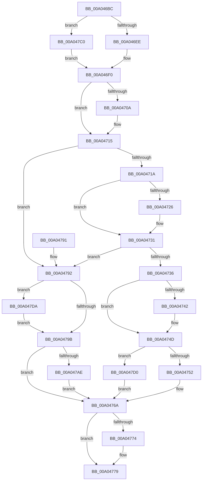

# PnpProcessTargetDeviceEvent

- RVA: `0x00A046BC`–`0x00A047EC` (길이 `304` bytes)
- VA: `0x0000000140A046BC`
- 실행 섹션: `PAGE`
- PDB 이름 있음: `예`; PDB Function 태그: `아니요`
- unwind 정보 RVA: `0x000A82D0`
- 디코드: `77`개 명령, `304/304` bytes 표시
- 미해석 바이트: `0` (있으면 어셈블리에 `.byte`로 보존)

> 이 문서는 커널 이미지의 기계어와 PDB 기호를 분석해 생성했습니다. 4번과 5번은 함수 원형과 자료형을 바이너리 사용 방식에서 추정한 C 해석이며 원본 소스 복구 결과는 아닙니다.

## 1. Dependencies

- 직접 호출 지점: **7**; 고유 호출 대상: **6**
- 직접 호출자로 확인된 함수: **1**
- RIP 상대 이미지 참조: **10**

### Outgoing calls
- `0x00A046F5` → [PiPnpRtlBeginOperation](../8E/PiPnpRtlBeginOperation_function_008E033C.md) (function, `0x008E033C`)
- `0x00A0475F` → [memcmp](../../text/6C/memcmp_function_006C6B10.md) (function, `0x006C6B10`)
- `0x00A04774` → [PiPnpRtlEndOperation](../8E/PiPnpRtlEndOperation_function_008E0518.md) (function, `0x008E0518`)
- `0x00A0479E` → [PnpProcessQueryRemoveAndEject](PnpProcessQueryRemoveAndEject_function_00A05170.md) (function, `0x00A05170`)
- `0x00A047B9` → [McTemplateK0z_EtwWriteTransfer](../../text/4D/McTemplateK0z_EtwWriteTransfer_function_004DEF6C.md) (function, `0x004DEF6C`)
- `0x00A047D3` → [PiUEventNotifyUserMode](../95/PiUEventNotifyUserMode_function_00954CB4.md) (function, `0x00954CB4`)
- `0x00A047E5` → [McTemplateK0z_EtwWriteTransfer](../../text/4D/McTemplateK0z_EtwWriteTransfer_function_004DEF6C.md) (function, `0x004DEF6C`)

### Direct callers
- [PnpDeviceEventWorker](../95/PnpDeviceEventWorker_function_009556B0.md) at `0x00955939`

### Static image references
- `0x00A04701` → RVA `0x00014D38` (`.rdata`; read)
- `0x00A0470E` → RVA `0x00014D40` (`.rdata`; read)
- `0x00A0471D` → RVA `0x00014D48` (`.rdata`; read)
- `0x00A0472A` → RVA `0x00014D50` (`.rdata`; read)
- `0x00A04739` → RVA `0x00014D58` (`.rdata`; read)
- `0x00A04746` → RVA `0x00014D60` (`.rdata`; read)
- `0x00A04758` → RVA `0x00014D68` (`.rdata`; read)
- `0x00A04792` → RVA `0x00EF012B` (`.data`; read)
- `0x00A047B2` → RVA `0x00026FB0` (`.rdata`; read)
- `0x00A047DE` → RVA `0x00027200` (`.rdata`; read)

## 2. Other-region calls and transfers

- 다른 실행 섹션으로 향하는 call: **3**
  - `0x00A0475F` → [memcmp](../../text/6C/memcmp_function_006C6B10.md) (`PAGE` → `.text`)
  - `0x00A047B9` → [McTemplateK0z_EtwWriteTransfer](../../text/4D/McTemplateK0z_EtwWriteTransfer_function_004DEF6C.md) (`PAGE` → `.text`)
  - `0x00A047E5` → [McTemplateK0z_EtwWriteTransfer](../../text/4D/McTemplateK0z_EtwWriteTransfer_function_004DEF6C.md) (`PAGE` → `.text`)
- 별도 외부 분기/꼬리 이동을 확인하지 못했습니다.

## 3. Assembly (complete function range)

```asm
00A046BC  48 8B C4                        mov rax, rsp
00A046BF  48 89 58 10                     mov qword ptr [rax + 0x10], rbx
00A046C3  48 89 70 18                     mov qword ptr [rax + 0x18], rsi
00A046C7  48 89 78 20                     mov qword ptr [rax + 0x20], rdi
00A046CB  41 56                           push r14
00A046CD  48 83 EC 20                     sub rsp, 0x20
00A046D1  48 83 60 08 00                  and qword ptr [rax + 8], 0
00A046D6  33 FF                           xor edi, edi
00A046D8  48 8B 31                        mov rsi, qword ptr [rcx]
00A046DB  4C 8B F1                        mov r14, rcx
00A046DE  48 8B 86 A0 00 00 00            mov rax, qword ptr [rsi + 0xa0]
00A046E5  48 85 C0                        test rax, rax
00A046E8  0F 85 D2 00 00 00               jne 0x140a047c0
00A046EE  33 DB                           xor ebx, ebx
00A046F0  48 8D 4C 24 30                  lea rcx, [rsp + 0x30]
00A046F5  E8 42 BC ED FF                  call 0x1408e033c
00A046FA  48 8D 4E 78                     lea rcx, [rsi + 0x78]
00A046FE  48 8B 01                        mov rax, qword ptr [rcx]
00A04701  48 2B 05 30 06 61 FF            sub rax, qword ptr [rip - 0x9ef9d0]
00A04708  75 0B                           jne 0x140a04715
00A0470A  48 8B 41 08                     mov rax, qword ptr [rcx + 8]
00A0470E  48 2B 05 2B 06 61 FF            sub rax, qword ptr [rip - 0x9ef9d5]
00A04715  48 85 C0                        test rax, rax
00A04718  74 78                           je 0x140a04792
00A0471A  48 8B 01                        mov rax, qword ptr [rcx]
00A0471D  48 2B 05 24 06 61 FF            sub rax, qword ptr [rip - 0x9ef9dc]
00A04724  75 0B                           jne 0x140a04731
00A04726  48 8B 41 08                     mov rax, qword ptr [rcx + 8]
00A0472A  48 2B 05 1F 06 61 FF            sub rax, qword ptr [rip - 0x9ef9e1]
00A04731  48 85 C0                        test rax, rax
00A04734  74 5C                           je 0x140a04792
00A04736  48 8B 01                        mov rax, qword ptr [rcx]
00A04739  48 2B 05 18 06 61 FF            sub rax, qword ptr [rip - 0x9ef9e8]
00A04740  75 0B                           jne 0x140a0474d
00A04742  48 8B 41 08                     mov rax, qword ptr [rcx + 8]
00A04746  48 2B 05 13 06 61 FF            sub rax, qword ptr [rip - 0x9ef9ed]
00A0474D  48 85 C0                        test rax, rax
00A04750  74 7E                           je 0x140a047d0
00A04752  41 B8 10 00 00 00               mov r8d, 0x10
00A04758  48 8D 15 09 06 61 FF            lea rdx, [rip - 0x9ef9f7]
00A0475F  E8 AC 23 CC FF                  call 0x1406c6b10
00A04764  F7 D8                           neg eax
00A04766  1B C9                           sbb ecx, ecx
00A04768  23 F9                           and edi, ecx
00A0476A  48 8B 4C 24 30                  mov rcx, qword ptr [rsp + 0x30]
00A0476F  48 85 C9                        test rcx, rcx
00A04772  74 05                           je 0x140a04779
00A04774  E8 9F BD ED FF                  call 0x1408e0518
00A04779  48 8B 5C 24 38                  mov rbx, qword ptr [rsp + 0x38]
00A0477E  8B C7                           mov eax, edi
00A04780  48 8B 7C 24 48                  mov rdi, qword ptr [rsp + 0x48]
00A04785  48 8B 74 24 40                  mov rsi, qword ptr [rsp + 0x40]
00A0478A  48 83 C4 20                     add rsp, 0x20
00A0478E  41 5E                           pop r14
00A04790  C3                              ret
00A04791  CC                              int3
00A04792  F6 05 92 B9 4E 00 10            test byte ptr [rip + 0x4eb992], 0x10
00A04799  75 3F                           jne 0x140a047da
00A0479B  49 8B CE                        mov rcx, r14
00A0479E  E8 CD 09 00 00                  call 0x140a05170
00A047A3  F6 05 81 B9 4E 00 10            test byte ptr [rip + 0x4eb981], 0x10
00A047AA  8B F8                           mov edi, eax
00A047AC  74 BC                           je 0x140a0476a
00A047AE  4C 8B 4B 30                     mov r9, qword ptr [rbx + 0x30]
00A047B2  48 8D 15 F7 27 62 FF            lea rdx, [rip - 0x9dd809]
00A047B9  E8 AE A7 AD FF                  call 0x1404def6c
00A047BE  EB AA                           jmp 0x140a0476a
00A047C0  48 8B 80 38 01 00 00            mov rax, qword ptr [rax + 0x138]
00A047C7  48 8B 58 28                     mov rbx, qword ptr [rax + 0x28]
00A047CB  E9 20 FF FF FF                  jmp 0x140a046f0
00A047D0  48 8B CE                        mov rcx, rsi
00A047D3  E8 DC 04 F5 FF                  call 0x140954cb4
00A047D8  EB 90                           jmp 0x140a0476a
00A047DA  4C 8B 4B 30                     mov r9, qword ptr [rbx + 0x30]
00A047DE  48 8D 15 1B 2A 62 FF            lea rdx, [rip - 0x9dd5e5]
00A047E5  E8 82 A7 AD FF                  call 0x1404def6c
00A047EA  EB AF                           jmp 0x140a0479b
```

## 4. C-style interpretation (structured pseudocode)

```c
__int64 __fastcall PnpProcessTargetDeviceEvent(__int64 a1)
{
    __int64 result;
    __int64 v_rbx;
    __int64 v_rdi;
    __int64 v_rsp;
    unsigned __int64 v_stack_p10;
    unsigned __int64 v_stack_p18;
    unsigned __int64 v_stack_p20;
    unsigned __int64 v_stack_p8;

    *(unsigned __int64 *)(v_rsp + 16) = v_rbx;
    *(unsigned __int64 *)(v_rsp + 24) = v_rsi;
    *(unsigned __int64 *)(v_rsp + 32) = v_rdi;
    v_rsp = (v_rsp) - (32);
    v_rdi = 0;
    if (*(unsigned __int64 *)(*(unsigned __int64 *)(a1) + 160) != 0) goto loc_00A047C0;
    v_rbx = 0;
loc_00A046F0:
    result = PiPnpRtlBeginOperation(v_stack_p8, a2, a3, a4);
    result = (*(unsigned __int64 *)(*(unsigned __int64 *)(a1) + 120)) - (*(unsigned __int64 *)(v_rip - 10418640));
    if (!(condition_is_not_equal)) {
        result = *(unsigned __int64 *)(*(unsigned __int64 *)(a1) + 120 + 8);
        result = (result) - (*(unsigned __int64 *)(v_rip - 10418645));
    }
    if (result == 0) goto loc_00A04792;
    result = (*(unsigned __int64 *)(*(unsigned __int64 *)(a1) + 120)) - (*(unsigned __int64 *)(v_rip - 10418652));
    if (!(condition_is_not_equal)) {
        result = *(unsigned __int64 *)(*(unsigned __int64 *)(a1) + 120 + 8);
        result = (result) - (*(unsigned __int64 *)(v_rip - 10418657));
    }
    if (result == 0) goto loc_00A04792;
    result = (*(unsigned __int64 *)(*(unsigned __int64 *)(a1) + 120)) - (*(unsigned __int64 *)(v_rip - 10418664));
    if (!(condition_is_not_equal)) {
        result = *(unsigned __int64 *)(*(unsigned __int64 *)(a1) + 120 + 8);
        result = (result) - (*(unsigned __int64 *)(v_rip - 10418669));
    }
    if (result == 0) goto loc_00A047D0;
    result = memcmp(*(unsigned __int64 *)(a1) + 120, v_rip - 10418679, 16, a4);
    result = (unsigned int)(-(result));
    v_rdi = (unsigned int)((v_rdi) & ((unsigned int)(*(unsigned __int64 *)(a1) + 120)));
loc_00A0476A:
    if (v_stack_p8 != 0) {
        result = PiPnpRtlEndOperation(v_stack_p8, v_rip - 10418679, 16, a4);
    }
    v_rsp = (v_rsp) + (32);
    return (unsigned int)((unsigned int)(v_rdi));
loc_00A04792:
    if (((*(unsigned __int8 *)(v_rip + 5159314)) & (16)) != 0) goto loc_00A047DA;
loc_00A0479B:
    result = PnpProcessQueryRemoveAndEject(a1, v_rip - 10418679, 16, a4);
    if (((*(unsigned __int8 *)(v_rip + 5159297)) & (16)) == 0) goto loc_00A0476A;
    result = McTemplateK0z_EtwWriteTransfer(a1, v_rip - 10344457, 16, *(unsigned __int64 *)(v_stack_p10 + 48));
    goto loc_00A0476A;
loc_00A047C0:
    goto loc_00A046F0;
loc_00A047D0:
    result = PiUEventNotifyUserMode(v_stack_p18, v_rip - 10344457, 16, *(unsigned __int64 *)(v_stack_p10 + 48));
    goto loc_00A0476A;
loc_00A047DA:
    result = McTemplateK0z_EtwWriteTransfer(v_stack_p18, v_rip - 10343909, 16, *(unsigned __int64 *)(*(unsigned __int64 *)(*(unsigned __int64 *)(result + 312) + 40) + 48));
    goto loc_00A0479B;
}
```

## 5. (Beta) C Style

```c
int64_t PnpProcessTargetDeviceEvent(void *Arg1)
{
    uint8_t *arg1 = (uint8_t *)Arg1;

    int64_t result;
    int64_t local_rbx;
    int64_t local_rdi;
    int64_t local_rsp;
    uint64_t v_stack_p10;
    uint64_t v_stack_p18;
    uint64_t v_stack_p20;
    uint64_t v_stack_p8;

    *(uint64_t *)(local_rsp + 0x10) = local_rbx;
    *(uint64_t *)(local_rsp + 0x18) = local_rsi;
    *(uint64_t *)(local_rsp + 0x20) = local_rdi;
    local_rsp = (local_rsp) - (32);
    local_rdi = 0;
    if (*(uint64_t *)(*(uint64_t *)(arg1) + 0xA0) != 0) goto loc_00A047C0;
    local_rbx = 0;
loc_00A046F0:
    result = PiPnpRtlBeginOperation(v_stack_p8, a2, a3, a4);
    result = (*(uint64_t *)(*(uint64_t *)(arg1) + 0x78)) - (*(uint64_t *)(v_rip - 0x9EF9D0));
    if (!(condition_is_not_equal)) {
        result = *(uint64_t *)(*(uint64_t *)(arg1) + 0x78 + 0x8);
        result = (result) - (*(uint64_t *)(v_rip - 0x9EF9D5));
    }
    if (result == 0) goto loc_00A04792;
    result = (*(uint64_t *)(*(uint64_t *)(arg1) + 0x78)) - (*(uint64_t *)(v_rip - 0x9EF9DC));
    if (!(condition_is_not_equal)) {
        result = *(uint64_t *)(*(uint64_t *)(arg1) + 0x78 + 0x8);
        result = (result) - (*(uint64_t *)(v_rip - 0x9EF9E1));
    }
    if (result == 0) goto loc_00A04792;
    result = (*(uint64_t *)(*(uint64_t *)(arg1) + 0x78)) - (*(uint64_t *)(v_rip - 0x9EF9E8));
    if (!(condition_is_not_equal)) {
        result = *(uint64_t *)(*(uint64_t *)(arg1) + 0x78 + 0x8);
        result = (result) - (*(uint64_t *)(v_rip - 0x9EF9ED));
    }
    if (result == 0) goto loc_00A047D0;
    result = memcmp(*(uint64_t *)(arg1) + 120, v_rip - 10418679, 16, a4);
    result = (uint32_t)(-(result));
    local_rdi = (uint32_t)((local_rdi) & ((uint32_t)(*(uint64_t *)(arg1) + 120)));
loc_00A0476A:
    if (v_stack_p8 != 0) {
        result = PiPnpRtlEndOperation(v_stack_p8, v_rip - 10418679, 16, a4);
    }
    local_rsp = (local_rsp) + (32);
    return (uint32_t)((uint32_t)(local_rdi));
loc_00A04792:
    if (((*(uint8_t *)(v_rip + 0x4EB992)) & (16)) != 0) goto loc_00A047DA;
loc_00A0479B:
    result = PnpProcessQueryRemoveAndEject(Arg1, v_rip - 10418679, 16, a4);
    if (((*(uint8_t *)(v_rip + 0x4EB981)) & (16)) == 0) goto loc_00A0476A;
    result = McTemplateK0z_EtwWriteTransfer(Arg1, v_rip - 10344457, 16, *(uint64_t *)(v_stack_p10 + 0x30));
    goto loc_00A0476A;
loc_00A047C0:
    goto loc_00A046F0;
loc_00A047D0:
    result = PiUEventNotifyUserMode(v_stack_p18, v_rip - 10344457, 16, *(uint64_t *)(v_stack_p10 + 0x30));
    goto loc_00A0476A;
loc_00A047DA:
    result = McTemplateK0z_EtwWriteTransfer(v_stack_p18, v_rip - 10343909, 16, *(uint64_t *)(*(uint64_t *)(*(uint64_t *)(result + 0x138) + 0x28) + 0x30));
    goto loc_00A0479B;
}
```

### 관측된 메모리 오프셋

구조체 형식이 확인되지 않은 접근은 인자 기준의 오프셋으로만 기록했습니다.

| 기준 인자 | 오프셋 표현 | 폭 (bit) | 접근 |
|---|---:|---:|---|
| `Arg1` | `+ 0x0` | `64` | `R` |

## 6. Execution-region graph

[열기: 2D/3D 그래프와 함수 탐색 컨트롤 패널](../../../control-panel.html?section=page&rva=0x00A046BC&view=graph)

- 2D 그래프는 위에서 아래로 흐르고, 3D 그래프는 빈 공간을 드래그해 회전합니다. Shift+드래그는 이동, 휠은 확대·축소, 함수 노드 선택은 대상 보고서 이동입니다.

### Static fallback


